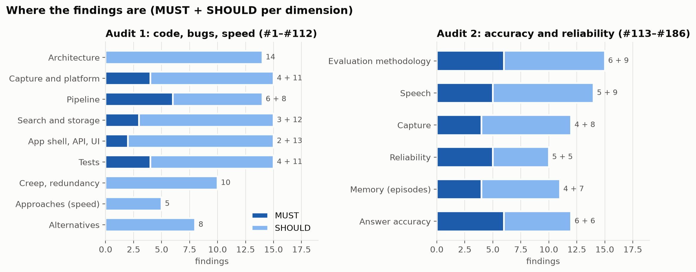
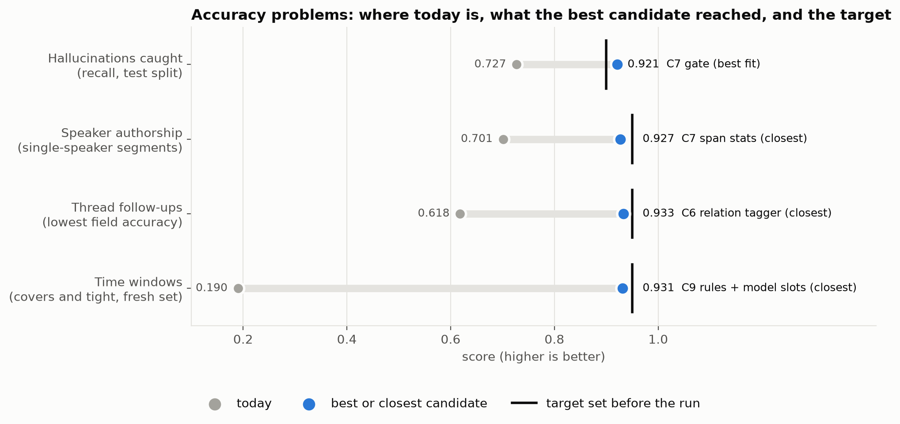
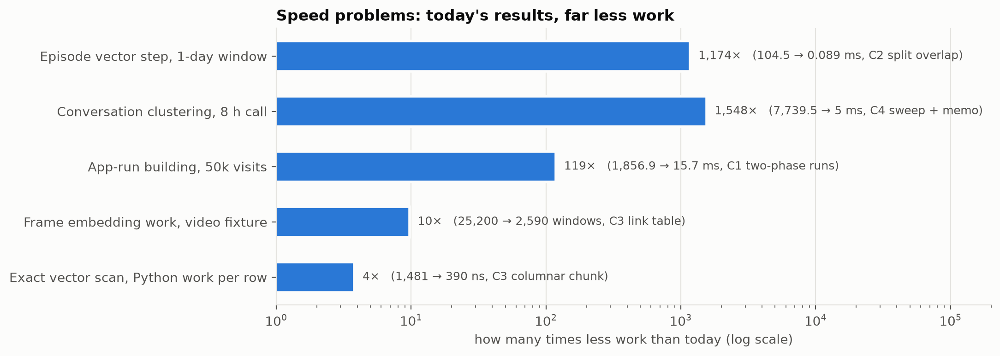
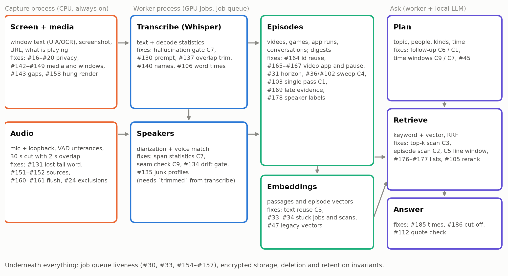
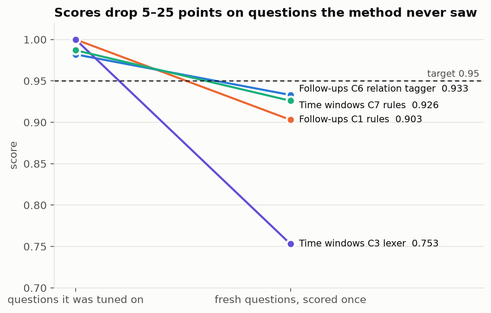
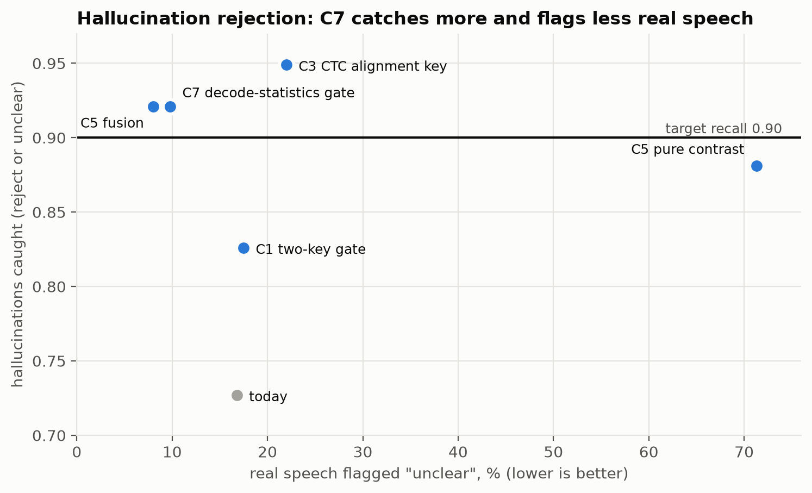
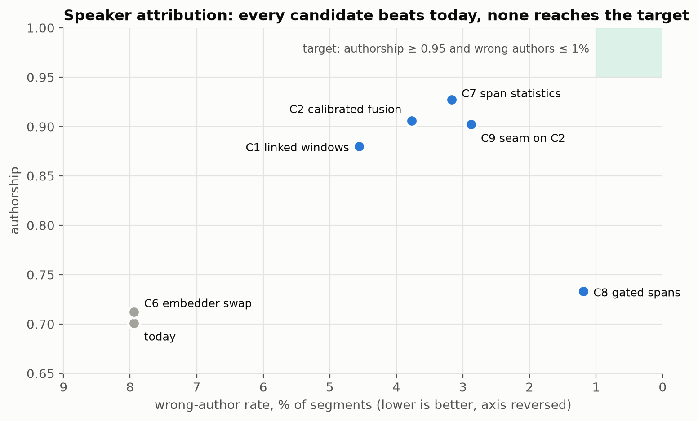
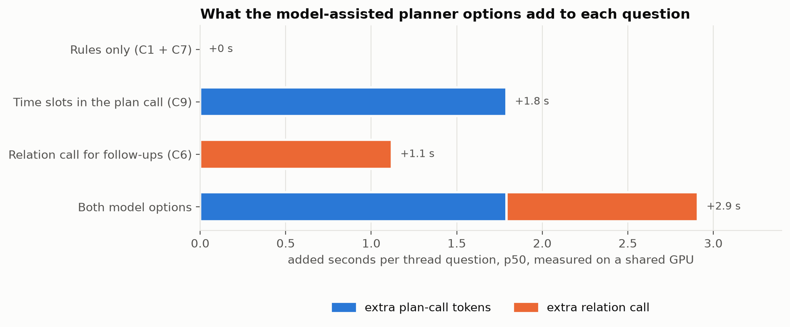

# Akashic: consolidated audit and solutions report

Read the [measured baseline](../../baselines/2026-11-11.md) alongside this report. Much of Phase 0 has
since been implemented in tests/evaluation scripts; production fixes and method integrations
remain open. The report below and its PDF preserve the pre-implementation assessment.

Date: 2026-11-11. Code base examined: the pre-audit code. The audit and report commits since then change no code.

Sources:
- The two audits of 2026-11-10: [docs/audits/2026-11-10.md](../2026-11-10.md) (findings #1–#112) and [docs/audits/2026-11-10-2.md](../2026-11-10-2.md) (findings #113–#186).
- The nine method reports in [docs/solutions/](../../solutions/).

This report is meant to be read on its own. It explains the context, the vocabulary and the reasoning behind each recommendation. It also explains how the fixes fit together, so that accuracy work, speed work and end-to-end efficiency support each other instead of colliding.

---

## Contents

1. How to read this report
2. Executive summary
3. How Akashic works, in one page
4. How the audits and the method studies were done
5. What is wrong, by theme
6. The nine method studies, explained
7. Making everything work together
8. Recommended order of work
9. Other alternatives that were examined
10. Open questions for the author
11. Limits of the evidence

Appendices:
- A: glossary
- B: where everything is
- C: every finding, with its phase

---

## 1. How to read this report

**Finding numbers.** Every problem has a number, written `#n`.
- #1 to #112 come from the first audit, which covered code, bugs and speed.
- #113 to #186 come from the second audit, which covered accuracy and reliability.
- The numbers match the audit files, so any finding can be looked up there for exact file and line references.

**Severity.**
- **MUST** means the problem breaks a target question, a privacy rule, or the app's ability to keep working.
- **SHOULD** means it is a real defect or a clear improvement, but not a breakage.

**Method studies ("invent runs").** For nine problems, an automated design process proposed several candidate methods, labelled C1, C2 and so on. It built prototypes and measured them against a target agreed in advance. Each study ends with one of these outcomes:
- **Best fit:** a candidate met every target and every hard rule.
- **Closest:** no candidate met every target. The closest one is reported with its gap, and is often still a large improvement over today.
- **Works:** a candidate met the targets but is not the best fit.
- **Fails:** a candidate missed a target or broke a rule.
- **Relaxes:** a candidate would only work if a rule were loosened.

Candidate labels are local to each study: "C7" in the hallucination study has nothing to do with "C7" in the speaker study. This report always names the study next to the label.

**What is measured and what is not.**
- Every number comes from a prototype run on public or synthetic data. None comes from the user's own recorded history, which was never opened.
- Timings were taken on the development PC while other jobs shared the CPU and GPU. Differences between candidates are meaningful; absolute times are not.
- The development PC has an RTX 4090. AGENTS.md lists an RTX 4080 Super.

---

## 2. Executive summary



The two audits found **185 numbered findings** (#1–#186; #59 was never used):
- 30 MUST and 44 SHOULD in the accuracy audit;
- 19 MUST and 84 SHOULD in the code audit, plus 8 smarter-alternative proposals and a workspace review.

**No finding was fully refuted.** Several were narrowed after checking.

The picture is consistent across both audits. The app has its features. What fails is the chain of small steps between "something happened on the PC" and "the answer cites it correctly". Each step loses or distorts some evidence, quietly, and the evaluations that should catch this measure something else.

### The five things that matter most

1. **The two target questions break in ordinary use.**
   - Asked in the same chat thread, "What video did I watch yesterday afternoon?" inherits Minlo and "game" from the earlier question and finds nothing (#175).
   - Asked alone, it lists five arbitrary videos as if they were the complete list (#177).
   - "Hier soir", "last night", "cet aprèm" and "il y a 2h" resolve to the wrong time window or to none (#45, #179, #180).
   - Chrome and Edge videos are stored under a display name, so app filters never match (#165, #166).
2. **Processing can stop silently while the tray says "Recording."**
   - Several bugs can stop all processing with no error shown: a job that crashes the worker is retried first forever (#154); without the speaker models, every speakers job stays pending, which freezes retention and every episode builder (#30, #31); and reused row ids stop new episodes being built (#164).
   - The worker's state is never shown to the user (#157).
3. **Privacy exclusions fail open in a few paths.**
   - The password-field check is skipped when the focused window covers another monitor (#16).
   - The same check also passes when the accessibility API errors (#17).
   - Media titles from excluded sites still reach the media log (#18).
   - These break AGENTS.md rule 2: excluded content must never touch disk.
4. **The evaluations do not measure what they are cited for** (#113–#118).
   - The 29-question evaluation exercises a search path production no longer uses.
   - Its scorers accept wrong answers.
   - "29/29" is a score on the questions used for tuning.
   - Until this is fixed, no accuracy improvement, including the ones below, can be proven.
5. **Speech evidence is noisier than it looks.**
   - 27% of Whisper hallucinations (text produced from non-speech) are stored as confident transcripts.
   - 30% of single-speaker segments lose their author.
   - 7.9% of segments get the wrong author.

### What the method studies produced



| Problem | Today | Recommended method | Result | Meets the target? |
| :- | :- | :- | :- | :- |
| Whisper hallucinations | 72.7% caught | Logistic gate on Whisper's own decode statistics | 92.1% caught, same false rejections as today, no extra compute | **Yes** |
| Speaker authorship | 70.1% kept, 7.9% wrong | Calibrated scoring + seam check, or span statistics | 90–93% kept, 2.9–3.2% wrong | No (target 95% and ≤ 1%) |
| Chat follow-ups | 61.8% (lowest field) | Standalone plan + rule gate, optionally a relation tag from the model | 90.3% rules only, 93.3% with the model | No (target 95%) |
| Time windows | 19.0% correct | New rule grammar on a "logical day" + overlap filtering of lines | 88.4–92.6% rules only, 93.1% with the model | No (target 95%) |

"No" means the agreed target was not reached on fresh test questions. It does not mean "not worth doing": each of these is a large improvement over today, and none lowers accuracy on any measured axis. Their compute and latency costs are listed with each method in section 6.



All five speed studies found a best fit that keeps **today's results**, at roughly 2.5× to 1,500× less work. The exceptions are deliberate or allowed by each study's contract:
- the conversation sweep fixes the #36 chaining bug;
- text reuse de-duplicates the result slots;
- the episode scan may order near-ties differently;
- the vector scan drops rows whose vector is NaN.

| Problem | Best fit | Today → best |
| :- | :- | :- |
| Vector search scan | C3 columnar chunk | 0.9–2.0 µs → 0.25–0.43 µs of Python work per row |
| Identical screen text | C3 link table | Embedding work ÷ 9.7 on a video; vector storage −21% to −99% |
| Conversation clustering | C4 two-pointer sweep | 7.7 s → 5 ms per pass on an 8-hour call; also fixes the microphone chaining bug |
| App-run building | C1 two-phase runs | 1.9 s → 16 ms per pass |
| Windowed episode vector search | C2 split overlap | 104 ms → 0.09 ms for a 1-day question |

### The recommended order of work, in one line each

| Phase | What | Why first |
| :- | :- | :- |
| 0 | Fix the evaluations so they measure production and keep a held-out set | Without this, every later change is unproven |
| 1 | Privacy exclusions and processing liveness | Rule violations and silent stops outrank everything |
| 2 | Episode correctness | Most target-question failures are here, and the speed refactors of the same code fit in naturally |
| 3 | Speech and capture evidence quality | Hallucination gate, speaker attribution, transcript continuity |
| 4 | Ask quality | Follow-ups, time windows, list questions, citations |
| 5 | Efficiency | Vector-scan and storage refactors, on the final schema |
| 6 | Structure and clean-up | Architecture, dead code, docs |

Section 8 gives the details and the dependencies.

---

## 3. How Akashic works, in one page



Akashic runs as **three processes** on one Windows PC.

**1. The app** shows the tray icon, the unlock dialog and the local web UI, and supervises the other two processes.

**2. Capture** runs on the CPU and is always on.
- **Screen.** It reads the focused window's text through Windows UI Automation (UIA), or through Windows OCR when UIA gives nothing. It renders a screenshot of the selected window and reads the browser URL.
- **Media.** It records what is playing through the Windows media-session API (GSMTC).
- **Audio.** It records the microphone and the PC's output (loopback). Silero VAD (voice-activity detection) cuts the audio into utterances. A long utterance is cut every 30 s with a 2 s overlap, so a word on the cut appears in both pieces.
- **Exclusions.** Excluded windows, sites and password fields are dropped in memory before anything is written.

**3. The worker** runs a persistent job queue in SQLite and uses the GPU for the heavy steps:
- **Transcribe.** Whisper large-v3, through faster-whisper, turns each utterance into text. It returns per-segment statistics such as `avg_logprob` (how confident the decoder was) and `no_speech_prob` (how likely the audio held no speech).
- **Speakers.** pyannote segmentation finds who speaks when ("diarization"), in fixed 10 s windows. A WeSpeaker voice embedding (a 256-number fingerprint of a voice) is compared with stored voice profiles by cosine similarity. A segment gets an author only if every turn in it is identified as the same person.
- **Episodes.** Every 30 s, builders group raw records into **episodes**: a video watched, a game played, a run of work in one app, a conversation. An episode has a text digest. Builders wait for the **transcript horizon**, the point before which every transcription and speakers job is finished, so they never build from half-processed audio.
- **Embeddings.** Text is cut into 400-character **passages**. A local embedding model turns each passage into a vector. The vectors are stored in half precision (float16) inside the encrypted database.
- **Ask.** A local LLM (Gemma 4 12B through `llama-server`) answers questions in four steps:
  1. **Plan:** turn the question into topic, people, kinds, apps and a time window. The time window comes from a deterministic French/English time resolver. A rule planner is the fallback.
  2. **Retrieve:** find candidate episodes and lines by keyword (SQLite FTS5 with bm25 ranking) and by vector similarity, then merge the two lists with Reciprocal Rank Fusion (RRF).
  3. **Answer:** write the answer from the retrieved evidence, with `[n]` citations.
  4. **Thread:** in a chat thread, a follow-up step decides what the new question inherits from the previous one.

**Storage.** Everything is in one SQLCipher (encrypted SQLite) database, plus encrypted media files, under `%LOCALAPPDATA%\Akashic`. Retention rules expire old data. "Delete all" stops capture and the worker first.

### The two target questions, followed through the pipeline

- **"What video did I watch yesterday afternoon?"**
  1. A media session is recorded.
  2. The worker builds a video episode.
  3. The planner sets kind = video and time = yesterday 12:00–18:00.
  4. Retrieval lists the video episodes in that window.
  5. The answer names them.
- **"What did Minlo say during our conversation this morning, something about a game?"**
  1. Audio is transcribed.
  2. Turns are attributed to Minlo's voice profile.
  3. A conversation episode is built.
  4. The planner sets person = Minlo, time = this morning, topic = game.
  5. Retrieval finds Minlo's lines about a game.
  6. The answer quotes them.

Every finding in this report is a place where one of these steps goes wrong.

---

## 4. How the audits and the method studies were done

### The audits

1. **Reviewers.** Each audit split the project into dimensions and gave each dimension to a separate reviewer agent. The code audit covered architecture, bugs per area, tests, scope creep, slow methods and smarter alternatives. The accuracy audit covered evaluation, speech, capture, reliability, episodes and answers.
2. **Refuters.** Every MUST finding was then given to an adversarial **refuter**, an agent whose job is to disprove it from the code and primary sources. Refuters ran small experiments in scratch folders, for example:
   - SQLite rowid reuse;
   - the audio `Segmenter`;
   - the time resolver;
   - the evaluation scorers;
   - faster-whisper's skip rule.
3. **Narrowing.** Findings that survived only in part were narrowed; the audits list each narrowing. Nothing was fully refuted.
4. **Limits.** During the first audit no Python environment existed, so findings were argued from code, not by running the app. The user's data directory was never opened.

### The method studies

The audits sent nine problems to a structured design process called `invent`:
- five speed problems from the first audit (#100–#104);
- four accuracy problems from the second (#128, #129, #138, #141 hallucinations; #132–#134 speakers; #175 follow-ups, #179–#181 time windows).

For each problem:

1. **Scope.** Goals, hard rules, budget and non-goals were written and confirmed with the user before any work.
   - Hard rules: for example "no new Python dependency" or "same results as today".
   - Budget: for example "≥ 95% correct" or "≤ 5 ms".
   - Non-goals: what the study deliberately leaves alone.
2. **Research.** Researcher agents collected known mechanisms from papers, library source code and shipped systems.
3. **Invention.** Inventor agents combined those mechanisms into candidates, each through a different "lens" (trade-off, transplant from another field, decomposition, and so on).
4. **Checks.** Each candidate was checked three ways: for prior art (has it been published or shipped?), by a refuter, and by a fact-checker on the sources it relied on.
5. **Prototypes.** Up to three candidates per round were built in `_dev/invent/<problem>/`, which was local and gitignored (now committed under `eval/<problem>/`). They were measured against a reference copy of today's code. A failing candidate got one fix round.
6. **Discipline for the accuracy studies.** Early prototypes scored perfectly on the questions they were tuned on and much worse on new ones. From then on:
   - fresh test sets were written by independent agents;
   - candidates were frozen, with a checksum, before being scored on them;
   - fresh sets were scored once.



*Left: the score on a question set used during tuning (the follow-up C6 point is its higher tuned set, 0.982; the time-window C7 point is the lowest of its tuned sets, 0.987). Right: the score on a fresh set scored once.*

This figure is the strongest single argument for Phase 0. A method can look perfect on the questions it was built against and lose 5 to 25 points on new ones. Akashic's own "29/29" has the same weakness (#118).

---

## 5. What is wrong, by theme

This section groups the findings by what they break, not by audit. It explains the important ones in plain terms. Appendix C lists every finding with its exact fix and the phase it belongs to.

### 5.1 Privacy and exclusions (Phase 1)

AGENTS.md rule 2 says excluded content is dropped in memory and never written. Four paths break it.

- **#16, password check skipped on other monitors.** When the focused window is large enough to cover another monitor's centre, the capture of that monitor treats it as unfocused and skips the password-field checks. The typed password is masked, but the rest of the form (and its OCR text) is stored.
  - Fix: treat the focused window as focused on every monitor, and capture each window once per tick.
- **#17, the password check fails open.** If UI Automation raises an error, the code assumes "not a password field".
  - Fix: on error, skip the frame and count it.
- **#18, media titles bypass URL exclusions.** Media sessions are checked only against window rules. A video on an excluded site (banking, a user-listed domain) still reaches the media log with its title.
  - Fix: screen capture publishes the focused browser's exclusion state, and media capture rejects that browser's session while it is set.
- **#24, audio exclusions fail open.** A COM error while listing audio processes looks like "no process".
  - Fix: return "unknown", and drop or flag segments not covered by a successful check.

Related SHOULD items:
- **#19:** URL rules are skipped when the address bar is unreadable.
- **#20:** an in-page input can be read as the URL.
- **#25:** UWP apps hide behind `applicationframehost.exe`.
- **#26:** the built-in finance rules over-match (`booking.fr`, `camping.fr`).
- **#27:** Akashic's own UI pages are re-captured.
- **#55:** a tampered keyfile can exhaust memory at unlock.
- **#74:** `python -m` without `-I` honours the working directory and environment.
- **#148:** a video titled "Bitwarden vs 1Password" or "Incognito" is dropped by window rules meant for password managers and private windows. This one narrows an exclusion, so it is the author's decision.

### 5.2 Processing that stops silently (Phase 1)

The worker is a job queue. Several bugs can stop it, or freeze part of it, with nothing shown to the user.

**Stalls:**
- **#30 + #31, missing speaker models stop everything.**
  1. Every finished audio segment, microphone included, gets a speakers job. Without the speaker models, these jobs stay pending forever.
  2. Raw-audio retention skips segments with pending speakers jobs, so retention stops.
  3. The shared transcript horizon also waits on speakers jobs, and all four episode builders wait on that horizon, including games and app runs that use no speech. No new episode of any kind is built.
  - Fix: run microphone segments without the models, queue no speaker jobs while the models are absent, and apply the horizon only to builders that read speech.
- **#33, one failing embed batch blocks all embedding.** When a batch fails five times, nothing marks it as given up, so the same items are queued again under a new key.
- **#154, a job that crashes the worker is retried first forever.** Attempts are counted but never checked outside the normal failure path.
- **#155, "Run waiting jobs now" does not run failed transcriptions.** It resets the job but not the segment, so the job completes without transcribing.
- **#156, a job can stay "running" for good.** A `database is locked` error inside `complete()` or `fail()` leaves the job running until restart, and a running transcribe job holds the horizon.
- **#158, one hung window render stops all screen capture.** While one `PrintWindow` render hangs, no frame or text is stored on any monitor.

**Visibility:**
- **#157:** the tray and sidebar never show a crashed or blocked worker.
- **#162:** capture reports "ready" even with audio off or every grab failing.
- **#159:** one failing housekeeping step stops the others.
- **#41:** environment failures (CUDA missing) mark segments failed permanently.
- **#39:** an HTTP error can leave `llama-server` running untracked, holding VRAM.
- **#40:** a failed question shows "working" for up to 42 minutes.
- **#35:** after a Qwen or Canary model was used once, garbage collection runs every 2 s.
- **#56:** one bad file path stops all retention.
- **#29, #23:** one exception ends the screen or audio capture thread.
- **#67, #68, #69:** thread crashes go unlogged, a bad config crash-loops, and the tray freezes during restarts.
- **#49:** a failed `COMMIT` leaves the shared connection unusable.
- **#44:** a missing index makes deletions quadratic, which then exceeds the 5 s busy timeout capture relies on.

**Why this is Phase 1.** None of the accuracy work matters if processing has silently stopped. The common thread is simple: every queue state needs an exit, and every exit needs to be visible. A single "processing health" line in `/api/status` would let the tray show a stall:
- worker state;
- blocked kinds;
- failed count;
- age of the oldest pending transcription;
- horizon age.

### 5.3 Episodes that are wrong or never built (Phase 2)

Episodes are what the target questions retrieve, and this is where most of the target-question failures sit.

**Episodes never built:**
- **#164, reused row ids block new episodes.**
  - The tables `media_sessions`, `game_sessions` and `audio_segments` have no `AUTOINCREMENT`. When the newest rows are deleted, SQLite reuses their ids.
  - The old episode links still point at those ids, so new videos and games fail the "not already linked" check.
  - Conversations collide on the reference `conversation:<id>`, and the conversation builder then stops moving its watermark for good. Nothing is reported.
  - Fix: rebuild these tables with `AUTOINCREMENT` (as migration 0012 already did for another table), and treat an ignored reference as skip-and-log.

**Video episodes wrong:**
- **#165:** video episodes store the media session's display name ("Google Chrome") as the app, while filters compare executables (`chrome`). "What video did I watch on Chrome?" gets zero candidates.
- **#166:** for Edge the mismatch also means the video never gets its soundtrack transcript.
- **#167, paused time counts as watching time.**
  - While a video is paused, its end time keeps advancing, so every paused or ended video gains up to 10 minutes.
  - The builder then pulls unrelated audio from that span.
  - The fix needs the play/pause history in `media_events`. This is why finding #90 (drop `media_events`) was taken off the queue.
- **#168:** a video claims every audio segment with unknown source in its span, so a Discord remark can become "video audio" and disappear from conversation searches.
- **#142:** suspending the PC within 10 minutes of a pause makes a video "end" at wake time, the next morning.
- **#145:** a video's URL is taken from the newest frame of any process whose title contains the video title, and then locked in, so it can be wrong.
- **#146:** locking the PC or any UAC prompt splits one video into two rows.

**Conversations and people wrong:**
- **#46:** merging a voice into a named speaker removes that person from every episode the voice was in.
- **#169:** late evidence (a retried transcription, a corrected speaker) never reaches episodes already built.
- **#178:** conversation digests have no speaker labels, so evidence taken from a digest loses its author.
- **#36:** microphone speech with gaps under 30 s chains onto a call indefinitely, because the attach loop widens the bounds it is reading.
- **#170:** in-game voice chat becomes a "Chrome conversation".

**Other builder rules:**
- **#32:** episodes deleted by retention are rebuilt on the next pass.
- **#171:** videos under 60 s never become episodes.
- **#172:** alternating between two apps yields no app-run episode.
- **#173:** a video watched an hour ago has no episode while transcription is deferred.
- **#174:** rebuilt digests lose the channel name once media sessions expire.

**One coordinated piece of work.** This is one module, `pipeline/episodes.py`, and two of the speed studies refactor it: the conversation sweep (#102, which also fixes #36) and the app-run single pass (#103). Section 7.2 explains how to sequence them so that the refactors prove themselves first and the behaviour changes come on top.

### 5.4 Capture coverage (Phase 3)

These findings decide whether evidence exists at all.

- **#143, outages leave no trace.** Pause, lock, a missing audio device, OCR unavailable and a crashed capture process leave no record, so Ask cannot tell "nothing happened" from "not recorded".
  - Fix: a content-free `capture_gaps(kind, reason, start, end)` table, shown in Ask's coverage line.
- **#144, scrolled side windows are missed.** Scrolling an unfocused window captures the window at the monitor's centre, not the one under the cursor. A scrolled Discord chat on a side monitor is never captured.
- **#147:** in game mode no other monitor is captured.
- **#149:** side-monitor streams get no time span.
- **#150:** fullscreen video players and RDP are detected as games.
- **#151, #152, audio sources.**
  - Sources are gathered from every audio endpoint, but only one is recorded.
  - A short remark while Spotify plays can be deleted as music.
- **#153:** deferred game OCR reads a downscaled image and misses small names.
- **#131, the word after a 30 s cut is lost.** A simulation with the real `Segmenter` showed 320 ms of speech after the cut dropped as "too short": "…je l'aime" [cut] "pas" loses "pas".
- **#160, #161:** stopping capture drops the open utterance, and busy-database writes are not retried.
- **#163:** pause is lost across lock/unlock.
- **#15:** game mode busy-spins on pending input triggers.

### 5.5 Speech quality (Phase 3)

**Hallucinations.** Whisper can produce fluent text from non-speech audio: subtitle credits, "thanks for watching", or a repeat of its own prompt.
- **#128:** prompt echoes are not detected.
- **#129:** `LOG_PROB_THRESHOLD = -2.0` means faster-whisper's own no-speech skip fires only when `avg_logprob` ≤ −2.0, which almost never happens, and `no_speech_prob` is neither checked nor stored.
- **#138:** credits are rejected only when they are the whole transcript.
- **#141:** Qwen3-ASR and Canary transcripts count as fully confident.
- Section 6.6 gives the recommended gate.

**Continuity across cuts and prompts:**
- **#130:** the previous segment's text is never used as the prompt for a continuation, because of an off-by-overlap condition.
- **#137:** overlap trimming needs an exact word match, and the word cut in half rarely matches.
- **#140:** names the user gave to voices are never added to the vocabulary prompt, so "Minlo" stays "Mean low".
- **#139:** a short French "ouais carrément" can be forced to English.

**Speakers:**
- **#132:** the fixed 10 s windows leave short tail turns unidentified, and one unidentified turn clears the author.
- **#133:** a continuation's 2 s overlap is diarized as the previous speaker.
- **#134:** profiles update from any match at 0.5 cosine, so similar voices drift together.
- **#135:** every unmatched 2 s voice (YouTube, cutscenes) creates a profile.
- Section 6.7 covers these.

**Evaluation of speech:**
- **#117:** the STT comparison's reference text is pre-filled with the incumbent Whisper output.
- **#119–#122:** WER pools errors and ignores failed clips, missed speech can never be measured, and normalization ignores "12" vs "douze".
- These belong to Phase 0.

**Speech options from the first audit:**
- **#106: word-level timestamps.** faster-whisper can time each word. Each word can then be given to the diarization turn it overlaps most, so speaker attribution works per line instead of per segment.
- **#111:** add Canary-1B-v2 and Cohere Transcribe to the French comparison.
- **#43:** Qwen3-ASR is not restricted to French and English.

### 5.6 Ask answer quality (Phase 4)

- **#175, inheritance in chat threads.** Every question in an open chat inherits the previous plan. Section 6.8 covers this.
- **#177, list questions.**
  - A question with no topic ("what video…") ranks episodes by similarity to the whole question, keeps 5 and presents them as complete.
  - With 8 videos, the model lists 5 arbitrary ones, and the newest (not yet embedded) drop first.
  - Fix: use chronological order when there is no topic, and tell the model "5 of 8".
- **#176:** when keyword languages differ and passages are not yet embedded, a conversation is returned without its lines.
- **#179, #180, #181, time windows.** Section 6.9 covers these.
- **#45:** "il y a 2h" and "2h ago" resolve to 02:00 today. This is a separate rule fix: the time-window study left clock-versus-duration misreads out of scope.
- **#182–#184, planner rules.**
  - Keywords are not stemmed or translated.
  - Stopwords are missing.
  - Rule cues become strict filters the model cannot correct: "regarding" means video, and a speaker named Max catches "max settings".
- **#185:** citations show the episode start, so a remark at 10:40 in an 08:00 call is cited "around 08:00".
- **#186:** answers cut off at 900 tokens are saved unmarked, and uncited answers are saved as grounded.
- **#50, #53, #54:** small planner and search bugs: a KeyError on quoted names, a limit applied before filtering, and a case-sensitive `.exe`.

**Alternatives from the first audit:**
- **#105:** rerank the fused candidates with Qwen3-Reranker through the existing `llama-server`. The published gain is MMTEB-R 64.6 → 66.4 with the 0.6B model and → 72.7 with the 4B model.
- **#112:** quote-then-answer, where the model returns verbatim quotes and code checks them.

### 5.7 Evaluation methodology (Phase 0)

This theme decides whether any improvement can be proven.

- **#113, the eval tests an unused path.** The default 29-question eval writes only legacy whole-segment vectors and never runs the passage embedder. Production writes only passages, so the eval exercises a fallback production does not use. Its fixtures also differ from production:
  - frames are "monitor" scope;
  - no question runs in a thread;
  - "now" is always 18:00;
  - no window has more than 2 videos.
- **#114, the fact scorer accepts wrong answers.** Facts are bare substring tests: "4" matches the citation marker `[4]`, and "plus" matches most French answers.
- **#115, the abstention scorer accepts fabrications.** A fabricated answer scored as a correct abstention because it contained "pas de".
- **#116, citation scoring ignores extra citations.** An answer listing every video scores 100%.
- **#117:** the STT reference starts as the incumbent's output (see 5.5).
- **#118, development scores are presented as validation.** "29/29 and 20/20" were reached by fixing failures of those same questions.
- **#119–#127, coverage gaps:**
  - per-language reporting;
  - noisy transcripts;
  - speaker attribution is never measured (#123);
  - capture-to-search delay;
  - one run at temperature 0.2 with no repeats.
- **#75–#89, tests:**
  - the hardware test checks the wrong Whisper model (#75);
  - the Qwen/Canary transcriber has no tests (#76);
  - a "survives errors" test passes when the loop crashed (#77);
  - selected-window capture is untested (#78);
  - weaker items (fixed sleeps, duplicate fixtures, trivial tests).

**Material to reuse.** The method studies built labelled material that can be reused here. None of it contains user data:
- 445 follow-up pairs (170 + 110 + 165);
- 577 time questions (234 + 145 + 198);
- a 1,008-segment speaker fixture from LibriSpeech and MLS French;
- a hallucination fixture from FLEURS, MSWC, FSD50K and ESC-50.

Section 7.6 explains how to use it.

### 5.8 Efficiency and storage (Phase 5)

**MUST:**
- **#34, the "missing embedding" queries scan everything.** They scan the whole encrypted history every 30 s even when nothing is missing.
  - Fix: a watermark per (kind, model), like the conversation watermark.
- **#61, `/api/status` scans the frames table.** Polled every 5 s per open tab, it runs `SELECT DISTINCT process FROM frames` with no index, under the global API lock.

**SHOULD:**
- **#37:** during a transcription backlog, Whisper and `llama-server` swap twice per embed batch.
- **#38:** the CPU busy check counts the worker's own last job.
- **#47:** a set of legacy segment vectors is loaded on every query but can never exclude anything. The user already decided to retire legacy segment vectors.
- **#48:** windowed passage queries probably walk the whole model index (to confirm with `EXPLAIN QUERY PLAN`).
- **#51:** expiring a screenshot rewrites its full-text index entry.
- **#58:** the storage report reads every table on each Settings view.
- **#63:** thumbnails are decoded under the global lock.
- **#64, #65:** the Debug page polls a full count and re-parses whole log files.
- **#13:** one shared API connection serializes all requests.
- **#21, #22:** UI Automation reads every node with no timeout.
- **#107:** plain `onnxruntime` instead of the GPU wheels saves about 1.2 GB of compressed wheels, since all ONNX sessions run on the CPU.
- **#109:** run the worker at below-normal priority.

The five speed studies (#100–#104) are in section 6.1–6.5.

### 5.9 Structure and clean-up (Phase 6)

**Architecture (#1–#14):**
- package cycles between `storage` and `pipeline`, and between `search` and `pipeline`;
- the episode digest built twice, once in SQL and once in Python (the user chose to keep both and add an equality test);
- job-queue SQL outside the queue;
- settings bounds repeated and disagreeing with the config;
- retention kinds listed three times;
- app identity rules in five places;
- a "Delete all" table list with no completeness test (#10, worth doing early because it protects privacy).

**Bugs in the app shell (#60–#73):**
- **#60, MUST:** Lock or Quit racing a pending Settings restart relaunches capture at the unlock prompt.
- **#62:** reused frame ids can show a deleted screenshot from the thumbnail cache.
- **#66–#73:** smaller lifecycle bugs.

**Creep (#90–#99):**
- **#90:** unqueued (see #167).
- **#91:** delete `change_passphrase`.
- **#92:** delete the rejected whole-monitor grab.
- **#93–#99:** dead code, duplicated helpers and stale citations.

**Workspace:**
- the repository is public while containing ported screenpipe logic under a non-commercial licence (the user accepts the risk);
- no `uv`/`.venv` during the first audit;
- `.gitignore` and `.gitattributes` gaps;
- AGENTS.md imports about 3,200 lines of docs into every agent session (unconfirmed).

---

## 6. The nine method studies, explained

Each study below follows the same pattern:
- the problem in plain words and why it matters;
- the recommended method, step by step;
- the measured result and its cost;
- workable alternatives, and when to prefer them;
- what to watch for when building it.

The full reports, with every candidate, figure and source, are in `docs/solutions/` and on the artifact links in Appendix B.

### 6.1 Vector search scan (#100): "Exact Vector Top-K Scan"

**The problem.**
- Semantic search compares the question's vector with every stored passage vector in scope. This is an exact scan, with no approximate index, which is a sound choice at personal scale.
- Today the scan does Python work for every row: it copies the blob, converts it, creates an object and fully sorts each 4,000-row chunk.
- That costs 0.87–2.0 µs per row, on top of the 1.4–2.3 µs SQLCipher itself needs to decrypt and decode the row.
- Frame passages grow with capture rate, so this cost grows every day.

**The recommended method: C3, "columnar chunk + run-level selection."**
1. Read rows in chunks of 4,000, exactly as today.
2. Drop filtered rows with array masks: the vector-size check, plus an "only/exclude" table indexed by owner id.
3. Join the kept vectors into one buffer and read it as one matrix with a single `numpy.frombuffer`.
4. Convert half-precision numbers to single precision with an exact bit trick: shift each 16-bit value left by 13 and mask it. The result equals the true value times 2^-112, exactly, for every finite half. Folding 2^112 into the query vector restores the scale.
   - This conversion is the largest remaining cost: 155 ns per row, against about 250 ns for numpy's own cast.
5. One matrix-vector product scores the whole chunk.
6. Select the top results with array operations: a running threshold, then the best passage per owner with `maximum.reduceat`. Python objects are created only for the winners.

**Why "bit-identical" is achievable and matters.**
- BLAS matrix-vector products give slightly different float32 results depending on a row's position and the matrix shape.
- Today itself scores byte-identical vectors differently in 223 of 420 synthetic cases.
- C3 keeps today's chunk shape, so it reproduces today's scores exactly. That made it possible to require "the same results", and to check it.

**Result.**
- 0 mismatches on 607 queries, with bit-identical float32 scores.
- 252–431 ns of Python work per row, against a 500 ns budget. Today does 865–2,025 ns.
- Peak extra memory 9.1 MB, against 12.8 MB today.
- The 5 differences are all queries with a NaN vector in scope, where today's own sort is undefined.

**Alternatives.**
- **C1** is the same pipeline with a self-test for DAZ/FTZ, a CPU mode that flushes tiny floats to zero and would break the bit trick. It measured within noise of C3. *Build C3 with C1's self-test*: the report notes C3 as built lacks it.
- **C4** uses numpy's plain float16 cast instead of the bit trick. It is simpler and still 2–3× faster than today, but over budget on 3 of 10 scenarios. Prefer it if the bit trick feels too clever.
- **Rejected:**
  - SQL-side aggregation (C2) moves the object work into SQLite and gains nothing.
  - `sqlite-vec` would change the storage format and is pre-1.0.

**What remains.** After C3, SQLCipher decoding dominates: 1.3–2.2 µs per row against 0.25–0.43 µs of Python. Further gains come from reading fewer rows, not from faster Python:
- text reuse (6.2) reads fewer frame rows;
- windowing (6.5 and #48) reads only the rows in the time window.

### 6.2 Identical screen text (#101): "Identical Frame Text Reuse"

**The problem.**
- While a video plays, pixels change but the window text often does not. The OCR gate correctly reuses the text, yet each frame still gets its own passages.
- The same text is therefore embedded hundreds of times: 720 frames gave 25,200 embedding windows on the video fixture.
- At search time, identical frames sit on consecutive ranks in both the keyword and the vector list. Reciprocal Rank Fusion then gives them near-equal high scores, and they fill the 5 frame result slots.

**The recommended method: C3, "link table."**
1. In the embed worker, not in capture, compute `key = HMAC-SHA256(subkey, text)`.
   - HMAC is a hash keyed with a secret: a different key derived from the database key, like the existing `db` and `media` subkeys.
   - Unlike a plain hash, nobody without the secret can check whether a guessed text was captured. A plain SHA-256 would allow exactly that, and the harness found 2,960 such plain-hash hits in the test data.
2. Store one passage set per `(key, model)` in a new `text_passages` table.
3. Give each frame one row in a new `frame_text_links` table that points to its key. The link is deleted automatically when the frame is deleted (`ON DELETE CASCADE`).
4. Two triggers keep it clean:
   - when the last link to a key disappears, the key's passages are deleted;
   - when a frame's text changes, its links are deleted.
5. At search time, group frames by `(key, window title, URL)`. Show one representative frame per group, with its own timestamp, and an "also seen at" list.
   - The title and URL are part of the group because two different videos can have identical player text.

**Result.**
- Embedding work equals the ideal (one per distinct text). On the video fixture that is 2,590 windows instead of 25,200, or 9.7× less GPU work.
- Vector storage falls by 89.7% on the video fixture, 99.2% on a static page and 21% on mixed browsing.
- The 5 result slots are correct in 36 of 36 queries, against 17 of 36 today.
- Every test text stays findable: 50 of 50 by keyword and 50 of 50 by meaning.
- No orphan vector survives any deletion path, and 18 of 18 rollbacks leave the database consistent.
- Query p50 is 7.6 ms against 52.7 ms today.
- Capture's write path is unchanged.

**Alternatives.**
- **C5, "per-sighting collapse,"** passes every quality check but lists each viewing separately. Prefer it if a list like "seen 09:00, 14:20, 17:05" matters more than one grouped hit. Its write-path tail is borderline over the 1 ms budget.
- **C1** tags frames at capture time. It fails the write-path budget, because the random-key index enlarges WAL checkpoints.
- **Rejected:**
  - Lazy tagging in a background job (C2) has an unbounded backlog while the worker is paused.
  - A generated column using a custom SQL function (C4) breaks every connection that has not registered the function, including capture and deletion.

**Watch for.**
- `foreign_keys` must stay on for every connection, which it is today.
- Links must never be written with `INSERT OR REPLACE`: with recursive triggers off, that silently skips the cleanup trigger.
- Rotating the data key would need every link re-keyed.
- Text that differs by one character (a clock in the window) still gets a new key. That is why mixed browsing saves only 21%.
- The prototype used a fake embedder, so the counts are exact but semantic ranking is approximate.
- `VACUUM` reclaims the space of the dropped `frame_passages`.

### 6.3 Conversation clustering (#102, fixes #36): "Conversation Clustering Sweep"

**The problem.**
- Conversation episodes are built in two steps:
  1. Voice-app audio segments are grouped when the gaps between them are 5 minutes or less.
  2. Microphone segments within 30 s of a group are attached to it.
- Today's code recomputes a group's end on every access and re-clusters the open call every 30 s. That is 7.7 s per pass on an 8-hour call.
- Worse, the attach loop widens the group's end while it is still reading it. Microphone speech with gaps under 30 s therefore chains onto a call indefinitely (#36).

**The recommended method: C4, "two-pointer sweep + per-pass memo."**
1. Sweep the voice segments once, in time order, keeping each group's running end. This gives the groups and their voice-only bounds, which are then frozen.
2. Walk the microphone segments in time order with a pointer that only moves forward. Each one is attached to at most one group: the nearest within 30 s of the frozen bounds, with ties going to the earlier group. Because the bounds never move, chaining is impossible.
3. Parse each distinct "audio sources" JSON string once per pass. A realistic call has about 6 distinct strings among 20,000 segments.

**Result.**
- 0 mismatches against the written contract on 10,000 random cases, 27 edge-case sets and 1,000 multi-pass replays.
- 5.0 ms per pass instead of 7,739 ms.
- Today's code differs from the contract on 1,165 of the random cases; those are the chaining bug.
- On the realistic 8-hour fixture, today returns no finished conversation at all, while C4 and the contract return 3.

**Alternatives.**
- **C1** is the same sweep without the memo: also exact, 35.5 ms, simpler.
- **C3,** a closed-form table, is the fastest at 4.3 ms but is exact only while microphone segments are ≤ 300 s. Capture caps them at 30 s, but the cap is not structural.
- **C5** would change when a conversation counts as finished. It was not built because it relaxes the contract.

### 6.4 App-run building (#103): "App Run Single Pass"

**The problem.**
- App-run episodes ("worked in VS Code 14:00–16:30", "browsed for 40 min") are built from focused-app visits.
- Today's code recomputes the run's end on every visit and re-sums durations per process. On 50,000 visits, rebuilt every 30 s, that takes 1.9 s.

**The recommended method: C1, "two-phase index-range runs."**
1. One scan drops visits that overlap a game session. A sorted "earliest start among games ending later" array answers each overlap check in constant time.
2. The same scan splits runs by kind and by the gap from the running end, and records each run as a pair of positions.
3. A second scan, over the runs only, computes:
   - the titles;
   - the dominant process;
   - the URL, with today's exact tie-breaking.

**Result.**
- Byte-identical episodes on 10,002 cases under four Python hash seeds.
- 15.7 ms instead of 1,857 ms at 50,000 visits.
- 21 ms on an extreme synthetic shape, 1 ms over the 20 ms budget because of the test recorder; 17.8 ms without it.

**A finding hidden inside it.** Today, when two processes tie for "dominant", the winner depends on Python's hash seed, which changes at every start. The same history can therefore produce different episodes after a restart. C1 reproduces this to stay byte-identical. When #172 changes the run rules, replace it with "first seen wins".

**Alternative.** **C2** is a single fused pass: 16.1 ms on realistic data, but 25.9 ms on the extreme shape.

### 6.5 Windowed episode vector search (#104): "Windowed Episode Vector Scan"

**The problem.** For a question with a time window, episode vector search reads every episode vector in history and filters by time in Python: 104.5 ms for a 1-day window with 40,000 episodes.

**The recommended method: C2, "split overlap predicate."**
1. Use a simple identity: an episode overlaps the window `[S, E)` exactly when it starts inside the window, or starts before `S` and ends after `S`.
2. Read the first group through the existing `embeddings_time` index, as a range read.
3. Fetch the second group (long episodes that began earlier) by primary key, from the candidate id list.
4. Score in float64 and order by (score, start, id).

**Result.**
- 0.089 ms warm and 0.50 ms cold for a 1-day window. A month takes 2.9 / 6.1 ms. Unwindowed questions take the same time as today.
- 0 real mismatches.
- 3 near-ties, with scores within 5·10⁻⁸ of each other, are ordered differently. The contract allows this, because today's float32 scores are the inexact ones.

**Alternatives.**
- **C3** replays today's float32 arithmetic and gives 0 mismatches. A 1-day window takes 0.62 ms, but one of its steps grows with history. Prefer it for exact consistency with the bit-identical passage scan (6.1).
- **C1** is a simpler bounded range read. It works only if no candidate began more than about 30 days before the window.

**Watch for.** Adding `ORDER BY` or a join to the id-list query makes SQLite walk the whole history again. The query must stay exactly as designed.

### 6.6 Whisper hallucinations (#128, #129, #138, #141): "Transcript Hallucination Rejection"

**The problem.**
- Whisper sometimes writes fluent text for audio that holds no speech: subtitle credits ("Sous-titres réalisés par… Amara.org"), "thanks for watching", or a repeat of its own vocabulary prompt.
- On a public test set of 253 such hallucinations and 1,157 real FR/EN speech clips, today's filter catches **72.7%**. It wrongly rejects 0.86% of real speech (10 clips) and flags 16.8% of real speech as "unclear".
- Today's filter is a whole-string phrase list plus a log-probability threshold of −2.0. With that threshold, faster-whisper's own no-speech skip fires only when `avg_logprob` ≤ −2.0, which almost never happens.

**The recommended method (best fit): C7, a decode-statistics logistic gate.**

Whisper already returns five numbers for every segment:
- `no_speech_prob`: the model's own estimate that the window held no speech;
- `avg_logprob`: average confidence in the words;
- compression ratio: a high value means repetitive text;
- word count;
- duration.

A **logistic regression** turns them into one probability P that the segment is a hallucination. It is a weighted sum of the standardized numbers, squashed into 0–1. The weights were fitted on a separate training split:

```
P = σ(−2.818 + 1.001·z(no_speech_prob) − 1.481·z(avg_logprob)
         + 2.400·z(compression) − 1.249·z(ln words) + 0.163·z(duration))
P ≥ 0.996 → reject;  P ≥ 0.105 → unclear;  otherwise keep.
```

Here `z(x) = (x − μ) / σ`, with μ and σ from the training split (the full values are in the report). Empty text and the existing phrase list still reject, as today.



**Result.**
- **92.1%** of hallucinations caught (rejected or flagged unclear).
- False rejections unchanged at 0.86%, with **0 new** false rejections among the 1,147 segments today keeps.
- Real speech flagged unclear falls to **9.8%**.
- **No extra decode and no extra time:** the numbers already exist.
- `no_speech_prob` alone separates speech from non-speech well (AUC 0.92), and the app computes it today but neither checks nor stores it (#129).

**What it needs.**
- Store `no_speech_prob` per segment (an additive column).
- Keep `LOG_PROB_THRESHOLD = -2.0`, so that faster-whisper never silently drops text and the gate judges after decoding.
- Make the answer step treat "unclear" lines as hedged evidence. It already marks them.

**Be aware.**
- Most catches become "unclear" rather than removed. Only 37.5% of hallucinations are rejected outright, because the reject threshold must sit above the most suspicious real speech seen (P = 0.9987). The threshold is therefore fragile, and the 37.5% matters if "unclear" lines are still shown in answers.
- The fixture is read speech plus Opus compression. Most "missed" hallucinations in the non-speech sources are actually real recorded voices (station announcements, radio): 33 of the two-key gate's 44 misses, and most of C7's. True recall is likely higher for every candidate.

**Alternatives.**
- **C3, a CTC alignment key.** It force-aligns the transcript with two wav2vec2 models (French and English, Apache-2.0, about 2.5 GB, about 1.2–1.6 GB of VRAM) and checks whether the audio supports the letters.
  - It catches 94.9% with only 0.35% false rejections, but almost everything it catches becomes "unclear" (reject-only 4.3%), and 22% of real speech is flagged.
  - The prototype ran the models through PyTorch/transformers in a development environment; how the app would run them is not settled.
  - Consider it only if catching the last 3% matters more than VRAM and unclear-flag noise.
- **C5, "audio × prompt contrast + fusion."** It scores the text against the real audio, silence and noise. It matches C7 but costs 20% more decode time, and the fitted weights show the contrast adds nothing.
- **Cheap complements to C7:**
  - an explicit prompt-echo rule (#128): most words of the line come from the prompt;
  - stripping known credit sentences at the start or end of a real transcript (#138). The fixture had only one such case, so this is untested.
- **Not recommended alone:** `hallucination_silence_threshold` needs word timestamps (#106) and flags one-word replies by construction.
- **Not covered:** Qwen3-ASR and Canary (#141), because the fixture is Whisper-only. Their confidence should count as "unclear" until it is calibrated.

### 6.7 Speaker attribution (#132, #133, #134): "Segment Speaker Attribution"

**How authorship works today.**
1. Each audio segment is diarized in fixed, non-overlapping 10 s windows.
2. Each turn of 1 s or more is embedded and matched against voice profiles at cosine ≥ 0.5.
3. The segment gets an author only if every turn is identified as the same person.

Three things break this:
- **The tail window.** A 10.5–12 s segment has a last window holding 0.5–2 s of speech. That turn is too short to identify or matches nothing, so the whole segment loses its author: 46% kept on that subset.
- **The continuation's lead.** A segment cut at 30 s continues with a 2 s copy of the previous audio. The previous speaker in that copy makes the new segment "mixed": 42% kept.
- **Short second voices.** A second voice under about 1 s is often merged into the main speaker by segmentation, so the segment gets a confident wrong author: 32% wrong on two-speaker segments.

Overall today: **70.1%** of single-speaker segments keep their author, and **7.9%** of segments get the wrong one. The fixture is 1,008 segments from LibriSpeech (English) and MLS (French), compressed with Opus like Discord.

**What was tried, and what happened.**



| Candidate | Idea | Authorship | Wrong | Compute vs today |
| :- | :- | -: | -: | :- |
| today | | 0.701 | 7.94% | 1× |
| C1 linked windows | Overlapping windows, voices linked across windows, one pooled embedding | 0.880 | 4.56% | 1.13–1.21× |
| C2 calibrated fusion | Cosine → likelihood ratio per duration bucket, margin over runner-up, vetoes | 0.906 | 3.77% | 1.17×, up to 3.6× on 10.3–10.5 s segments |
| C7 span statistics | One extra output from the voice model gives exact embeddings of any sub-span; spread windows; same-voice merges | **0.927** | 3.17% | 1.35× (max 2.3×) |
| C9 seam check on C2 | Defer a 30 s segment's author until its continuation is processed, then check the 2 s copy | 0.902 | **2.88%** | 1.17× per pair |
| C8 gated spans | C7 plus a fitted veto gate | 0.733 | 1.19% | 1.40× |
| C6 embedder swap | Plain ResNet34 instead of ResNet34-LM | 0.712 | 7.94% | 1.0× |

**Key terms.**
- **Calibration** turns a raw cosine score into a likelihood ratio, how much more likely "same person" is than "different person", separately for each speech duration. A 0.6 cosine on 1 s of speech means much less than 0.6 on 8 s. Error rates on this fixture were 9.1% at 0.3–1 s, 2.5% at 1–2 s and 1.3% at 2–4 s.
- **Span statistics (C7).** The voice model pools frame features into a mean and standard deviation, then applies a final layer. Exposing the frame features as an extra model output lets the code compute the embedding of any sub-span with a few sums. Over all frames the result is identical to today's embedding (cosine ≥ 0.9999999), so stored profiles stay valid.
- **Seam check (C9).**
  1. A segment cut at 30 s keeps no author (NULL) until its continuation's job runs, about a minute later.
  2. A waveform correlation confirms that the continuation's first 2 s are an exact copy.
  3. A 10 s window centred on the cut checks whether another voice starts there. If one does, the first segment stays NULL.
  - This cuts early-switch wrong authors from 12 to 3.
  - It needs an additive `trimmed` column recording whether the transcript overlap was actually removed. Without it, counting the overlap as body costs 41 points on second halves.

**No candidate reaches 95% / ≤ 1%.** The cause sits upstream of identification. On the hidden second voice's frames, the shipped segmentation model reports "main speaker alone" 2,723 times out of 2,760. No CPU-side test on its output can see a voice it does not report.

**Recommendation.** Every candidate above C6 beats today on both axes, so each satisfies the hard rule "wrong-author rate no worse than today". Two routes:
- **Route A, no model edit:**
  - C2 calibrated fusion plus the C9 seam check, with the `trimmed` column: 0.902 / 2.88% at 1.17×.
  - C2's worst case (3.6× on 10.3–10.5 s segments) needs C7's evenly spread windows. That part of C7 does not depend on the model edit, but it was not measured separately.
- **Route B, highest authorship:**
  - C7 span statistics, using a model file derived once with the `onnx` package as a development tool and pinned by checksum, plus the C9 seam check. C7 alone measured 0.927 / 3.17%. The combination targets C7's 10 remaining early-switch wrong authors, but **was not measured**.
  - It requires limiting BLAS threads (`OPENBLAS_NUM_THREADS=1`): with default threading on a loaded CPU, one matrix product took 130–1,400 ms instead of about 1.7 ms. Section 7.5 covers the side effects.

Prefer Route A first. A wrong author is worse than a missing one, and Route A has the lower wrong rate.

**Alternatives and complements.**
- **Per-line attribution with word timestamps (#106).** faster-whisper can time each word, and each word can go to the diarization turn it overlaps most.
  - This attacks the target question ("what did Minlo say") at the line level, so a segment no longer needs a single author.
  - It does not fix merged voices: a merged word still goes to the main speaker.
  - It changes decoding slightly (see 7.3).
- **A stronger segmentation model (X3: NVIDIA Sortformer or DiariZen).** This is the only route aimed at merged voices.
  - It needs the GPU, which the user ruled out for this problem, and a one-time export from PyTorch or NeMo.
  - DiariZen's weights are CC BY-NC, which is compatible with this personal project's terms but limits any future change of licence.
- **Profile hygiene:**
  - store the match score;
  - update a profile only above threshold plus a margin over the runner-up (#134). The study's synthetic test showed the gate and margin, not a drift alarm, prevent drift.
  - create profiles only when a voice-chat or game process is audible (#135).
- **Measurement.** The user's own turn corrections are the best gold labels (#123), and the 1,008-segment public fixture can become a regression test.

### 6.8 Follow-ups in chat threads (#175): "Thread Follow-up Field Inheritance"

**The problem.**
- In a chat thread, the planner merges every new question with the previous plan.
- After "What did Minlo say about a game?", the question "What video did I watch yesterday afternoon?" becomes video + Minlo + "game", and finds nothing.
- The vector query is also built from "previous question + new question" instead of the planner's topic.

Some follow-ups should inherit, for example "and on Tuesday?", "what else did he say?" or "et après ?"; self-contained questions should not. On 165 fresh labelled question pairs, today's rule scores **0.618** on its weakest field (keywords).

**The fix every candidate needs.** Plan each question on its own first. Today the plan call sees earlier questions and the model may add names and keywords from them. Then decide, field by field (people, kinds, keywords, time), whether to carry the previous value.

**Candidates.**

| Candidate | Method | Lowest field, fresh set | Extra cost |
| :- | :- | -: | :- |
| today | inherit everything | 0.618 | |
| C1 rules | Typed cue words ("he", "lui", "else", "aussi", "et…?") gate a per-field carry table | **0.903** | 0 calls; p99 about 0.3 ms |
| C5 inverted routing | Rules decide cue-free questions; one model call decides the rest | 0.927 | 1 call on 78%; p50 0.93 s |
| C6 relation tagger | Model returns a 4-label relation code (new / more / else / link) + 3 flags; a fixed table maps it to fields | **0.933** | 1 call on 86%; p50 1.12 s |
| C2 | Model only for cells the rules call undecided | not scored (0.900 on the second set, same as C1 there) | rarely called |
| C3 | One "topic shift" bit | 0.636 | |

**Recommendation.**
1. Ship **C1 rules** plus standalone planning, and embed the planner's `semantic_query` (#175). Keyword accuracy goes from 0.618 to 0.903 at zero model cost, deterministically.
2. Add **C6** when the model is loaded, if three more points are worth about 1.1 s per thread question on a shared GPU. An uncontended call is estimated at 0.4–0.5 s, unmeasured.
3. Both target pairs are decided by the rules even with C6. A question with its own time and kind or person never goes to the model.

**Alternatives.**
- C5 is a close second.
- Two unbuilt ideas would need the rule-side time limit raised from 5 ms to 30 ms:
  - a nearest-example cue detector using the local embedder (C8);
  - a model call routed only when rules and embedder disagree (C9).
- A classifier trained on public data (C4) was dropped: the one French corpus has no licence, and QReCC is English-only.

**Caveat.**
- The labels follow 11 conventions written by agents, not by the user.
- Two sets disagree on one convention: whether a follow-up inherits an earlier topic that was only a weekday.

### 6.9 Time windows (#179, #180, #181): "Conversational Time Windows"

**The problem.** The time resolver turns phrases into a window `[start, end)`. On 198 fresh questions asked at several times of day (1,070 question-and-time cases), only **19.0%** get a window that covers the right moment and is not too wide. The failures:
- **No window at all.** These phrases search all history: "cet aprèm", "ce midi", "à midi", "minuit", "tout à l'heure", "ce week-end", "this/last weekend" (#180).
- **Night use.** "Last night" is 23:00–06:00, so it misses a 20:30–22:45 call. "Hier soir" ends at 23:00. At 00:40, "ce soir" is a future window and "aujourd'hui" covers 40 minutes (#179).
- **Two anchors.** "…yesterday afternoon, which Minlo told me about this morning" picks the wrong pair (#181).
- **Durations read as clock times.** "Il y a 2h" is read as 02:00 (#45), and "a 2h video" as a clock time. The study left these out of scope; #45 is fixed separately.
- **Video titles.** Titles such as "Les 12 coups de midi" contain time words and become false filters.
- **Lines cut off.** Retrieval keeps only lines that *start* inside the window, so a call that crosses its edge loses its later lines.

**The key idea: a "logical day."**
- For someone who is often up after midnight, the day ends around 05:00, not at 00:00. The logical date is `date(now − 5 h)`.
- Evening runs to 02:00, and "last night" covers yesterday evening plus the night.
- A window that would start in the future steps back one occurrence ("past preference"), and a window still in progress is clipped to now.
- 0 future windows on every candidate built on this idea, against 172 today.

**Candidates.**

| Candidate | Method | Fresh set | Extra cost |
| :- | :- | -: | :- |
| today | | 0.190 | |
| C1 | Logical-day phrase table, first anchor only | 0.684 | |
| C3 | C1 + choosing the anchor by clause (asking clause first) | 0.753 | |
| **C7 rules** | Slot grammar on C3: 111 verified variant spellings, folding of shortened forms ("aprèm"), structural title rules, and a RAM-only list of captured media titles that vetoes time words inside them | 0.884 without the title list; 0.894 with a public list; **0.926** with a simulated captured-title list | p99 ≤ 0.17 ms |
| C9 | C7 + the model fills grounded time slots in the existing plan call; rules win where they matched | **0.931** | +44 tokens, +1.8 s p50 (shared GPU) |
| C5 (retrieval) | Keep lines by overlap; extend the window to a voice call that crosses it (gaps ≤ 15 min, cap 3 h) | line recall 1.000 vs 0.779 | 3 SQL statements instead of 2 |

**Recommendation.**
- Ship **C7 rules with the captured-title list** together with **C5 overlap retrieval**.
- The model slots of C9 add half a point for 1.8 s per question. Leave them off by default, or enable them only when the model is already loaded and idle.

The 0.926 assumes every time-free title in the test set had been captured, so a real title list should land between 0.884 and 0.926. The title list must stay in memory only: no learned aliases are persisted, per the user's choice. It needs a cheap freshness check across processes (`PRAGMA data_version`).

**Watch for.**
- The C1 family changes 36 existing test expectations, for example whole past days becoming 05:00–05:00. They are listed with reasons in the prototype folder (`eval/conversational-time-windows/C1/changed_tests.md`, local).
- Remaining errors:
  - lower-case titles that were never captured;
  - typos;
  - two-anchor questions with no connecting word.
- The labels follow a "night-owl" convention chosen by agents. It needs the author's confirmation (section 10).

---

## 7. Making everything work together

Thirty-odd fixes and nine methods land in the same few files. Done in a careless order, they undo each other or re-break the guarantees the method studies proved. This section maps the collisions and how to sequence them.

### 7.1 The dependency map

| Change | Needs first | Unblocks or affects |
| :- | :- | :- |
| Evaluation fixes (#113–#118, #123, #127) | nothing | Proving every accuracy change below |
| Liveness fixes (#30, #31, #33, #154–#157) | nothing | Every builder, retention, embedding |
| `AUTOINCREMENT` rebuild (#164) | a migration with a disposable-store test | All episode builders after any deletion |
| Conversation sweep C4 (#102, #36) | contract tests in the repo | Late-evidence fix (#169), speaker labels in digests (#178) |
| App-run single pass C1 (#103) | identity tests | New run rules (#172) and a deterministic tie rule |
| Playing spans for videos (#167) | keep `media_events` (#90 unqueued) | #168 source-less claims, #173 build at close |
| `no_speech_prob` column (#129) | migration | Hallucination gate C7 |
| `trimmed` column (#133) | `trim_overlap` reporting success (#137) | Seam check C9 (speakers) |
| Deferred author (speakers C9) | episodes recomputing people (#169) or waiting for pending authors | Conversation participants |
| Standalone plan + `semantic_query` (#175) | nothing | Follow-up C1/C6, time slots C9 |
| Retire legacy segment vectors (#47) | the user's decision (taken) | Simpler scan paths for #100 and #104 |
| Vector scan C3 (#100) | identity harness | Text reuse C3 (#101) reuses its scorer |
| Text reuse C3 (#101) | `foreign_keys` on, delete-all test (#10) | Fewer rows for the scan |

### 7.2 Hot spot 1: `pipeline/episodes.py`

Eleven findings and two speed refactors touch this one module.

**Recommended sequence:**
1. **Liveness first:**
   - #31: split the horizon so games and app runs don't wait for speech jobs;
   - #164: `AUTOINCREMENT`, and skip-and-log on reference collisions.
2. **Pure refactors with identity proofs:**
   - #103 app-run C1, proven byte-identical;
   - #102 conversation C4, proven against the written contract, which deliberately differs from today only in the chaining bug.
   - Port the prototypes' fuzz tests into `tests/` before changing behaviour. They become the regression net for everything after.
3. **Behaviour changes on top of the refactored code:**
   - #172: chain runs on gap only and pick the kind by dominant time. This is easy in C1's second scan. Also replace the hash-seed-dependent tie with "first seen".
   - #165/#166: map display names to executables with `process_for_app`.
   - #167: build videos from playing spans, using `media_events`.
   - #168: don't let videos claim source-less audio when a voice app was audible.
   - #170: prefer the overlapping game's process for in-game voice chat.
   - #171: shorter minimum video length.
   - #173: build media episodes at close with a transcription-only horizon, and refresh the body later.
4. **Late evidence (#169)** last, because it changes watermarks.
   - Any change to the conversation watermark must re-run C4's multi-pass replay tests.
   - The report notes one inherited boundary case: a segment starting exactly at the horizon with a gap of exactly 5 minutes.
5. **Digest format (#178):** prefix utterances with "You:", the name, or "someone:", in both the Python builder and the SQL view, and add the equality test the user chose for #3.

### 7.3 Hot spot 2: the transcription → speakers chain

Several speech fixes change what Whisper sees or returns, and the hallucination gate (6.6) was fitted on today's decoding.

**Changes that alter decoding, and therefore the gate's input statistics:**

| Change | Effect on decoding |
| :- | :- |
| #130 | Continuations finally get the previous text as prompt |
| #140 | Speaker names are added to the vocabulary prompt; more prompt also means more chances of a prompt echo (#128) |
| #106 | Word timestamps change how the decoder advances through the audio |
| #139 | Decoding both languages on short clips |
| #111 | A different speech model |

**Rule:** after each of these, re-run the hallucination harness and refit the gate's weights and thresholds if the score distributions moved. The gate costs nothing to refit; the harness takes minutes.

**Overlap trimming and the seam check.**
- #137 makes overlap trimming tolerant of the half-cut word.
- The speaker seam check (C9) needs to know whether trimming happened (`trimmed` column).
- Implement both together, with the column written by the transcribe job.

**Deferred authors versus episodes.**
- With the seam check, about 9% of segments (the 30 s cuts) keep author NULL for about a minute.
- The transcript horizon waits for speakers jobs, but this deferral happens *after* the job completes.
- Either count "pending author" in the horizon, or make episodes recompute participants when turns change (#169). The second fixes a wider problem.

**The continuation's short tail (#131).**
- The word after a 30 s cut is dropped as "too short".
- Fix it in capture before tuning the seam check, which assumes both halves exist.

### 7.4 Hot spot 3: the Ask path

**Three changes touch the plan call.**

| Change | Effect on the plan call |
| :- | :- |
| Follow-ups | The question must be planned **without** earlier context, then merged by rule or by relation tag |
| Time windows C9 (optional) | Adds a `when` object, about 44 output tokens |
| #184 | The model may veto rule-matched lower-case names |



*Measured p50 deltas, on a GPU shared with other model servers. The "both" bar adds two separately measured deltas; the combination was not measured.*

**Latency budget.**
- The recommended default, **rules only (follow-up C1 + time C7)**, adds nothing and reaches 0.903 / 0.926.
- The two model options together would add about 2.9 s per thread question for about 3 points on follow-ups and 0.5 on time.
- An unmeasured but plausible middle path: carry the relation tag in the same plan call, as a separate schema field that sees the previous question while the plan fields do not. Measure it before relying on it.

**Retrieval changes and their order.**
- #177: chronological order for topic-free questions, and "N of M" passed to the answer. This is the single most direct fix for the video question.
- #176: fall back to the remaining eligible lines when keyword and vector hits are empty.
- **C5** (6.9): overlap line filtering and call extension. It uses the same overlap identity as the episode vector scan (6.5); share one helper.
- #48: confirm the passage query plan with `EXPLAIN QUERY PLAN` before optimizing it.

**Reranker (#105) versus memory.**
- A reranker needs a third resident model, and `--models-max 2` is already full with chat and embeddings (about 7.6 GB of weights).
- The user has reported about 16 GB VRAM and 16 GB RAM in use.
- Add a reranker only after measuring real peaks (an open item in INVESTIGATION.md), and only if the evaluation from Phase 0 shows retrieval, not planning, is the remaining bottleneck.
- Its scores could also drive "no evidence" abstention.

### 7.5 Hot spot 4: vectors and storage

**Order.**
1. Retire legacy segment vectors (#47, already decided).
2. Then the vector scan (#100, C3).
3. Then text reuse (#101, C3), which changes the frame passage table and can reuse C3's chunk scorer, with the owner being the text key instead of the frame.
4. Then the windowed episode scan (#104, C2).

Each step has an identity harness. Run it after each step, not only at the end.

**Precision consistency.**
- The passage scan keeps today's float32 scores bit for bit.
- The recommended episode scan scores in float64 and allows differences up to 10⁻⁶.
- Both are fine, but pick deliberately. If consistency matters, use the episode scan's C3 (bit-exact) variant.

**BLAS thread setting.**
- The speaker C7 route requires `OPENBLAS_NUM_THREADS=1` in the worker.
- Ask also runs in the worker, so the vector scans would run single-threaded too.
- Their numbers were measured with default threading. A matrix-vector product of 4,000 × 256 is small, so single-threaded is probably fine.
- The bit-identity proof for C3 depends on the BLAS kernel and the matrix shape, not the thread count, but this was not tested.
- Re-run the scan harness under the final thread setting.

**What dominates after the refactors.**
- SQLCipher page decryption and decoding: 1.3–2.2 µs per row.
- The remaining wins are reading fewer rows: text reuse, windowing and the query-plan check (#48).
- Status-endpoint and Debug scans (#61, #64, #34) are separate and cheap to fix.

**Storage.**
- The link table adds one small row per embedded frame, but removes 21–99% of frame vectors.
- `capture_gaps`, `no_speech_prob`, `trimmed` and a pending flag are small.
- After dropping `frame_passages`, a `VACUUM` returns the space.

### 7.6 Hot spot 5: measurement

The method studies built test material that the repository's own evaluations lack. None of it contains user data:
- 445 labelled follow-up pairs;
- 577 labelled time questions, each asked at several clock times;
- a 1,008-segment FR/EN speaker fixture with a 500-segment drift stream;
- a hallucination fixture: 253 hallucinations and 1,157 real-speech units on the test split.

**Recommendations.**
1. **Promote the question sets and fixture builders into `tests/` or `scripts/`.** The prototypes live in `_dev/invent/`, which is gitignored.
2. **Keep the discipline that exposed the generalisation gap:**
   - development, held-out and fresh sets;
   - candidates frozen before fresh scoring;
   - fresh sets scored once.
3. **Fix the scorers (#114–#116) before trusting any new number:**
   - word-boundary matching after removing `[n]`;
   - anchored abstention;
   - citation precision.
4. **Make the eval run production's path (#113):**
   - passages through `EmbedHandler`;
   - window-scope frames;
   - thread questions;
   - several "now" times;
   - more than 5 videos in a window.
5. **Add real data where only real data can answer.** Use the user's own corrections:
   - STT references typed from scratch (#117);
   - speaker turn corrections (#123).

### 7.7 Rules every change must keep

| Rule | What it means for these changes |
| :- | :- |
| Exclusions before disk | No new table may receive data from an excluded window. `capture_gaps` stores only kind, reason and times. |
| Encrypted at rest; no captured text in logs | New tables live in SQLCipher. Text keys are keyed HMACs, never plain hashes. Debug counters stay content-free. |
| Deletion propagates | Every new table (`text_passages`, `frame_text_links`, `capture_gaps`) and every new column must be covered by "Delete all" and retention. Add the `sqlite_master` completeness test (#10) first. Transcript deletion must still clear derived digests and saved answers. |
| Loopback only, nothing leaves the device | None of the recommended methods calls out. Model downloads stay user-initiated with pinned checksums. |
| No new dependency without asking | No recommended runtime method adds one. Speaker Route B derives a model file once with the `onnx` package as a development tool. The CTC alternative (6.6) would need its model files and a runtime path. |
| Transcription quality over speed | Nothing recommended trades accuracy for speed. The speed studies all return identical or stricter-contract results. |

### 7.8 End-to-end resource picture

| Resource | Effect of the recommended set |
| :- | :- |
| Capture CPU | Unchanged, or lower once #15 (game-mode busy spin) is fixed. Text reuse leaves capture's write path untouched. |
| Worker CPU, background | Episode building drops from seconds to milliseconds per 30 s pass: 7.7 s → 5 ms for an 8-hour call, 1.9 s → 16 ms for app runs. The embedding-gap scans stop scanning all history (#34). Speakers jobs cost 1.17× (Route A) to 1.35× (Route B). |
| GPU work | Frame embedding drops by up to 9.7× during video playback. The hallucination gate adds nothing. No recommended method adds a GPU model. |
| VRAM | Unchanged by the recommended set. A reranker or the CTC alternative would add a resident model; measure first. |
| Ask latency | Rules-only planning adds nothing. Episode vector search drops from about 104 ms to under 1 ms for a 1-day window. The passage scan's Python work drops about 3–4×, while decryption stays. |
| Disk | Frame vectors shrink by 21–99%, depending on how repetitive the screen is. |

### 7.9 The two target questions after the changes

**"What video did I watch yesterday afternoon?"**

| Step | Fix |
| :- | :- |
| The video session is recorded | #18 now also respects URL exclusions |
| Its end is right | #167 playing spans, #142 suspend |
| It is not split | #146 lock/UAC |
| Its episode is built, even after deletions | #164 |
| Its episode is built while transcription lags | #31 horizon split, #173 build at close |
| Its app is `chrome`/`msedge`, not "Google Chrome" | #165, #166 |
| Its soundtrack is attached, and only its own | #166, #168 |
| A follow-up in a thread does not inherit Minlo | #175, follow-up C1 |
| "Yesterday afternoon" resolves the same way at 00:40 as at 18:00 | Time C7 |
| All the day's videos are listed in order, with "N of M" if truncated | #177 |
| Short clips count | #171 |

*Residual risk:* a video played with no media session (some players), or on a side monitor during a game (#147, #149).

**"What did Minlo say this morning, something about a game?"**

| Step | Fix |
| :- | :- |
| Minlo's voice is recorded from the right endpoint | #151 |
| His short reply is not deleted as music | #152 |
| His words are transcribed with his name spelled right | #140, refit the gate after |
| His last word after a 30 s cut is kept | #131 |
| A hallucinated credit line is not stored as a confident line | Hallucination C7 |
| His lines keep his name | Speakers Route A or B; #134 drift; #46 merges keep people |
| The conversation episode is built and its digest carries speaker labels | #178 |
| The keyword "game" also matches "jeu" or "partie" | #182 |
| Evidence is returned even before passages are embedded | #176 |
| "This morning" covers the right hours | Time C7 |
| A remark at 10:40 is cited at 10:40, not at the call start | #185 |

*Residual risk:*
- a very short interjection by Minlo merged into another speaker's turn (the segmentation limit in 6.7);
- in-game voice chat recorded from the game's own process (same process as game sound, #110).

---

## 8. Recommended order of work

Effort is a rough size: S is under a day of focused work, M a few days, L a week or more. "Verify" says how to know it worked.

| Phase | Item | Findings | Effort | Depends on | Verify |
| :- | :- | :- | :- | :- | :- |
| 0 | Eval runs production's path; fix scorers | #113–#116 | M | | Old eval reproduces known failures |
| 0 | Held-out question set; per-language reporting; repeats | #118, #126, #127 | S | | Dev and held-out scores reported apart |
| 0 | STT reference typed from scratch; failure counting; normalization | #117, #119–#122 | S | | Panel shows WER with/without draft clips |
| 0 | Promote invent question sets and fixture builders | 7.6 | S | | Harnesses run from the repo |
| 0 | Test fixes (hardware model, transcriber fakes, assertions) | #75–#89 | M | | Tests fail when the behaviour breaks |
| 1 | Password check on all monitors; fail closed; media URL exclusions; audio exclusions | #16, #17, #18, #24 | M | | Unit tests with fakes; hardware test |
| 1 | Other exclusion fixes | #19, #20, #25–#27, #55, #74 | M | | Tests per rule |
| 1 | Delete-all completeness test | #10 | S | | Fails on a new unlisted table |
| 1 | Speaker jobs without models; horizon split; embed give-up | #30, #31, #33 | M | | Episodes build with models absent |
| 1 | Poison jobs, retries, stuck "running", hung render | #154–#156, #158 | M | | Fault-injection tests |
| 1 | Processing health in status, tray and sidebar | #157, #162, #159 | M | | Visible stall state |
| 1 | Lock/Quit race; deletion index; transaction rollback | #60, #44, #49 | S | | Tests |
| 2 | `AUTOINCREMENT` rebuild; skip-and-log refs | #164 | M | migration test | Build after deleting newest rows |
| 2 | App-run single pass C1; conversation sweep C4 | #103, #102, #36 | M | identity tests | Prototype fuzz suites in `tests/` |
| 2 | Video app identity, playing spans, source claims, build at close | #165–#168, #173, #171 | L | #90 kept | Video question in eval |
| 2 | People after merges; late evidence; digest speaker labels | #46, #169, #178, #3 | M | sweep in place | Minlo question in eval |
| 2 | Suspend, lock/UAC, URL lock-in | #142, #145, #146 | M | | Media tracker tests |
| 3 | Hallucination gate C7 + `no_speech_prob` column; echo rule; edge credits | #128, #129, #138, #141 | M | Phase 0 STT eval | Harness: recall ≥ 0.90, FRR unchanged |
| 3 | Continuation prompt; short tail; overlap trim + `trimmed` | #130, #131, #137, #133 | M | | Segmenter and transcribe tests |
| 3 | Speakers Route A (C2 + C9 seam), profile gates | #132–#135 | L | `trimmed`; #169 | Speaker fixture ≥ 0.90 / ≤ 3% |
| 3 | Names in prompt; language choice; Qwen language | #140, #139, #43 | S | gate refit after | Harness re-run |
| 3 | Capture gaps table; cursor window; other coverage | #143, #144, #147, #149–#153, #160, #161, #163 | L | | Coverage line in Ask |
| 4 | Standalone plan + follow-up C1 + `semantic_query` | #175 | M | | 445 follow-up pairs |
| 4 | Time C7 + C5 overlap lines + "il y a 2h" | #45, #179–#181 | M | | 577 time questions; 36 changed tests reviewed |
| 4 | Topic-free list order and "N of M"; line fallback | #177, #176 | S | | Video question with 8 videos |
| 4 | Planner cues, stopwords, bilingual keywords; citation times; truncation | #182–#186, #50, #53, #54 | M | | Eval |
| 4 | Optional: follow-up C6 model tag; time C9 slots; reranker | 6.8, 6.9, #105 | M | VRAM measured | Latency and accuracy deltas |
| 5 | Retire legacy segment vectors | #47 | S | | Search tests |
| 5 | Vector scan C3 (+ C1 self-test) | #100 | M | | Identity harness |
| 5 | Text reuse C3 link table | #101 | L | scan C3; #10 | Identity, deletion and rollback suites |
| 5 | Windowed episode scan C2 | #104 | S | | Identity harness |
| 5 | Embed watermark; status/Debug scans; API read connection; scheduler | #34, #61, #64, #65, #13, #37, #38, #58, #63, #51, #48 | M | | Timings before/after |
| 5 | Plain `onnxruntime` wheel; worker priority | #107, #109 | S | Whisper smoke test | Bundle size; responsiveness |
| 6 | Architecture moves, single sources of truth | #1–#9, #11, #12, #14 | M | | Layout tests |
| 6 | Dead code and docs | #91–#99 | S | | |
| 6 | Remaining app-shell bugs | #52, #57, #62, #66–#73 | M | | |

---

## 9. Other alternatives that were examined

The first audit looked for smarter solutions within the project's intent. Each was researched against primary sources and then challenged by a refuter.

| # | Alternative | Verdict | In plain terms |
| :- | :- | :- | :- |
| 105 | Qwen3-Reranker through the existing `llama-server` | Confirmed | Re-scores the top candidates with a model that reads question and passage together. Published gain is large with the 4B model. No new Python package. Needs a GGUF with the classifier head, a third resident model, and has a reported 6× slowdown issue. See 7.4. |
| 106 | Word-level timestamps for speaker attribution | Confirmed | Built into faster-whisper. Attributes each word to a diarization turn. Whisper path only; decoding shifts slightly. See 6.7. |
| 107 | Plain `onnxruntime` without the CUDA/cuDNN 13 wheels | Partial (corrected) | All ONNX sessions run on the CPU; CTranslate2's Windows build needs only cuBLAS 12. Saves about 1.2 GB of compressed wheels. Needs a Whisper decode smoke test. |
| 108 | `cryptography`'s Argon2id instead of `argon2-cffi` | Confirmed | Same keyfile outputs with the right parameter mapping. One dependency fewer. Test that an existing keyfile unlocks first. |
| 109 | Below-normal priority for the worker and `llama-server` | Partial | Lowers CPU and I/O priority. Does not arbitrate GPU contention with games. A memory limit needs measured peaks first. |
| 110 | Per-process audio loopback for Discord | Partial | Separates Discord from game, music and video audio. Does not separate in-game voice chat. Needs a spike. |
| 111 | Canary-1B-v2 and Cohere Transcribe in the French comparison | Partial | On read French speech: Cohere 4.05, Canary v2 4.83, Qwen3-ASR 5.74, Whisper large-v3 6.36 WER. Read speech only; Cohere is weak on code-switching and has no timestamps. A reason to compare, not to switch. |
| 112 | Quote-then-answer citations | Partial | The model returns verbatim quotes and code checks each exists. Proves the quote exists, not that the claim follows. Complicates streaming. |

**Leads with thin evidence (spike before acting):**
- Qwen3-Embedding-4B, only if reranking is not enough;
- tuned convex fusion instead of RRF, which needs labelled queries;
- Qwen3.6-35B-A3B with CPU-offloaded experts for chat;
- an NVML free-memory admission check in the scheduler;
- an isolated Edge `--app` window for the UI;
- per-process GPU priority;
- French inflection handling in FTS5;
- Chrome 138+ native UIA as a cause of a blank Edge probe;
- multiple media sessions per browser;
- a French Whisper fine-tune.

**Checked and not better:**
- `sqlite-vec` (pre-1.0; loading it into SQLCipher is unverified; the exact numpy scan is fine at this scale);
- Windows.Graphics.Capture (capture border; `PrintWindow` already verified);
- another OCR engine (no FR/EN benchmark; installing the French Windows OCR pack is the known fix);
- pyannote community-1 (worse than 3.1 on a French benchmark);
- PyInstaller or the embeddable Python;
- IPC or service frameworks instead of the stdlib supervisor and SQLite queue;
- `ty` instead of pyright.

The SQLCipher/FTS5/numpy storage, the key handling and deterministic time parsing had no clearly better alternative.

---

## 10. Open questions for the author

Every question below changes a label, a threshold or a priority. None blocks Phases 0–2.

1. **Time-window conventions.**
   - Before 05:00, should "hier soir" mean the logical yesterday (the evening before the current night) or the calendar yesterday?
   - Should a phrase that only makes sense in the future ("ce soir" asked at 23:30 when it has started) step back to the previous occurrence, or produce no window?
2. **Follow-up convention.** When the earlier question named only a weekday ("what did I do on Tuesday?"), should a topic follow-up inherit the weekday? The test sets disagree.
3. **Hallucination gate.**
   - Should "unclear" count as handled? The 92.1% figure assumes yes; outright removal is 37.5%.
   - Should spoken outros ("merci d'avoir regardé" said by a real person) be kept or flagged?
4. **Speaker thresholds.** Should thresholds be refitted on locally labelled Discord calls (turn corrections) before shipping? Everything so far is fitted on read speech with synthetic noise.
5. **GPU for segmentation.** Is a stronger GPU segmentation model worth reopening the "CPU only" choice for speakers? It is the only route aimed at merged short voices.
6. **Planner model options.** Is about 1–3 s more per thread question acceptable for the model-assisted follow-up and time options, or should rules-only be the default?
7. **Exclusion narrowing (#148).** May the private-window and password-manager rules be narrowed so a video titled "Bitwarden vs 1Password" is kept?
8. **Reranker and VRAM.** Measure real RAM/VRAM peaks first; then is a third resident model acceptable?

---

## 11. Limits of the evidence

- **No real data.** Nothing here was measured on the user's history, by design. Every accuracy number comes from public speech corpora or agent-written questions. Real FR/EN conversation, Discord compression with Krisp, game audio and the user's own phrasing will move every number.
- **Agent-written labels.** The follow-up and time-window labels follow conventions chosen by agents. Section 10 lists the ones that need the author's decision.
- **Fitting.**
  - The speaker thresholds were fitted 2-fold on the same 1,008 segments they were scored on.
  - The hallucination gate was fitted on a separate mining split.
  - The follow-up and time-window methods were tuned on two sets and scored once on a third.
- **Timing.** Timings were taken on a shared CPU/GPU. Ratios between candidates are reliable; absolute values are not.
- **The first audit ran no code.** Its findings were argued from source, then checked by refuters who ran small experiments in scratch directories.
- **The fixtures miss some edge cases.** The hallucination fixture never decodes more than one Whisper window per segment and has a single "credits after real speech" case.
- **Unmeasured combinations.** These were reasoned about here but not measured together:
  - speakers C7 + seam C9;
  - follow-up C6 + time C9 in one call;
  - the BLAS thread setting with the vector scans.

---

## Appendix A: glossary

| Term | Meaning here |
| :- | :- |
| AUC | Area under the ROC curve: the chance a random positive scores above a random negative. 0.5 is chance, 1.0 is perfect. |
| AUTOINCREMENT | SQLite option that stops a table from reusing the ids of deleted rows. |
| BLAS / gemv | The linear-algebra library numpy calls; gemv is its matrix-vector product. Its float32 results can depend on row position and matrix shape. |
| bm25 | The keyword-relevance score SQLite FTS5 uses. |
| Calibration (speakers) | Turning a raw similarity into a likelihood ratio that means the same thing at every speech duration. |
| CTC alignment | Checking whether audio supports a given text letter by letter, using a speech model trained with Connectionist Temporal Classification. |
| Diarization | Finding who speaks when, without knowing who they are. |
| Embedding / vector | A list of numbers representing text or a voice, so that similar things have similar vectors. Compared by cosine similarity. |
| Episode | Akashic's unit of memory: a video, a game, an app run or a conversation, with a text digest. |
| float16 / float32 / float64 | Half, single and double precision numbers. Vectors are stored in float16 to halve storage. |
| FRR | False-rejection rate: real speech wrongly removed. |
| Held-out / fresh set | Test questions never used while designing the method. Only scores on these predict real use. |
| HMAC | A hash computed with a secret key, so only the key holder can recompute it. |
| Horizon | The time before which every transcription and speakers job is finished; builders wait for it. |
| Logical day | A day that ends at about 05:00 instead of midnight, for night use. |
| Logistic regression | A weighted sum of inputs turned into a probability between 0 and 1. |
| `no_speech_prob`, `avg_logprob`, compression ratio | Whisper's per-segment estimates: chance of no speech, average word confidence, and how repetitive the text is. |
| Recall | The share of true cases caught (here: hallucinations caught). |
| RRF | Reciprocal Rank Fusion: merging ranked lists by summing 1/(60 + rank). Rewards items high in both lists, which over-rewards identical duplicates. |
| SQLCipher | SQLite with transparent page encryption. |
| UIA | Windows UI Automation, which reads text and controls from applications. |
| VAD | Voice-activity detection: deciding which audio frames contain speech. |
| Watermark | A stored "processed up to here" marker so a builder doesn't re-scan old data. |
| WER / CER | Word and character error rate of a transcript against a reference. |

## Appendix B: where everything is

| Item | Location |
| :- | :- |
| Code audit (#1–#112) | `docs/audits/2026-11-10.md` |
| Accuracy audit (#113–#186) | `docs/audits/2026-11-10-2.md` |
| Vector search scan (#100) | `docs/solutions/2026-11-10 - Exact Vector Top-K Scan/`, https://claude.ai/artifact/CXBNvyW94hG1Lu6S1v2QFp |
| Identical screen text (#101) | `docs/solutions/2026-11-10 - Identical Frame Text Reuse/`, https://claude.ai/artifact/1227UVrd15NwR7duYYfVwH |
| Conversation clustering (#102) | `docs/solutions/2026-11-10 - Conversation Clustering Sweep/`, https://claude.ai/artifact/1iE4xoaAU1Pe4zL48h6d9K |
| App-run building (#103) | `docs/solutions/2026-11-10 - App Run Single Pass/`, https://claude.ai/artifact/WAJFVR4Ut3K5sG1aSn3phJ |
| Windowed episode vectors (#104) | `docs/solutions/2026-11-10 - Windowed Episode Vector Scan/`, https://claude.ai/artifact/AnBz8un8Lbu5MFySWCGxEd |
| Hallucination rejection | `docs/solutions/2026-11-10 - Transcript Hallucination Rejection/`, https://claude.ai/artifact/CyLnkd8ksxRJtzwDfs9PNE |
| Speaker attribution | `docs/solutions/2026-11-10 - Segment Speaker Attribution/`, https://claude.ai/artifact/SgDN7AHy3FwRm3gRXpabZQ |
| Follow-up inheritance | `docs/solutions/2026-11-10 - Thread Follow-up Field Inheritance/`, https://claude.ai/artifact/3Wke6aUpA2JaaiGCFQSkyv |
| Time windows | `docs/solutions/2026-11-10 - Conversational Time Windows/`, https://claude.ai/artifact/AUonzqgnTyFUwXQj6a53Ra |
| Prototypes and harnesses | `eval/<problem>/` (data rebuilt from public sources, see `eval/README.md`) |

The artifact links are private to the account that published them; share them from each page's Share menu.

<!-- APPENDIX A -->
## Appendix C: every finding, with its phase

Generated from the two audit files: problem and fix text are copied as written there; only the phase was added, following section 8. "Where" gives file and line references in the pre-audit code. #90 was taken off the queue (kept for #167). #59 was never used.

### Phase 0 Measure (30 findings)

| # | Sev | Dimension | Where | Problem | Fix |
| :- | :- | :- | :- | :- | :- |
| 75 | MUST | Tests | `tests/hardware/test_real_hardware.py:67,178` | The fixture checks the turbo model but the test loads the default large-v3, so it skips or fails on the wrong model. | Check `SPEECH_CANDIDATES[DEFAULT_WHISPER_MODEL]`. |
| 76 | MUST | Tests | `pipeline/speech.py:30-155` | `make_transcriber` and `TransformerTranscriber` (model dispatch, size checks, Canary FR/EN choice, Qwen language mapping, `unload_if_idle`, silencing of transformers/huggingface_hub loggers) have no tests although users can select these models. The logger silencing is a rule-3 guard. | Fake `torch`/`transformers` modules in `sys.modules`, like `fake_faster_whisper`. |
| 77 | MUST | Tests | `tests/test_runner_and_scheduler.py:331-349` | "survives errors" asserts `not thread.is_alive()` after join (true if the loop crashed), sleeps fixed times and checks nothing after resume. | Wait on predicates; assert alive before stop; assert state after resume. |
| 78 | MUST | Tests | `platform/win/screen.py:101-165` | Selected-window capture (the user's 2026-11-09 choice) has no test of its 1 s bound, single render thread, late-pixel discard or bounds crop. | Unit test with a blocking `_render_window` fake; a hardware test with an occluded window. |
| 79 | SHOULD | Tests | `tests/test_capture_screen.py:445-478` | `test_run_capture_wires_storage` asserts only `count == 0`, so broken store wiring passes. | Add an unpaused run that waits for a frame row and an `.enc` file; pass `--paused` for the paused case. |
| 80 | SHOULD | Tests | `tests/test_runner_and_scheduler.py:297,324` | Fixed sleeps before asserting handler counters and states. | `wait_for(predicate)` as in `test_processes.py:40`. |
| 81 | SHOULD | Tests | `tests/test_memory_api.py:67-70` | "today" is computed before the request; a run across midnight fails. | Fix the clock used by the route. |
| 82 | SHOULD | Tests | `tests/capture_fakes.py:114-117` | `FakeUia.read_text` returns `list[str]`, production returns `TextBlock`s; controls-only fallback to OCR and the `MAX_TEXT_CHARS` cap are untested. | Return `TextBlock`s; add those two tests. |
| 83 | SHOULD | Tests | `app.py:52-117`, `api/stt.py:106` | `_overall_state`, `_ask_blocker`, `autostart_command` and `GET /api/stt/recordings` are untested. | Small unit and endpoint tests. |
| 84 | SHOULD | Tests | 8 test files (`test_runner_and_scheduler.py:46`, `test_debug.py:31`, `test_audio_capture.py:66`, `test_jobs_and_audio_store.py:32`, `test_ocr_frames.py:45`, `test_retention.py:38`, `test_transcribe.py:137`, `test_speakers.py:50`) | Each redefines a `conn` fixture identical to `conftest.py:127`; several fixtures never close connections. | Delete duplicates; fixtures `yield` and `close()`. |
| 85 | SHOULD | Tests | `tests/test_network_guard.py:73-74` | The no-external-URL check skips itself when the UI folder is missing (stale "milestone 3" reason). | `assert ui.is_dir()`. |
| 86 | SHOULD | Tests | `tests/test_gaming_and_sessions.py:276` | `fetchone() != ("game",)` also passes when nothing was stored. | Assert the row exists first. |
| 87 | SHOULD | Tests | `tests/test_whisper_and_worker_body.py:205-214` | Asserts only a log line; a job left running still passes. | Also assert the job state is `pending`. |
| 88 | SHOULD | Tests | `tests/hardware/test_real_hardware.py:9,111-118,161` | The scheduler smoke check uses 100 % thresholds (weak); the OCR check is English-only; docstrings point to a deleted `tests/manual/audio.md`. | Tighten the assertion; add a French OCR/SAPI case when a French voice is installed; fix references. |
| 89 | SHOULD | Tests | `tests/test_runner_and_scheduler.py:29,400-402`, `tests/test_capture_screen.py:490`, `tests/test_capture_units.py:1` | Two trivial tests (dataclass construction, `__module__`), and a docstring listing tests the file doesn't contain. | Delete both tests (and the now-unused `TYPE_CHECKING` import); fix the docstring. |
| 113 | MUST | Evaluation methodology | `scripts/eval_ask.py:523-530,695-703` | The default 29-question eval writes only legacy whole-segment vectors and never runs `EmbedHandler`. Production writes only `segment_passages`/`frame_passages` (`pipeline/embed.py:176-195`), so the eval tests the legacy fallback (`search/hybrid.py:395-405`), and its frames are keyword-only. The fixtures also differ from production:  • frames default to `image_scope='monitor'` • no question runs in a thread • "now" is always 18:00 • no window has more than 2 videos `eval_hard_memory.py:364` embeds the whole question, not `semantic_query`. | Index through `EmbedHandler` (segments and frames), as `eval_hard_memory.backfill` already does, and set `image_scope='window'`. Add test cases for:  • the two target questions asked in one thread • runs at 00:40 and 09:00 • a window with at least 8 videos and a count check • probes on `semantic_query` |
| 114 | MUST | Evaluation methodology | `scripts/eval_ask.py:584` (alternatives `:312,:318,:336`), `scripts/eval_hard_memory.py:140,151-156,310-325` | Facts are bare substring tests over the answer, including its `[n]` citation markers. A test confirmed false passes: "4", "3" and "7" match `[4]`, `[3]` and `[7]`, "ill" matches "will", and "plus" matches most French answers. `validate_gold` never checks that alternatives are absent from non-answer text. | Match on word boundaries after removing `[n]` markers. Reject alternatives that also occur in distractors. Drop short or bare-digit alternatives, or require a unit. |
| 115 | MUST | Evaluation methodology | `scripts/eval_ask.py:442-446,592-593,426` | Abstention passes when the unanchored `ABSTAIN` regex ("pas de", "rien", "nothing", "isn't") matches anywhere in the answer. Abstain questions skip the citation check, and Netflix (and the hard hotel question) has no `forbid`. A fabricated "vous avez regardé Inception sur Netflix ; il n'y a pas de détails" scored as a correct abstention. | Require no cited in-window episode. Anchor the pattern to a refusal sentence. Give every abstain question a `forbid` list of plausible distractors. |
| 116 | MUST | Evaluation methodology | `scripts/eval_ask.py:585-590,276-290,550`; `scripts/eval_hard_memory.py:174-179,391-392` | Citation scoring is recall-only (`gold ⊆ cited`). Extra citations are never penalized, video questions forbid almost nothing, and `plan_ok` is not part of `ok`. An answer listing every video scores 100% on "which video". | Score cited-episode precision and report false citations. Add other-day and other-kind titles to `forbid`. |
| 117 | MUST | Evaluation methodology | `src/akashic/ui/stt.js:30`, `src/akashic/api/stt.py:110-111,135` | The STT comparison's reference textarea is pre-filled with the stored transcript, which is the incumbent Whisper's output, and nothing checks that it was edited. Errors the user does not hear become "gold" and favour the incumbent. | Start from an empty reference, or show the draft read-only beside it. Record the draft's model, and report WER with and without draft-derived clips. |
| 118 | MUST | Evaluation methodology | `docs/README.md:56-59`, `docs/INVESTIGATION.md:262-288,358-363,1284-1285,1307`, `docs/RETRIEVAL.md:110-112` | "29/29 and 20/20" is presented as validation. The planner, ranking and scorer fixes were made against failures of those same questions, so these are development-set scores, not held-out ones. The docs give general caveats but never say this. | Freeze a held-out question set written before any fix. Report development and held-out scores separately, and say so in README.md. |
| 119 | SHOULD | Evaluation methodology | `src/akashic/ui/stt.js:73-79`, `src/akashic/api/stt.py:40-43` | WER pools errors across clips and excludes a model's failed clips, so two models can be scored on different clip sets. Clips have no FR/EN/mixed/condition tag. | Count a failure as full deletion, or compare only on clips every model completed. Add a required `condition` field and report per condition. |
| 120 | SHOULD | Evaluation methodology | `src/akashic/api/stt.py:42,111,135` | Only `done` segments with a transcript can become references. Missed speech, filtered hallucinations and "no speech here" clips can never be measured, so deletions and hallucinations go unscored. | Accept `empty` segments with an empty draft, and allow an empty reference (score inserted words as hallucinations). |
| 121 | SHOULD | Evaluation methodology | `src/akashic/pipeline/stt_compare.py:114-117` vs `pipeline/transcribe.py:206-216` | The comparison skips the production prompt tail, `trim_overlap` and the hallucination filter. Continuation clips then carry overlap words that the reference lacks. | Run candidates through the same post-processing, with a fixed previous text taken from the preceding clip's reference. |
| 122 | SHOULD | Evaluation methodology | `src/akashic/pipeline/stt_compare.py:26-35` | `normalize` keeps "12" vs "douze" and splits hyphenated numbers, and there is no CER. Number formatting decides rankings among 12 clips. | Normalize FR/EN numbers and hyphens on both sides. Also report CER and term hits. |
| 123 | SHOULD | Evaluation methodology | `scripts/eval_ask.py:501-507`, `tests/memory_data.py:51-56`, `tests/hardware/test_real_hardware.py:198-239` | Speaker attribution is measured nowhere. Fixtures set `speaker_id` directly, never NULL or wrong, and the hardware test uses two TTS voices with silence between them. | Use the user's turn corrections as gold labels. Add mixed, unattributed and mis-attributed decoys to the Ask fixtures. |
| 124 | SHOULD | Evaluation methodology | `scripts/eval_ask.py:462-520`, `src/akashic/api/debug.py` | Evals insert episodes directly, in a body format production never writes. Nothing measures closed sessions with no episode, or the delay from capture to searchable. | Add a content-free Debug counter (unbuilt sessions, oldest age, horizon age). Add one test that goes from capture rows through `build_episodes` to the video answer. |
| 125 | SHOULD | Evaluation methodology | `scripts/eval_ask.py:500-509,89-256` | Every eval transcript is perfect and `confidence` is never set, so the "(unclear)" marker and the hedging rule are never exercised. | Add noisy and low-confidence variants of the anchor lines, with questions that require a hedge. |
| 126 | SHOULD | Evaluation methodology | `docs/SPIKES.md:428-440`, `docs/MODEL_RESEARCH.md:171-173,248-257`, `tests/manual/CHECKLIST.md:92`, `src/akashic/pipeline/llm.py:398` | Answers are sampled at 0.2 with no seed and run once. Models were ranked on 28 vs 27 vs 26, and the baselines disagree (28/29 vs 29/29). | Add `--repeats N` and `--output` JSON, and compare per question against one stored baseline that every doc references. |
| 127 | SHOULD | Evaluation methodology | `scripts/eval_ask.py:263-273,655-668` | Questions have no language tag and results are totals only, so a French regression nets out against an English gain. Code-switching barely occurs in the fixtures. | Add `lang` to `Q`, report per language, and add mixed-language lines and questions. |

### Phase 1 Privacy and liveness (39 findings)

| # | Sev | Dimension | Where | Problem | Fix |
| :- | :- | :- | :- | :- | :- |
| 10 | SHOULD | Architecture | `storage/retention.py:350-366` | "Delete all recorded data" uses a hand-written table list. A new captured table would silently survive a privacy-critical deletion. | Add a test that every table in `sqlite_master` is either deleted or on an explicit keep-list. |
| 16 | MUST | Bugs: capture and platform | `capture/screen.py:296-301,325,333,348,377` | When the focused window covers another monitor's centre, the capture of that monitor treats it as unfocused and skips the password checks, storing the full window render with OCR text. The password itself is masked; the rest of the form is stored. | In `_window_for`, treat a window whose HWND is the focused one as focused (or skip it as covered), and skip an HWND already captured on another monitor that tick. |
| 17 | MUST | Bugs: capture and platform | `platform/win/uia.py:75-79`, `capture/screen.py:389` | `focused_is_password` returns False on COM or OS errors (fails open). `read_text` still drops password elements, but the screenshot and surrounding form text are stored. | Return True (skip the frame) on UIA failure; False only when there is no focused element. Count `excluded:password_unknown`. |
| 18 | MUST | Bugs: capture and platform | `capture/media.py:143-163` | Media sessions are checked against window and private-window rules only, never against URL or finance exclusions, so titles and channels from excluded sites reach the media log. CAPTURE.md accepts only the background-private-window gap. | Have screen capture publish the focused browser's URL exclusion state and reject the browser's session when it is set. |
| 19 | SHOULD | Bugs: capture and platform | `capture/screen.py:379-381` | URL rules are skipped entirely when the address bar cannot be read. | For browsers with an unreadable URL, match finance and user URL rules against the title, or skip the frame when user URL rules exist. |
| 20 | SHOULD | Bugs: capture and platform | `platform/win/uia.py:125-129` | "First Edit in tree order" can be an in-page input in app, PWA or kiosk windows, so typed text is stored as `url` and drives exclusion decisions. | Restrict the search to the omnibox (class `OmniboxViewViews`) or exclude Document descendants. |
| 23 | SHOULD | Bugs: capture and platform | `capture/audio.py:402-414` | A non-`AudioError` exception (ONNX, device lookup) kills a stream's recorder thread for the session, silently. | Catch per iteration, log the type, count it, release and retry. |
| 24 | SHOULD | Bugs: capture and platform | `capture/audio.py:239-257`, `platform/win/audio.py:531-533` | Audio process exclusions fail open: a COM error returns "no active processes", which looks like silence. | Return None on failure, record unknown spans, drop or flag segments not covered by a successful sample. |
| 25 | SHOULD | Bugs: capture and platform | `platform/win/windows.py:128-141`, `capture/exclusions.py:35` | UWP apps report `applicationframehost.exe`, so process exclusions miss them; title fallbacks cover only four of the listed password managers. | Resolve the hosted CoreWindow's PID; add title patterns for every listed manager. |
| 26 | SHOULD | Bugs: capture and platform | `capture/exclusions.py:45-66,141-149` | Built-in finance "host" patterns are substring globs on the whole URL, so `booking.fr`, `camping.fr`, `otherwise.com` and searches mentioning `paypal.com` are excluded. | Parse the host and match built-ins as host suffixes; keep globs for user rules. |
| 27 | SHOULD | Bugs: capture and platform | `capture/exclusions.py:119` | Akashic's own UI is excluded by tab title only; media URLs and the reopen page on 127.0.0.1 are captured, re-recording stored memory. | Pass the API origin into `Exclusions` and reject it in `check_url`. |
| 28 | SHOULD | Bugs: capture and platform | `platform/win/media.py:65-82`, `capture/media.py:136-141` | A failed AUMID-name load is cached for the process lifetime, so browser sessions stop being recognized as browsers and skip the private-window check. | Reload on a miss with backoff; don't cache fallbacks permanently. |
| 29 | SHOULD | Bugs: capture and platform | `capture/screen.py:136-150` | `run` has no per-iteration guard; one exception (for example a DB error in `GameLog.close`) ends screen capture, and the `finally` also stops audio and media. | Catch per iteration, log the type, count it, continue. |
| 30 | MUST | Bugs: pipeline | `storage/audio.py:164-168`, `pipeline/speakers.py:287-288,301-304`, `storage/retention.py:159-160` | Every done segment, mic included, gets a speakers job. Without the ONNX speaker models they all stay pending forever (mic jobs need no model), and `expire_raw_audio` skips segments with pending speakers jobs, so raw-audio retention silently keeps all audio. | Run mic segments without the models, and don't queue speaker jobs while the models are absent. |
| 31 | MUST | Bugs: pipeline | `pipeline/episodes.py:109-118,474-482` | One transcript horizon gates all four builders, including games and app runs that read no speech. With #30 (or any permanently blocked job), no new episode of any kind is ever built. | Apply the horizon only to media and conversations; give games and app runs `now - CLOSE_GAP_MS`. |
| 33 | MUST | Bugs: pipeline | `pipeline/embed.py:59-91,211-212`, `pipeline/jobs.py:105-119,146` | After an embed batch fails 5 times, `give_up` does nothing; the same oldest ids are queued again under a new key, so one always-failing batch blocks all later embedding, and failed jobs accumulate forever. | Mark given-up ids as skipped (or retry one by one), and purge old failed jobs. |
| 35 | MUST | Bugs: pipeline | `pipeline/speech.py:65,95,151-155` | `unload_if_idle` tests `_torch`, which is never cleared, so once a Qwen or Canary model was used, `gc.collect()` and `torch.cuda.empty_cache()` run on every idle loop (about every 2 s), every gaming loop and before every ask or embed job. | Test `self._model is not None`. |
| 39 | SHOULD | Bugs: pipeline | `pipeline/llm.py:112,142,226-238`, `pipeline/models.py:678` | `http.client.HTTPException` is not an `OSError` and escapes the fallbacks; inside `_start` it leaves llama-server running untracked, holding VRAM. | Catch it; terminate the process on any `_start` exception. |
| 40 | SHOULD | Bugs: pipeline | `pipeline/ask.py:167-169`, `pipeline/jobs.py:26-29` | Ask jobs use 5 attempts and up to 32 min backoff, so a question can show "working" for about 42 minutes. | Give ask jobs 1-2 attempts; don't restart the server within a run after a failed start. |
| 41 | SHOULD | Bugs: pipeline | `pipeline/transcribe.py:221-225`, `pipeline/speech.py:73-75`, `pipeline/whisper.py:91-98` | Environment failures (missing CUDA, model load error) fail each job 5 times and then mark segments failed for good. | Remember the load failure and report it from `blocked()` so jobs stay pending. |
| 44 | MUST | Bugs: search and storage | `storage/migrations/0003_audio.sql:18`, `storage/retention.py:193-208,359-372` | `audio_segments.continues_id` is a self-FK (`ON DELETE SET NULL`) with no index; with `foreign_keys = ON`, each deleted segment scans the whole table. Batch retention, per-category and full deletion become O(n²) under `BEGIN IMMEDIATE`, past the 5 s busy timeout that capture inserts rely on. | Migration: `CREATE INDEX audio_segments_continues ON audio_segments(continues_id)`. |
| 49 | SHOULD | Bugs: search and storage | `storage/db.py:72` | `transaction()` always rolls back (raising "no transaction is active" after an automatic rollback, hiding the real error) and leaves the transaction open if `COMMIT` fails, breaking every later `BEGIN` on the shared connection. | Roll back only `if conn.in_transaction`; roll back and re-raise on commit failure. |
| 55 | SHOULD | Bugs: search and storage | `storage/crypto.py:222` | Keyfile Argon2 parameters have floors but no ceilings and are used before authentication; a tampered keyfile can make unlock exhaust memory or CPU. | Reject values above sane ceilings with `KeyfileError`. |
| 56 | SHOULD | Bugs: search and storage | `storage/retention.py:79` | `_delete_files` catches only `OSError`; one bad path raising `MediaPathError` aborts `apply_retention` on every pass, stopping all retention. | Also catch `MediaPathError`, log the type, skip or clear the reference. |
| 57 | SHOULD | Bugs: search and storage | `storage/retention.py:120` | Expiring frame text leaves screen-text excerpts in saved answers and sources; only transcripts have invalidation triggers. | Record question-to-frame provenance and invalidate like `transcript_copies_au`, or document the retained copies in STORAGE.md. |
| 60 | MUST | Bugs: app shell, API, UI | `app.py:217-221`, `supervisor.py:98,165-171`, `api/settings.py:640-643` | On Lock or Quit the supervisor stops while the API still serves. A pending `/api/settings/restart` then calls `restart()`, which ignores `_stopping` and relaunches both children; after Lock they keep recording at the unlock prompt. | Stop the API before the supervisor; add a terminal `shutdown()` flag that turns `restart`, `while_stopped` and `poll` into no-ops. |
| 62 | SHOULD | Bugs: app shell, API, UI | `api/server.py:378-383`, `api/settings.py:517-529`, `pipeline/retention.py:65` | Thumbnails are cached by `(frame_id, w)`; ids can be reused after per-category deletes or retention remove the highest rows, and neither clears the cache, so a new frame can show a deleted screenshot. "Delete all" is safe. | Key by `(frame_id, image_path, w)`; clear on per-category screenshot and frame-text deletes. |
| 67 | SHOULD | Bugs: app shell, API, UI | `log.py:49`, `app.py:206-210` | No `threading.excepthook`; an exception in the monitor thread ends crash restarts and tray refresh with nothing logged. | Set a type-only `threading.excepthook`; guard the monitor loop body. |
| 68 | SHOULD | Bugs: app shell, API, UI | `child.py:100-103` | An invalid `config.toml` makes both children exit before logging is set up; they crash-loop and the UI shows "Starting…" forever. | Catch `ConfigError`, log the key name, exit with a distinct code the supervisor reports. |
| 69 | SHOULD | Bugs: app shell, API, UI | `app.py:192-196`, `tray.py:84` | Tray Pause/Resume blocks on `_restart_lock` (held through restarts and full deletion), freezing the tray including Quit and Lock. | Run it on a short-lived thread like `restart_children`. |
| 74 | SHOULD | Bugs: app shell, API, UI | `app.py:117`, `packaging/Akashic.cmd:3`, `supervisor.py:55` | `python -m` without `-I` puts the working directory first on `sys.path` and honours `PYTHON*` variables and user site-packages. | Add `-I` to autostart, `Akashic.cmd` and child spawns. |
| 148 | SHOULD | Capture | `src/akashic/capture/media.py:151`, `src/akashic/capture/exclusions.py:35,116,137-139` | The media title is matched against window rules. "Bitwarden vs 1Password", "Incognito" or "Navigation privée…" drop the video and the browser's frames. | Match private markers only as a browser title suffix, and apply password-manager globs only to non-browser processes. This narrows an exclusion rule, so confirm with the user. |
| 154 | MUST (narrowed) | Reliability | `src/akashic/pipeline/jobs.py:85-93,107,121-126`, `src/akashic/supervisor.py:147-162` | A job that crashes the worker process is re-queued at restart. `claim` increments `attempts` but nothing compares it outside `fail()`, so the oldest job is claimed first and crashes the worker forever. Later jobs of runnable kinds starve. If it is a transcribe or speakers job, it also holds `horizon_ms`. | In `release_running`, fail jobs at `max_attempts` (calling `give_up`) and back off the rest. Log the kind and id. |
| 155 | MUST | Reliability | `src/akashic/pipeline/transcribe.py:199-200,221-225`, `src/akashic/api/debug.py:161-169`, `src/akashic/ui/debug.js:99` | "Run waiting jobs now" resets failed transcribe jobs to pending, but `run()` returns because the segment is `failed`, and the job completes without transcribing. A bad CUDA day is never recovered this way. | Treat a `failed` segment as retryable in `run`, or reset segments in the same retry transaction. |
| 156 | MUST | Reliability | `src/akashic/pipeline/runner.py:115-125`, `src/akashic/pipeline/main.py:171-172,251` | `complete()` and `fail()` are unguarded. A `database is locked` after the 5 s busy timeout leaves the row `running` until the worker restarts. A transcribe or speakers job then holds the horizon, and an `ask` shows "working" forever. | Retry on `OperationalError`, then return the job to `pending`. Periodically release `running` jobs this process is not executing. |
| 157 | MUST (narrowed) | Reliability | `src/akashic/app.py:52-63`, `src/akashic/ui/app.js:446-448`, `src/akashic/tray.py:30` | The tray and sidebar never surface a crashed, starting or stopped worker: capture is recording, but nothing is processed. When models are missing, the tray shows at best "catching up" (plus a banner on the Memory page); the sidebar shows nothing. | Return the worker state, `blocked`, the failed count and the oldest pending transcribe age from `/api/status`. Add "needs attention" and "processing stopped" states. |
| 158 | MUST | Reliability | `src/akashic/platform/win/screen.py:26,107-108,131-132`, `src/akashic/capture/screen.py:250-252,315,330-332` | While one `PrintWindow` render hangs, `grab_window` returns None for every HWND, and capture returns before reading UIA/OCR text. No frame or text is stored on any monitor until restart, with no state change. Windows over 16 MP lose their row the same way. `docs/CAPTURE.md:12-13` notes the image loss, not the text loss. | Skip only the hung HWND. On a None image, store the row text-only (like black frames). Downscale large windows. Report degraded capture, or exit for a supervisor restart, after N minutes. |
| 159 | SHOULD | Reliability | `src/akashic/pipeline/main.py:88,163-164` | Housekeeping is all-or-nothing. One failing builder stops embedding enqueue and the daily retention job, and only the exception type is logged. | Give each step its own try/except, and publish per-step last-success times. |
| 162 | SHOULD | Reliability | `src/akashic/capture/main.py:168`, `src/akashic/ui/app.js:446-453` | Capture reports `ready` with audio off or every grab failing. A crashed capture shows "Starting…" forever. | Add a `degraded` state, and show "Stopped" or "Restarting" correctly. |

### Phase 2 Episodes (22 findings)

| # | Sev | Dimension | Where | Problem | Fix |
| :- | :- | :- | :- | :- | :- |
| 3 | SHOULD | Architecture | `storage/migrations/0017_transcript_copies.sql:31-49` vs `pipeline/episodes.py:105,201-203,355` | The episode digest format is built twice, once in a SQL view for deletion triggers and once in the Python builders. Only minor drift today (`rtrim` vs `.rstrip()`); any format change silently diverges after a deletion. | One source of truth (see Open questions) or a test asserting both produce identical bodies. |
| 11 | SHOULD | Architecture | `capture/ports.py:24`, `pipeline/episodes.py:57,64`, `capture/media.py:43`, `search/hybrid.py:511`, `search/keyword.py:25`, `api/memory.py:19`, `search/planner.py:34` | App identity rules (browser sets, which differ; process normalization; episode kinds) exist in at least five forms. The API imports a capture module to map names. | One neutral `akashic/apps.py`. |
| 32 | MUST | Bugs: pipeline | `pipeline/episodes.py:183-191,223-231,414-422`, `storage/retention.py:252-263` | When episode retention is shorter than media/app session retention, expired media and game episodes are rebuilt on the next 30 s pass, copying kept transcripts back in and re-embedding them. App runs are rebuilt only once all linked episodes expire. Conversations are protected. | Pass the episode retention cutoff into the builders, or keep per-builder watermarks in `state` that never move back. |
| 36 | SHOULD | Bugs: pipeline | `pipeline/episodes.py:300-306` | `cluster.segments.extend(<generator>)` reads `cluster.end_ms` while extending, so each attached mic segment widens the bound for the next; mic speech with gaps under 30 s chains onto a call indefinitely. | Freeze the bounds before attaching (the sorted sweep in #101 does this). |
| 46 | MUST | Bugs: search and storage | `storage/speakers.py:331-341`, `pipeline/episodes.py:174` | `merge` deletes the source speaker; `episode_people` cascades and is never rebuilt, so the merged-away person disappears from episode candidates (`hybrid.py:214`) and labels (`hybrid.py:258`). Line-level person filtering survives. `reassign_turn` leaves `episode_people` stale too. | Re-point `episode_people` to the target (upsert, summing `speech_ms`) before the delete; recompute participants on `reassign_turn`. |
| 102 | SHOULD | Approaches | `pipeline/episodes.py:100-102,294,305-311,368-369` | `_Cluster.end_ms` recomputes a max per access; clustering plus mic attachment is O(N·K), and the open call is re-clustered every 30 s. | invent: incremental conversation clustering with a sorted sweep; contract: same clusters as today minus the #36 chaining bug, O(N log N) per pass. |
| 103 | SHOULD | Approaches | `pipeline/episodes.py:398,443-446,415-422` | `_runs` recomputes the run's max end per visit and re-sums durations per process: O(V·R), rebuilt every 30 s for an open run. | invent: running aggregates for app-run building; contract: same runs and dominant process, O(V). |
| 142 | MUST (narrowed) | Capture | `src/akashic/capture/media.py:103-117,184-185,231`, `src/akashic/capture/screen.py:226` | When the PC suspends before a locked poll and within 10 minutes of a pause, open media and game rows close at the wake time. A video paused at 23:40 then ends at 09:15 and overlaps "this morning". Nothing is recorded during suspend, so no overnight audio is pulled in; the damage is the wrong `end_ms`. | When `now - last_poll_ms > MAX_POLL_GAP_MS`, close at `last_poll_ms` and reopen if still playing. Close game rows at the last time the game was seen. |
| 145 | MUST | Capture | `src/akashic/storage/sessions.py:68-78`, `src/akashic/capture/media.py:209,223-225` | `find_url` takes the newest frame of any process whose title contains the media title (case-sensitive) and locks it in permanently. The first try runs before the video tab's frame exists. Short titles, or a search page titled with the video, attach the wrong URL. | Filter by `process_for_app(app)`, require the title as a prefix, skip search engines, and do not lock in the URL while the 120 s window is open. |
| 146 | SHOULD | Capture | `src/akashic/capture/media.py:105`, `src/akashic/platform/win/windows.py:97-104` | Lock, and every UAC prompt, closes all media rows while audio keeps recording. Locked-period speech is orphaned, and a UAC prompt splits one video into two rows. | Close media only on Akashic pause, or gate audio the same way. |
| 164 | MUST | Memory | `src/akashic/pipeline/episodes.py:186-188,227-228,349,360-361`, migrations `0002:10,80`, `0003:6`, `src/akashic/storage/retention.py:214-245`, `src/akashic/api/settings.py:517-529` | `media_sessions`, `game_sessions` and `audio_segments` reuse rowids, because they have no AUTOINCREMENT; SQLite reuse was confirmed. After retention, or a per-category delete removes the newest rows, old episode links and refs block new builds:  • games and videos fail the `NOT EXISTS` check • conversations collide on `conversation:<id>`, and `build_conversations` returns before moving its watermark, so every later conversation stalls | Rebuild with AUTOINCREMENT, as 0012 did, or always keep the max-id row. Treat an ignored ref as skip-and-log, not as a stall. |
| 165 | MUST | Memory | `src/akashic/pipeline/episodes.py:211`, `src/akashic/search/hybrid.py:205-210,276-278`, `src/akashic/search/planner.py:99`, `src/akashic/platform/win/media.py:65-79` | Video and music episodes store the GSMTC display name ("Google Chrome") as `app`, while the app filter compares it with `chrome`. "What video did I watch on Chrome yesterday?" gets zero video candidates, with no fallback. "on Edge" makes no filter, because the planner only knows "msedge". (Merged from the memory and answer reviews; new evidence for #11.) | Store `process_for_app(app)` in `episodes.app` and keep the display name in the body, or map in `_candidates`. Test Chrome and Edge. |
| 166 | MUST | Memory | `src/akashic/pipeline/episodes.py:70-78,197` | `app_matches_source("Microsoft Edge", ("msedge.exe",))` is False, so Edge videos get only source-less segments and no soundtrack transcript. | Map with `process_for_app` and compare executables exactly. |
| 167 | MUST | Memory | `src/akashic/capture/media.py:178,184-190,227-233`, `src/akashic/pipeline/episodes.py:193-198` | While paused, `touch(end_ms=now)` keeps advancing `end_ms`, and the pause close uses `now`. Every paused or ended video gains up to 10 minutes, and `build_media` pulls audio from that span (source-less, or from the same app). **This conflicts with queued #90:** the fix needs the play/pause history in `media_events`, which #90 drops. | Freeze `end_ms` while paused, close at `paused_since`, and build from playing spans only. Keep `media_events`, or replace it with stored playing spans, before dropping it. |
| 168 | SHOULD | Memory | `src/akashic/pipeline/episodes.py:197`, `src/akashic/search/hybrid.py:344-355` | A video claims every source-less segment in its span. A Discord line from Minlo with unknown sources becomes a `video_segment` and is excluded from conversation queries. | Do not claim source-less segments, or claim them only when no voice app or game was audible. |
| 169 | SHOULD | Memory | `src/akashic/pipeline/episodes.py:336-343,367-371,187` | Late evidence never reaches episodes. After a failed job's retry or a re-transcription, `episode_people` and links stay frozen, the conversation watermark has passed those segments, and media bodies are never rebuilt. (Merged from the memory and reliability reviews.) | Recompute people when turns change. Lower the conversation watermark when an older segment becomes done, and rebuild media episodes that overlap re-transcribed segments. |
| 170 | SHOULD | Memory | `src/akashic/pipeline/episodes.py:323-326` | Without a voice app, the conversation app is the alphabetically first source, so an in-game voice chat becomes "Chrome conversation". | Prefer the overlapping game's process. |
| 171 | SHOULD | Memory | `src/akashic/pipeline/episodes.py:42,186` | Media under 60 s played never becomes an episode, so Shorts and sent clips cannot answer "what video". | Lower the threshold to 10-15 s, or keep short clips that played to completion. |
| 172 | SHOULD | Memory | `src/akashic/pipeline/episodes.py:392-403,440-441` | `_runs` splits on every kind switch, so alternating editor and docs yields no work or browsing episode. The App Run Single Pass solution keeps "same runs", so it inherits this. | Chain on the gap only and pick the kind by dominant time. |
| 173 | SHOULD (recurring #31) | Memory | `src/akashic/pipeline/episodes.py:109-118,186`, `src/akashic/search/hybrid.py:344-351,498` | Media episodes wait for `closed = 1` and the shared transcript horizon, which also counts speakers jobs. A video watched an hour ago, while transcription is deferred, has no episode, and `media_sessions` is never consulted. | Build media episodes at close, with a transcribe-only horizon, and refresh the body later. Or add unlinked `media_sessions` as provisional hits. |
| 174 | SHOULD | Memory | `src/akashic/storage/migrations/0017_transcript_copies.sql:37-40`, `src/akashic/storage/retention.py:214-225` | A body rebuild re-reads the channel from `media_sessions`. Once those rows expire, rebuilt bodies lose " - Channel", and channel searches miss. | Keep the episode's own head line when rebuilding. |
| 178 | MUST (narrowed) | Answer accuracy | `src/akashic/pipeline/episodes.py:355`, `migrations/0017_transcript_copies.sql:34-38`, `scripts/eval_ask.py:481-484` | Conversation digests have no speaker labels, not even "You" for the mic. Retrieved lines are labelled (`answer.py:138-143`), so attribution is lost only when evidence comes from the digest (see #176). The eval seeds "Speaker: text" digests that production never builds. | Prefix each digest utterance with "You:", the name, or "someone:" in both builders (keep the #3 equality test). Build eval episodes with the production builders. |

### Phase 3 Speech and capture (30 findings)

| # | Sev | Dimension | Where | Problem | Fix |
| :- | :- | :- | :- | :- | :- |
| 15 | MUST | Bugs: capture and platform | `capture/screen.py:136-163,282-284` | During game mode, input triggers stay due because `_tick_game` returns before `pop_due`. `run` then waits 0 s and busy-spins, calling `focused_window()` (Win32) for the whole game session. With no monitors it spins in pure Python. | Clear the debouncer each game-mode tick (or skip `note` while gaming), and ignore pending triggers when there are no monitors. |
| 43 | SHOULD | Bugs: pipeline | `pipeline/speech.py:116-119` | Qwen3-ASR is not constrained to French or English; other languages are stored as `und`. | Constrain to fr/en or pick the better of the two, as `_canary` does. |
| 106 | CONFIRMED | Alternatives | `pipeline/whisper.py:105-117`, whole-segment authorship (SPEECH.md:59-77) | Turn on faster-whisper **word timestamps** and assign each word to the diarization turn with the most overlap. · Built into the existing dependency (faster-whisper 1.2.1); also enables `hallucination_silence_threshold`. Directly targets "what did Minlo say". Whisper path only; with word timestamps the decoder seeks to the last word end, so text may shift slightly. Slower decode is acceptable under the quality-over-speed rule. | see section 9 |
| 110 | PARTIAL | Alternatives | Endpoint loopback in `platform/win/audio.py` | **Per-process loopback** (`PROCESS_LOOPBACK_MODE_INCLUDE_TARGET_PROCESS_TREE`, Windows build ≥ 20348; this PC is 26200) for the Discord process tree. · Separates Discord from game, music and video audio and removes endpoint-routing risk. Does not separate in-game voice chat (same process as the game). Driving it from comtypes (async completion handler, manual format) is unproven: spike first. Docs defer it (CAPTURE.md:117, SPIKES.md:344). | see section 9 |
| 111 | PARTIAL | Alternatives | STT challenger order (MODEL_RESEARCH.md:30) | In the hand-corrected comparison, run **Canary-1B-v2** (already integrated) and consider **Cohere Transcribe** for French-dominant clips, not only Qwen3-ASR. · Open ASR Leaderboard v4 (arXiv 2510.06961, 2026-03-30), French WER on read speech: Cohere 4.05, Voxtral Small 4.13, Canary v2 4.83, Parakeet v3 5.42, Qwen3-ASR-1.7B 5.74, Whisper large-v3 6.36. Read speech only; Cohere needs the language given, is weak on code-switching, has no timestamps, and its download is gated. A reason to evaluate, not to switch. | see section 9 |
| 128 | MUST | Speech | `src/akashic/pipeline/transcribe.py:209`, `src/akashic/pipeline/speech.py:109` | Nothing rejects a transcript that repeats `initial_prompt` (vocabulary plus previous tail). Whisper is known to output its prompt on noise ([OpenAI forum](https://community.openai.com/t/how-to-avoid-hallucinations-in-whisper-transcriptions/125300), [diart #165](https://www.github.com/juanmc2005/diart/issues/165)). A prompt echo on game noise is stored as a confident line naming Minlo. | Drop the line, or mark it unclear, when most of its words come from the prompt. Add a test with a fake transcriber that echoes the prompt. |
| 129 | MUST | Speech | `src/akashic/pipeline/whisper.py:40,113,118-121` | `LOG_PROB_THRESHOLD = -2.0` makes faster-whisper's no-speech skip fire only when avg_logprob ≤ -2.0. The rule was verified against [faster-whisper source](https://raw.githubusercontent.com/SYSTRAN/faster-whisper/master/faster_whisper/transcribe.py). `no_speech_prob` is neither checked nor stored, and low-confidence lines are only greyed out. | Drop parts with high `no_speech_prob` and low logprob, or restore -1.0. Store `no_speech_prob`. Record the choice as a decision. |
| 130 | MUST | Speech | `src/akashic/storage/audio.py:193`, `src/akashic/pipeline/transcribe.py:206-208` | `previous_transcript` requires `end_ms <= start_ms`. A continuation starts about 2 s before the end of the segment it continues (`capture/audio.py:213-215`), so that segment is always excluded from the prompt, which defeats `PREVIOUS_MAX_CHARS`. | When `continues_id` is set, use that segment's transcript as `previous`. |
| 131 | MUST | Speech | `src/akashic/capture/audio.py:185-190,217` | After a 30 s cut, the continuation is checked against `min_speech_ms` using only its fresh windows. A simulation with the real `Segmenter` showed 320 ms of speech after the cut dropped as `short`: "…je l'aime" [cut] "pas" is lost. | Skip the short check when the utterance is a seeded continuation with any fresh speech, and keep the quiet check. |
| 132 | MUST (narrowed) | Speech | `src/akashic/pipeline/speakers.py:226-229`, `src/akashic/storage/speakers.py:149-159,217-227` | Diarization uses fixed 10 s windows. Any window that yields a 0.3-1 s solo turn (stored unidentified), or a 1-2 s turn that matches no profile, clears the whole segment's speaker label. This is typical of the last window of a single-speaker segment. The person filter still finds the segment through `speaker_turns`, but the line loses its author. | Align the last window to the segment end, or merge a sub-identify turn into the adjacent turn. Fix the outdated module docstring. |
| 133 | SHOULD | Speech | `src/akashic/pipeline/speakers.py:309` | The 2 s overlap at the start of a continuation is diarized, but its words are trimmed from the transcript. The previous speaker's turn then makes a segment that only Minlo speaks unattributed. | Pass the overlap length, and leave turns inside it out of the authorship check. |
| 134 | SHOULD | Speech | `src/akashic/storage/speakers.py:153` | Any match of 2 s or more at the bare 0.5 threshold updates the profile centroid, and the score is not stored. One similar voice can drift into Minlo's profile. | Store the score. Update the profile only above threshold plus margin, and only when clearly ahead of the runner-up. |
| 135 | SHOULD | Speech | `src/akashic/storage/speakers.py:158` | Every unmatched system-stream turn of 2 s or more creates a profile, YouTube and cutscenes included. Junk profiles bury real voices and steal matches. | Create profiles only when the sources include a voice-chat or game process. Always match against existing profiles. |
| 136 | SHOULD | Speech | `src/akashic/pipeline/speakers.py:116` | Needs checking: the fbank uses Kaldi's povey window, while WeSpeaker's training code is believed to use hamming. That has not been verified. | Check against the WeSpeaker reference and add a feature-parity test. |
| 137 | SHOULD | Speech | `src/akashic/pipeline/transcribe.py:161` | `trim_overlap` matches the exact last words of the previous segment. The word cut in half at 30 s usually differs, so the repeated phrase and the wrong word stay. | Allow skipping trailing words of `previous`. Cut at the lowest-probability window in the last ~3 s. |
| 138 | SHOULD | Speech | `src/akashic/pipeline/transcribe.py:142` | Known hallucinations ("Sous-titres réalisés par… Amara.org") are rejected only when they are the whole transcript. | Remove leading and trailing hallucination sentences. |
| 139 | SHOULD | Speech | `src/akashic/pipeline/whisper.py:124` | FR/EN is chosen per segment from the audio alone. A short French "ouais carrément" can be forced to English. | When unsure or under ~3 s, decode both and keep the better score, or use the previous same-stream language (quality over speed applies). |
| 140 | SHOULD | Speech | `src/akashic/pipeline/main.py:225` | The prompt vocabulary comes only from config, which is empty by default. Names the user gave voices are never used, so "Minlo" stays "Mean low". | Add named non-self speakers to the vocabulary at job time, within `PROMPT_MAX_CHARS`. |
| 141 | SHOULD | Speech | `src/akashic/pipeline/speech.py:119,145` | Qwen and Canary return `confidence=None`, which counts as clear, and they have no no-speech or compression guard. Canary already computes a mean log-probability and discards it. | Return `exp(score)` for Canary and Qwen. Treat `None` as unclear until calibrated. |
| 143 | MUST | Capture | `src/akashic/storage/migrations/*`, `src/akashic/capture/audio.py:416-424,453-456`, `src/akashic/capture/media.py:105`, `src/akashic/capture/screen.py:320`, `src/akashic/platform/win/__init__.py:24-42`, `src/akashic/storage/frames.py:104` | No capture outage is persisted. These leave no record:  • pause • lock • a missing or failed audio device • gated drops • OCR unavailable (frames stored with empty text and never backfilled) • the capture process down Ask cannot tell "nothing happened" from "not recorded". | Add a `capture_gaps(kind, reason, start_ms, end_ms)` table written on state transitions, and list overlapping gaps in Ask's coverage line. Queue OCR for frames stored without it. |
| 144 | MUST | Capture | `src/akashic/capture/screen.py:168-180,296-301` | The "scroll an unfocused window" capture uses `window_at(monitor.center)`, not the window under the cursor. A scrolled off-centre side window (a Discord chat) is never captured. On the focused monitor nothing extra is captured at all. This contradicts `docs/CAPTURE.md:42-44`. | Pass the cursor point through and use `window_at(cursor)`, skipping the focused HWND. |
| 147 | SHOULD | Capture | `src/akashic/capture/screen.py:162,184-187` | In game mode no other monitor is captured, so Discord on monitor 2 and a video on monitor 3 get no frames and no URL. `docs/CAPTURE.md` does not list this limit. | Keep idle captures of other monitors without UIA, with OCR deferred, and measure the cost. |
| 149 | SHOULD | Capture | `src/akashic/pipeline/sessions.py:31` | App sessions use only focused frames. A side-monitor stream, or a player without GSMTC, gets no time span. | Derive visible-window sessions from unfocused frames too. |
| 150 | SHOULD | Capture | `src/akashic/capture/gaming.py:76` | Game detection is a deny-list. Fullscreen MPC-BE, PotPlayer, new Teams or RDP is logged as a game, which cuts capture and defers transcription. | Add common players and RDP. Require D3D fullscreen evidence (`SHQueryUserNotificationState`). |
| 151 | SHOULD | Capture | `src/akashic/platform/win/audio.py:421-426,525`, `src/akashic/capture/audio.py:313` | Loopback records one endpoint, but sources are gathered from all endpoints. Discord on a non-looped headset stamps game-only segments, and Minlo is never recorded, with no warning. | Attribute only the recorded endpoint's processes, and log a gap when a voice app is audible elsewhere. |
| 152 | SHOULD | Capture | `src/akashic/capture/audio.py:318`, `src/akashic/platform/win/audio.py:558` | A segment is dropped as music when the sources seen are a subset of the music processes, sampled once per second. A short remark from Minlo while Spotify plays, or a Spotify podcast, is deleted. | Drop only when every sample showed music and there are enough samples. Sample at 4 Hz or more. |
| 153 | SHOULD | Capture | `src/akashic/pipeline/ocr_frames.py:67`, `src/akashic/capture/imaging.py:34,72-81` | Deferred game OCR reads the 1920 px quality-70 WebP, so small lobby and chat names are lost. | Keep an encrypted full-resolution copy (or a crop) until the OCR job runs. |
| 160 | SHOULD | Reliability | `src/akashic/capture/audio.py:413,467-471` | Stopping capture, or a default-device change, drops the open utterance (up to 30 s per stream). This contradicts `supervisor.py:166-167`. | Flush the open utterance on stop and on device change, and drop it only on pause. |
| 161 | SHOULD | Reliability | `src/akashic/capture/audio.py:305`, `src/akashic/capture/media.py:227-233` | Capture writes are not retried on a busy database. The segment file is deleted for good, and `_close` pops the session before writing, so the row stays open until restart. | Retry with backoff, and pop only after a successful write. |
| 163 | SHOULD | Reliability | `src/akashic/app.py:186`, `src/akashic/supervisor.py:169-187` | Pause is lost on lock/unlock and on app restart, so capture resumes without being asked. | Keep the paused flag across `run_until_quit`, or in `state`. |

### Phase 4 Ask (17 findings)

| # | Sev | Dimension | Where | Problem | Fix |
| :- | :- | :- | :- | :- | :- |
| 45 | MUST | Bugs: search and storage | `search/timeparse.py:117-130,143-150,395-397` | "il y a 2h" and "2h ago" fall through to the clock rule ("a" matches its prefix) and resolve to 01:30-02:30 today. Only "2 hours ago" and "il y a 2 heures" are tested. | Accept compact `(\d+)\s*(h\|min)` units in the relative rules, and don't read `NNh` as a clock time after "il y a", "de" or "ago". |
| 50 | SHOULD | Bugs: search and storage | `search/planner.py:285` | Membership tests a stripped key but looks up the unstripped one; a quoted name raises KeyError and skips the rule-based fallback. | Strip once and use the same key. |
| 53 | SHOULD | Bugs: search and storage | `search/hybrid.py:493` | `episode_lines` applies the limit before dropping empty or expired lines, so a video with silent first segments returns few or no lines. | Filter, then slice. |
| 54 | SHOULD | Bugs: search and storage | `search/hybrid.py:207,340` | `lower(replace(x, '.exe', ''))` is case-sensitive on `.exe`, so `EXCEL.EXE` never matches `excel`. | Use `replace(lower(x), '.exe', '')` everywhere. |
| 105 | CONFIRMED | Alternatives | `search/hybrid.py` (RRF k=60, no reranker) | Rerank the fused candidates with **Qwen3-Reranker** through the existing llama-server (`--reranking`, `/v1/rerank`, present at the pinned b12209). · Qwen3 paper (arXiv 2506.05176, Table 4): MMTEB-R 64.64 (embedding only) → 66.36 (reranker 0.6B) → 72.74 (4B). No new Python dependency; encryption unaffected. Caveats: GGUF must include the classifier head (llama.cpp issue 25447); a reported 6× slowdown (issue 30422); `--models-max 2` is already full (chat + embedding). Docs list reranking as a proposal, not a rejection (INVESTIGATION.md:607,749,783). Reranker score could also drive "no evidence" abstention. | see section 9 |
| 112 | PARTIAL | Alternatives | `search/answer.py:280-295` (drops only nonexistent `[n]`) | **Quote-then-answer**: the model returns claims with verbatim quotes, code checks each quote exists in the cited source (json_schema output, already used by the planner). · Proves the quote exists, not that the claim follows from it. Breaks live streaming of answers unless JSON is parsed as it streams; format constraints can lower answer quality (arXiv 2408.02442). | see section 9 |
| 175 | MUST | Answer accuracy | `src/akashic/search/planner.py:233-242`, `src/akashic/pipeline/ask.py:269-270,331-335`, `src/akashic/ui/memory.js:305`, `src/akashic/pipeline/episodes.py:204-216` | `follow_up` runs on every question in an open chat. A run confirmed it: after the Minlo question, "What video did I watch yesterday afternoon?" plans video + Minlo + "game". No video has `episode_people`, so the answer is empty. The embedded query is "previous\nnew", not `semantic_query`. | Inherit only for elliptical questions: add `follow_up: bool` to the plan, or skip inheritance when the question has its own anchor. Embed `semantic_query`. Add a two-target-question thread test. |
| 176 | MUST (narrowed) | Answer accuracy | `src/akashic/search/hybrid.py:395-414,422`, `src/akashic/search/answer.py:38,123` | `_ranked_lines` returns only FTS or vector hits, with no fallback to eligible lines. When the keyword language differs and passages are not yet embedded, the conversation episode is still returned, but only with `body[:400]` and no line evidence, so the game remark can be missing. The answer is fully empty only before the episode is built. | When people, time or kinds are set, append the remaining eligible segments, newest first, up to `limit`. |
| 177 | MUST | Answer accuracy | `src/akashic/search/hybrid.py:284-295,587`, `src/akashic/search/answer.py:34,84-87,251-267`, `src/akashic/search/planner.py:170,312` | A question with no topic ranks episodes by similarity to the whole question, keeps `MAX_EPISODES`=5, and does not say more matched. With 8 videos, the model lists 5 arbitrary ones as complete, and unembedded (newest) videos drop first. | With no topic and no summary, use chronological order. Pass the eligible count ("N of M") and allow up to `MAX_OVERVIEW_EPISODES`. |
| 179 | MUST | Answer accuracy | `src/akashic/search/timeparse.py:358-361`, `src/akashic/search/hybrid.py:361,369` | A run confirmed:  • "last night" = yesterday 23:00 to 06:00, missing a 20:30-22:45 call • "hier soir" ends at 23:00, and lines filter on start • at 00:40, "ce soir"/"tonight" is a future window and "aujourd'hui" covers 40 minutes The convention is documented, but it misses how a night gamer talks. | Make "last night" yesterday 18:00 to 06:00. Let evening run past midnight. Before ~05:00, resolve today and tonight against the previous day. |
| 180 | MUST (narrowed) | Answer accuracy | `src/akashic/search/timeparse.py:240-250,326-328`, `src/akashic/search/planner.py:276-280` | These resolve to no window, so the search covers all history: "cet aprèm", "ce midi", "à midi", "at noon", "minuit", "midnight", "tout à l'heure", "this/last weekend", "ce week-end". "hier aprèm" gives the whole of yesterday. The model's `time_text` is discarded when the rules find nothing. | Add aprèm, midi/noon, minuit/midnight, "tout à l'heure"/earlier and weekend ranges. Test each in both languages. |
| 181 | SHOULD (recurring #45) | Answer accuracy | `src/akashic/search/timeparse.py:149-153,368` | Day and part of day are picked independently from anywhere in the question, so "…yesterday afternoon that Minlo told me about this morning" becomes yesterday 06-12. "a 2h video" is read as a clock time. | Match adjacent day+part pairs first, and do not read `\d+h` as a clock time when a noun follows. |
| 182 | SHOULD (narrowed) | Answer accuracy | `src/akashic/search/planner.py:152-162,208`, `migrations/0003_audio.sql:33`, `src/akashic/search/hybrid.py:101-104` | Keywords come in the question's language with no stemming or prefixes. Accents are removed, so shared spellings ("video", names) match, but game/jeu/partie and inflections do not. | Ask for topic keywords in both French and English, and add prefix terms for words of 4+ characters. |
| 183 | SHOULD | Answer accuracy | `src/akashic/search/planner.py:56,295-300` | Stopwords miss notre, truc, rien, time units, weekdays and months. Model keywords like "conversation" or "video" match every title. | Extend the stopwords, and filter model keywords for cues, names and time words. |
| 184 | SHOULD | Answer accuracy | `src/akashic/search/planner.py:37,287,294` | Rule cues become strict filters that the model cannot correct: "regarding" means video, "partie du doc" means game, "maté" has no cue, and a speaker named Max catches "max settings". | Tighten the cues, add the "maté" cue, and let the model veto lowercase rule-matched names. |
| 185 | SHOULD | Answer accuracy | `src/akashic/search/answer.py:242`, `src/akashic/ui/memory.js:70` | Episode sources give only the episode start, so a remark at 10:40 in an 08:00 call is cited "around 08:00", and the link opens at 08:00. | Give start and end, and record the excerpt's segment and time for the citation link. |
| 186 | SHOULD | Answer accuracy | `src/akashic/pipeline/llm.py:396`, `src/akashic/pipeline/ask.py:363` | `max_tokens=900` with `finish_reason` ignored saves cut-off answers unmarked. An answer with no valid citation is still saved as grounded. | Raise the limit and mark truncation. Flag uncited answers as unsupported. |

### Phase 5 Efficiency (19 findings)

| # | Sev | Dimension | Where | Problem | Fix |
| :- | :- | :- | :- | :- | :- |
| 13 | SHOULD | Architecture | `api/server.py:148` | All API requests share one connection behind one RLock, so a long read (unscoped memory search, storage report) blocks status, timeline and thumbnails. | A separate read-only connection for read endpoints (WAL allows concurrent readers). |
| 21 | SHOULD | Bugs: capture and platform | `platform/win/uia.py:92-104` | `FindAllBuildCache(TrueCondition)` marshals every descendant; offscreen nodes are filtered after the 3000-node cut, so visible text can be lost in long histories. | Put `IsOffscreen == False` (and control types) in the FindAll condition. |
| 22 | SHOULD | Bugs: capture and platform | `platform/win/uia.py:67` | No UIA connection or transaction timeouts; a hung target app stalls the single capture thread for seconds per call. | Set short `IUIAutomation2` timeouts. |
| 34 | MUST | Bugs: pipeline | `pipeline/embed.py:94-112`, `pipeline/main.py:95-101`, `config.py:181` | With the default `embeddings = "forever"`, the three "missing embedding" queries scan the whole encrypted history every 30 s even when nothing is missing. | Per (kind, model) watermark in `state`, like the conversation watermark at `episodes.py:363-371`. |
| 37 | SHOULD | Bugs: pipeline | `pipeline/runner.py:99-111`, `pipeline/embed.py:59-91` | During a transcription backlog an embed batch runs between transcriptions every 30 s, swapping Whisper and llama-server twice per batch; embedding is capped at 32 items per 30 s. | Queue embed batches only when no transcription is runnable, or drain embeds until heavier work waits. |
| 38 | SHOULD | Bugs: pipeline | `pipeline/scheduler.py:58-63`, `pipeline/runner.py:80-82` | The CPU/GPU busy check includes the worker's own last job, causing stalls and log flapping after heavy jobs. | Reset the CPU baseline after each job, or subtract the worker's own process time. |
| 47 | SHOULD | Bugs: search and storage | `search/hybrid.py:378-410`, `storage/embeddings.py:98` | Every semantic query loads `DISTINCT segment_id` over all segment passages to exclude legacy segment vectors, but `passages.publish` deletes the legacy row in the same transaction and nothing writes `owner_kind='segment'` any more, so the set can never exclude anything. The legacy segment path is migration leftover. | Drop the covered set; retire legacy segment vectors (see Open questions). |
| 48 | SHOULD | Bugs: search and storage | `storage/passages.py:113` | No ANALYZE statistics; the planner likely drives from `model = ?`, so windowed questions walk every model-index entry and decrypt every parent frame/segment row across history (vector blobs are only read inside the window). | Confirm with `EXPLAIN QUERY PLAN`; force the time-bounded side outer (`CROSS JOIN`) or run `PRAGMA optimize`. |
| 51 | SHOULD | Bugs: search and storage | `storage/retention.py:110`, `storage/migrations/0001_frames.sql:38` | `frames_au` fires on every update, so screenshot expiry rewrites the FTS entry of each expired frame. | Recreate the trigger as `AFTER UPDATE OF text, window_title, url`. |
| 58 | SHOULD | Bugs: search and storage | `storage/usage.py:101` | The storage report reads every frame text, transcript and vector table through joins on each Settings view. | Cache it and refresh it in the worker after retention, or show file sizes only. |
| 61 | MUST | Bugs: app shell, API, UI | `api/server.py:244-246`, `search/keyword.py:135`, `ui/app.js:483` | `/api/status`, polled every 5 s per tab, runs `SELECT DISTINCT process FROM frames` with no index on `process`: a full scan and sort of the encrypted frames table under the global lock, blocking every other request. | Serve the app list from a separate endpoint (or `app_sessions`, or a TTL cache); keep `/status` index-only. |
| 63 | SHOULD | Bugs: app shell, API, UI | `api/server.py:333-340,381-399` | Image and audio decryption and thumbnailing run under the global DB lock; one Timeline page (120 thumbnails) serializes all requests. | With the #62 key, only `frames.get` needs the lock. |
| 64 | SHOULD | Bugs: app shell, API, UI | `api/debug.py:61-62` | `sum(ts_ms >= ?)` scans all of `frames_ts` every 2 s while Debug is open. | `SELECT count(*) FROM frames WHERE ts_ms >= ?`. |
| 65 | SHOULD | Bugs: app shell, API, UI | `api/logview.py:85`, `ui/debug.js:232` | The live "All logs" view re-reads and re-parses up to 6 MB per file every 2 s, even when unchanged. | Cache by `(size, mtime_ns)` and parse appended bytes only. |
| 100 | SHOULD | Approaches | `storage/passages.py:128-146`, `storage/embeddings.py:115-131` | Exact vector scans do per-row Python work (bytes copy, `frombuffer`, an object per row, a full sort per 4000-row chunk). The ~4.5-10 µs/row end-to-end figures (INVESTIGATION.md:907-908, 1237-1240) include FTS and SQL costs, so the per-row share is plausible but unmeasured. Frame passages grow with capture rate. | invent: chunked exact top-k with per-owner max over encrypted SQLite rows; contract: identical results, no new dependency, profile SQLCipher decode vs Python first, budget µs/row at 100k passages. |
| 101 | SHOULD | Approaches | `pipeline/embed.py:176-195`, `capture/ocr_gate.py:63-64`, `capture/screen.py:335-364`, `search/hybrid.py:528-544,628` | Frames with byte-identical text (OCR gate reuses text while pixels change) are each embedded in full; identical passages tie and fill the 5 frame slots, crowding out other screen evidence. | invent: content-addressed passage reuse plus tie collapse at ranking; contract: deletion and expiry propagation preserved, no rows shared across retention boundaries without a reference count. |
| 104 | SHOULD | Approaches | `search/hybrid.py:285-287`, `storage/embeddings.py:86-87` | Episode vector search for a windowed question streams every episode vector of the model and filters in Python, although `embeddings_time` exists. Bounds must use overlap: `[min candidate start, scope.end)`. | invent: windowed episode vector scan; contract: overlap semantics as in `hybrid.py:197`, cost proportional to the window. |
| 107 | PARTIAL (corrected) | Alternatives | `onnxruntime-gpu[cuda,cudnn]` + `override-dependencies` in `pyproject.toml` | Use plain **`onnxruntime`** (all ONNX sessions are CPU, `capture/vad.py:72`, `pipeline/speakers.py:214`) and drop the cuDNN/CUDA 13 wheels; keep `nvidia-cublas-cu12`. · CTranslate2's Windows build has cuDNN off and loads only `cublas64_12` (CTranslate2 v4.8.5 build script), so cuDNN 13, cuBLAS 13, nvrtc, cufft, curand and nvjitlink all go: about 1.2 GB of compressed wheels. Torch ships its own CUDA on Windows. Needs a real Whisper decode smoke test. Corrects SPIKES.md:291. | see section 9 |
| 109 | PARTIAL | Alternatives | `supervisor.py:50-62` (no priority), `platform/win/process.py` | Run the worker (and llama-server) at **below-normal priority or background mode**, never the capture process. · Microsoft: background mode also lowers I/O and memory priority (SetPriorityClass docs); may slow multi-GB model loads. A job memory limit makes commits fail outright, so it needs measured peaks first, and the worker is not in a job object today. CPU priority does not arbitrate GPU contention with games. | see section 9 |

### Phase 6 Structure (28 findings)

| # | Sev | Dimension | Where | Problem | Fix |
| :- | :- | :- | :- | :- | :- |
| 1 | SHOULD | Architecture | `storage/frames.py:10`, `storage/audio.py:18` | Storage imports `pipeline.jobs`, which imports `storage.db`: a package cycle (no runtime import failure). `AudioStore.set_transcript` enqueues the speakers job, so workflow chaining lives in storage. | Move `pipeline/jobs.py` to `storage/jobs.py` (or inject an enqueue callback; see Open questions). Add package-direction rules to `tests/test_layout.py`. |
| 2 | SHOULD | Architecture | `search/semantic.py:15-16`, `search/hybrid.py:22`, `pipeline/ask.py:30` | `search` and `pipeline` import each other. | Move `query_vector` (enqueue and poll) to a small `pipeline/query.py` or `api/`; move `UNCLEAR_BELOW` to a neutral module. `search/` only ranks. |
| 4 | SHOULD | Architecture | `api/debug.py:166`, `storage/audio.py:184`, `pipeline/embed.py:71`, `pipeline/episodes.py:113`, `storage/retention.py:101,159` | The `jobs` table is mutated and queried outside `JobQueue`, with key formats hard-coded. | Add `retry_failed`, `replace`, `has_pending`, `oldest_pending`, `key_for` to `JobQueue`; callers use only those. |
| 5 | SHOULD | Architecture | `pipeline/runner.py:100-108,15` | The generic runner hard-codes which job kinds release which models and imports `LlamaError` to log it. | Each handler declares the resources it uses; the runner idles conflicting handlers. |
| 6 | SHOULD | Architecture | `storage/audio.py:33` vs `pipeline/speakers.py:51`; `pipeline/ocr_frames.py:34`, `pipeline/transcribe.py:177` | Job kind names are defined twice or written as literals. | Define kinds once next to the queue and import them. |
| 7 | SHOULD | Architecture | `api/ask.py:103,162`, `api/stt.py:133-202` | HTTP handlers hold persistence SQL; `questions` and `stt_samples`/`stt_runs` each have two writers (API and worker). | Add `storage/questions.py` and `storage/stt_samples.py`. |
| 8 | SHOULD | Architecture | `api/settings.py:74-372,124,370` vs `config.py:412-432` | Settings repeats the config bounds, and they disagree: the form accepts `audio.min_speech_ms = 0`, then the save rejects it; `log_level` choices repeat `LOG_LEVELS`. | One bounds table used by both the form and `parse_config`; `choices=LOG_LEVELS`. |
| 9 | SHOULD | Architecture | `config.py:16`, `storage/retention.py:296`, `api/settings.py:248-324` | Retention kinds are listed in three places. | Derive `RETENTION_TYPES` and the Settings rows from `PURGERS`. |
| 12 | SHOULD | Architecture | `app.py:104`, `pipeline/main.py:84` | "Model ready" is re-implemented as `glob("*.gguf")` instead of the pinned-file checks. | Use `models.is_ready` / `is_complete`. |
| 14 | SHOULD | Architecture | `docs/ARCHITECTURE.md:29-103`, `pipeline/llm.py:3`, `pipeline/whisper.py:4-5` | Layout and docstrings drifted: vector search lives in storage, not `semantic.py`; prompts are in `search/`; `unlock_dialog.py` is the dialog; a dozen modules are missing; "one model at a time" is false (`models_max=2`). | Regenerate the layout from the tree and state the real dependency rules. |
| 42 | SHOULD | Bugs: pipeline | `pipeline/stt_compare.py:78-91` | One job runs every model on every clip without re-checking the scheduler; a game starting mid-run competes for the GPU and the worker loop is stuck. | Check game/heavy gates between clips and requeue the rest (rows with `prediction IS NULL` already make it resumable). |
| 52 | SHOULD | Bugs: search and storage | `storage/frames.py:61`, `storage/audio.py:70` | File names use local wall-clock time; at the DST fall-back two captures can share a path, the second overwrites the first, and retention of one deletes the other's file. | Name files by UTC `ts_ms`; keep local time for folders only. |
| 66 | SHOULD | Bugs: app shell, API, UI | `api/models.py:123-129` | Only `ModelDownloadError` is caught; an `OSError` kills the thread and leaves a spec "downloading" and the rest "queued" forever. | Catch `Exception`, record failed, mark remaining queued keys failed. |
| 70 | SHOULD | Bugs: app shell, API, UI | `ui/settings.js:29` | Navigating away before `/api/settings` resolves still builds a detached view, starts its intervals and overwrites `cleanup`. | Use a sequence token; skip stale builds. |
| 71 | SHOULD | Bugs: app shell, API, UI | `ui/memory.js:290` | One failed `GET /api/ask/{id}` stops polling; the composer stays disabled until reload. | Retry with backoff while alive; stop only on 404. |
| 72 | SHOULD | Bugs: app shell, API, UI | `app.py:220-222` | After a 5 s join timeout, `conn.close()` runs without the Services lock while a handler may still use the connection. | `Services.close()` under `_lock`. |
| 73 | SHOULD | Bugs: app shell, API, UI | `api/settings.py:524-528` | Per-category deletion lets `OSError`/`CryptoError` become bare 500s; "delete all" maps them to a 409 with guidance. | Same mapping. |
| 90 | SHOULD | Creep, redundancy | `storage/sessions.py:45`, `capture/media.py:183,196,232`, `storage/migrations/0002_sessions.sql:36-61` | `media_events` is written on every play/pause and read by nothing; `media_sessions_fts` and its three triggers are never queried. Captured personal history with no reader. | Migration dropping both and the triggers; remove `MediaLog.add_event`; edit `tests/test_media_tracker.py:46,271`, `tests/test_retention.py:302-320`, `tests/test_delete_all.py:74,121`. |
| 91 | SHOULD | Creep, redundancy | `storage/crypto.py:253`, `docs/SECURITY.md:26`, `docs/STORAGE.md:15` | `change_passphrase` is reachable only from tests, but the docs present passphrase change as a capability. | Wire it to Settings, or delete it and its tests and reword the docs. |
| 92 | SHOULD | Creep, redundancy | `platform/win/screen.py:4-5,188`, `capture/ports.py:62,86`, `tests/capture_fakes.py:56-74` | `GdiScreen.grab` (whole-monitor BitBlt, the path the user rejected) has no caller; the test fake builds window images by cropping a monitor grab. | Delete `grab` and the Protocol member; rewrite the fake to return per-window images, then drop `Rect.translate`. |
| 93 | SHOULD | Creep, redundancy | `search/timeparse.py:154`, `config.py:37`, `ui/app.css:70,232,283,364,371` | Dead: `_WORD_TOKEN`; `WHISPER_MODELS` (used only by `tests/test_models.py:202-205`); CSS `.pre`, `.section-title`, `.subhead`, `.scroll-x`, `.sqlbox` (SQL console leftover). | Delete; rewrite that test against `REGISTRY`. |
| 94 | SHOULD | Creep, redundancy | `pipeline/models.py:451-462` | `REGISTRY` repeats the four speech specs. (The proposal to also drop the GPT-OSS 20B and Qwen3 14B chat choices was refuted: they are the only alternatives scored on the eval, `docs/SPIKES.md:429-432`.) | Build `REGISTRY` from `SPEECH_CANDIDATES` plus the other specs. |
| 95 | SHOULD | Creep, redundancy | `ui/debug.js:106,110`, `api/debug.py:65-69` | The Debug page hard-codes 50 GB and 0.4 s instead of `disk_warning_free_gb` / `min_speech_ms`, and re-implements free-space and DB-size checks with a hard-coded DB path. | Use the storage report, settings and `Paths.db_file`. |
| 96 | SHOULD | Creep, redundancy | `pipeline/whisper.py:8,15`, `storage/speakers.py:7`, `capture/media.py:1`, `capture/ocr_gate.py:1`, `capture/imaging.py:3,33`, `capture/screen.py:51`, `platform/win/process.py:9`, `platform/win/screen.py:5`, `tray.py:4`, `unlock_dialog.py:1`, `docs/SPIKES.md:291` | Citations to the absent `docs/RESEARCH.md` and to deleted `tests/manual/*.md` files. SPIKES.md:291 wrongly says CTranslate2 uses the CUDA 13/cuDNN wheels (its Windows build has cuDNN off and loads only `cublas64_12`). | Point to `docs/SPIKES.md`, `docs/CAPTURE.md` or `tests/manual/CHECKLIST.md`, or drop; correct SPIKES.md:291. |
| 97 | SHOULD | Creep, redundancy | `pipeline/main.py:176-178,190,195` | A conditional that maps `state` to itself for typing; two identical `MediaStore` instances. | Annotate `state: State`; build one `MediaStore`. |
| 98 | SHOULD | Creep, redundancy | `api/ask.py:45`, `api/memory.py:22`, `search/transcripts.py:53` | `_now_ms` duplicated (and inlined ~20 times); `transcripts._clamp` duplicates `keyword._clamp`. | One `now_ms()`; import the clamp. |
| 99 | SHOULD | Creep, redundancy | `scripts/eval_long_evidence.py:371-380`, `scripts/eval_ask.py:690-698`, `scripts/eval_hard_memory.py:347-351` | The disposable encrypted DB plus embedding-server setup is copied three times, against INVESTIGATION.md:758. | One helper in `eval_ask.py`. |
| 108 | CONFIRMED | Alternatives | `argon2-cffi` in `storage/crypto.py:23,126-135` | `cryptography`'s **Argon2id** KDF (already a dependency; added in 44.0.0, Windows wheels ship OpenSSL ≥ 3.2). · Same outputs with the right mapping (passphrase as `key_material`, `iterations=time_cost`, `lanes=parallelism`, `memory_cost=memory_kib`, `length=32`). Verify by unlocking an existing keyfile in a test before switching. One fewer dependency. | see section 9 |
