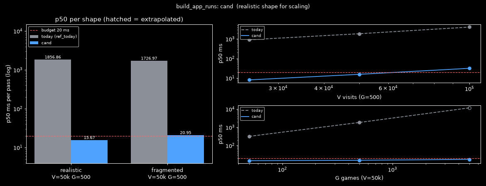
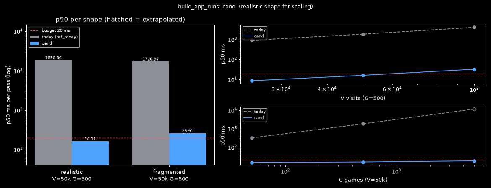

# How can app-run episode building run in one linear pass and produce the same rows as today?
Date: 2026-11-10 · Context: Windows 11, CPython 3.14.7, stdlib only · Goal: (1) the same runs, title, dominant process, URL and body as today on any input; (2) O(V) per pass (plus the sort), including the game-overlap filter · Ruled out: the run rules themselves (gap, minimum lengths, browser set), the MAX(item_id) watermark and the rebuild after expiry, the SQL that loads visits · Constraints: Python standard library only · Contract: must: byte-identical episode rows (kind, ref, start, end, title, app, url, body, items) for any input, including tie-breaking of the dominant process and URL; stdlib only (today's dominant-process tie follows hash-randomized set order, so identity is checked within one interpreter across PYTHONHASHSEED 0, 1, 2 and random) / may fake: nothing · Budget: ≤ 20 ms per pass at V = 50,000 visits and G = 500 game sessions, compute only (add_episode replaced by a stub; writes excluded) · Artifact: https://claude.ai/artifact/WAJFVR4Ut3K5sG1aSn3phJ

## Answer
Best fit: **C1 Two-phase index-range runs + suffix-min game pointer**. It produced byte-identical rows on all 10,002 cases under each of the four hash seeds (0 mismatches). A realistic 50k-visit pass takes 15.67 ms against the 20 ms budget. Today's code takes 1,856.9 ms on the same input. On the synthetic fragmented shape (18,207 runs, 4,014 episodes) it takes 20.95 ms with the harness's recording stub, 0.95 ms over budget, and 17.8 ms with a do-nothing stub. Time is linear in V (ratio 2.03 from 50k to 100k visits) and nearly flat in G (14.92 / 15.67 / 17.62 ms at G = 50 / 500 / 5000).
Prior art:
- Splitting runs on the running max end is the packing-intervals pattern [6] and ActivityWatch's heartbeat merge [3].
- Summing durations per process matches ActivityWatch's `merge_events_by_keys` [4].
- Testing overlap by binary search over sorted ends follows BITS [7].
- No named source was found for the suffix-min existence test.
No candidate that relaxes the contract beats it.

## Candidates
| Candidate | Uses | Error | Cost vs budget | Status | Prior art |
| :- | :- | :- | :- | :- | :- |
| C1 Two-phase index-range runs + suffix-min game pointer | M1 Running-max-end gap sessionization [6], M3 Suffix-min overlap test + M4 Merge-then-two-pointer [7], M2 Per-key accumulators [4][9], M5 First-wins argmax [8][10], M6 Best-URL single pass | `mismatches_by_seed=0:0,1:0,2:0,random:0 cases_per_seed=10002 realistic_p50_ms=15.67 fragmented_p50_ms=20.95 budget_ms=20 V25k/50k/100k_ms=8.13/15.67/31.76 ratio_V50/25=1.93 ratio_V100/50=2.03 G50/500/5000_ms=14.92/15.67/17.62` | realistic 15.67 ms / 20 ms; fragmented 20.95 ms / 20 ms (17.8 ms with a do-nothing stub); today 1,856.9 / 1,727.0 ms | works (best fit): meets the budget on the realistic shape, 0.95 ms over on the fragmented shape with the recording stub | Ben-Gan packing intervals [6], ActivityWatch heartbeat_merge [3] |
| C2 Fused single pass with threshold-triggered accumulation | M1 [6], M3 + M4 [7], M2 [4][9], M5 [8][10], M6 | `mismatches_by_seed=0:0,1:0,2:0,random:0 cases_per_seed=10002 realistic_p50_ms=16.11 fragmented_p50_ms=25.91 budget_ms=20 V25k/50k/100k_ms=8.60/16.11/32.57 G50/500/5000_ms=15.14/16.11/18.59` | realistic 16.11 ms / 20 ms; fragmented 25.91 ms / 20 ms | works on the realistic shape; fragmented over budget (per-episode emit ~2.4 µs + recorder ~1.4 µs per episode) | ActivityWatch heartbeat_merge [3] |




## Method
C1 makes two scans. The first scan filters the visits, splits them into runs and closes those runs as index ranges. The second scan runs only over the emitted runs. It derives the titles, the dominant process and the URL with today's tie-breaking.

```
drop(v)   <=>  exists g: g.start < v.end and g.end > v.start
          <=>  suf[j] < v.end,   games sorted by end,
               j = #{g : g.end <= v.start},  suf[k] = min(g.start for g in games[k:]),  suf[G] = +inf
new run   <=>  kind(v) != kind(run)  or  v.start - max_end(run) > 300,000
stop      <=>  max_end(run) + 300,000 > horizon    (first such run; later runs are newer)
emit      <=>  max_end(run) - start(run) >= 180,000 (browsing) | 300,000 (work)
process   =   max({p in first-seen order}, key = sum(list of durations of p))
url       =   first visit with a truthy url and d > best (strict), best starting from None
```

1. Sort the games by end and build the suffix minimum of their starts. Walk the visits in start order with a pointer `j` that counts the games ending at or before the visit's start. Drop the visit when `suf[j] < v.end`. This equals today's strict test `g.start < v.end and g.end > v.start` for any set of games, inverted and zero-length games included [7]. Assumes visits arrive in start order, as `ORDER BY start_ms, id` returns them. A row out of order re-seats the pointer with `bisect_right`, which costs O(log G) and stays correct.
2. Split runs on the kind (in the browser set or not) and on the gap from the running max end. The max changes only on a strict `>`, so the first of equal ends is kept, as builtin `max()` keeps it [6][8]. Assumes the same input order as today, with the gap measured from the running max end and not from the last visit's end.
3. Apply the minimum length during the scan. Stop at the first run whose end + 300 s passes the horizon, which equals today's `break`. Keep each emitted run as an index range `(i0, i1)` into the kept rows.
4. For each emitted run, sum the time per title in a first-seen dict, counting each visit as at least 1,000 ms. Take the stable `sorted(reverse=True)[:8]`, as today does (equivalent to `heapq.nlargest`) [9].
5. Integer fast path: while the run's running total stays an `int`, per-process `+=` sums are exact. The URL is then the first truthy URL with a strictly larger duration, with the scan starting from `None`. Assumes integer durations, which is what capture writes (`pipeline/sessions.py` copies `frames.ts_ms`).
6. A run with any float duration takes a slower path. Float durations can occur because `0002_sessions.sql` uses non-STRICT INTEGER affinity, so the columns can hold REAL fractions, ±inf and values beyond int64 [2]. That path keeps per-process duration lists and sums them with builtin `sum()`, which has used compensated float summation since Python 3.12 [8]. A NaN duration (inf − inf) falls back to today's literal stable sort for the URL. Assumes the same interpreter version as today's code. A plain running `+=` picks a different dominant process when REAL durations cancel.
7. Pick the dominant process with `max` over a set built from the distinct processes in first-seen order. Repeated inserts are no-ops, so the set's table and iteration order equal today's comprehension, and `max` keeps the same first maximum on ties [5][8][10]. Assumes the same interpreter and hash seed as the code it is compared with, because the tie result itself varies with `PYTHONHASHSEED`.
8. Memoize `app_label` per process for the pass. Call `add_episode` with the same kwargs and the same `items` list as today.

Result: 0 mismatches in 10,002 cases under each of `PYTHONHASHSEED` 0, 1, 2 and random. The cases cover int tie-heavy inputs, REAL inputs with ±inf, NaN from inf − inf and values beyond int64, medium V, and two full 50k shapes. The comparison is byte-for-byte on the recorded `add_episode` kwargs and the return value, against today's code in the same interpreter. The harness catches its mutation self-checks:

| Mutation | Mismatches |
| :- | :- |
| Plain running sum | 11–12 per seed |
| URL scan from −inf | 8 |
| Sorted tie-break | 343–546 per seed |
| `<=` game test | 733 |

Cost:

| Step | Complexity | Measured, fragmented shape |
| :- | :- | :- |
| Sort games, suffix minimum | O(G log G) + O(G) | not separated |
| Scan 1 | O(V + G) | ~7.5 ms, of which the game test ~2.5 ms |
| Scan 2 | O(emitted visits) ≤ V, plus a sort of each run's distinct titles | ~2.8 ms per-visit loop, ~0.6 ms building `items` |
| Per-episode overhead | O(episodes) | ~10 ms by subtraction, about half of it the recorder stub (~5 ms) |

The fragmented shape has V = 50k, 18,207 runs and 4,014 episodes. The realistic shape has 531 runs and 492 episodes; it takes 15.67 ms against 1,856.9 ms today, about 118× less.

Measured times:

| Point | C1 | Today |
| :- | :- | :- |
| V = 25k / 50k / 100k | 8.13 / 15.67 / 31.76 ms | 912 / 1,857 / 4,062 ms |
| G = 50 / 500 / 5000 | 14.92 / 15.67 / 17.62 ms | 322 / 1,857 / ~11,740 ms |

Under concurrent load C1 took 16–18 ms realistic and 22.8–25.4 ms fragmented.

Fails when:
- Many short runs make the per-episode overhead dominate. The fragmented shape takes 20.95 ms with the recording stub, 0.95 ms over budget, and 17.8 ms with a do-nothing stub.
- V grows well above 50k. Time grows linearly (31.76 ms at 100k).
- The game bounds become inclusive. The suffix-min test then no longer matches (the `<=` mutation gives 733 mismatches).
- The process restarts with another hash seed. Today's own tie result changes, so byte identity holds only within one interpreter.

Reproduce: from `eval/app-run-single-pass/`, run `..\.venv\Scripts\python.exe harness.py C1\cand.py C1_quiet`.

## Findings
### How do existing tools split activity into sessions?
- ActivityWatch's `heartbeat_merge` extends the previous event when the next heartbeat carries the same data and arrives within `pulsetime` of its end [3].
- Google Analytics 4 ends a session after a period of inactivity, 30 minutes by default [5].
- Itzik Ben-Gan's packing-intervals solution finds where each group starts by comparing each start with the running maximum of the earlier ends [6]. C1 and C2 use the same rule for runs (M1).

### How are per-key durations and overlap tests computed in one pass?
- ActivityWatch's `merge_events_by_keys` sums event durations per key value into one event per key [4].
- BITS, as rust-lapper's `count()` implements it, counts the intervals that overlap a query with two binary searches, one over sorted starts and one over sorted ends [7]. C1 and C2 only need to know whether any game overlaps, so one suffix minimum over games sorted by end replaces the count. No named source was found for this variant.

### Which Python semantics fix today's tie results?
- `max()` returns the first maximal item it meets. `sorted()` is stable, also with `reverse=True` [8].
- `sum()` of floats has used compensated summation since Python 3.12, so a running `+=` can differ from today's generator sum [8].
- `heapq.nlargest(n, it, key)` is equivalent to `sorted(it, key=key, reverse=True)[:n]` [9].
- `str` hashes are salted per process unless `PYTHONHASHSEED` is set. Set iteration order, and with it today's dominant-process tie, can therefore change between runs [10].

### What values can the stored visit times hold?
- Today's code recomputes the run's max end for every visit, re-sums the run once per distinct process, and tests every visit against every game [1].
- `app_sessions.start_ms` and `end_ms` are `INTEGER NOT NULL` columns in a non-STRICT table, so they can store REAL values: fractions, ±inf and values beyond int64. A NaN is stored as NULL and then rejected by NOT NULL, but an inf − inf duration is still NaN inside the code [2].

## Mechanisms
- M1 Running-max-end gap sessionization: a visit starts a new run when its start minus the running max end exceeds the gap · assumes input sorted by start and the gap measured from the running max end · breaks when the input is unsorted or the gap is measured from the last visit's end [3][5][6]
- M2 Per-key accumulators with first-seen tie order: dict accumulators keep first-seen key order; `heapq.nlargest` ≡ `sorted(reverse=True)[:n]` · assumes ties follow first-seen order · breaks if ties must follow another order [4][9]
- M3 Suffix-min overlap test: games sorted by end, suffix minimum of their starts, then a pointer or bisect; a game overlaps iff `suf[j] < v.end`. Exact for the strict predicate `g.s < v.e and g.e > v.s` on any input, O(G log G + V) · assumes strict bounds · breaks only if the bounds become inclusive (the `<=` mutation gives 733 mismatches) [7]
- M4 Merge-then-two-pointer: advance a pointer over games sorted by end as visit starts grow · assumes the pointer is keyed on the visit start and skips games whose end is at or before it · breaks when merged on `<=` or when the pointer is keyed on the visit end
- M5 First-wins argmax over insertion order: `max()` keeps the first maximum in iteration order, and a set of `str` iterates in hash order · assumes the same interpreter and hash seed as the reference · breaks across processes with different `PYTHONHASHSEED` [8][10]
- M6 Best-URL single pass: the first truthy URL with a strictly larger duration, starting from `None`, equals the first truthy URL of a stable reverse sort · assumes durations are totally ordered · breaks when the scan starts from −inf or a duration is NaN

## Explored
- Running `+=` per-process sums: wrong on REAL data. The visits a.exe (0, 1e12), a.exe (1, 1.0001), b.exe (2, 2.00011), a.exe (1e12, 0) give a different dominant process than today's compensated `sum()`. The mutation gives 11–12 mismatches per seed.
- URL scan starting from −inf: wrong when the only URL has duration −inf (8 mismatches).
- Deterministic tie rules (first-seen or sorted process): they change today's tie result (343–546 mismatches per seed), so they would relax the contract.
- Inclusive (`<=`) game test: the mutation self-check gives 733 mismatches.
- Column-wise builtin unrolling of scan 2: slower than the per-row loop.
- `try`/`except KeyError` dict updates: slower on the fragmented shape, where most lookups miss.
- C2 Fused single pass: not chosen. It is exact and within budget on the realistic shape (16.11 ms), but takes 25.91 ms on the fragmented shape against C1's 20.95 ms. It also folds a long run that is still open at the horizon and then discards it. With a 10k realistic prefix and one 40k-visit open run it takes 13.23 ms, of which ~6 ms is that wasted folding. The same rows closed and emitted take 14.76 ms.
- C2 needed two fixes during its fix round. Its game pointer is now bounded by G, because a visit at +inf raised `IndexError` on 46 of 3,000 real cases. A NaN process total now triggers today's literal URL sort. It unpacks exactly 6 columns per row, so a row of another width raises where today's code does not.

## Caveats
- Today's dominant-process tie depends on `PYTHONHASHSEED`: in a code.exe vs notepad.exe tie, seed 3 gives code.exe and the other seeds give notepad.exe. The tie is therefore not reproducible across restarts, and "byte-identical" holds within one interpreter [10].
- REAL and ±inf values only arrive through non-capture writers or edited data. Capture writes integers (`pipeline/sessions.py` copies `frames.ts_ms`).
- The fragmented shape (18,207 runs per 50k visits) is synthetic and far more fragmented than real app sessions.
- The recorder stub builds a tuple and a key set per call. That costs ~5 ms on the fragmented shape and is included in every measured number.
- The first-round timings were taken under heavy concurrent load (±15%). The verdict uses the quiet re-timing.
- The main harness has no unsorted visit rows, because the SQL orders by `start_ms, id`. C2's own check on 10,000 shuffled-row cases gave 0 mismatches. C1 was not run on shuffled rows.
- Timings are compute only: `add_episode` is a stub, and database writes are excluded.
- Today's G = 5000 time is extrapolated: it was measured at V = 12,500 and multiplied by 4.

## Sources
[1] episodes.py (build_app_runs) — src/akashic/pipeline/episodes.py:373-472 — tier 1 — pre-audit
[2] 0002_sessions.sql (app_sessions) — src/akashic/storage/migrations/0002_sessions.sql:64-74 — tier 1 — pre-audit
[3] ActivityWatch heartbeats.py — https://raw.githubusercontent.com/ActivityWatch/aw-core/master/aw_transform/heartbeats.py — tier 1 — master, 2026-11-10
[4] ActivityWatch merge_events_by_keys.py — https://raw.githubusercontent.com/ActivityWatch/aw-core/master/aw_transform/merge_events_by_keys.py — tier 1 — master, 2026-11-10
[5] GA4 session timeout — https://support.google.com/analytics/answer/9191807 — tier 1 — 2026-11-10
[6] Ben-Gan, New solution to the packing intervals problem — https://itprotoday.com/sql-server/new-solution-packing-intervals-problem — tier 2 — article
[7] rust-lapper count() (BITS) — https://docs.rs/rust-lapper/1.3.0/src/rust_lapper/lib.rs.html — tier 1 — 1.3.0
[8] Python built-in functions (max, sorted, sum 3.12 change) — https://docs.python.org/3/library/functions.html — tier 1 — Python 3
[9] Python heapq — https://docs.python.org/3/library/heapq.html — tier 1 — Python 3
[10] Python data model, __hash__ and PYTHONHASHSEED — https://docs.python.org/3/reference/datamodel.html#object.__hash__ — tier 1 — Python 3
