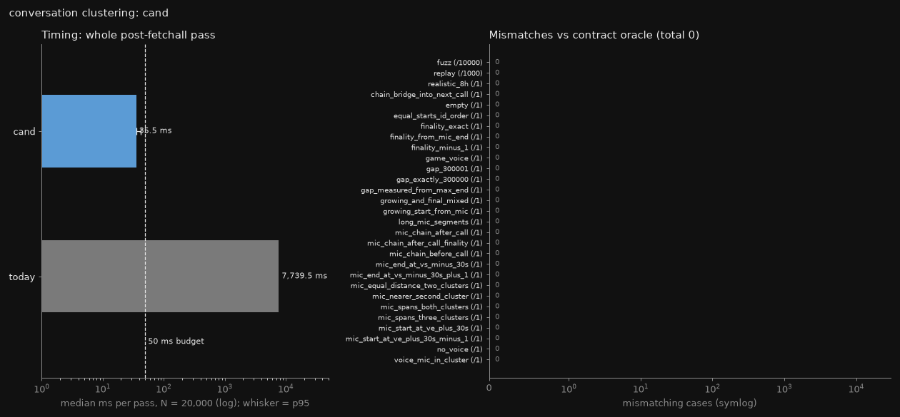
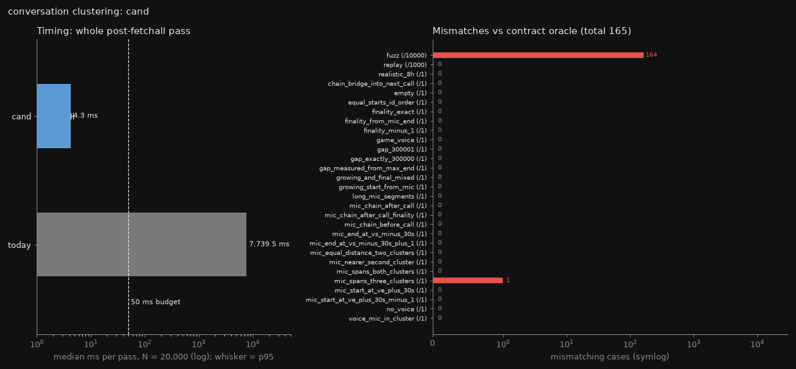
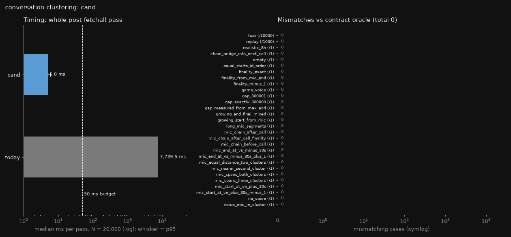

# How can conversation clustering keep today's voice clusters, stop microphone chaining, and run one pass of an 8-hour call within 50 ms?
Date: 2026-11-10 · Context: Windows 11, CPython 3.14.7, stdlib only · Goal: (1) the same voice clusters as today; (2) microphone speech attaches only within 30 s of a cluster's voice-only bounds, which fixes the chaining bug; (3) O(N log N) per 30 s pass during long calls · Ruled out: what counts as voice, speaker attribution, the SQL that loads segments, the expired-episode rebuild, the transcript horizon · Contract: must: voice clustering identical (5 min gap rule, `<=`); a mic segment attaches iff it overlaps [voice start − 30 s, voice end + 30 s) of one cluster's voice segments, to at most one cluster (the nearer by gap distance d = max(0, vs − m.end, m.start − ve), ties to the earlier); final/growing split (cluster end including attached mic + 300 s ≤ horizon) and the conversation watermark unchanged; stdlib only / may fake: nothing · Budget: ≤ 50 ms per pass at N = 20,000 segments (8-hour call, voice + mic), all Python work after `fetchall` (parsing, voice test, clustering, attachment, finality); SQL fetch excluded · Artifact: https://claude.ai/artifact/1iE4xoaAU1Pe4zL48h6d9K

## Answer
Best fit: **C4, a two-pointer sweep over frozen voice-only bounds plus a per-pass memo of parsed `sources` strings**. It matches the contract oracle on every check (0 of 10,000 fuzz cases, 0 of 27 edge sets, 0 of 1,000 multi-pass replays) and takes 5.0 ms median (p95 5.9 ms) per pass at N = 20,000, against 50 ms. Today's code takes 7,739.5 ms on the same input and differs from the contract on 1,165 fuzz cases. The voice sweep is a gap merge, the same rule as pyannote-core `Annotation.support(collar)` [1]; no prior art was found for attaching a second stream to frozen cluster bounds. C1 is the same sweep without the memo: also exact, 35.5 ms median, and 75 % of that is today's unchanged per-row parsing. C3 is the fastest (4.3 ms) but exact only while non-voice mic segments are ≤ 300 s; capture caps them at 30 s [8]. No `RELAXES` candidate was built.

## Candidates
| Candidate | Uses | Error | Cost vs budget | Status | Prior art |
| :- | :- | :- | :- | :- | :- |
| C4 Two-pointer sweep + per-pass sources memo | M1 [1], M3, low-cardinality memo | `mismatches_fuzz=0 mismatches_edges=0 mismatches_replay=0 median_ms=5.022 p95_ms=5.866` | 5.0 ms median, 5.9 ms p95 / 50 ms (36.5 ms median with 20,000 distinct `sources` strings) | works (best fit) | pyannote-core `Annotation.support` [1] (voice sweep only) |
| C1 Frozen-bounds two-pointer sweep | M1 [1], M3 | `mismatches_fuzz=0 mismatches_edges=0 mismatches_replay=0 median_ms=35.519 p95_ms=41.718` | 35.5 ms median, 41.7 ms p95 / 50 ms | works | pyannote-core `Annotation.support` [1] (voice sweep only) |
| C3 Midpoint cell table, closed form | M1 [1], frozen table, integer-sum comparison, bisection [5] | `mismatches_fuzz=164 mismatches_edges=1 mismatches_replay=0 median_ms=4.261 p95_ms=4.689` | 4.3 ms median, 4.7 ms p95 / 50 ms | works (condition: non-voice mic segments ≤ 300 s; capture caps them at 30 s [8]) | none found |
| C2 Bisect attach | M1 [1], M2 [5] | not built: same output and mechanisms as C1 | not measured / 50 ms | not built | pyannote-core `Annotation.support` [1] (voice sweep only) |
| C5 Two-term finality | M1 [1], M3, two-term finality | not built: relaxes the contract's final/growing split | not measured / 50 ms | works if the final/growing formula relaxes from (end incl. mic) + 300 s ≤ horizon to max(ve + 300 s, mic_end + 30 s) ≤ horizon | none found |

## Method
C4: freeze each cluster's voice-only bounds in one sweep, then give each non-voice mic segment to at most one cluster with a pointer that only moves forward.

Input: rows `(id, stream, start_ms, end_ms, speech_ms, sources_json, transcript)` exactly as `fetchall` returns them, ordered by `(start_ms, id)`.

1. **Classify with a per-pass memo.** A dict local to the call maps each raw `sources` JSON string to `(parsed tuple, voice-app flag, game processes named in it)`. `json.loads` and the `VOICE_APPS` test run once per distinct string. The game-session overlap test still runs per row, but only for rows whose string names a game process. Assumes few distinct `sources` strings per pass (the realistic 8 h fixture has 6). Rows stay tuples with an `owner` array beside them; building `_Segment` dataclasses for all rows would add 9.8 ms median.
2. **Voice sweep (M1).** For each voice row in order: if a cluster is open and `start − cur_end ≤ 300,000`, extend it and raise `cur_end` to `max(cur_end, end)`; else open cluster k with `vs_k = start`, `ve_k = end`. This is today's rule with the end kept as a local instead of a `max` over all members on every access [7]. Assumes rows sorted by `(start_ms, id)`, as the SQL guarantees.
3. **Mic attachment (M3).** Since `vs_{k+1} > ve_k + 300 s`, `ve_k + 30 s` strictly increases with k. For each non-voice mic row m in start order, advance `lo` while `ve_lo + 30 s ≤ m.start`.
   - If `lo` is past the end or `vs_lo − 30 s ≥ m.end`, m attaches nowhere.
   - Otherwise the owner is `lo`, unless all three hold: `lo + 1` also overlaps its window, `lo` does not touch m (d > 0), and `d_{lo+1} = max(0, vs_{lo+1} − m.end)` is strictly smaller. Ties stay with `lo`.
   - Only `lo` and `lo + 1` can be nearest: `lo + 1` starts after m.start, so every later cluster is strictly farther.
   - Bounds are never widened by attached mic, so mic speech cannot chain. Assumes mic rows in start order.
4. **Members.** One ordered pass over `owner` appends each row id to its cluster, so members come out in `(start_ms, id)` order with no per-cluster sort.
5. **Finality.** `end_all_k = max(ve_k, attached mic ends)`; the cluster is final iff `end_all_k + 300 s ≤ horizon`, today's formula. `growing_start` = the minimum member start (voice or mic) over non-final clusters, so the watermark at episodes.py:367-371 [7] is unchanged.

Result: 0 mismatches against the literal O(N·K) oracle on 10,000 seeded fuzz cases, 26 edge sets plus the realistic 8 h fixture, and 1,000 multi-pass replays (horizon steps of 30 s; union of finals equals the one-shot result). On the realistic fixture today returns no final cluster; C4 and the oracle return 3.

Cost: step 1 is O(N) dict lookups plus one parse per distinct string. Step 2 is O(N). Step 3 is O(M + K) for M mic rows and K clusters. Steps 4 and 5 are O(N + K). With 6 distinct strings the measured pass is 5.0 ms median at N = 20,000. The same code without the memo takes 29.1 ms, so per-row parsing was about 85 % of a memo-free pass.

Fails when:
- Every row has a distinct `sources` string: the memo never hits and costs about +4.5 ms (36.5 ms median, p95 45.3 ms, against 31.8 ms without it). That is still under 50 ms at the median.
- Rows arrive out of `(start_ms, id)` order: the voice sweep, the pointer and the member order all break, as today's voice loop would.

Reproduce: from `eval/conversation-clustering-sweep/`: `..\.venv\Scripts\python.exe harness.py C4\cand.py C4`. Side bench: `C4\bench.py` → `C4\bench.txt`.

## Findings
### Why today's pass is slow and wrong
- `_Cluster.end_ms` is a property that takes `max` over all segments of the cluster on every access, so the voice loop and the attachment filter cost O(N·K) over an open call [7].
- The microphone attachment calls `cluster.segments.extend(<generator>)`, and the generator's filter reads `cluster.end_ms`. `list.extend` on a generator appends one item at a time, so each attached mic segment widens the bound the next one is tested against [6][7]. Mic speech with gaps under 30 s chains on indefinitely.
- Each cluster runs its own filter over all segments with only its own voice ids excluded, so one mic segment can attach to two or more clusters [7].
- Measured: today's code takes 7,739.5 ms median per pass at N = 20,000 (another run 5,289.8 ms). It differs from the contract on 1,165 of 10,000 fuzz cases, 40 of 1,000 replays, 8 of 26 edge sets and the realistic 8 h fixture. On that fixture, mic speech in pauses chains every cluster to the last mic segment, so no cluster is ever final; the contract gives 3. The literal O(N·K) contract oracle takes 678.9 ms.
- The 8 differing edge sets:
  - mic chain after a call (28 extra segments attached, contract 2)
  - chained end blocking finality
  - a chain bridging into the next call with double attachment
  - long mic segments chaining
  - equal-distance mics attached to both clusters
  - nearer-second-cluster mics attached to both clusters
  - mic segments spanning 2 clusters attached to both
  - mic segments spanning 3 clusters attached to all three

### How existing tools merge intervals with a gap
- pyannote-core `Annotation.support(collar)` merges same-label segments whose gap is under the collar, carrying the merged segment's end forward [1].
- ActivityWatch merges adjacent heartbeats with a pulse time and a maximum duration [2].
- SQL "packing intervals" (gaps and islands) computes the running maximum end over start-sorted rows and opens a new group where the next start exceeds it [3].
- whisperX `merge_chunks` caps chunk length rather than clustering by gap, so it does not apply here [4].
- No published source was found for attaching a second stream (microphone) to frozen bounds of a first (voice) with a nearest-cluster rule.

### Where a pass spends its time
- Today's per-row parse is the floor C1 keeps: `_segment` over 20,000 rows takes 26.4 ms (11.8 ms of it `json.loads`), `_is_voice` 3.9 ms. In C1's 35.5 ms pass, 25.9 ms (75 %) is that unchanged parsing.
- The realistic 8 h fixture has 6 distinct `sources` strings across 20,000 rows. A memo keyed by the raw string removes nearly all of that parsing (C4 5.0 ms against 29.1 ms without the memo).
- With 20,000 distinct strings, the memo costs +4.5 ms (36.5–38.1 ms median against 31.8–32.7 ms without it).
- The refuter measured `json.loads` at 0.50–0.64 µs per row, lower than the estimate used when the candidates were designed.

### What bounds microphone segment length
- Capture cuts audio segments at `max_segment_ms = 30_000` (audio.py:79), enforced at audio.py:152 [8]. C3's error class needs a non-voice mic segment over 300 s, which capture does not produce today.
- `bisect_left` and `bisect_right` give the leftmost and rightmost insertion points in a sorted list in O(log n) [5]; C2 and C3 use them for the owner lookup.

### Exactness checks by the refuter
- Brute force over 20,000 layouts per mic-length cap from 30 s to 700 s: C1 and C2 0 mismatches; C3 0 mismatches up to 300 s, 1 at 330 s, 805 at 700 s.
- Multi-pass simulation on 3,000 seeds gives the same clusters as one shot for C1, C2 and C3.
- Chaining reproduced on today's code: cluster 1's end chained to 715 s, and 14 segment ids landed in two clusters.
- Stability: an attached mic segment of a final cluster can never prefer a cluster not yet seen, because a later cluster starts more than 300 s after the final cluster's voice end.

## Mechanisms
- M1 Gap sweep with running max end (merge intervals with tolerance): sort by start, carry the end as a local, extend while `start − end ≤ GAP` · assumes input sorted by `(start, id)` and the gap measured from the max end · breaks when unsorted, or when the end is taken from the last element [1][2]
- M2 Bisect over frozen voice-only cluster bounds: `ends = [ve_k + M]`, `k = bisect_right(ends, m.start)`, scan while `vs_k − M < m.end`, min d, ties to the lowest · assumes clusters sorted and margin windows disjoint (gap > 300 s > 2 × 30 s) · breaks if `CLOSE_GAP ≤ 2 · MIC_MARGIN` (still correct, longer scan) or if mic is counted into the bounds [5]
- M3 Two-pointer variant of M2: one pointer that only moves forward over start-sorted mic segments · assumes mic sorted by start · breaks when unsorted
- M4 Incremental cached open-cluster state across passes · assumes no late out-of-order transcripts · breaks when the horizon releases late transcripts

## Explored
- C2 Bisect attach: C1 with `k = bisect_right(ends, m.start)` per mic instead of a pointer, so it does not need mic rows in order. Not built: same output and mechanisms as C1. The refuter confirmed 0 mismatches against brute force and a 3,000-seed replay.
- C3 Midpoint cell table: kept as a working candidate, not the best fit. A non-voice mic segment over 300 s that spans a whole voice gap goes to the later cluster instead of the earlier one: 164 of 10,000 fuzz cases, plus edge set `mic_spans_three_clusters`. Exact on all 207,057 cases whose mic segments are ≤ 300 s.
- C5 Two-term finality: final iff `max(ve + 300 s, mic_end + 30 s) ≤ horizon`, which finalizes up to 30 s plus the mic length earlier. Not built: it changes the contract's final/growing split.
- M4 incremental open-cluster state across passes: judged not worth it, because state goes stale when the horizon releases late transcripts.
- whisperX `merge_chunks` [4]: caps chunk length, not gap clustering.

## Caveats
- Timings were taken on this PC with other processes running; today's code measured 7,739.5 ms in one run and 5,289.8 ms in another.
- C4's margin depends on few distinct `sources` strings per pass, which holds for capture today. With every string distinct it runs at 36.5–38.1 ms median, p95 43–45 ms.
- C3 is exact only for non-voice mic segments ≤ 300 s. Capture caps them at 30 s [8]; if that cap is lifted, C3 misassigns segments that span a whole voice gap.
- Inherited boundary case outside the contract: a pending segment starting exactly at the horizon (horizon = start, gap exactly 300,000 ms) could chain onto a cluster already declared final. The replay with the horizon at the segment's start instead of start − 1 failed 1 seed in 3,000 for the oracle too.
- Unsorted input is not tested; the SQL guarantees `ORDER BY start_ms, id` [7].
- The candidates return final member id lists and `growing_start`. `build_conversations` needs segment objects for final clusters (start, end, transcripts). Building those for the final clusters only was not measured.
- Prior-art and documentation fetches were summaries, not verbatim code.

## Sources
[1] pyannote-core annotation.py — https://raw.githubusercontent.com/pyannote/pyannote-core/develop/src/pyannote/core/annotation.py — tier 1 — develop, fetched 2026-11-10
[2] ActivityWatch aw-core heartbeats.py — https://raw.githubusercontent.com/ActivityWatch/aw-core/master/aw_transform/heartbeats.py — tier 1 — master, fetched 2026-11-10
[3] Ben-Gan, New Solution to the Packing Intervals Problem — https://itprotoday.com/sql-server/new-solution-packing-intervals-problem — tier 2 — 2015 (description only)
[4] whisperX vad.py — https://raw.githubusercontent.com/m-bain/whisperX/main/whisperx/vads/vad.py — tier 1 — main
[5] Python bisect — https://docs.python.org/3/library/bisect.html — tier 1 — 3.14
[6] CPython listobject.c `list_extend` — https://github.com/python/cpython/blob/3.14/Objects/listobject.c — tier 1 — 3.14
[7] episodes.py — src/akashic/pipeline/episodes.py:93-102,265-311,363-371 — tier 1 — pre-audit
[8] capture audio segment cap — src/akashic/capture/audio.py:79,152 — tier 1 — pre-audit
