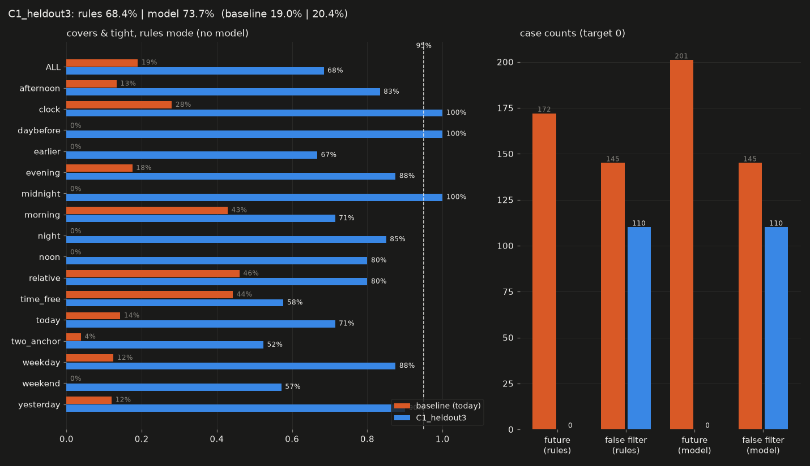
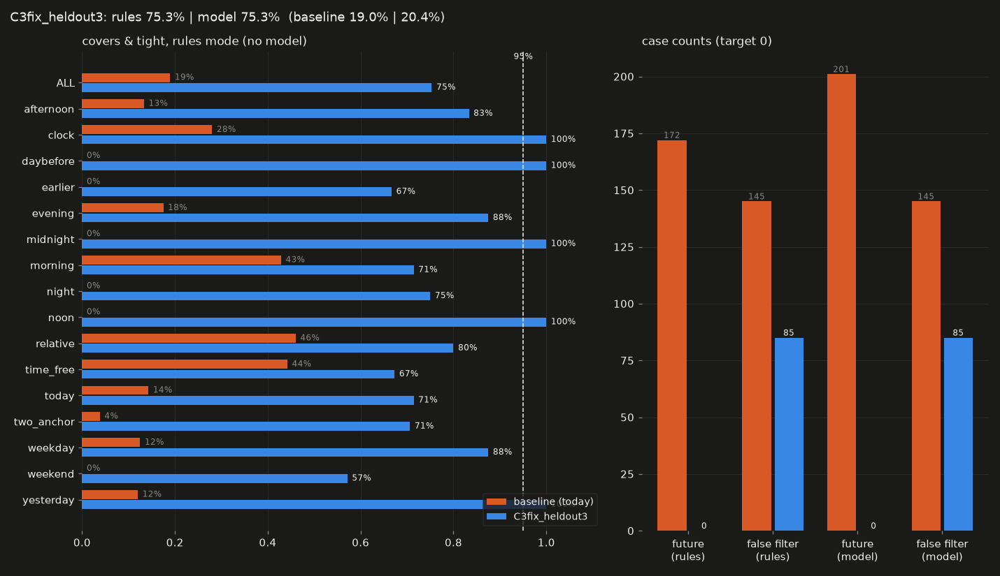
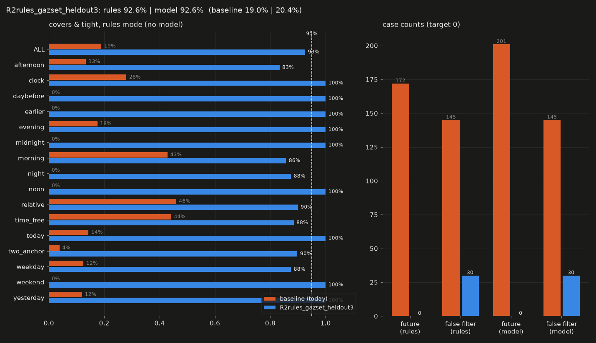
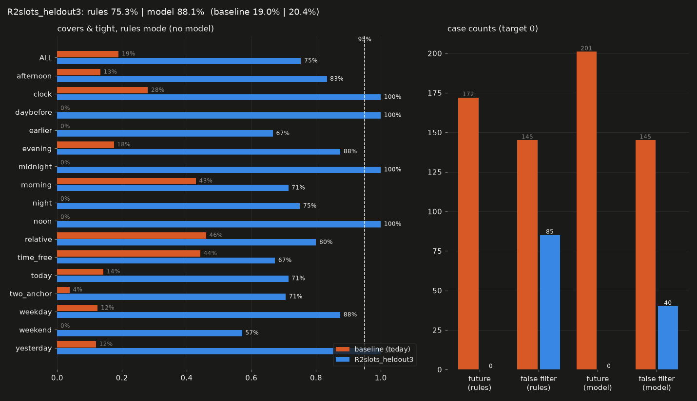
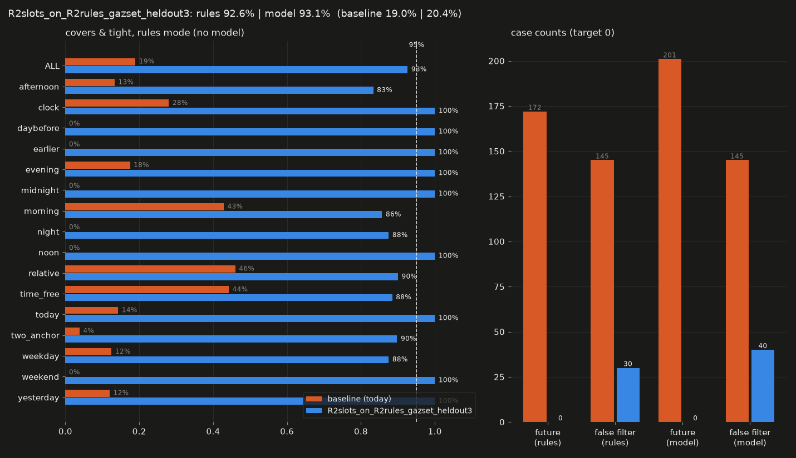
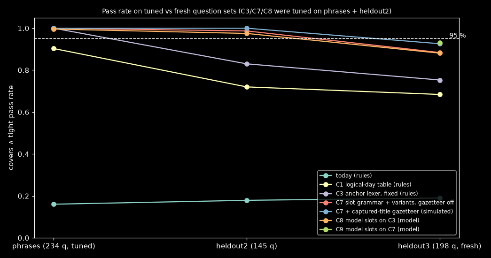
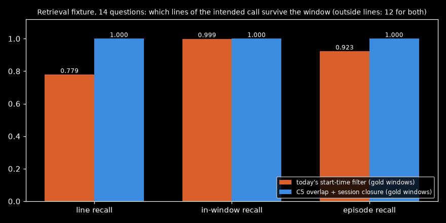

# Conversational Time Windows

Date: 2026-11-10

Context: Akashic (Python 3.14, sqlcipher3 / SQLite 3.54 FTS5, local gemma-4-12b-it-qat-q4_0 through llama-server b12209, RTX 4090 on the test PC)

Goal:
1. Common FR/EN phrasings resolve to a window: cet aprèm, ce midi, à midi / at noon, minuit / midnight, tout à l'heure / earlier, this / last weekend, ce week-end.
2. Night use is handled: "last night" covers the evening; the evening runs past midnight; before about 05:00, today / tonight / ce soir mean the previous day.
3. When a question names two times, the window is the one the question asks about.
4. Retrieval does not lose a call that overlaps the window.

Ruled out: absolute dates beyond today's support, timezones and DST, the clock-versus-duration misread ("a 2h video").

Contract:
- The rule path is deterministic and works without the LLM.
- The model may fill in, refine or veto a window.
- A RAM-only list of captured titles is allowed. A persisted learned alias table is not.
- Existing tests pass, or each changed expectation is listed.
- No dependency; local-time [start, end).
- May fake fuzzy part-of-day edges by ±30 min.

Budget:
- ≥ 95% of labelled cases pass covers ∧ tight (each case is a question at 5 "now" times), with the model loaded.
- The rules-only fallback is no worse than the best rule resolver.
- 0 future windows.
- ≤ 1 ms per question on the rule path.

Artifact: https://claude.ai/artifact/AUonzqgnTyFUwXQj6a53Ra

## Answer
No candidate reaches 95% on fresh questions, so there is no best fit.

The closest is C9: the local model fills structured time slots inside the existing plan call, and the slots are merged with the C7 rule resolver.
- **Score:** 0.931 on 198 fresh questions × 5 times (1,070 cases), against 0.190 today. 0 future windows.
- **Cost:** about +44 output tokens per plan call, measured at +1.8 s p50 on a shared GPU.

The best rules-only resolver is C7: a closed slot grammar with offline-verified variants, abbreviation folding and a captured-title gazetteer. It scores 0.926 with the simulated gazetteer and 0.884 without it, in ≤ 0.17 ms.

For retrieval, C5 keeps every line and episode of a call that crosses the window when the window is right: line recall 1.000, against 0.779 for today's start-time filter.

Prior art covers the parts: Duckling's part-of-day tables and past preference [1][3], and dateparser [6]. No surveyed resolver handles the after-midnight logical day, informal French ("aprèm", "tout à l'heure") or the choice between two time anchors.

## Candidates
| Candidate | Uses | Error (heldout3, 1,070 cases) | Cost vs budget | Status | Prior art |
| :- | :- | :- | :- | :- | :- |
| C1 Logical-day phrase table + past preference + clip to now | M8, M12, M13 [1][2] | rules 0.684, model-copy 0.737 (heldout2: 0.720) | p99 ~128 µs / 1 ms | fails: phrase table and title coverage | Duckling [1] |
| C2 Activity-derived day boundary | M12, M1 | not built | ~0.5 ms | not built: variant (b) breaks on calls in progress; variant (a) adds a stored fitted state | wearable sleep-day rules [10] |
| C3 Anchor lexer with clause attachment (C3fix after one fix round) | M14, M8 [1] | rules 0.753 (heldout2 0.830); 85 false filters | p99 127 µs | fails: lexicon gaps and titles on fresh sets | none found |
| C4 Rules-first, lexicon-gated model fallback | M8, M13 | not built | ~0.1 ms | fails: today's prompt copies the phrase verbatim, so the model adds nothing; superseded by C8/C9 | none found |
| C5 Session-closure line window (overlap + voice-run extension) | M1, M5, M6 [7][8] | gold windows: line recall 1.000 vs 0.779; episode recall 1.000 vs 0.923; 12 outside lines for both | 3 SQL statements vs 2; p50 7.3 vs 6.6 ms | works (retrieval part; needs a correct window) | none by name; vitrivr temporal scoring is related |
| C6 Hard core + soft margin band + labelled rerun | M6 [9] | not built | ~4 float ops per candidate | fails: no effect on unscored candidates (timeline ordering), and it changes the overview count | TRank FuzzySet [9] |
| C7 Closed slot grammar + verified variants + folding + captured-title gazetteer (rules) | M8, M13, M14 [1] | rules 0.926 with simulated gazetteer, 0.894 with a public list, 0.884 without; 30–80 false filters | p99 137–150 µs / 1 ms | fails: 0.926 < 0.95 | Duckling tables [1] |
| C8 Grounded model time slots on C3 | M8, model `when` slots | model 0.881, rules 0.753 | +44 output tokens; +1.6–1.8 s p50 (shared GPU) | fails: 0.881 | none found |
| C9 Grounded model time slots on C7 | C8 + C7 | model 0.931, rules 0.926 (gazetteer on) / 0.884 (off) | as C8 | fails: 0.931 < 0.95; the model adds title false filters (40 vs 30) | none found |
| C10 Soft window when rules and model disagree | M6 | not built | ~µs | works if the metric counts soft windows on time-free questions as non-filters | none found |
| C11 Learned alias table in the encrypted DB | C8 output | not built | ~20 µs | fails: excluded by the contract (no persisted learned aliases) | none found |

## Method
C9 is the closest candidate. It is not a best fit.

1. **Rules lex the question (C7).**
   - Slot grammar: [governor] [modifier] [day] [part] [modifier] [clock] [half-day marker].
   - 111 static variants, each verified in 20 carrier questions × 5 times.
   - Apocope folding for part-of-day heads only. It never touches weekdays, so "jeu" never becomes jeudi.
   - Title vetoes: structural rules plus a RAM-only n-gram gazetteer of captured titles.
   - Anchor choice by clause: the asking clause first, otherwise the dislocated head. Tiers: adverbial, then noun-attached, then subordinate.
   - Assumption: users' time phrases are surface variants of about 70 concepts.
2. **The model fills a `when` object in the existing plan call.**
   - It holds a span copied from the question and closed-enum slots: day, part, clock (`HH:MM` pattern), special and n.
   - A slot is kept only if a cue word inside its own span supports it.
   - Assumption: the model recognises slang better than the rules but picks the main anchor worse. Measured: letting the model's span override the rule tiers lost 90–98 cases.
3. **Merge.**
   - Where the rules lexed the span, the rule slots win and the model only fills gaps.
   - The model takes over only for longer spans ("hier soir tard", "earlier this week") or a clock that fits no rule part ("3h du matin").
   - Stoplist and title spans count as vetoed.
   - If the model says "no time" next to a weak rule anchor, there is no window.
4. **Build the window with the rule builder.**
   - Logical day L = date(now − 5 h).
   - The evening runs past midnight. "last night" is the evening plus the night.
   - Past preference: step back when start ≥ now.
   - In-progress windows are clipped to now.
   - Result: 0 future windows by construction.
5. **Retrieval (C5).**
   - Lines are kept by overlap, with an index-friendly lower bound at W.start − 30,016 ms.
   - The window is extended to whole voice runs that cross it. Voice-app segments chain while gaps are ≤ 15 min; music and video never chain. The extension is capped at 3 h on each side.

**Cost**
- Rule path p50 70–80 µs, p99 ≤ 170 µs.
- The model path adds ~44 output tokens: p50 129 vs 86 tokens, prompt 743 vs 298 tokens with the prefix cached.
- Interleaved A/B on a shared GPU: +1.79 s p50, +3.8 s p95.

**Fails when**
- A lower-case time word is used as a noun or title the user never captured: "table de nuit", "robe de soirée", "3am challenge", "menu du midi", "last minute". The model path adds such false filters too.
- Typos in time words ("this afternon", "cte nuit").
- "sat night".
- Two-anchor questions with no connector (0.68).

**Reproduce:** run `eval/conversational-time-windows/harness.py --phrases heldout3.jsonl --candidate R2slots/candidate.py --name X --no-retrieval` with `RULES_MODULE=R2rules/candidate.py` and `CTW_GAZ=set`. The model cache comes from `R2slots/fill_cache.py`. The model cache needs a local llama-server (see `eval/README.md`).

**Changed expectations:** the C1 family (C3, C7 and C9 inherit them) changes 36 existing test expectations, listed with reasons in `eval/conversational-time-windows/C1/changed_tests.md`:
- 19 from 05:00–05:00 whole days;
- 4 from the evening ending at 02:00;
- 5 from past preference;
- 5 from clipping to now;
- 2 from night spans;
- 1 from the test_ask_job fixture.

## Findings
### What do existing resolvers do?
- Duckling FR: soir 18–00, matin 04–12, après-midi 12–19, midi and minuit as points. It has no aprèm or tout à l'heure [1].
- Duckling EN: "last night" is the 6 h before the start of today; "tonight" is 18–00 today; the weekend runs Friday 18:00 to Monday 00:00 [2][3].
- "this" is predNth 0, so Duckling has no past preference and no after-midnight logic [3].
- HeidelTime maps parts of the day to symbolic TIMEX3 values with no hour ranges. On French TimeBank: strict F1 .85, value F1 .74 [4].
- On TempEval-3 EN, HeidelTime reaches value F1 77.6 [5].
- dateparser maps parts of the day to clock points and offers PREFER_DATES_FROM = past for partial dates [6].

### How do lifelog systems match times to items?
- MyEachtra splits events that span two days so date filters stay clean [7].
- Temporal IR uses decay priors and target-time smoothing, and warns against temporal scoring on queries that are not recency-sensitive [8].
- Fuzzy interval matching exists in TRank FuzzySet [9].
- Wearables assign sleep to days with fixed or sleep-onset rules. Shift workers break fixed boundaries [10].

## Mechanisms
- **M1 Interval overlap:** keep an item iff it starts before W ends and ends after W starts. Assumes a reliable end_ms. Breaks on truncated ends and on long sessions. [8]
- **M2 Start-time containment:** today's line filter. Breaks when a call starts before the window. [12]
- **M3 Exponential decay prior.** Assumes recency intent. [8]
- **M4 Target-time smoothing.** Assumes a single target time. [8]
- **M5 Midnight event split.** Assumes date-granular filters. Breaks on "last night". [7]
- **M6 Trapezoid soft window.** Unvalidated. Breaks when the margin is large relative to the window.
- **M8 Duckling latent part-of-day ∩ day, predNth.** Assumes a calendar day. Breaks after midnight and on French slang. [1][2][3]
- **M9 HeidelTime symbolic normalisation.** No hour ranges. [4]
- **M12 Logical day = date(now − 5 h).** Assumes the user's day ends around 05:00. Breaks for users who wake before 05:00. (design)
- **M13 Portable phrase table.** Unmeasured synthesis.
- **M14 Multi-anchor choice by clause.** No surveyed system does this. (design)

## Explored
- **C1:** phrase table without the anchor rule. 0.684 on fresh questions.
- **C2:** activity-derived day boundary. Variant (b) reads closed episodes, so a call in progress at 00:40 looks like sleep. Variant (a) needs stored fitted constants. Not built.
- **C3 / C3fix:** 1.000 on tuned questions; 0.830 and 0.753 on fresh sets. Lexicon gaps on informal phrasing.
- **C4:** the current plan prompt makes the model copy the phrase verbatim, so falling back to the model adds nothing. The edit-distance gate is almost always open.
- **C6:** the rank factor does nothing for candidates without scores. The overview path counts band items.
- **C7 without a gazetteer:** 0.884. Lower-case titles and nouns that contain time words stay false filters.
- **C8:** model slots over C3 reach 0.881. Lexicon misses that the model also gets wrong remain.
- **C9:** 0.931. The model adds false filters on time words used inside titles and nouns.
- **C10:** changes the metric without approval. Does nothing for candidates without scores.
- **C11:** a persisted learned alias table is excluded by the contract.

## Caveats
- **Labels.** All labels follow a night-owl convention written by agents, not by the user. Whole past days run 05:00–05:00. "hier soir" asked before 05:00 means the logical yesterday.
- **Tuning and fresh sets.**
  - heldout2's failures were published into C7's variant list, so heldout2 is seen data for C7, C8 and C9.
  - heldout3 was written independently. It was scored once for each frozen candidate.
- **The gazetteer is simulated.**
  - "set" mode adds the titles named in the scored set's time-free questions, standing in for titles the user captured.
  - "public" mode uses 411 real titles.
  - Production needs a per-process rebuild keyed on `PRAGMA data_version`.
- **Latency.** Measured on an RTX 4090 while other model servers and Whisper jobs shared the GPU. Uncontended latency is not measured. AGENTS.md lists an RTX 4080 Super.
- **Retrieval fixture.** It has 14 questions on synthetic sessions, so C5's recall numbers are directional.

## Sources
[1] Duckling FR time rules — https://raw.githubusercontent.com/facebook/duckling/main/Duckling/Time/FR/Rules.hs — tier 1 — main, 2026-11
[2] Duckling EN time rules — https://raw.githubusercontent.com/facebook/duckling/main/Duckling/Time/EN/Rules.hs — tier 1 — main, 2026-11
[3] Duckling time helpers (weekend, predNth) — https://raw.githubusercontent.com/facebook/duckling/main/Duckling/Time/Helpers.hs — tier 1 — main
[4] Moriceau & Tannier, French resources for HeidelTime — https://aclanthology.org/L14-1382.pdf — tier 1 — LREC 2014
[5] UzZaman et al., TempEval-3 — https://aclanthology.org/S13-2001.pdf — tier 1 — 2013
[6] dateparser settings — https://dateparser.readthedocs.io/en/latest/settings.html — tier 1 — 1.5.x
[7] MyEachtra, LSC'23 — https://doras.dcu.ie/29497/1/3592573.3593100.pdf — tier 1 — 2023
[8] Campos et al., Survey of temporal information retrieval — https://dias.users.greyc.fr/publications/cs2014.pdf — tier 1 — 2014
[9] TRank, SIGIR 2011 — https://folk.idi.ntnu.no/noervaag/papers/SIGIR2011TRANK.pdf — tier 1 — 2011
[10] Which day does sleep belong to — https://sahha.ai/blog/which-day-does-sleep-belong-to/ — tier 3 — vendor blog
[11] src/akashic/search/timeparse.py — local
[12] src/akashic/search/hybrid.py:197-414 — local
[13] src/akashic/search/planner.py:190-310 — local
