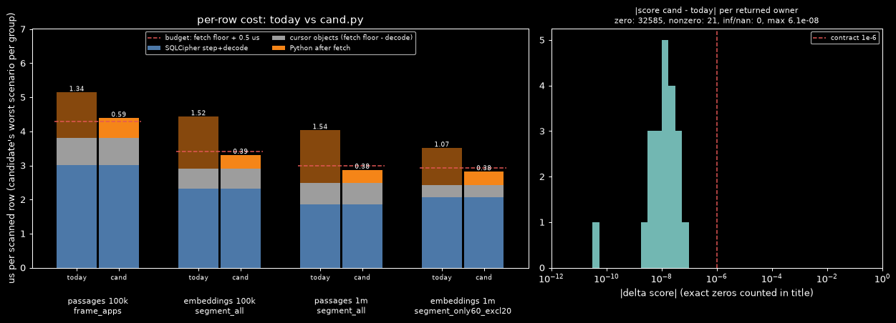
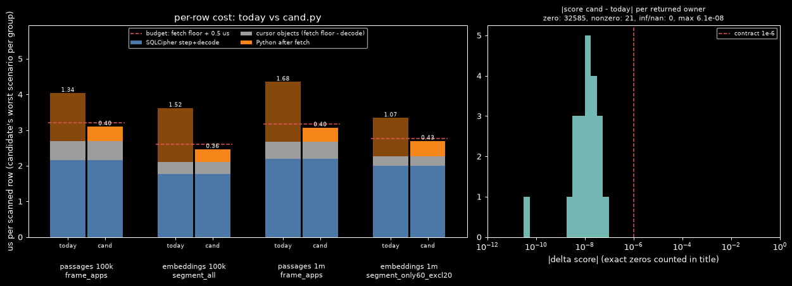
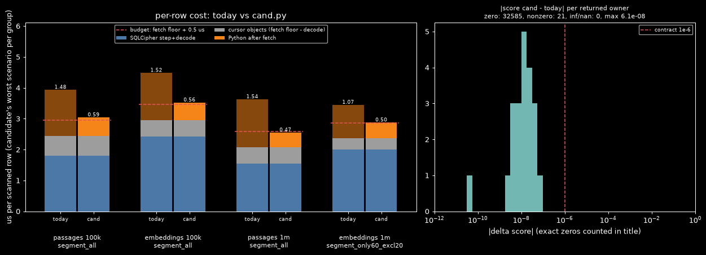

# How can exact top-k vector search over encrypted SQLite rows spend its per-row time in SQLCipher decode rather than Python object work?
Date: 2026-11-10 · Context: Windows 11, CPython 3.14, numpy 2.5.4 (OpenBLAS 0.3.34; wheel baseline X86_V2, no F16C dispatch for the float16 cast), sqlcipher3 (SQLCipher 4.20.0, SQLite 3.54.1) · Goal: (1) exactly the same top-k results as today; (2) per-row cost dominated by SQLCipher decode rather than Python object work; (3) memory bounded by the chunk size · Ruled out: ANN indexes, GPU search, storage-format change, identical-text dedupe, SQL join order for time windows · Constraints: rows arrive as one Python tuple + one bytes object each through the sqlcipher3 cursor; stock numpy wheel (X86_V2 baseline); no new dependency; encryption unchanged · Contract: must: same owners in the same order (ties: passages by owner_id; embeddings by scan order, as today), max-passage per owner with its char offsets, float16 storage unchanged, time/only/exclude/apps/vector-size filters unchanged / may fake: score differences up to 1e-6; queries with a NaN vector in scope are reported separately (today's Python sort with a NaN key is undefined there) and dropping non-finite-score rows is accepted · Budget: ≤ 0.5 µs (500 ns) per scanned row of Python work after rows arrive from the cursor, at 100k and 1M rows (cursor fetch floor and SQLCipher decode measured and reported separately, not counted); ≤ 64 MB extra peak memory · Artifact: https://claude.ai/artifact/CXBNvyW94hG1Lu6S1v2QFp

## Answer
Best fit: **C3 Columnar chunk + run-level selection**. It returns today's owners, order and char offsets on every query without a NaN vector in scope (0 mismatches over 612 queries), and its float32 scores are bit-identical to today's. Its after-fetch cost is 252–431 ns/row across the 10 timed scenarios, against a budget of 500. Today costs 865–2025 ns/row on the same scenarios. Peak extra memory is 9.1 MB against 64 MB. What remains is 15–25% of the SQLCipher decode cost (1.3–2.2 µs/row), so decode now dominates. The 5 differences from today are all NaN-scope queries at 100k, where the NaN key corrupts today's own sort. Prior art: the float16 shift-and-rebias is Fabian Giesen's "half to float done quic" [13]. No prior art was found for folding the 2^112 factor into the query, or for the columnar pipeline as a whole.
C1 shares the same pipeline and is within measurement noise of C3. Its one scenario over budget (588 ns/row) measured 310 ns/row in an earlier run of unchanged code.

## Candidates
| Candidate | Uses | Error | Cost vs budget | Status | Prior art |
| :- | :- | :- | :- | :- | :- |
| C1 Columnar chunk with integer f16 rebias | M1, M2, M4, M11, M12 [3][4][13], M13 [6][7] | `mismatches=0 hard=5 tie_order=0 near_tie=0 today_noise=0 errors=0 type_errors=0 nan_scope_mismatches=5 max_abs_dscore=6.07e-08 passages_after_fetch_ns_100k=588 embeddings_after_fetch_ns_100k=393 passages_after_fetch_ns_1m=380 embeddings_after_fetch_ns_1m=381 peak_MB=11.7` | 209–588 ns/row (9 of 10 scenarios within) / 500 ns/row; 11.7 / 64 MB | works | Giesen, half to float done quic [13] |
| C2 SQL-side chunk aggregate | M7 [10][11], M1 | not built: a refuter measured the core on stdlib SQLite 3.50.4 instead | 0.77–0.82 µs/row total vs today's 0.79–0.82 (refuter, stdlib SQLite) | fails: it moves the object work into the engine (keyset co-routine +0.10, `group_concat` +0.14 µs/row) instead of removing it; order not guaranteed without `ORDER BY` inside the aggregate [11] | none found |
| C3 Columnar chunk + run-level selection | M1, M2, M3, M4, M6, M11, M12 [3][4][13], M13 [6][7] | `mismatches=0 hard=5 tie_order=0 near_tie=0 today_noise=0 errors=0 type_errors=0 nan_scope_mismatches=5 max_abs_dscore=6.07e-08 passages_after_fetch_ns_100k=403 embeddings_after_fetch_ns_100k=360 passages_after_fetch_ns_1m=401 embeddings_after_fetch_ns_1m=431 peak_MB=9.1` | 252–431 ns/row (10 of 10 within) / 500 ns/row; 9.1 / 64 MB | works (best fit) | Giesen, half to float done quic [13] |
| C4 Columnar chunk, plain preallocated cast | M1, M2, M4, M11, M13 [6][7] | `mismatches=0 hard=5 tie_order=0 near_tie=0 today_noise=0 errors=0 type_errors=0 nan_scope_mismatches=5 max_abs_dscore=6.07e-08 passages_after_fetch_ns_100k=587 embeddings_after_fetch_ns_100k=558 passages_after_fetch_ns_1m=467 embeddings_after_fetch_ns_1m=503 peak_MB=10.2` | 303–587 ns/row (7 of 10 within) / 500 ns/row; 10.2 / 64 MB | fails: 3 scenarios over budget (587, 558, 503); numpy's float16 cast alone costs ~250–260 ns/row as a scalar loop [4][5] | none found |





Per-scenario after-fetch cost, in ns/row at 100k / 1M. All runs were median of 9, measured on a loaded machine with ±100–150 ns/row noise:

| Scenario | Today | C1 | C3 | C4 |
| :- | -: | -: | -: | -: |
| passages segment_all | 1481 / 1543 | 429 / 380 | 390 / 378 | 587 / 467 |
| passages segment_only50 | 1007 / 874 | 312 / 209 | 252 / 256 | 310 / 303 |
| passages frame_apps | 1341 / 1681 | 588 / 245 | 403 / 401 | 491 / 406 |
| embeddings segment_all | 1518 / 2025 | 393 / 309 | 360 / 323 | 558 / 416 |
| embeddings only60_excl20 | 865 / 1075 | 364 / 381 | 278 / 431 | 452 / 503 |

## Method
C3 scores each `fetchmany(4000)` chunk as one matrix in exactly today's shape. It converts float16 to float32 with integer shifts, moving the 2^112 factor into the query, and selects the top-k on arrays, so Python objects exist only for the winners.

```
w = (int32(h) << 13) & 0x8FFFFFFF        float32 bits of value(h) · 2^-112, exact for every finite half h
s = W[:k] @ (q · 2^112)                   same real products as float32(H[:k]) @ q, same (k, 256) shape
passages:   keep s ≥ T; per owner run m = max(s), first i with s_i = m; order (−s, owner)[:limit]
embeddings: keep s > T; stable argsort(−s) over [retained, survivors][:limit]
```

1. Run today's SQL unchanged and read it with `fetchmany(4000)`. Take the owner, offset and vector columns with `map(itemgetter)`. Build the vector-size mask, plus the `only`/`exclude` mask from one bool table indexed by owner id [1][2]. *Assumes* owner ids are ints in [0, 2^24). Other ids use today's sets: slower, same result.
2. Drop masked rows before one `b"".join`, so the kept rows and their order equal today's filtered list. Then call `np.frombuffer(…, int16).reshape(k, 256)` once. *Assumes* every kept blob has the query's byte size, which the mask already checked.
3. Check for inf/NaN halves with two read-only reductions (`int16 max < 0x7C00`, `uint16 max < 0xFC00`, ~7 ns/row). If the chunk is clean, sign-extend into the reused int32 buffer, shift left 13, mask with `int32(-0x70000001)` and view the result as float32. This is value × 2^-112 exactly, subnormals and ±0 included [13]. The literal `0x8FFFFFFF` overflows int32 in numpy 2.5.4, hence the negative constant. *Assumes* no inf/NaN half in the chunk; otherwise that chunk uses numpy's cast.
4. Multiply by `q · 2^112`. Scaling by a power of two commutes with float32 rounding, so every product and the gemv sum round exactly like today's `astype(float32) @ q` in the same shape [6][7]. *Assumes* `q` is a finite 1-D float32 vector with |q| < 2^15, which C3 checks. It also assumes BLAS keeps float32 subnormals (no DAZ/FTZ). C3 as built does not check that; C1's once-per-process self-test plus per-call check carries over unchanged.
5. Passages: keep rows with `s ≥ T`, where T is the retained limit-th score. NaN fails the comparison and drops out. An owner run starts wherever the owner id changes. `maximum.reduceat` gives each run's max, and `minimum.reduceat` over `where(s == runmax, seq, BIG)` gives its first max row. If an owner has two runs in one chunk, `lexsort((seq, −s, owner))` handles that chunk instead. *Assumes* owners are contiguous within a chunk for the fast path; this held in every passage plan tested.
6. Take the chunk top-k with `argpartition` at the threshold, giving ties at the threshold to the smallest owner ids. Merge with the retained set (≤ 2·limit rows) by `lexsort`; for the same owner the retained row wins ties, matching today's strict `>`. The final order is `lexsort((owner, −s))[:limit]`.
7. Embeddings: keep rows with `s > T`, because today's stable sort puts an equal later row after the kept one. Partition ties at the threshold by scan order, then run `argsort(−s, kind="stable")` with the retained set first.
8. Build `Match`/`Scored` objects and read `start_char`/`end_char` only for chunk newcomers to the retained set and for the final winners. Free each chunk before the next fetch.

Result: 0 mismatches on the 607 queries with no NaN vector in scope. Owner sequences and char offsets are identical, and float32 scores are bit-identical (32,585 compared deltas exactly 0).

Cost arithmetic from the stage profile, per scanned row:

| Stage | ns/row |
| :- | -: |
| f16 → f32 rebias | 155 |
| `b"".join` | 57 |
| Column extraction (`itemgetter`) | 22 |
| Length check | 12 |
| gemv | 12–17 |
| Owner ids | 9 |
| inf/NaN check | 7 |
| Selection | 5–20 |
| Filter gather | ~2 |
| **Total** | **≈ 280–300** |

The full harness measured 252–431 ns/row against 500. Memory is a 4,000 × 256 × 4 B = 4.1 MB float32 buffer, a 2 MB blob and the chunk's objects. The bool table is capped at 16 MB (1 MB at 1M). Measured peak: 9.1 MB against 64 MB; today peaks at 12.8 MB.

Fails when:
- **inf/NaN or unusual query.** A chunk with an inf/NaN half, or a query that is not float32, not finite, or has |q| ≥ 2^15, uses numpy's cast for that chunk. That adds ~+95 ns/row and brings some scenarios near 500.
- **Interleaved owners.** The `lexsort` fallback gives the same result; selection measured 24.5 ns/row on the fallback bench.
- **DAZ/FTZ set in BLAS threads.** Small halves flush to zero and scores differ from today. C1's self-test detects this and falls back.
- **NaN vector in scope.** Its rows are dropped, so results differ from today's corrupted order.

Reproduce from `eval/exact-vector-top-k-scan/`: `..\.venv\Scripts\python.exe harness.py C3\cand.py C3`. A full run takes about 20 minutes. The first run builds disposable 100k and 1M SQLCipher DBs into `cache/`. The DBs are gitignored and rebuilt on demand.

The harness tests:
- **Data:** 256-dim float16 vectors in segment_passages, frame_passages and embeddings. Owners have 1–60 passages. The data includes duplicate vectors within and across owners and at 4,000-row chunk boundaries, subnormals, ±0, wrong-size rows, one inf row and one NaN row.
- **Queries:** 306 per size, covering time windows, only/exclude/apps filters and limits 1/30/100/200. About 35% copy a stored tie vector.
- **Mismatch classes:** hard, tie_order, near_tie, today_noise and NaN-scope.
- **Timing:** median of 9 interleaved runs. After-fetch = (total − fetch floor) / rows. The fetch floor is the same SQL iterated with `fetchmany(4000)`; decode is an aggregate over the same SQL. Peak memory comes from tracemalloc.

## Findings
### Where does today's per-row time go?
- Today copies each blob, calls `np.frombuffer` per row, builds a `Match`/`Scored` per row and fully sorts each 4,000-row chunk [1][2]. Its after-fetch cost is 865–2025 ns/row across the 10 scenarios.
- SQLCipher step and decode cost 1.4–2.3 µs/row in the reference run. The cursor's tuple and bytes objects add 0.35–0.5 µs/row (fetch floor minus decode) [8].

### Why is the float16 → float32 cast the largest remaining stage?
- numpy converts halves per element with a software routine in `half.hpp` [3], called from the strided cast loops [4]. F16C dispatch needs a baseline above the stock wheel's X86_V2 [5]. Measured: 0.97–0.99 ns per element, ~250 ns per 256-dim row.
- Shifting a half's bits left 13 and masking gives a float32 equal to value × 2^-112 [13]. A refuter confirmed this is exact for all 63,488 finite halves and gives bitwise-equal scores in 132 matrix shapes. Measured cost: ~155 ns/row.

### Can a faster method keep today's scores bit for bit?
- numpy's matmul hands a (k, d) @ (d,) product to BLAS gemv [6]. OpenBLAS's `sgemv_t` kernel blocks rows, so one row's float32 result depends on its position and on the matrix shape [7]. Today itself gives byte-identical rows different scores by position in 223 of 420 synthetic cases.
- Keeping today's chunk rows, order and matrix shape reproduces every score exactly. The only nonzero deltas (max 6.07e-8) come from NaN-scope queries.

### Can SQLite assemble the chunk instead?
- `group_concat` concatenates blobs byte for byte [10], but its order is unspecified without `ORDER BY` inside the aggregate [11]. Measured on stdlib SQLite, it costs as much as today's per-row fetch.
- A Python `create_aggregate` calls back into Python once per row [9], so it cannot remove per-row object work.
- sqlite-vec's `vec0` stores vectors in chunk-sized blobs that one read returns as a matrix [12]. Adopting that layout would be a storage-format change, which is a non-goal.

### How exact are today's scores?
- On this data, today's float32 scores are within 1.34e-7 of the float64 exact dot product, and all three built candidates match that exactly. The general accumulation bound γ_n [14] could not be reached in the fact-check.

## Mechanisms
- M1 Chunk join + single frombuffer: join a chunk's kept blobs into one buffer and read it as one (k, d) array · assumes uniform blob size (checked per row by length) · breaks on mixed sizes, which the mask removes before the join
- M2 Threshold-pruned top-k: only rows scoring at or above the retained limit-th score enter the merge · assumes the retained set is full · breaks during warm-up chunks (everything survives) and on NaN scores (comparisons fail)
- M3 Sorted-run group max: `maximum.reduceat` per owner run plus first argmax by `minimum.reduceat` · assumes owners contiguous in the chunk · breaks on interleaved owners, covered by a `lexsort` fallback
- M4 Lexsort first-per-owner: `lexsort((seq, −s, owner))`, keep the first row per owner · assumes few survivors or a cheap sort · breaks: none found, 10–23 ns/row even on 4,000-row plateaus
- M5 np.maximum.at group max: unbuffered scatter-max per owner · breaks: slow, and gives no argmax for the char offsets (not used)
- M6 Tie-safe partition: split at the threshold value and break ties at it explicitly (owner id or scan order) · assumes a defined tie rule · breaks when plain `argpartition` picks arbitrary rows among equal scores
- M7 SQL-side chunk aggregate: `CAST(group_concat(vec, '') AS BLOB)` per keyset page · assumes engine-side concatenation is cheaper than Python objects · breaks: measured no gain; order unspecified without `ORDER BY` in the aggregate [10][11]
- M8 create_aggregate: Python aggregate class collecting blobs · breaks: one Python callback per row, no gain [9]
- M9 vec0 chunk-blob layout: store vectors in chunk-sized blobs · assumes a storage-format change · breaks: non-goal here; source of the idea behind M1 [12]
- M10 Narrow scan + second lookup: scan owner ids and vectors only, then read char offsets for the winners with a second query · assumes a second lookup per winner set is cheap · not built or measured in this run
- M11 Vectorized owner filter: a bool lookup table indexed by owner id, one gather per chunk · assumes integer ids in a bounded range (≤ 2^24 entries) · breaks: other id types fall back to sets; large sets cost cache misses (523 ns/row at 1M before this fix)
- M12 Integer f16 rebias: `(int32(h) << 13) & 0x8FFFFFFF` = value × 2^-112, with 2^112 folded into the query · assumes finite halves, no DAZ/FTZ and a finite scaled query · breaks on inf/NaN chunks and under DAZ, which fall back to numpy's cast [3][4][5][13]
- M13 Position-dependent sgemv: a row's result depends on its position and the matrix shape in BLAS gemv · breaks: any change of chunk or matrix shape changes float32 scores, so the candidates keep today's [6][7]
- M14 Accumulation error bound: float32 dot-product error ≤ γ_n Σ|a_i b_i| · assumes the standard rounding model · source unreachable in the fact-check [14]
- M15 einsum fixed order: fixed-order reduction instead of BLAS · unmeasured, and not needed once shapes match (not used)

## Explored
- C2 SQL-side chunk aggregate: the refuter measured 0.77–0.82 µs/row total against today's 0.79–0.82. The keyset co-routine (+0.10) and `group_concat` (+0.14 µs/row) move the object work into the engine, and order is not guaranteed without `ORDER BY` in the aggregate.
- C4 Columnar chunk, plain preallocated cast: 3 of 10 scenarios over 500 ns/row (587, 558, 503). numpy's cast alone costs 250–260 ns/row; the quiet floor is ~360 ns/row.
- C1 Columnar chunk with integer f16 rebias: works (9 of 10 within budget) and has the DAZ self-test. It is not the best fit only by measured margin under load.
- C3 round 0 (numpy cast, sets, chunk kept alive until the next fetch): 540–690 ns/row after fetch. Fixed by the rebias, freeing each chunk before the next fetch, and the bool owner table.
- np.maximum.at group max: slow, and gives no argmax for the char offsets.
- create_aggregate: one Python callback per row.
- sqlite-vec vec0 chunk-blob layout: needs a storage-format change (non-goal).
- einsum fixed-order reduction: unmeasured; not needed once today's shapes are kept.
- Rebias in 256- or 1024-row L2 blocks: no gain over rebiasing the whole chunk.
- One 2 MB `b"".join` per chunk in a fresh allocation: page faults on every chunk. `BytesIO.writelines` (12 ns/row vs 43) or 512-row sub-blocks are cheaper.
- Run-level selection as the main gain: the plateau bench measured run-level selection at 17.9/18.8/24.5/7.3 ns/row against survivor `lexsort` at 10.7/22.1/20.7/8.4 (ascending plateau, shuffled plateau, repeated owners, continuous). The claimed ~180 ns/row `lexsort` cost on plateaus was not reproduced. Selection is ≤ 5% of per-row cost, so C3's lead over C1 comes mostly from the shared pipeline plus noise.

## Caveats
- All candidate timings were measured while other harnesses loaded the machine. Fetch floors moved ±30% between runs, and after-fetch values moved by ±100–150 ns/row. Differences between candidates are meaningful; absolute margins less so.
- The 500 ns/row budget excludes the cursor floor (0.35–0.5 µs/row) by the user-confirmed reading; counting it, no candidate fits. SQLCipher decode (1.4–3.0 µs/row across runs) now dominates the total.
- C3 as built lacks C1's DAZ/FTZ self-test. With DAZ set in BLAS threads, the rebias would flush small halves to zero. C1's `_rebias_is_exact` check (once per process, plus a per-call check) and its fallback carry over unchanged.
- NaN-scope behaviour differs from today by design. The 5 hard results are all NaN-scope queries at 100k (0 at 1M), exactly the queries where today differs from the NaN-dropped stable oracle. Each candidate equals that oracle on 15 of 16 at 100k and 13 of 13 at 1M. The 16th is an exact tie across a chunk boundary, where the candidates keep today's per-chunk float32 rounding.
- Today breaks its own tie rule when OpenBLAS gives byte-identical rows different float32 scores by position (223 of 420 synthetic cases). The candidates reproduce today's scores, so they reproduce this too.
- Owner runs were contiguous in every passage query plan tested; another plan would take the `lexsort` fallback.
- numpy sources [3][4][5][6] were read on `main`, not tag 2.5.4. Higham [14] was UNREACHABLE in the fact-check.
- The C2 refutation ran on stdlib SQLite 3.50.4, not SQLCipher.

## Sources
[1] passages.py — src/akashic/storage/passages.py:96-147 — tier 1 — pre-audit
[2] embeddings.py — src/akashic/storage/embeddings.py:80-132 — tier 1 — pre-audit
[3] numpy half.hpp — https://raw.githubusercontent.com/numpy/numpy/main/numpy/_core/src/common/half.hpp — tier 1 — main
[4] numpy lowlevel_strided_loops.c.src — https://raw.githubusercontent.com/numpy/numpy/main/numpy/_core/src/multiarray/lowlevel_strided_loops.c.src — tier 1 — main
[5] numpy meson_cpu x86 — https://raw.githubusercontent.com/numpy/numpy/main/meson_cpu/x86/meson.build — tier 1 — main
[6] numpy matmul.c.src — https://github.com/numpy/numpy/blob/main/numpy/_core/src/umath/matmul.c.src — tier 1 — main
[7] OpenBLAS sgemv_t_4.c — https://github.com/OpenMathLib/OpenBLAS/blob/develop/kernel/x86_64/sgemv_t_4.c — tier 1 — develop
[8] CPython _sqlite cursor.c — https://raw.githubusercontent.com/python/cpython/3.14/Modules/_sqlite/cursor.c — tier 1 — 3.14
[9] CPython _sqlite connection.c — https://raw.githubusercontent.com/python/cpython/3.14/Modules/_sqlite/connection.c — tier 1 — 3.14
[10] SQLite func.c — https://raw.githubusercontent.com/sqlite/sqlite/master/src/func.c — tier 1 — master
[11] SQLite aggregate functions — https://sqlite.org/lang_aggfunc.html — tier 1 — current
[12] sqlite-vec.c — https://raw.githubusercontent.com/asg017/sqlite-vec/main/sqlite-vec.c — tier 1 — main
[13] Fabian Giesen, Half to float done quic — https://fgiesen.wordpress.com/2012/03/28/half-to-float-done-quic/ — tier 2 — 2012
[14] Higham, Accuracy and Stability of Numerical Algorithms — https://doi.org/10.1137/1.9780898718027 — tier 1 — unreachable in fact-check
