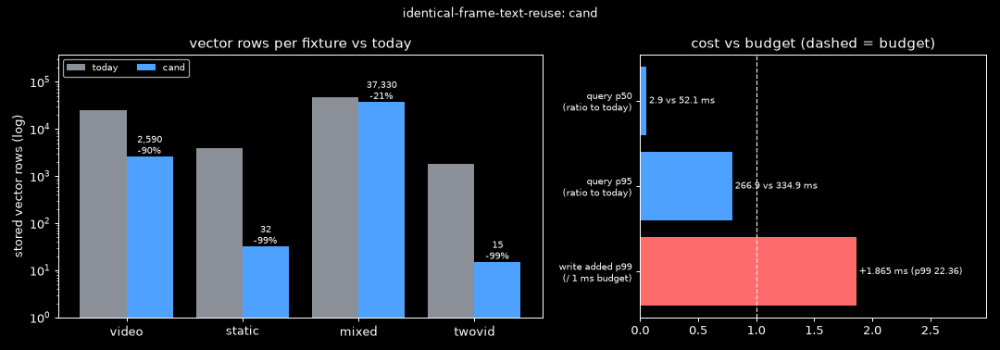
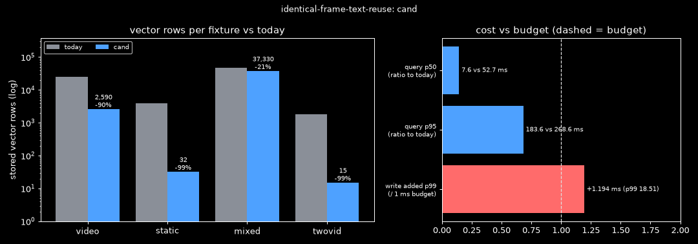
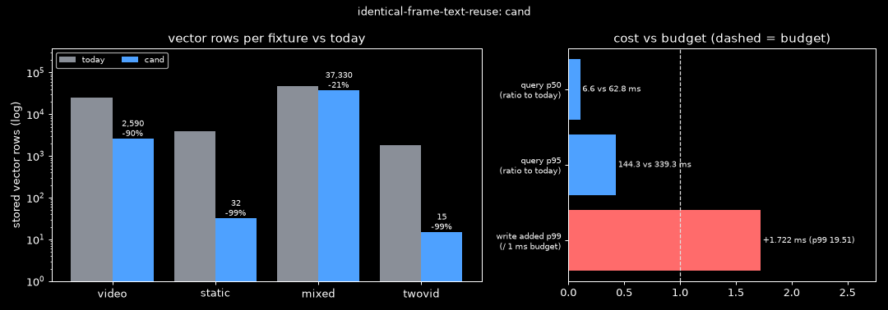

# Identical Frame Text Reuse
Date: 2026-11-10 · Context: Windows 11, CPython 3.14, numpy 2.5.4, sqlcipher3 (SQLCipher 4.20.0, SQLite 3.54.1), stdlib `hmac` · Goal: embed each distinct window text once, so GPU time and stored vectors grow with distinct text instead of capture rate; stop frames with identical text from filling the 5 frame result slots; keep every deletion and expiry path removing every derived vector · Ruled out: near-duplicate (fuzzy) text reuse, audio segment passages, changes to the OCR gate or screenshot dedupe, exact-scan speed · Constraints: `foreign_keys = ON` on every connection (`db.py:60`), `recursive_triggers` off (SQLite default), `db.migrate` runs SQL files only, no new dependency · Contract: must keep every frame with text T findable and linked to its own timestamp, propagate deletion, text expiry, embedding expiry and full delete in the same transaction as today, keep everything encrypted, use only a keyed content hash (HMAC with a DB subkey); may fake which of the identical frames is shown as the representative · Budget: embedding work proportional to distinct texts; ≤ 1 ms added per stored frame on the write path; query cost no worse than today; vector-storage reduction reported on a video fixture and a static-page fixture · Artifact: https://claude.ai/artifact/1227UVrd15NwR7duYYfVwH

## Answer
Best fit: **C3, a link table**. Capture's write path stays as it is today. The embed worker computes `key = HMAC-SHA256(subkey, text)` [1][2] and stores one passage set per `(key, model)`. Each frame gets one link row, and the last link of a key deletes its vectors through a trigger [5][6]. Search collapses results to `(key, window_title, url)` groups before the 5 slots, in the style of Elasticsearch collapse [9].
Measured: embeds equal the ideal on all four fixtures (video 2,590 instead of 25,200). Stored vectors drop 89.7 % on the video fixture and 99.2 % on the static page. Result slots are correct on 36/36 queries (today 17/36). Findability is 50/50 by keyword and 50/50 by meaning, with 0 orphan vectors after every deletion path and 18/18 rollbacks. Query p50 is 7.6 ms against 52.7 ms today, and p95 is 183.6 ms against 268.6 ms. The write path gains no statement. The single harness run measured +1.194 ms of added p99, but three reruns gave −1.218, +0.713 and −1.635 ms, and today measured against itself varies by up to +1.685 ms.
Prior art covers only parts of this: LangChain CacheBackedEmbeddings for skipping repeat embeds [3], LlamaIndex's docstore for skipping by hash [4], and Elasticsearch, Solr and Vespa for collapsing results [9][11][12]. No shipped system was found that combines a keyed content key, trigger-based cleanup and result collapse.
No candidate passes only by relaxing a limit.

## Candidates
| Candidate | Uses | Error | Cost vs budget | Status | Prior art |
| :- | :- | :- | :- | :- | :- |
| C1 Shared content-addressed passages, write-path tag | M1 Keyed text tag [1][2], M5 Trigger-maintained shared rows [5], M8 Post-fusion key collapse [9], M9 RRF duplicate over-weighting [10] | `video:sent=2590/ideal=2590 rows=2590 MB=1.33 red=89.7% static:sent=32/ideal=32 rows=32 MB=0.02 red=99.2% mixed:sent=37330/ideal=37330 rows=37330 MB=19.11 red=21.0% twovid:sent=15/ideal=15 rows=15 MB=0.01 red=99.2% orphans=0 rollback=18/18 survivors=5/5 expired_returned=0 stale_sem=0 rows_after_delete_all=0 findable_kw=50/50 findable_sem=50/50 groups_ok=36/36 mean_groups=3.11 top1_agree=33/36 win_viol=0 ts_mismatch=0 write_add_p50=0.034ms write_add_p99=1.865ms q_p50=2.9ms(today 52.1) q_p95=266.9ms(today 334.9) unkeyed_hash=0 raw_leak=0 upgrade=ok` | write added p99 +1.865 ms, repeats +0.976 / +1.976 / +8.730 ms / 1 ms; query p50 0.06× / p95 0.80× today / 1×; embeds 1.00× ideal | fails: write-path p99 is over 1 ms in most repeated runs. The random-key index `frames(text_key, ts_ms)` on capture's write path enlarges WAL checkpoints | LangChain CacheBackedEmbeddings [3] (skip half only) |
| C2 Lazy tags in a background job (compare-and-set) | M1 Keyed text tag [1][2], M5 Trigger-maintained shared rows [5], M8 Post-fusion key collapse [9] | `not built: refuted on its bound` | no write-path cost by design; the untagged backlog has no bound / embeds ∝ distinct texts | fails: the untagged backlog grows without limit while the worker is paused or a long job runs, and Ask still runs while paused. Capture adds up to ~30 frames per monitor per 30 s interval. C1 and C3 tag in the same transaction as publish, so they have no such window | LlamaIndex IngestionPipeline [4] (skip by hash) |
| C3 Link table, capture path untouched | M1 Keyed text tag [1][2], M5 Trigger-maintained shared rows [5][6], M8 Post-fusion key collapse [9], M9 RRF duplicate over-weighting [10] | `video:sent=2590/ideal=2590 rows=2590 MB=1.33 red=89.7% static:sent=32/ideal=32 rows=32 MB=0.02 red=99.2% mixed:sent=37330/ideal=37330 rows=37330 MB=19.11 red=21.0% twovid:sent=15/ideal=15 rows=15 MB=0.01 red=99.2% orphans=0 rollback=18/18 survivors=5/5 expired_returned=0 stale_sem=0 rows_after_delete_all=0 findable_kw=50/50 findable_sem=50/50 groups_ok=36/36 mean_groups=3.11 top1_agree=34/36 win_viol=0 ts_mismatch=0 write_add_p50=0.003ms write_add_p99=1.194ms q_p50=7.6ms(today 52.7) q_p95=183.6ms(today 268.6) unkeyed_hash=0 raw_leak=0 upgrade=ok` | write added p99 +1.194 ms, reruns −1.218 / +0.713 / −1.635 ms, with `insert_frame` unchanged from today [22] / 1 ms; query p50 0.14× / p95 0.68× today / 1×; embeds 1.00× ideal | works (best fit). The +1.194 ms single run is within the today-vs-today noise of up to +1.685 ms | LangChain CacheBackedEmbeddings [3] (skip half), Elasticsearch collapse [9] (query half) |
| C4 Generated-column key via an app-defined SQL function | M1 Keyed text tag [1], M5 Trigger-maintained shared rows [5] | `not built: refuter confirmed the blocking risk` | none measured | fails: on a connection without the function, an INSERT, an unrelated UPDATE and even a DELETE fail with "unknown function", which blocks capture, retention and full delete. With `trusted_schema` OFF, SQLite rejects the column as "unsafe use", and Python's `create_function` has no `SQLITE_INNOCUOUS` flag [7][8] | none found |
| C5 Shared passages + per-sighting collapse | M1 Keyed text tag [1][2], M5 Trigger-maintained shared rows [5], M8 Post-fusion key collapse [9] | `video:sent=2590/ideal=2590 rows=2590 MB=1.33 red=89.7% static:sent=32/ideal=32 rows=32 MB=0.02 red=99.2% mixed:sent=37330/ideal=37330 rows=37330 MB=19.11 red=21.0% twovid:sent=15/ideal=15 rows=15 MB=0.01 red=99.2% orphans=0 rollback=18/18 survivors=5/5 expired_returned=0 stale_sem=0 rows_after_delete_all=0 findable_kw=50/50 findable_sem=50/50 groups_ok=36/36 mean_groups=3.11 top1_agree=34/36 win_viol=0 ts_mismatch=0 write_add_p50=0.038ms write_add_p99=1.722ms q_p50=6.6ms(today 62.8) q_p95=144.3ms(today 339.3) unkeyed_hash=0 raw_leak=0 upgrade=ok` | write added p99 +1.722 ms, repeats +1.586 / +0.627 / +1.761 ms, and +0.544 ms with WAL autocheckpoint off / 1 ms; query p50 0.11× / p95 0.43× today / 1×; embeds 1.00× ideal | fails: write-path p99 is over 1 ms in 3 of 4 runs (borderline). Its per-sighting collapse is the alternative to use only if results should list each viewing separately | Elasticsearch collapse [9], Solr grouping [11] |





## Method
C3: one passage set per keyed text, reached from frames through a link table. Capture is not touched. The key, the embedding and the link are all created in the embed worker's publish transaction.

```
key(frame)            = HMAC-SHA256(K_frame_text, utf8(frame.text))        32 bytes
text_passages         : PK (key, model, start_char) → (end_char, dim, vec fp16)
frame_text_links      : PK (frame_id, model) → key,  frame_id REFERENCES frames ON DELETE CASCADE
vectors(key, model)   exist  ⇔  ∃ link (·, model, key)
group(frame)          = (key, window_title, url)
score(group)          = Σ over {FTS list, vector list} 1 / (60 + rank of the group in that list)
```

Steps:
1. Migration 0019 creates `frame_text_links(frame_id → frames ON DELETE CASCADE, model, key)` with an index on `(key, model)`, and `text_passages(key, model, start_char, end_char, dim, vec)`. It drops `frame_passages` and its update trigger. Assumes the subkey `K_frame_text` is derived with HKDF from the data key, like the existing `db` and `media` subkeys [1].
2. Trigger `AFTER DELETE ON frame_text_links WHEN NOT EXISTS (another link with old.key, old.model)` deletes that key's passages. Trigger `AFTER UPDATE OF text ON frames WHEN old.text IS NOT new.text` deletes the frame's links. Assumes `foreign_keys = ON`, so the cascade from `frames` fires the link trigger, which `db.py:60` sets on every connection [6][23]. It also assumes nested (non-recursive) triggers fire with `recursive_triggers` off [5][7].
3. Embed worker: select frames with text ≥ 12 characters and no link for the model. Compute one HMAC per frame (9.7 µs at 7.9 K characters), keep the first text per key, and drop keys whose passages already exist. Split the remaining texts into 400-character windows with a 300-character step and embed them in one batch. Assumes identical text yields an equivalent vector. That holds by cosine, not bit for bit, through llama.cpp batches [15].
4. Publish in one transaction. Re-read each frame's text, keep only frames whose text is unchanged, insert passages with `INSERT OR IGNORE`, and drop a key that lost its vectors since the check, so the next pass embeds it. Then insert links with `INSERT OR IGNORE`. Assumes links are never written with `INSERT OR REPLACE`: with `recursive_triggers` off, the delete done by REPLACE fires no delete trigger [5][7].
5. Deletion paths keep their shape. A frame delete cascades to its links, and the last link removes the vectors. Text expiry sets the text to NULL, which deletes the frame's links. `expire_embeddings` deletes the links of frames older than the cutoff in batches of 500, so per-frame vector reach stays the same as today [20]. `delete_all` deletes the frames, which cascade, and then sweeps `text_passages`, which already holds 0 rows when the data is consistent.
6. Query. FTS still ranks frames with `bm25(frames_fts, 1.0, 3.0, 2.0)` [21], depth 200. Each hit takes its key from its link, or from an HMAC computed in Python for unlinked rows: frames not embedded yet, frames past vector retention, and short text. Frames whose text has expired stay one group per frame. The vector side scores each key once, using the keys linked from frames in the window, depth 100. Both lists become `(key, window_title, url)` groups and are fused with RRF k = 60. Assumes title and url belong in the group, because `frames_fts` weights title 3.0 and url 2.0, and two videos with identical player text differ only in title.
7. Fill the 5 slots with one real frame per group. The representative is the group's best-bm25 frame, otherwise its latest in the window, returned with its own `(frame_id, ts_ms)`. `extra` carries `snippet`, `also_seen` (up to 50 `(id, ts)` pairs) and `also_seen_count`.
8. Upgrade from v18 in one transaction. Hash only frames that already have `frame_passages`, copy one passage set per `(key, model)`, insert the links, then drop `frame_passages`. On ~420 frames this took 0.095 s with 0 re-embeds, 0 orphans and 20/20 findable.

Result: the four fixtures send 2,590 + 32 + 37,330 + 15 embeds, each equal to the ideal (Σ windows over distinct texts). Result slots are correct on 36/36 queries (mean 3.11 distinct groups in the top 5, today 2.03). Window violations and timestamp mismatches are both 0, and neither an unkeyed hash nor raw plaintext appears on disk.

Cost:
- Embedding. On the video fixture, 74 distinct texts make 2,590 windows, against 720 frames making 25,200 windows today: a 9.73× drop in GPU work. The static page needs 32 windows against 3,840.
- Vector storage. Each vector row is 256 dims × 2 B = 512 B. Video: 2,590 rows = 1.33 MB against 12.90 MB (−89.7 %). Static: 32 rows = 0.016 MB against 1.97 MB (−99.2 %). Mixed browsing: −21.0 %. Two videos: −99.2 %. Whole DB file: video 29.6 → 15.4 MB, static 4.8 → 2.3 MB.
- Links. Each embedded frame gets one link row of 8 B id + model + 32 B key, plus a `(key, model)` index entry. These grow with frames, not with text.
- Write path. `insert_frame` and `set_text` are today's functions [22], so the write path adds 0 statements and 0 HMAC calls. The HMAC (≈ 10 µs per frame) runs in the deferred embed worker.
- Query. In the worst case Python computes up to 200 HMACs for unlinked FTS hits, ≈ 2 ms. Measured p50 is 7.6 ms against 52.7 ms and p95 183.6 ms against 268.6 ms, because the vector side reads one passage set per key instead of one per frame.

Fails when:
- Text that differs by one character, such as a clock or a counter in the window text, gets a new key. That is why mixed browsing saves only 21 %. Fuzzy reuse is a non-goal.
- A long identical run still fills the keyword candidate list, which counts frames: up to 200 FTS rows can belong to one group, so fewer distinct groups reach RRF from the keyword side.
- A connection opened with `foreign_keys = OFF` turns frame deletes into orphan links and vectors.
- A link written with `INSERT OR REPLACE` drops vectors without firing the trigger.
- Rotating the data key requires re-keying every link and every `text_passages` row.
- A group shown over a whole day lists at most 50 other sightings, with a count of the rest.

Reproduce: from `eval/identical-frame-text-reuse/`, run `..\.venv\Scripts\python.exe harness.py C3\cand.py C3`. The baseline is `ref_today.py`, written to `ref\`.

## Findings
### How do existing systems avoid re-embedding identical text?
- LangChain's `CacheBackedEmbeddings` looks keys up with `mget`, embeds only the misses and stores them with `mset`. It has no delete path, and its default key is an unkeyed SHA-1 of the text [3].
- LlamaIndex's `IngestionPipeline` docstore strategies skip a document when its hash is unchanged. Upsert deletes by `ref_doc_id`, and there is no reference count on rows that several documents share [4].
- FTS5 indexes each rowid separately and shares nothing between rows that hold identical text [13].
- OpenRecall drops screenshots by image similarity (MSSIM ≥ 0.9). This works on pixels, not text, and is out of scope here [14].

### How can a content key stay private?
- HMAC with a secret key gives a key that cannot be recomputed from a guessed text without the secret [2]. Akashic already derives independent 256-bit subkeys from the data key with HKDF [1].
- A plain, unkeyed hash of captured text would allow confirmation-of-file attacks, the known weakness of convergent (message-locked) encryption. The harness self-test that groups frames by plain SHA-256 finds 2,960 hash hits. Every candidate found 0.

### Which SQLite rules decide whether trigger-based cleanup is complete?
- Foreign-key actions such as `ON DELETE CASCADE` run only when `foreign_keys` is on. Akashic sets it on every connection [6][23].
- A trigger's own statements fire other triggers (nested) even with `recursive_triggers` off. With `recursive_triggers` off, the delete performed by `REPLACE` conflict resolution fires no delete trigger [5][7].
- `AFTER UPDATE OF <column>` with a column that does not exist is accepted silently and never fires [16].
- A generated column or index that calls an application-defined function fails on any connection that has not registered it, and `trusted_schema = OFF` rejects functions not marked innocuous [7][8].

### How do search engines stop duplicates from filling the top results?
- Elasticsearch `collapse` keeps the top hit per field value and returns the other hits through `inner_hits`, and it can collapse after an `rrf` retriever [9][10]. Solr result grouping and Vespa grouping do the same per group [11][12].
- RRF adds `1/(k + rank)` from each list. Identical frames hold consecutive ranks in both lists, so they collect near-equal scores and push other content out of the 5 slots [10]. Today 17/36 queries have correct slots, with a mean of 2.03 distinct groups in the top 5.

### Can identical text be detected from its vectors?
- No, not exactly. llama.cpp output for the same text varies with batch composition, so vectors are not bit-identical [15]. The harness therefore matches orphan vectors by cosine ≥ 0.999.

### Where does today's duplication happen?
- `embed.py:176-195` splits each frame's text into windows and publishes one passage set per frame [17] through `passages.publish` [18] into `frame_passages` [19]. `expire_embeddings` deletes per frame [20].
- `hybrid.py` ranks frames by `bm25(frames_fts, 1.0, 3.0, 2.0)` and RRF, then keeps 5 frames (`_ranked_frames(conn, scope, min(limit, 5))`) [21].

## Mechanisms
- M1 Keyed text tag: `HMAC-SHA256(subkey, exact stored text)`, UTF-8 with `surrogatepass`; about 19 µs per 20 KB · assumes the hashed string is exactly the stored string and the subkey stays secret · breaks when the hashed and stored strings differ, tags are logged, or the key rotates [1][2]
- M2 Secret-keyed convergent identity: identical content maps to the same key only for the key holder · assumes the key stays out of reach · breaks when an unkeyed hash is used, which allows confirmation-of-file attacks (background, Bellare et al. message-locked encryption, uncited)
- M3 Cache-backed embeddings: `mget`, embed misses, `mset` · assumes cache entries are never deleted · breaks when deletion must propagate (no delete path; default key is unkeyed SHA-1) [3]
- M4 Docstore hash strategies: skip by hash, upsert deletes by `ref_doc_id` · assumes one owner per stored row · breaks when rows are shared (no reference count) [4]
- M5 Trigger-maintained shared rows: delete a shared row when `NOT EXISTS` another referrer · assumes every writer sets the key and every delete path runs triggers · breaks on a misspelled `UPDATE OF` column (silent), `foreign_keys` off, `REPLACE` with `recursive_triggers` off, or writers that bypass the key [5][6][7][16]
- M6 Explicit reference counter: increment and decrement a count per shared row · assumes every path updates the count · breaks when the counter drifts from the real reference set
- M7 Copy-on-embed: per-frame rows, vectors copied from an existing key · assumes storage is cheap · breaks the storage goal, because storage stays ∝ frames
- M8 Post-fusion key collapse: group hits by a key after ranking and keep one per group · assumes the key captures "same content" · breaks when the key is too coarse (different videos with identical player text) or too fine [9][10][11][12]
- M9 RRF duplicate over-weighting: duplicates on consecutive ranks in both lists collect near-equal fused scores · assumes ranking happens per frame · breaks result diversity whenever identical items are ranked separately [10]
- M10 FTS5 per-rowid index: every row is indexed separately · assumes rows are independent · breaks sharing, since identical text is indexed once per frame [13]
- M11 Image-similarity dedupe: MSSIM ≥ 0.9 drops a screenshot · assumes pixel similarity means identical content · breaks on video playback, where pixels change and text does not; a non-goal here [14]

## Explored
- C1 Shared content-addressed passages, write-path tag: passes every quality check, but the added write p99 was +1.865 ms, and repeats gave +0.976, +1.976 and +8.730 ms against 1 ms. The random-key index on capture's write path enlarges WAL checkpoints. The mean is +0.06 to +0.15 ms per frame, and the HMAC alone is 9 µs at p50.
- C2 Lazy tags in a background job: not built. The untagged window has no bound while the worker is paused or a long job runs, and capture adds up to ~30 frames per monitor per 30 s interval.
- C4 Generated-column key via an app-defined SQL function: not built. Connections without the function cannot insert, update or delete frames, and `trusted_schema = OFF` rejects it [7][8].
- C5 Shared passages + per-sighting collapse: passes every quality check, with added write p99 of +1.722, +1.586, +0.627 and +1.761 ms (+0.544 ms with autocheckpoint off). Its sightings (runs split at gaps over 15 min, at most 2 runs per group) hide 70 of 72 runs when a page is opened 1 min every 20 min, with no count of the hidden runs. Capture throttled to one frame every 16 min splits one hour into 4 runs.
- M6 explicit reference counter: the count can drift from the real set of references. `NOT EXISTS` derives the count from the rows instead.
- M7 copy-on-embed: removes repeated GPU work, but stored vectors stay ∝ frames.
- Grouping by text key alone: merges two videos whose player text is identical but whose titles differ. Groups use `(key, window_title, url)` instead.

## Caveats
- The embedder is a fake: a seeded bag-of-words model, not the GPU model. Embed counts and storage are exact, while semantic findability and ranking agreement only approximate the real model.
- Timings were measured on the target PC under concurrent load. Today's query p50 varies from 52 to 70 ms and p95 from 268 to 363 ms between runs.
- Write p99 is dominated by WAL checkpoints (a tail of ~17–23 ms), with ±0.8–1.7 ms of run-to-run noise. Today measured against itself ranges from −0.642 to +1.685 ms. C3's verdict rests on its unchanged `insert_frame` and three reruns, not on one run below 1 ms.
- Dropping `frame_passages` leaves free pages in the file until `VACUUM`.
- The keyword candidate list still counts frames, so a long identical run can use most of the 200 FTS candidates (noted in C5).
- No key rotation exists today. Adding one would require re-keying links and passages.
- Embedding retention keeps per-frame semantics: C3 by construction, C1 and C5 through a cutoff floor. C5's upgrade cannot infer today's cutoff and takes it as a parameter.
- C3's `top1_agree` is 34/36: in 2 queries the top group differs from today's top frame, because group-level RRF compresses the ranks of identical frames.
- Refuter checks ran on stdlib SQLite 3.50.4; the app uses SQLite 3.54.1 through SQLCipher 4.20.0.
- M2's background (convergent encryption, message-locked encryption) is not cited to a source here.
- No shipped system combining a keyed content key, trigger-based cleanup and collapse was found. The git-style reachability analogy for C3 is uncited.

## Sources
[1] Akashic HKDF subkeys — src/akashic/storage/crypto.py:108-115 — tier 1 — pre-audit
[2] RFC 2104, HMAC: Keyed-Hashing for Message Authentication — https://www.rfc-editor.org/rfc/rfc2104 — tier 1 — 1997
[3] LangChain CacheBackedEmbeddings, cache.py — https://raw.githubusercontent.com/langchain-ai/langchain/master/libs/langchain/langchain_classic/embeddings/cache.py — tier 1 — master, read 2026-11-10
[4] LlamaIndex IngestionPipeline, pipeline.py — https://raw.githubusercontent.com/run-llama/llama_index/main/llama-index-core/llama_index/core/ingestion/pipeline.py — tier 1 — main, read 2026-11-10
[5] SQLite CREATE TRIGGER — https://www.sqlite.org/lang_createtrigger.html — tier 1 — current
[6] SQLite foreign key support — https://www.sqlite.org/foreignkeys.html — tier 1 — current
[7] SQLite PRAGMA statements (recursive_triggers, trusted_schema, foreign_keys) — https://www.sqlite.org/pragma.html — tier 1 — current
[8] SQLite generated columns — https://www.sqlite.org/gencol.html — tier 1 — current
[9] Elasticsearch collapse search results — https://www.elastic.co/guide/en/elasticsearch/reference/current/collapse-search-results.html — tier 1 — current
[10] Elasticsearch reciprocal rank fusion — https://www.elastic.co/guide/en/elasticsearch/reference/current/rrf.html — tier 1 — current
[11] Solr result grouping — https://solr.apache.org/guide/solr/latest/query-guide/result-grouping.html — tier 1 — latest
[12] Vespa grouping — https://docs.vespa.ai/en/grouping.html — tier 1 — current
[13] SQLite FTS5 — https://www.sqlite.org/fts5.html — tier 1 — current
[14] OpenRecall screenshot.py — https://raw.githubusercontent.com/openrecall/openrecall/main/openrecall/screenshot.py — tier 1 — main, read 2026-11-10
[15] llama.cpp PR 6950 — https://github.com/ggml-org/llama.cpp/pull/6950 — tier 1 — 2024
[16] SQLite docsrc check-in 998c5310ebb9d6e1 (UPDATE OF unknown column) — https://sqlite.org/docsrc/info/998c5310ebb9d6e1 — tier 1
[17] Akashic frame embedding loop — src/akashic/pipeline/embed.py:176-195 — tier 1 — pre-audit
[18] Akashic passage publish — src/akashic/storage/passages.py:40 — tier 1 — pre-audit
[19] Akashic frame_passages migration — src/akashic/storage/migrations/0018_frame_passages.sql — tier 1 — pre-audit
[20] Akashic retention (expire_frame_text, expire_embeddings) — src/akashic/storage/retention.py:120, 266 — tier 1 — pre-audit
[21] Akashic hybrid frame ranking — src/akashic/search/hybrid.py:515-560, 523, 628 — tier 1 — pre-audit
[22] Akashic frame writer (set_text) — src/akashic/storage/frames.py:129 — tier 1 — pre-audit
[23] Akashic connection pragmas (foreign_keys = ON) — src/akashic/storage/db.py:60 — tier 1 — pre-audit
