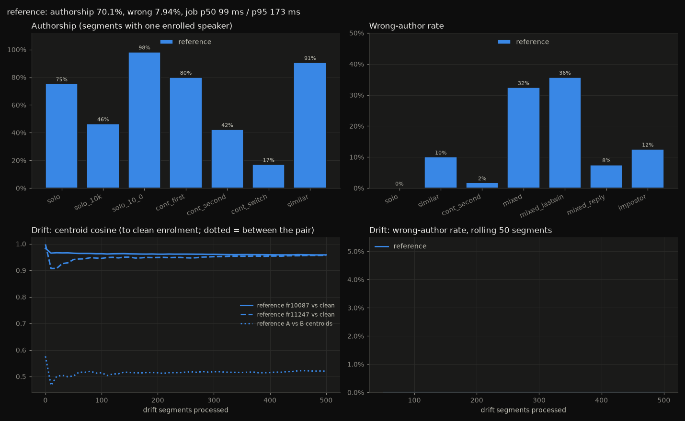
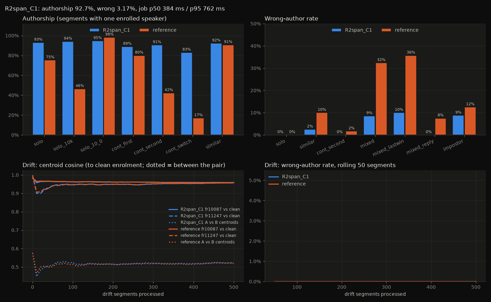
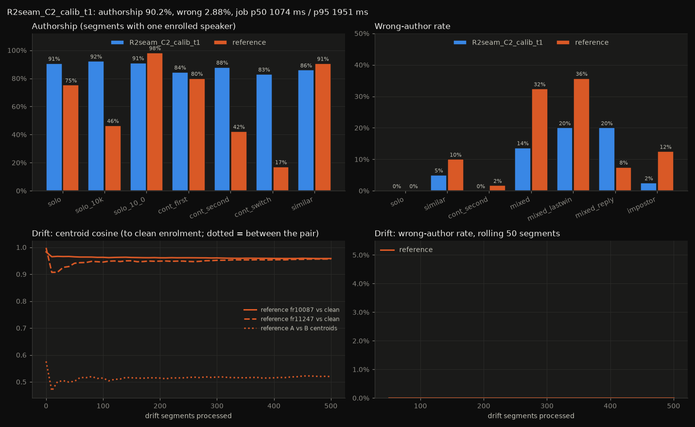
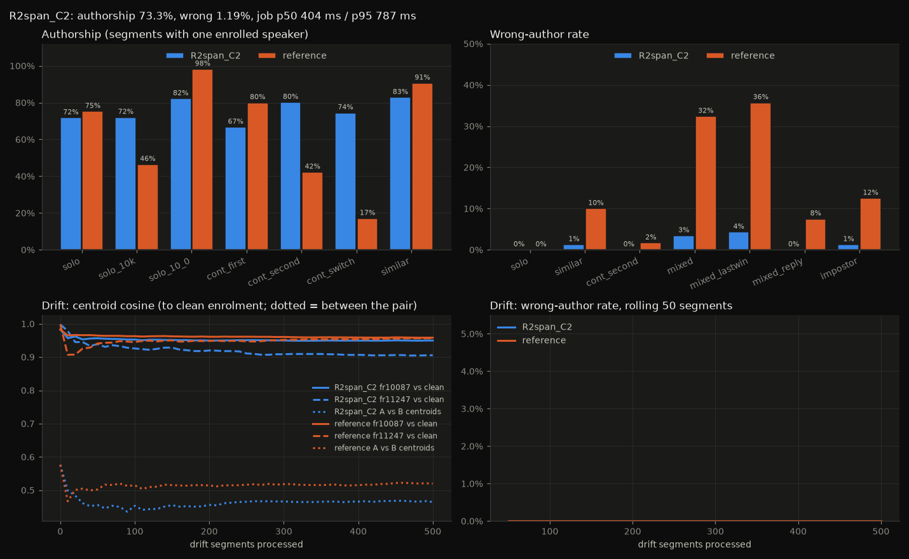
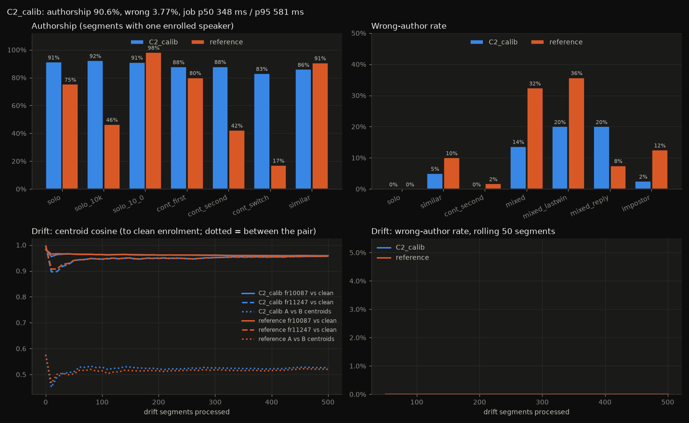
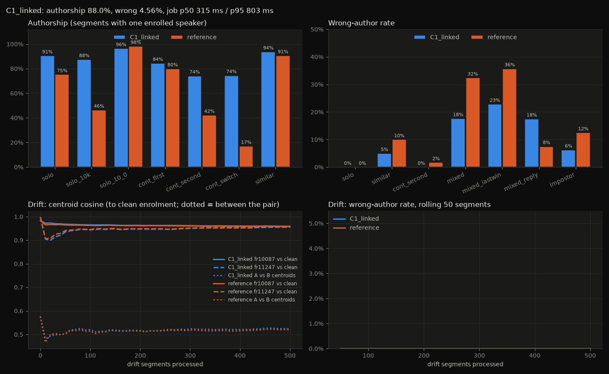
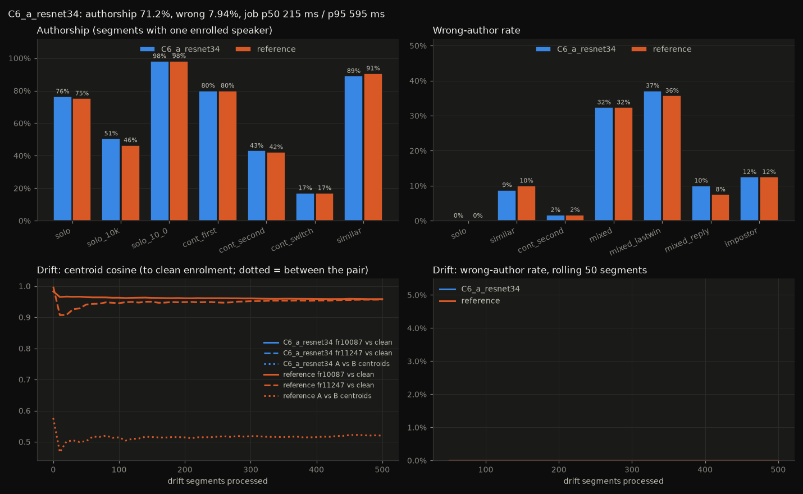
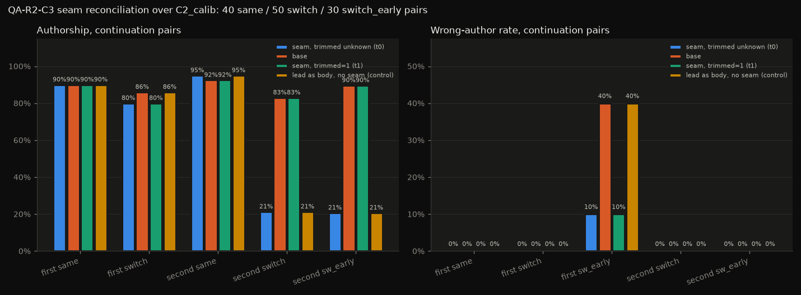

# Segment Speaker Attribution

Date: 2026-11-10

Context: Akashic (Python 3.14, onnxruntime as shipped, pyannote segmentation-3.0 ONNX, WeSpeaker ResNet34-LM ONNX, numpy; CPU only; test PC with an RTX 4090 left unused)

Goal:
1. Single-speaker segments keep their author, whatever their length or window alignment.
2. Mixed segments are never attributed to the wrong person: they stay unattributed or are attributed per span.
3. A voice profile does not drift from marginal matches.

Ruled out: word-level attribution, separating overlapping speech, naming and merging UI, junk profiles from media audio, the fbank window check.

Contract:
- Must: wrong-author rate no worse than today.
- Must: additive schema only.
- Must: offline at runtime.
- Must: no new runtime Python dependency.
- Must: CPU only.
- Must: any other voice of 300 ms or more makes the segment unattributed (no absorption).
- Allowed: a different local model.
- Allowed: a model file derived dev-only with `onnx` (same weights, pinned checksum).
- Allowed: an author deferred for segments cut at 30 s, until the continuation's job runs.
- May fake: speech under 300 ms; turn boundaries within ±0.5 s.

Budget, on a labelled FR/EN fixture of 1,008 segments plus a 500-segment drift stream, Opus-compressed:
- Solo-segment authorship ≥ 95%.
- Wrong-author rate ≤ 1%.
- Compute ≤ 2× today's speakers job per segment.

Artifact: https://claude.ai/artifact/SgDN7AHy3FwRm3gRXpabZQ

## Answer
**No candidate reaches 95% authorship with ≤ 1% wrong authors, so there is no best fit.** Today scores 0.701 authorship and 7.94% wrong authors on the same fixture. Today itself breaks the 1% limit, mostly on mixed segments.

The three closest candidates:

| Candidate | Authorship | Wrong authors | Total CPU | Over 2× |
| :- | :- | :- | :- | :- |
| C7 Span statistics | **0.927** | 3.17% | 1.35× (one BLAS thread) | 2 of 300 segments |
| C9 Seam reconciliation on C2 | 0.902 | **2.88%** | 1.17× per pair | 2 of 300 segments (C2) |
| C8 Gated spans | 0.733 | 1.19% | 1.40× | yes |

**C7, closed-form span statistics.** It adds one output to the shipped embedder (pinned checksum) and pools frames across overlapping windows. Cosine with today's embedding is ≥ 0.9999999. It also merges same-voice channels.

**C9, exact-copy seam reconciliation over C2.** It defers the author of 30 s cuts until the continuation's job runs. On early switches, wrong authors fall from 12 to 3. The cost is 3.3 points of authorship on first halves.

**C8, a fitted logistic gate over C7.** It gets closest to the wrong-author limit, but authorship falls below today's.

**The residual every candidate shares is upstream of identification.** Segmentation decodes a short second voice as the main speaker's solo speech (2,723 of 2,760 hidden-voice frames). Its posteriors show no trace of the hidden voice, so the proposal gate fails (AUC 0.71, recall 0.42 at ≤ 8 proposals). No CPU-side test on the shipped segmentation model can see that voice.

Prior art:
- Duration-aware calibration exists as quality measure functions [12].
- Overlap-aware pooling and cannot-link come from diart [2]; solo-frame pooling from pyannote [1].
- No prior art was found for window linking by IoU, closed-form span embeddings, or seam reconciliation.

## Candidates
| Candidate | Uses | Error (1,008 segments) | Cost vs budget | Status | Prior art |
| :- | :- | :- | :- | :- | :- |
| C7 Closed-form span statistics + leave-one-out test (R2-C1) | M1, M2, M4, M7, M9 | authorship 0.927, wrong 3.17% | 1.35× total; p95 1.75×; max 2.32× (2/300 > 2×) with BLAS at 1 thread | fails: wrong 3.17% > 1% | pyannote solo pooling [1]; QMF calibration [12] |
| C9 Exact-copy seam reconciliation + deferred author, on C2 (R2-C3) | M4, M9 | t1: authorship 0.902, wrong 2.88%; t0: 0.837, 3.08% | 1.17× per pair; 1.51–1.59× on the continuation | fails: wrong > 1%; first-half authorship −3.3 pts | none found |
| C8 Posterior-proposed spans + fitted gate (R2-C2; proposals dropped) | M7, M9 | authorship 0.733, wrong 1.19% | 1.40× total; max 2.38× | fails: authorship < today on solo | none found |
| C2 Calibrated duration-bucketed fusion + margin + veto | M5, M7, M9 | authorship 0.906, wrong 3.77% | 1.17× total; up to 3.6× on 10.3–10.5 s | fails | QMF calibration [12] |
| C1 Linked overlapped windows, pooled identity | M1, M2, M4, M9 | authorship 0.880, wrong 4.56% | 1.13× p50, 1.21× p95 | fails | diart cannot-link [2]; pyannote [1] |
| C6 Embedder swap (plain WeSpeaker ResNet34) | M10 | authorship 0.712, wrong 7.94% | ~1.0× | fails: no change | WeSpeaker [9] |
| C3 AS-norm against a duration-matched cohort | M7, M8, M9 | not built | ~1.003× + 4 MB cohort | not built: a scoring layer only, and stricter than today at 1–2 s | Nautsch 2015 [8] |
| C4 Anchored profiles + CUSUM drift alarm | M5, M6, M9 | not built | ~1.00× | not built: in a synthetic run the CUSUM never fired; the gate and margin did the work | Heck & Mirghafori [4] |
| C5 Call-level clustering revision | M1 | not built | | not built: rewriting a call's authors can raise wrong authors above today | pyannote / VBx [1] |
| X1 Minor-voice absorption | M4 | not built | | relaxes: no absorption of voices ≥ 300 ms | |
| X2 GPU dense verification | M7 | not built | | relaxes: CPU only | |
| X3 GPU segmentation swap (DiariZen / Sortformer) | M11 | not built | | relaxes: GPU, torch/NeMo export; DiariZen weights CC BY-NC | |

## Method
C7, the candidate with the highest authorship. It is not a fit.

1. **Expose the embedder's frame map.** Add an extra graph output on the pre-pooling tensor (256 × 10 × T′), derived dev-only with `onnx` and pinned by sha256. The head is rebuilt in numpy:
   - e(S) = W·[μ_S; σ_S] + b − mean_vec, with unbiased σ.
   - Over all frames this equals today's embedding (min cosine 0.99999992 on 200 turns), so stored profiles stay valid.
2. **Windows.** Use as many windows as today, with starts spread evenly so the last window ends at L. Each frame belongs to the nearest window centre. This removes C2's 3.6× worst case on 10.3–10.5 s segments.
3. **Merges.** Merge two channels in a window when both are ≥ 1 s and cos ≥ 0.60. Out of fold this merged 0 of 48 different-voice pairs and 52 of 154 same-voice pairs. Their overlap is still counted.
4. **Prefix sums.** Keep float64 prefix sums (n, Σh, Σh²) per channel, so any span or union costs one Gemm.
5. **Change test.** Δ_j = LLR(e_j, k₂) − LLR(e_j, k*) over sub-spans and edge spans. NULL if max Δ > τ_k, fitted out of fold to null ≤ 1.5% of solo segments. The span-vs-rest z test was fitted to τ = ∞ (unused).
6. **Decision.** Use C2's calibrated LLR sum, margin and update gate. Profiles update from full-turn vectors only.

**Cost:**
- 1.35× in total, 1.41× p50 and 1.75× p95, measured back to back with `OPENBLAS_NUM_THREADS=1`.
- 2 of 300 segments exceed 2× (max 2.32×).
- With default BLAS threading on a loaded CPU, a 53 × 5120 × 256 Gemm took 130–1,400 ms instead of about 1.7 ms. A thread limit is required.

**Fails when:**
- A backchannel under 1 s is decoded by segmentation as the main voice: 11 of 32 wrong authors.
- A switch comes early at a 30 s cut: 10 of 32 (C9 targets these).
- An impostor passes looser fitted thresholds: 7 of 32.

**Reproduce:** `eval/.venv/Scripts/python.exe eval/segment-speaker-attribution/harness.py candidates/R2span_C1.py`. The derived model is in `data/models_derived/`.

## Findings
### Why today fails
- Today's authorship is 0.701, and only 0.464 on segments 0.5–2 s past a 10 s boundary. The tail window's short turn is stored unidentified, and one unidentified turn clears the segment author.
- Continuation segments keep 0.422 authorship: the previous speaker's 2 s lead is diarized.
- Wrong authors are 7.94% overall and 32.4% on two-speaker segments. Short second voices are missed or merged, so they never trigger the mixed rule.
### What identification can and cannot fix
- Duration matters: EER at 0.3–1 s is 9.1%, at 1–2 s 2.5%, at 2–4 s 1.3% (calibrated ResNet34-LM on the fixture). Short-probe EER rises sharply in published systems too [5][6].
- Calibration by duration bucket reaches Cllr close to PAV in every bucket (C2).
- The dominant residual after any identification change is segmentation merging a short second voice into the main channel, with no overlap frames: 24 of 38 wrong authors in C2.
- Segmentation posteriors on the hidden voice's frames show solo speech of the main channel 2,723 of 2,760 times, so posterior-based proposals reach AUC 0.71 only.
### Profile drift
- Neither today nor any candidate drifted on the 500-segment stream of two similar speakers: 0 wrong authors in the first and last 100.
- C8 kept fewer profile updates; one speaker's centroid ends at 0.905 to its clean enrolment (today 0.957).

## Mechanisms
- **M1 Pyannote overlapped-window pipeline.** 10 s windows with 90% overlap, solo-frame embeddings, global clustering. Assumes local segmentation is right. Breaks when a speaker is active only briefly in a chunk. [1]
- **M2 Hamming overlap-add stitching.** Activity and count only, never raw local channels (they permute). [1]
- **M3 Diart incremental clustering.** Cannot-link within a chunk; only long speakers update centroids; short unmatched speakers are forced onto a free centroid, a wrong-author risk. [2]
- **M4 Solo-frame pooling across windows.** Pool a cross-window speaker's solo frames and embed once. (design, from code reading)
- **M5 Gated online centroid update.** Top-1 only, above a threshold; online matched offline. [3]
- **M6 Confidence-weighted adaptation.** [4]
- **M7 Duration-aware threshold / calibration.** Short-turn EER rises sharply; θ(d) per bucket. [5][6][12]
- **M8 AS-norm.** Cohort score normalisation; short probes need a duration-matched cohort. [7][8]
- **M9 Margin over the runner-up.** (design)
- **M10 Alternative ONNX embedders.** WeSpeaker ResNet34 / CAM++ / ResNet293; LM variants may be better only above 3 s. [9]
- **M11 Heavier diarizers.** pyannote community-1, DiariZen (CC BY-NC weights), NeMo Sortformer; need torch or NeMo.
- **M12 Simulated-conversation fixture.** Interleaved per-speaker segments with real pause and overlap statistics; under-produces overlap. [10][11]

## Explored
- **C1 Linked windows:**
  - Authorship 0.880, wrong 4.56%.
  - Zero-padded edge windows dropped authorship to 0.716.
  - Short second voices are merged by segmentation.
- **C2 Calibrated fusion:**
  - Authorship 0.906, wrong 3.77%.
  - Up to 3.6× cost on 10.3–10.5 s segments.
  - 24 of 38 wrong authors are segmentation merges.
- **C6 Embedder swap:**
  - Plain ResNet34 beats ResNet34-LM in every bucket up to 8 s.
  - A matched threshold erases the authorship gain.
  - It leaves 101 unembedded short turns and 62 lead failures untouched.
- **C7 change test:** the span-vs-rest test was fitted to τ = ∞ and the Δ test nulls 1 solo segment. Short voices bleed into the main voice through the receptive field, as predicted.
- **C8 proposals:**
  - Recall 0.42 at ≤ 8 proposals (gate b failed), so the proposal step was dropped.
  - The fitted gate's weights flip sign between folds.
- **C9 iteration 1:** N+1's first window merged the lead voice with the next speaker, which cost 11–16 points of first-half authorship. Iteration 2 uses a seam-centred spliced window.
- **C9 lead as body (t0):** without the additive `trimmed` column, counting the lead as body costs 41 points of second-half authorship on C2. The same loss appears with the rule off.
- **C3, C4, C5:** not built; reasons in the table above.

## Caveats
- **The fixture is synthetic conversation.**
  - Speech is read speech: LibriSpeech EN and MLS French.
  - Noise is synthetic pink/brown noise; there is no game audio, Krisp or real Discord channel.
  - Thresholds fitted on it may be too strict or too loose on real calls.
- **Fitting.** Thresholds and gates were fitted 2-fold over disjoint speakers on the same 1,008 segments they are scored on. There was no separate held-out set.
  - C7's merge threshold 0.60 is one value for both folds.
  - C8's gate weights are unstable between folds.
- **Wrong-author rates are small counts.** C7 has 32 wrong authors and C8 has 12, so ±0.3 points at 1%.
- **Timing.**
  - Ratios were measured back to back on a shared CPU.
  - C9's p50 in its metrics line comes from parallel runs; use its back-to-back ratios.
  - C7/C8 need a BLAS thread limit.
- **C7 + C9 combined was not measured.** C9 targets the 10 switch-early wrong authors left in C7.
- **Drift.** The drift stream has no segment ≥ 30 s, so C9 equals its base there.
- **Hardware.** AGENTS.md lists an RTX 4080 Super; the test PC has an RTX 4090. Either way the GPU was unused.

## Sources
[1] pyannote speaker_diarization.py / inference.py — https://raw.githubusercontent.com/pyannote/pyannote-audio/refs/heads/main/src/pyannote/audio/pipelines/speaker_diarization.py — tier 1 — main
[2] Coria et al., diart overlap-aware online diarization — https://arxiv.org/abs/2109.06483 — tier 1 — 2021
[3] Sholokhov et al., household speaker recognition benchmark — https://arxiv.org/pdf/2205.00288 — tier 1 — 2022
[4] Heck & Mirghafori, confidence-weighted adaptation — https://www.microsoft.com/en-us/research/?p=166284 — tier 2
[5] Short-duration speaker verification (WavLM-ECAPA by duration) — https://arxiv.org/pdf/2609.25007 — tier 1 — 2026 preprint
[6] ERes2NetV2 — https://arxiv.org/abs/2406.02167 — tier 1 — 2024
[7] AS-norm analysis — https://arxiv.org/html/2504.04512v1 — tier 1 — 2025
[8] Nautsch et al., condition-matched cohorts — https://www.isca-archive.org/interspeech_2015/nautsch15_interspeech.html — tier 1 — 2015
[9] WeSpeaker pretrained models — https://github.com/wenet-e2e/wespeaker/blob/master/docs/pretrained.md — tier 1 — master
[10] Landini et al., simulated conversations — https://ar5iv.labs.arxiv.org/html/2204.00890 — tier 1 — 2022
[11] Multilingual LibriSpeech — https://www.openslr.org/94/ — tier 1
[12] Mandasari et al., quality measure functions for duration calibration — https://www.sri.com/publication/speech-natural-language-pubs/quality-measure-functions-for-calibration-of-speaker-recognition-systems-in-various-duration-conditions/ — tier 1 — 2013
[13] src/akashic/pipeline/speakers.py — local
[14] src/akashic/storage/speakers.py — local
