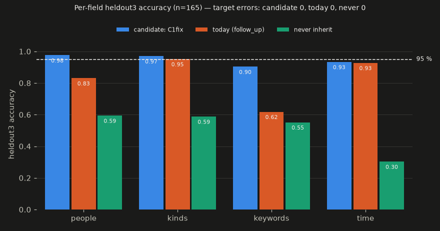
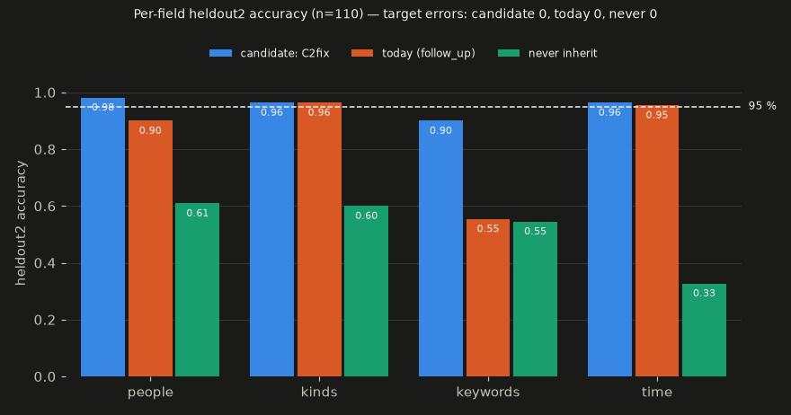
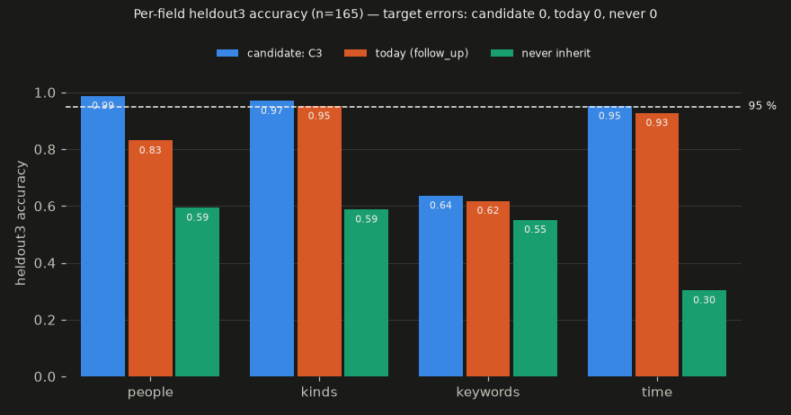
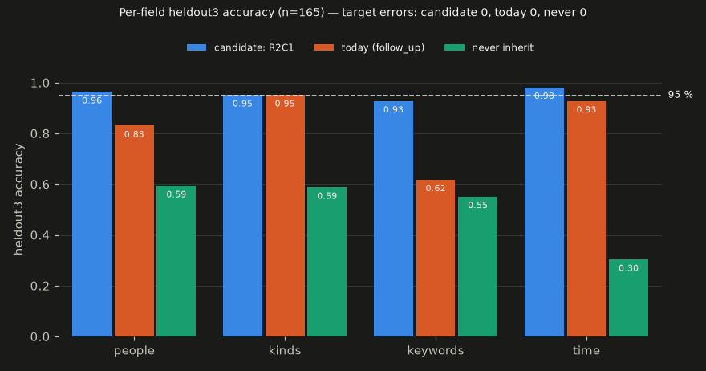
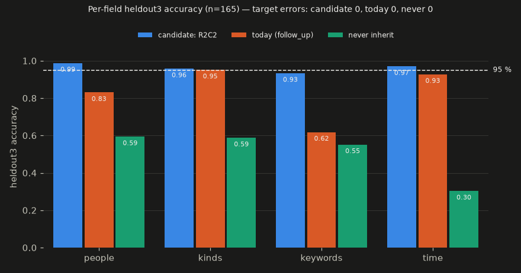
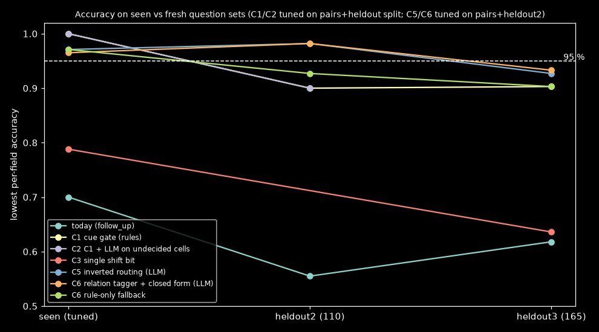

# Thread Follow-up Field Inheritance

Date: 2026-11-10 · Context: Akashic (Python 3.14, local gemma-4-12b-it-qat-q4_0 through llama-server b12209, RTX 4090 24 GB on the test PC) · Goal: (1) a self-contained question asked in a chat thread plans exactly as if asked alone; (2) elliptical follow-ups ("and on Tuesday?", "what else did he say?", "et après ?") inherit only the fields they leave out; (3) French, English and mixed · Ruled out: coreference beyond the immediately previous turn, answer generation, time-phrase resolution, retrieval ranking, the planner's kind and person cue rules · Contract: must work on the rule-only path, keep the existing follow-up tests, add no dependency, and use at most one extra small LLM call per thread question when the model is loaded; may fake genuinely ambiguous questions · Budget: ≥ 95% correct inherit/no-inherit per field (people, kinds, keywords, time) on ≥ 150 labelled pairs, with the model loaded (the rule-only fallback must stay ≥ the best rules version), 0 errors on the target pairs, rule side ≤ 5 ms per question · Artifact: https://claude.ai/artifact/3Wke6aUpA2JaaiGCFQSkyv

## Answer
No candidate meets the budget on unseen questions, so there is no best fit.

The closest is C6, which works but falls short:
- **Method:** the local model returns only a four-label relation code between the previous and the new question (new / more / else / link, own topic, kind change, points back). A closed-form map of the labelling conventions then turns the code into per-field carry or drop. Values are only ever copied from the two standalone plans.
- **Accuracy on the third fresh set:** lowest field 0.933 (people .988, kinds .958, keywords .933, time .970). Today's `follow_up` scores 0.618 on the same set.
- **Errors:** 0 target-pair errors. Rule-only fallback 0.903.
- **Cost:** one call on 86% of thread questions, p50 1.1 s on a shared GPU.

All candidates lose about 5 points between the question sets they were tuned on and fresh ones. No published method was found that reaches 95% on this decision. The closest shipped prior art is CHIQ's binary topic-switch step [9], and LIF follow-up classifiers reach 78–86% F1 [3].

## Candidates

All scores are the lowest per-field accuracy on the set named. The rule budget is p99 ≤ 5 ms; the call budget is ≤ 1 call per question.

| Candidate | Uses | Error | Cost vs budget | Status | Prior art |
| :- | :- | :- | :- | :- | :- |
| C1 Standalone plan + typed-cue gate + per-field carry table (rules) | M2, M7, M4, M6 [1][5] | heldout3 min 0.903 (people .976, kinds .970, kw .903, time .933); heldout2 0.900 | gate p99 306 µs / 5 ms; 0 calls | fails: 0.903 < 0.95 after one fix round; overfits its lexicons (seen set 1.000) | Alexa slot-carryover rule baseline [1] |
| C2 C1 + LLM keep/drop for undecided cells only | M10, M4 [1] | heldout2 min 0.900 (identical to C1) | 3/110 questions routed; ~390 ms warm | fails: the rules' errors sit in cells they consider decided, so the model never sees them | none found |
| C3 Single joint topic-shift bit | M6, M1 [2] | heldout3 min 0.636 (kw) | p99 46 µs | fails: partial shifts and "what else" carry stale keywords | Chen 2019 joint decision [2] |
| C4 Offline-fitted logistic link gate | M9, M7, M8 [8][5] | not built: Calor-Dial carries no licence; QReCC is English-only | ~0.1 ms | fails: no usable French training data | LIF follow-up identification [3] |
| C5 Inverted routing: rules decide only cue-free questions, one LLM call decides every open field | M10 inverted, M4, M1 | heldout3 min 0.927 (people .964, kinds .952, kw .927, time .982) | 78% routed; p50 931 ms, p95 1.33 s (shared GPU) / 1 call | fails: 0.927 < 0.95 | CHIQ topic switch [9] |
| C6 LLM relation tagger + closed-form op map | M10, M7, M4, M1, M3 [9] | heldout3 min 0.933 (people .988, kinds .958, kw .933, time .970); rule-only 0.903 | 86% routed; p50 1.12 s, p95 1.30 s (shared GPU) / 1 call; rule p99 136 µs | works, under budget: 0.933 < 0.95 | CHIQ topic switch [9] |
| C7 LLM-distilled hashed n-gram relation classifier (rules at runtime) | M9, M7, synthetic data | not built | ~0.2–0.45 ms, 0 calls | fails: classifiers trained on LLM-generated data trail real data by ~18 points [10][11] | ZeroGen / Generate-then-Refine [10] |
| C8 Embedding nearest-exemplar cue detector | M9 (SetFit-like) [12] | not built | ≤ 30 ms with one local embed | works if the rule-side cost limit rises from 5 ms to 30 ms and the stoplist edit to `heuristic_plan` is accepted | SetFit [12] |
| C9 Disagreement-routed LLM call with retrieved few-shots | M10, M9 [13] | not built | ≤ 1 call on ~15–30% | works if as C8; depends on an unmeasured kNN | FrugalGPT cascades [13] |

## Method
C6 is the closest working candidate. It does not meet the budget.

1. **Plan the new question alone.** Use `heuristic_plan`, or the plan call without earlier-question context, to get S. E is the earlier question's standalone plan.
   - Assumption: S and E carry no merged context. Today `_plan` passes the earlier questions and `plan_from_model` accepts model-added names and keywords, so production must change here [15][16].
2. **Skip the model when the question is complete.** If the question has its own time plus a kind or person and fires no regex cue, it plans as standalone with no call. Both target pairs fall here, so their decision is deterministic.
3. **Ask the model for a relation code.** Every other thread question gets one grammar-constrained `complete_json` call returning `["n|m|e|l", own_topic, kind_change, topic_ref]` (15 output tokens).
   - The prompt holds the previous and new questions only, definitions of the four labels, and 14 FR/EN/mixed examples.
   - Assumption: the model labels discourse relations more reliably than it chooses per-field values.
4. **Gate the labels with rules.** Gates added on seen data:
   - `topic_ref` needs a deictic cue;
   - `kind_change` needs a stated kind or a first-person subject;
   - `own_topic` needs a real keyword.
5. **Map the code to fields with the closed form.**
   - standalone → S.
   - more → E, except keywords = S when the question has its own topic.
   - else → keywords dropped.
   - A kind change drops people and keywords (people even with `topic_ref`).
   - Any stated field → S.
   - Otherwise → E.
   - With perfect labels this reproduces gold on both seen sets, except 3 rows whose labels conflict across sets (weekday-only earlier topics).
6. **Fall back to the regex cues.** With no model, an error or invalid JSON, the same closed form is fed by the C1 regex cues.

**Cost:** the rule gate is p99 ≤ 136 µs. One call costs ~1.16k prompt tokens (1.13k cached) plus 15 output tokens: p50 1.12 s and p95 1.30 s measured while a second model server shared the GPU. An uncontended call is estimated at ~0.4–0.5 s, unmeasured.

**Fails when:**
- an exclusion is phrased so the model labels it "more" ("Il a rien dit d'autre ?");
- a deictic determiner points at a new entity;
- a partial shift keeps the topic;
- on French phrasings (fr min .893).

**Reproduce:** `eval/.venv/Scripts/python.exe eval/thread-follow-up-field-inheritance/harness.py R2C2 --pairs heldout3.jsonl --reps 1`, with `R2C2_LLM=1` and a local server.

## Findings
### How is the carry decision made in the literature?
- **Per-slot carryover.** The Alexa work classifies each earlier slot as carry or not. A rule baseline reaches P 91.8 / R 67.1; a neural model reaches F1 84.2 in-house and 97.4 on DSTC2. Carrying everything scores F1 28.7 [1].
- **Joint decisions.** Deciding slots jointly beats independent per-slot decisions on long dialogues [2].
- **Follow-up identification.** On LIF the best model reaches F1 77.9–86.1, with precision around 70–80% [3].
- **Instructed-LLM rewriting.** It reaches CAsT-19 recall@500 0.645, against 0.737 for manual rewrites. It rewrites every turn, with no gate for self-contained questions [4].
- **Topic shift.** CHIQ uses an LLM new-topic/old-topic label and reports no accuracy for it [9].
### What do the data say about cues?
- QReCC rewrites split into replacement 52%, insertion 38% and copy 9%, so pronoun cues alone miss ellipsis [5]. Pronouns occur in 53.9% of QuAC questions [6].
- The French Calor-Dial corpus labels self/coreference/ellipsis on 1,663 questions [7], but its public repository states no licence.
- An ambiguity classifier with simple features (92.2%) beat few-shot GPT-3.5 (72.7%) on an English enterprise set [8].
### Does synthetic training data reach real-data accuracy?
- Intent classifiers trained on LLM-generated data reach 70–77% on CLINC150 unseen domains, against 95.4% with real data [10].
- The gap widens on subjective tasks [11].

## Mechanisms
- M1 Slot-carryover classifier: p(carry | slot, utterance, context), deciding slots jointly · assumes labelled data · breaks across domains (F1 72) [1][2]
- M2 Rule carryover baseline: carry when an anaphor or a missing slot of a matching type is present · assumes lexical cues · breaks on implicit ellipsis (R 67) [1]
- M3 Follow-up identification: a binary follow-up/shift classifier · assumes in-domain shift examples · breaks at 70–80% precision [3]
- M4 Per-slot operation set {carry, update, delete} · assumes a fixed schema · breaks on open vocabulary [1]
- M5 Conversational query rewriting · assumes the rewrite keeps meaning · breaks with changed meaning, hallucinated entities and no self-contained gate [4][6]
- M6 Topic-shift awareness · assumes shifts are detectable · breaks on partial shifts [14]
- M7 Rewrite-type labels (copy / insertion / replacement) · assumes minimal rewrites · breaks on paraphrased rewrites [5]
- M8 French self/coreference/ellipsis labels (Calor-Dial) · assumes a usable licence · unavailable: no licence stated [7]
- M9 Feature gate with optional embedding · assumes in-domain data · breaks out of domain [8]
- M10 Rule-confidence or disagreement gating of an LLM call · assumes rule confidence tracks rule error · breaks when rule errors are confident (measured in C2) [13]

## Explored
- C1 (cue gate, rules): seen set 1.000 after tuning; fresh sets 0.900 and 0.903. The lexicons do not generalise to new phrasings.
- C2 (LLM on undecided cells): routed 3 of 110 fresh questions and changed nothing.
- C3 (single shift bit): keywords 0.636 on fresh data. "What else" and partial shifts carry stale topics.
- C4 (logistic gate on public corpora): not built. Calor-Dial has no licence and QReCC is English-only.
- C5 (inverted routing): fresh 0.927, below 0.95. It is weakest on conjunction-led questions (.667) and time links (.824).
- C7 (offline-distilled classifier): not built. Synthetic-data classifiers trail real data by ~18 points [10], and the labels are convention-heavy [11].
- C8 and C9 (embedding kNN, disagreement routing): not built. They need the rule-side cost raised to ~30 ms, an embedder that shares the server that fails in the fallback case, and a stoplist change that alters `heuristic_plan` for every question. The unbuilt kNN caps keywords near 0.945 by arithmetic on the C1 error rows.

## Caveats
- **Labels.** All evaluation sets were written by agents under 11 labelling conventions, not by the user. heldout2 and heldout3 were written independently of the candidates, but by the same kind of author. The two sets label weekday-only earlier topics inconsistently (3 rows conflict).
- **Seen sets.** pairs.jsonl and heldout2 were used for tuning C5 and C6. Only heldout3 is unseen for them.
- **Test conditions.** All S and E values come from `heuristic_plan` run on each question alone. In production the plan call currently sees earlier questions, which the method requires changing.
- **Latency.** Measured on an RTX 4090 (this PC; AGENTS.md lists an RTX 4080 Super), while a second llama-server process held part of the GPU (≈23 GB in use). Uncontended latency is not measured.
- **Determinism.** Model outputs at temperature 0 changed one row between identical runs (server batching).

## Sources
[1] Naik et al., Contextual slot carryover for disparate schemas — https://arxiv.org/abs/1806.01773 — tier 1 — Interspeech 2018
[2] Chen et al., Improving long distance slot carryover in spoken dialogue systems — https://aclanthology.org/W19-4111/ — tier 1 — 2019
[3] Kongyoung, Macdonald, Ounis, Multi-task learning of query generation and classification for generative conversational question rewriting — https://eprints.gla.ac.uk/307893/2/307893.pdf — tier 1 — 2023
[4] Rewriting conversational utterances with instructed LLMs — https://arxiv.org/html/2410.07797v1 — tier 1 — 2024 preprint
[5] Anantha et al., QReCC — https://arxiv.org/abs/2010.04898 — tier 1 — 2021; licence https://github.com/apple/ml-qrecc
[6] Elgohary et al., CANARD — https://aclanthology.org/D19-1605/ — tier 1 — EMNLP 2019
[7] Béchet et al., Calor-Dial — https://ceur-ws.org/Vol-3178/CIRCLE_2022_paper_28.pdf — tier 1 — 2022; repository https://gitlab.lis-lab.fr/calor/calor-dial-public
[8] Detecting ambiguities to guide query rewrite in enterprise AI assistants — https://arxiv.org/html/2502.00537v1 — tier 1 — 2025 preprint
[9] CHIQ: contextual history enhancement for improving query rewriting — https://arxiv.org/html/2406.05013v2 — tier 1 — EMNLP 2024
[10] Generate then Refine: data augmentation for zero-shot intent detection — https://arxiv.org/html/2410.01953v1 — tier 1 — 2024 preprint
[11] Li et al., Synthetic data generation with LLMs for text classification — https://aclanthology.org/2023.emnlp-main.647.pdf — tier 1 — EMNLP 2023
[12] SetFit: efficient few-shot learning without prompts — https://arxiv.org/abs/2209.11055 — tier 1 — 2022
[13] FrugalGPT — https://arxiv.org/abs/2305.05176 — tier 1 — 2023
[14] Mele et al., Topic propagation in conversational search — https://arxiv.org/abs/2004.14054 — tier 1 — 2020
[15] src/akashic/search/planner.py:215-310 — local
[16] src/akashic/pipeline/ask.py:260-340 — local
