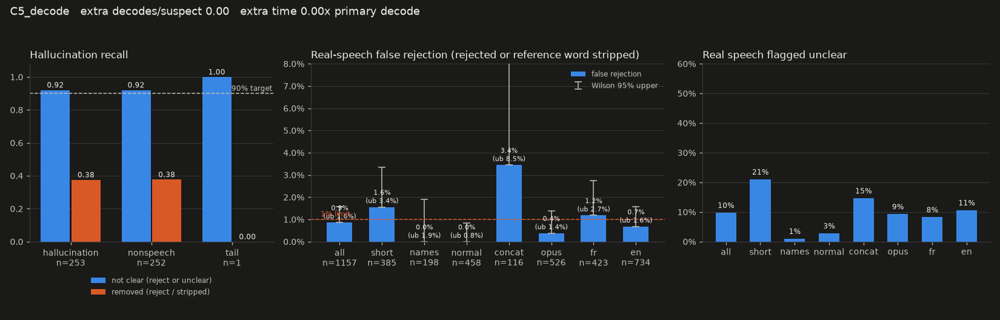
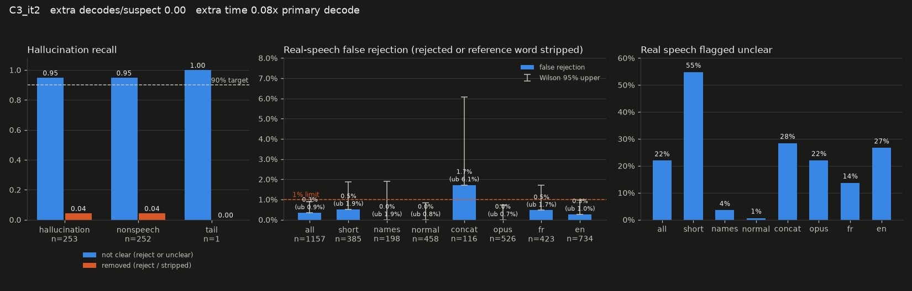
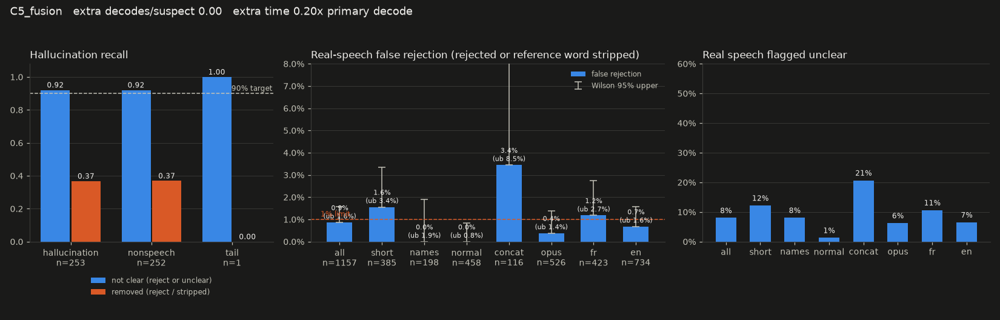
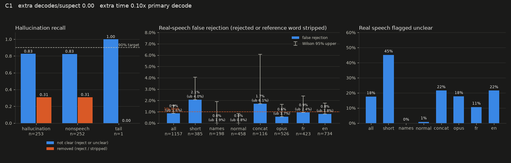
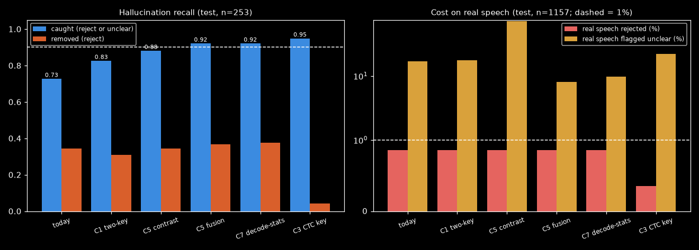

# Transcript Hallucination Rejection

Date: 2026-11-10

Context: Akashic (Python 3.14, faster-whisper 1.2.1 / CTranslate2 4.8.5, Whisper large-v3 as shipped, Silero v6 ONNX, RTX 4090 on the test PC)

Goal:
1. Text that is not speech (prompt echoes, no-speech output, subtitle credits) is not stored as a confident transcript.
2. Real FR/EN speech is kept, including short replies and vocabulary names.
3. Uncertain cases are flagged "unclear" rather than dropped.

Ruled out: VAD and segmentation changes, music-drop rules, language identification, `trim_overlap`, the STT comparison panel.

Contract:
- Must: real-speech false rejection ≤ 1% of utterances.
- Must: works with Whisper large-v3 (Qwen3-ASR/Canary where the backend allows).
- Must: no new Python dependency (a new local model is allowed).
- Must: captured text is never logged.
- May fake: hallucinated words inside real speech, mid-sentence.

Budget:
- Hallucination recall (rejected or unclear) ≥ 90%.
- Real-speech false rejection ≤ 1%.
- Up to one extra decode per suspected segment.

Artifact: https://claude.ai/artifact/CyLnkd8ksxRJtzwDfs9PNE

## Answer
**Best fit: C7, a decode-statistics logistic gate.** A five-feature logistic over numbers Whisper already returns for every segment decides keep / unclear / reject. The features are `no_speech_prob`, `avg_logprob`, compression ratio, log word count and duration.

On the test split it scores:
- Recall 0.921 (today 0.727). Reject-only recall 0.375.
- Real-speech false rejection 0.86% (Wilson ub95 1.58%). This is the same 10 segments today rejects: Whisper returned them empty or matched the whole-string credit list.
- 0 new false rejections among the 1,147 segments today keeps.
- Real speech flagged unclear: 9.8% (today 16.8%).
- 0 extra decodes and 0 extra time.

`no_speech_prob` alone has a mining AUC of 0.92. The app computes it on every decode today but neither stores nor checks it.

**C3, a CTC alignment key, catches more but removes almost nothing.** It uses two Apache-2.0 wav2vec2 heads, about 2.5 GB.
- Recall 0.949, false rejection 0.35%.
- Reject-only recall drops to 0.04, and unclear rises to 22%.
- Its test split was seen once before the final iteration.

Prior art for the gate's inputs:
- faster-whisper's built-in no-speech rule [1]; Akashic's −2.0 log-prob threshold disables it.
- A learned fusion of the same three statistics scored 23.6% F1 on a different task, HALAS [7].
- No prior art was found for a gate fitted on non-speech plus FR/EN speech.

## Candidates
| Candidate | Uses | Error (test: 253 hallucinations, 1,157 real) | Cost vs budget | Status | Prior art |
| :- | :- | :- | :- | :- | :- |
| C7 Decode-statistics logistic gate | M1, M2, M7 [1] | recall 0.921, reject 0.375, FRR 0.86% (ub 1.58%), unclear 9.8% | 0 extra decodes, 0× time / ≤ 1 decode | best fit | faster-whisper no-speech rule [1]; HALAS fusion [7] |
| C3 CTC monotonic-alignment key (wav2vec2 FR + EN heads) | M8, M12, M13 [6] | recall 0.949, reject 0.043, FRR 0.35% (ub 0.89%), unclear 22.0% | 0 decodes; 0.08× time; +1.2 GB VRAM; 2.5 GB of models | works; most removals become "unclear" | none as a gate; WhisperX aligns only [8] |
| C5 Audio × prompt likelihood contrast + fusion | M7, M11, M13 + contrast cells | pure contrast: recall 0.881, unclear 71%; fusion: recall 0.921, unclear 8.0% | 0 decodes; 0.20× time (align passes) | fusion works, but the contrast cells get ~0 weight; pure contrast fails | VCD family [9] |
| C1 Two-key gate (credit list, echo, rate, VAD, no-speech) | M1, M2, M4, M11, M12, M13 [2][3] | recall 0.826, FRR 0.86% (short 2.1%), unclear 17.5% | 0 decodes; 0.10× time (Silero re-run) | fails: recall < 0.90 | Bag of Hallucinations [2] |
| C2 Prompt-removal re-decode | M10, M11 | not built | 1 decode per suspect | fails: removing the prompt leaves the training prior (ghosts survive), and its reject rule cannot fire on echo-only suspects | prompt-echo reports only |
| C4 Backend-split calibrated confidence for Qwen3-ASR / Canary | M7 [5] | not built | 0 decodes | not built: the fixture is Whisper-only | Local Confidence Drop and others |
| C6 Time-reversed control stimulus | M7, M11 | not built | ~1.3 encoder passes | not built: the contrast family proved redundant in C5 | none found |

## Method
C7, the best fit.

1. **Read five statistics per segment** from the primary decode, with no extra model work:
   - `no_speech_prob`, the first window's no-speech probability;
   - `avg_logprob`;
   - gzip compression ratio;
   - log word count;
   - duration.

   Assumption: these statistics separate real FR/EN speech from Whisper output on non-speech. Mining AUC is 0.92 for `no_speech_prob` alone.
2. **Fit a logistic regression on the mining split.** It uses standardised features, IRLS, and 2-fold cross-fitting by source group. Fitted weights:

   | Term | Weight |
   | :- | :- |
   | Intercept | −2.82 |
   | `no_speech_prob` | +1.00 |
   | `avg_logprob` | −1.48 |
   | Compression ratio | +2.40 |
   | Log word count | −1.25 |
   | Duration | +0.16 |
3. **Decide from the probability P.**
   - P ≥ 0.996 → reject.
   - P ≥ 0.105 → unclear.
   - Otherwise keep.

   The reject threshold sits just above the highest real-speech out-of-fold P (0.9987), so it is fragile.
4. **Keep the rest of the app's decision as today:** empty text is rejected, and today's whole-string list still applies. Leave `LOG_PROB_THRESHOLD` at −2.0 so faster-whisper never drops text silently; the gate judges after the decode.

**Cost:** five numbers per segment plus a dot product. No extra decode or encode.

**Fails when:**
- A real voice is recorded in "noise" (station announcements, ATC radio, phone menus). It is kept as speech, which is arguably correct.
- Fluent short ghosts carry confident statistics ("Welcome back.", "On the ferry.").
- Laughter is decoded as "Ha, ha".
- The calibration decile gap is 0.13, above the 0.1 target.

**Reproduce:** `eval/.venv/Scripts/python.exe -I eval/transcript-hallucination-rejection/harness.py C5_decode.py --name C5_decode`.

## Findings
### How often does Whisper hallucinate, and on what?
- On non-speech audio, large-v3 produced text in 40.3% of 301k inferences. 1,270 repeated outputs cover 67% of them; credits and "thanks for watching" dominate [2].
- Silero VAD alone cut WER on mixed audio from 104.8 to 8.0 [2].
- Calm-Whisper fine-tunes three decoder heads to cut non-speech hallucination from 99.97% to 15.5% [3].
### Do faster-whisper's built-in gates catch it?
- No-speech skips need `no_speech_prob > 0.6` and `avg_logprob ≤ log_prob_threshold`. With Akashic's −2.0 the skip almost never fires [1].
- Tuning the no-speech threshold alone barely moves the hallucination rate (46–47% at 0.5–0.6) [4].
- `hallucination_silence_threshold` needs word timestamps and flags one-word replies by construction [1].
### What did this run measure?
- On the user's own short replies, today's code already marks 45% unclear.
- The 10 "false rejections" every candidate shares are clips where Whisper heard no reference word at all, e.g. "super" decoded as a Radio-Canada credit. Rejecting them removes no real word.

## Mechanisms
- **M1 Whisper no-speech gate** (`no_speech_prob` with an `avg_logprob` exception). Assumes the first-token no-speech probability separates silence from speech. Breaks on confident noise ghosts. [1][4]
- **M2 Compression-ratio guard.** Assumes hallucinations repeat. Breaks on short fluent ghosts. [1]
- **M3 hallucination_silence_threshold.** Assumes ghosts have odd word timings. Breaks on one-word replies. [1]
- **M4 Bag of Hallucinations.** Mined phrase list with substring removal. English-only; breaks on legitimately spoken phrases. [2]
- **M5 Calm-Whisper head fine-tune.** A model change; English only. [3]
- **M7 Token-posterior / entropy confidence.** Assumes posteriors track correctness. Confidently wrong on stock phrases. [5]
- **M8 CTC forced-alignment score.** Assumes the CTC alphabet covers the text. Breaks on short or noisy audio, where the xlsr heads emit letters on noise. [6]
- **M10 Cross-model agreement.** Assumes uncorrelated errors. (design)
- **M11 Prompt-copy check.** Assumes echoes depend on the prompt. (design)
- **M12 VAD speech ratio.** Silero false alarms on noise. [2]
- **M13 Two-signal rule.** Reject only on two independent signals. (design)

## Explored
- **C1 two-key gate:** recall 0.826. Fluent prompt-free ghosts fire no key. Reject-only recall fell to 0.31 because spoken outros are routed to unclear.
- **C5 pure contrast:** short noise ghosts are better supported by noise than by silence (S_P AUC 0.69). Reaching 90% recall marks 71% of real speech unclear.
- **C5 fusion:** meets recall, but the decode-only control (C7) matches it with no align passes. The contrast cells add nothing.
- **C3 CTC key:** a high G cannot tell noise from real speech with a hallucinated transcript. Rejecting safely needs a speech-presence guard, so it ends up flagging rather than removing.
- **C2 re-decode without prompt:** the training prior survives (99.97% non-speech hallucination with no prompt [3]).
- **C4 backend scoring:** the fixture has no Qwen3-ASR/Canary run.
- **C6 time-reversed control:** the contrast family proved redundant in C5.

## Caveats
- **Label noise in non-speech sources.** About 33 of C1's 44 misses (and most of C3/C5/C7's) are real recorded voices inside weakly labelled FSD50K clips: announcements, ATC radio, voicemail. These were judged from the transcripts, not by listening. True recall is likely higher than measured for every candidate.
- **The FRR rule, applied per subset, fails today too.** "≤ 1% on every subset" fails for short replies, concatenations and French for today and for every candidate, because of the same 10 pre-existing rejections. Only "≤ 1% of utterances" overall is met.
- **Fixture coverage.**
  - The speech is read speech (FLEURS, MSWC words).
  - The only channel effect is Opus at 32 kbps; there is no game audio over a voice.
  - Trailing credits after real speech almost never occur (n=1), so edge stripping is untested.
  - Every segment decoded as a single Whisper window.
- **Possible split leakage.** FSD50K-dev is split per clip, so recordings from the same uploader may sit in both splits.
- **Iterations on C3.** C3's second iteration was triggered by its first test result.
- **Timing.** Timings are ratios measured while other jobs shared the GPU (an RTX 4090; AGENTS.md lists an RTX 4080 Super).
- **Silero for C1.** C1 recomputed Silero on the stored Opus segment, because the app does not store per-window VAD probabilities.

## Sources
[1] faster-whisper transcribe.py — https://raw.githubusercontent.com/SYSTRAN/faster-whisper/master/faster_whisper/transcribe.py — tier 1 — 1.2.1
[2] Barański et al., Investigation of Whisper ASR hallucinations induced by non-speech audio — https://arxiv.org/html/2501.11378 — tier 1 — 2025
[3] Calm-Whisper — https://arxiv.org/html/2505.12969 — tier 1 — 2025 preprint
[4] Reducing hallucinated transcripts in Whisper via hallucination space projection — https://arxiv.org/html/2609.04561 — tier 1 — 2026 preprint
[5] Laptev & Ginsburg, entropy-based ASR confidence — https://arxiv.org/abs/2212.08703 — tier 1 — 2022
[6] torchaudio CTC forced-alignment tutorial — https://docs.pytorch.org/audio/stable/tutorials/ctc_forced_alignment_api_tutorial.html — tier 1 — stable
[7] From text metrics to model internals: Whisper ASR hallucination detection — https://arxiv.org/html/2606.23060 — tier 1 — 2026 preprint
[8] WhisperX alignment context — https://aphasia.talkbank.org/publications/2024/Wagner24.pdf — tier 2
[9] AVCD, audio-visual contrastive decoding — https://arxiv.org/html/2505.20862v2 — tier 1 — 2025
[10] src/akashic/pipeline/whisper.py — local
[11] src/akashic/pipeline/transcribe.py — local
