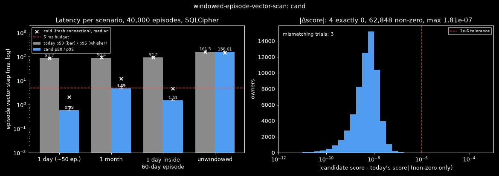
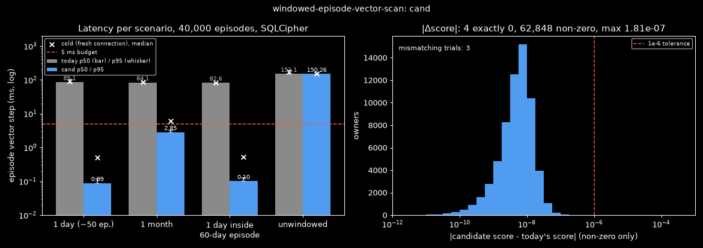
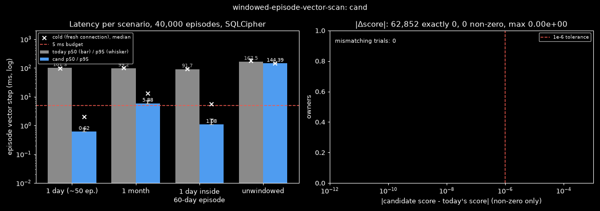
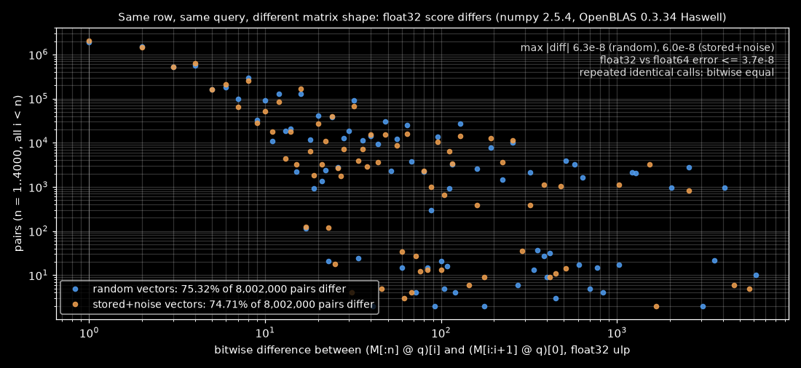

# How can the episode vector step of a windowed question cost only the episodes that overlap the window?
Date: 2026-11-10 · Context: Windows 11, CPython 3.14, numpy 2.5.4 (OpenBLAS 0.3.34, Haswell kernels), sqlcipher3 (SQLCipher 4.20.0, SQLite 3.54.1) · Goal: (1) the same scored episodes as today for a windowed question; (2) cost proportional to the episodes overlapping the window · Ruled out: unwindowed speed beyond "no slower than today", approximate nearest-neighbour indexes, passage scans and their join order, legacy segment vectors · Constraints: SQLCipher-encrypted database with encryption unchanged, only additive schema changes, no new dependency · Contract: must: identical owner set; scores within 1e-6 of today's; order identical except exact score ties, broken by (score desc, start_ms, rowid); overlap semantics (`e.start_ms < end AND e.end_ms > start`) / may fake: score differences up to 1e-6, and with them the order of owners whose scores differ by less than that (today's own float32 scores depend on 4,000-row chunk boundaries) · Budget: ≤ 5 ms for the episode vector step on a 1-day window (~50 episodes) with 40,000 episodes in history; unwindowed no slower than today · Artifact: https://claude.ai/artifact/AnBz8un8Lbu5MFySWCGxEd

## Answer
Best fit: **C2 Split overlap predicate**. It reads the window's own vectors by an `embeddings_time` range `[S, E)` and fetches every candidate that the range did not return (episodes that began before `S`) by primary-key probe. A 1-day window takes 0.089 ms warm p50 and 0.50 ms cold against 5 ms. Today takes 104.5 ms (78–111 ms across runs). Over 1,200 trials it has 0 hard mismatches and 0 tie-order mismatches. The largest score difference is 1.8e-7 against the 1e-6 tolerance. The 3 remaining near-tie order differences are between scores less than 4.8e-8 apart, which the contract allows. Unwindowed takes 150.3 ms against today's 151.1 ms in the same run. Prior art: the pre-filter allow-list followed by an exact flat search matches the Weaviate flat-search cutoff [1], the Qdrant full-scan threshold [2], LanceDB prefiltering [3] and pgvector exact search [4]. No named source was found for splitting the overlap predicate.
If the order must also equal today's float32 order at near ties, C3 does that with 0 mismatches and bitwise-equal scores. Its 1-day window costs 0.62 ms warm and 2.03 ms cold, but its chunk-boundary count step grows with history.

## Candidates
| Candidate | Uses | Error | Cost vs budget | Status | Prior art |
| :- | :- | :- | :- | :- | :- |
| C1 Candidate-bounded range | M2 Start-bound range [9] | `mismatches=3 max_abs_dscore=1.809e-07 day_p50_ms=0.5856 day_p95_ms=0.8736 month_p50_ms=4.688 straddle_p50_ms=1.505 unwindowed_p50_ms=158.6 today_unwindowed_p50_ms=161.5` | day 0.59 ms warm / 2.1 ms cold vs ≤ 5 ms; month 4.7 / 12.0 ms; straddle 1.5 / 4.8 ms; unwindowed 158.6 vs today 161.5 ms | works if no candidate began more than ~30 days before the window (cold) | none found |
| C2 Split overlap predicate | M1 Id-list primary-key probe, M2 Start-bound range [9], M3 json_each IN-subquery | `mismatches=3 max_abs_dscore=1.809e-07 day_p50_ms=0.089 day_p95_ms=0.1227 month_p50_ms=2.855 straddle_p50_ms=0.1018 unwindowed_p50_ms=150.3 today_unwindowed_p50_ms=151.1` | day 0.089 ms warm / 0.50 ms cold vs ≤ 5 ms; month 2.9 / 6.1 ms; straddle 0.10 / 0.52 ms; unwindowed 150.3 vs today 151.1 ms | works (best fit) | Weaviate flat-search cutoff [1] |
| C3 Gated allow-list probe, bit-exact replay | M1 Id-list primary-key probe, M6 Fitted crossover gate [2] | `mismatches=0 max_abs_dscore=0 day_p50_ms=0.6152 day_p95_ms=0.8199 month_p50_ms=5.876 straddle_p50_ms=1.082 unwindowed_p50_ms=144.4 today_unwindowed_p50_ms=167.5` | day 0.62 ms warm / 2.03 ms cold vs ≤ 5 ms; month 5.9 / 13.1 ms; straddle 1.1 / 5.5 ms (3.9–4.2 ms in three other runs); unwindowed 144.4 vs today 167.5 ms | works | Qdrant full_scan_threshold [2] |





## Method
C2 uses one identity: an episode overlaps `[S, E)` exactly when it starts inside the window, or starts before it and ends after `S`:

```
overlap(e, [S, E))  <=>  e.start in [S, E)  or  (e.start < S and e.end > S)
score(row) = sum_d float64(f16 row[d]) * float64(q[d])      (one reduction per row)
order      = sort by (-score, start_ms, rowid), keep the first VECTOR_DEPTH = 100
```

1. Take the candidate ids from today's overlap query (`hybrid.py:199`, `e.start_ms < :end AND e.end_ms > :start`) unchanged. Only the ids are needed, so `_candidates` does not change.
2. Range part: `SELECT rowid, owner_id, start_ms, vec FROM embeddings WHERE owner_kind = 'episode' AND model = ? AND start_ms >= S AND start_ms < E`, read in 4,000-row chunks. Keep rows whose `owner_id` is a candidate and whose blob has the query's size. Record every candidate owner seen. This assumes `embeddings.start_ms == episodes.start_ms` (`embed.py` writes the episode start, and nothing updates `episodes.start_ms`) [9]. The assumption affects cost only: a drifted row is still found by step 3.
3. Straggler part: `missing = candidates − found`. Fetch them with `... AND owner_id IN (SELECT value FROM json_each(?))`. Traced plan: `SEARCH embeddings USING INDEX sqlite_autoindex_embeddings_1 (owner_kind=? AND owner_id=? AND model=?)` plus `LIST SUBQUERY` over `json_each`. This assumes the planner keeps that plan. With no join and no `ORDER BY` it does in every traced case. Adding `ORDER BY start_ms, rowid` makes the planner walk `embeddings_time` over the whole history. The day scenario probes 5 ids and the straddle scenario 8.
4. Score each row in float64 (f16 → f64, multiply by the f64 query, row sum). Identical vectors then get identical scores wherever they sit, so exact ties are true ties. This assumes the contract's 1e-6 tolerance: today's float32 scores differ from these by up to 1.8e-7, because today's float32 result depends on the matrix shape and row position (see the figure).
5. Order with `np.lexsort((rowid, start_ms, -score))[:limit]`. The order of the two fetches does not matter, and a cut through a tie group keeps the smallest `(start_ms, rowid)` keys.
6. Unwindowed (`S ≤ 0` and `E ≥ 2**62`): the range is today's full range. The probe still runs for the ~300 candidates that have no vector (~1–2 ms).

Result: 1,197 of 1,200 trials ok, with 0 hard, 0 tie-order and 3 near-tie mismatches. The near ties are pairs whose exact float64 scores differ by 1.3e-8 to 4.8e-8 (2 unwindowed, 1 one-week), where today's float32 order is the inexact one. Of 62,852 compared owners, 4 have a score difference of exactly 0 and the largest difference is 1.809e-7.

Cost: the range reads only rows whose start lies in the window (the 1-day scenario has 50 candidates), and the probe reads one primary-key row per straggler, however far back the straggler began. Measured times are 0.089 ms warm and 0.50 ms cold for 1 day (50 candidates), 0.10 / 0.52 ms for 1 day inside a 60-day episode (60 candidates), and 2.9 / 6.1 ms for a month (1,660 candidates). Today reads all 39,700 main-model rows for every window: 104.5 ms for 1 day in the reference run. Unwindowed costs 150.3 ms against 151.1 ms. Of that, the full-history fetch takes 95 ms through the index (85 ms with `NOT INDEXED`), and the rest is Python decoding.

Fails when:
- Many candidates, as with windows of a month or longer, push the cost past the 1-day budget: a month is 6.1 ms cold. Cost still follows the candidate count, not the history.
- Many long episodes begin before `S`. Each one costs one random primary-key probe, which takes a page decrypt when cold.
- An `ORDER BY` or a join is added to the probe statement. The planner then switches to `embeddings_time` and reads the whole history.
- Two owners score within ~5e-8 of each other. Their order may differ from today's float32 order, which the contract allows.

Reproduce: from `eval/windowed-episode-vector-scan/`, run `..\.venv\Scripts\python.exe harness.py C2\cand.py C2`.

## Findings
### How do vector stores combine a selective filter with exact search?
- Weaviate builds an allow-list from the filter first and switches to a flat (brute-force) search over it when the list is small relative to the dataset (cutoff around 15% by default) [1].
- Qdrant's query planner uses the payload index and exact scoring when the filtered cardinality is below `full_scan_threshold`, and the vector index otherwise [2].
- LanceDB applies the filter before the vector search by default (prefilter) [3].
- pgvector returns exact results without an approximate index, and recommends an index on the filter column so that the filtered rows are found first [4].
- The candidates here follow the same pattern. They take the allow-list from the episode overlap query, then run an exact scan over only those rows (M5). C3 adds a fitted crossover gate in the manner of Qdrant (M6).

### How can an overlap query use an index that only has the start?
- An index on `start` alone bounds only `start < E`. Episodes that began before `S` need either a bound on the longest interval or a separate structure. Interval trees and HINT index both ends [5]. SQLite's R*Tree supports range-overlap queries but stores 32-bit float coordinates [6].
- Splitting the predicate into "start in window" (an index range) and "started earlier, ends after S" (ids already known from the episode query, fetched by primary key) avoids both a length bound and a new structure. No named source for this form was found.
- In this repository, `embeddings_time (owner_kind, model, start_ms)` exists. `embeddings.start_ms` is the episode start, written by `embed.py`, and candidates are selected by overlap. Today's `top(..., only=allowed)` passes no time bounds [9].

### Why are today's float32 scores not reproducible from a different matrix?
- NumPy's `matmul` hands a matrix-vector product to the BLAS gemv routine [7]. The OpenBLAS `sgemv_t` x86-64 kernel processes rows in blocks with separate accumulation paths for the remainder [8], so a row's float32 result can depend on its position and on the matrix shape.
- Measured on this PC: (M[:n] @ q)[i] and (M[i:i+1] @ q)[0], for n = 1..4,000, differ bitwise in 75.3% of 8,002,000 pairs (max 6,144 ulp, max |diff| 6.3e-8). Shifting the same row by 1 to 32 positions changes its result in 1,621 of 127,472 cases. Repeated calls on the same matrix are deterministic, and the float32 error against float64 is at most 3.7e-8.
- Consequence: today's scan, compared against itself with a different row grouping, gives 14 tie-order mismatches, because identical vectors get different float32 scores depending on where they sit. Matching today's order bitwise at near ties requires replaying today's 4,000-row chunk boundaries (C3).



## Mechanisms
- M1 Id-list primary-key probe: fetch candidate vectors by `(owner_kind, owner_id, model)` primary key, either chunked ≤ 500 ids or through a `json_each` subquery · assumes the candidate ids are already known · breaks when the list is huge (cold random probes each decrypt a page) or when tie order must match today's scan order. Measured with stdlib sqlite3: 0.21 ms for 83 ids against 117 ms for a full scan.
- M2 Start-bound range: an `embeddings_time` range from the earliest candidate start (or the window start) to the window end · assumes `embeddings.start_ms == episodes.start_ms`, which holds because `embed.py` writes the episode start and nothing updates `episodes.start_ms` [9] · breaks when a long early candidate drags the lower bound back.
- M3 json_each IN-subquery: `owner_id IN (SELECT value FROM json_each(?))` is planned as a list subquery plus primary-key probes · breaks when written as a direct join (216 ms) or a temp-table join (80 ms) without `ANALYZE`.
- M4 R*Tree interval table: a virtual table indexed on `[start_ms, end_ms]` · needs the extra table plus sync triggers, and its 32-bit float coordinates round epoch milliseconds · judged unnecessary [6].
- M5 Pre-filter vs post-filter planning: build the allow-list first, then run an exact flat search when it is selective · assumes the filter is cheaper than the vector scan [1][2][3][4].
- M6 Fitted crossover gate: choose between the probe and the full scan by a fitted cost model of the allow-list size · assumes the cost lines are stable on the target machine [2].

## Explored
- M4 R*Tree interval table: it needs an extra virtual table and sync triggers, and its float32 coordinates round millisecond epochs. The split predicate needs no schema change.
- Temp-table join and direct `json_each` join for the probe: the planner chose poor plans (80 ms and 216 ms). The IN-subquery form keeps the primary-key plan.
- Filtering by `start_ms` inside the window only: 883 hard mismatches, because it drops episodes that began before the window.
- C1 Candidate-bounded range: within budget only while no candidate began long before the window. Its scan cost is ~2.5–3.0 µs per row cold. The day window already scans 823 rows because one candidate starts 14 days earlier. The cold budget breaks past ~1,700–1,800 scanned rows (one episode beginning ~30 or more days back), while warm holds to ~6,500 rows. Episode length is unbounded for open media or game sessions.
- C3 first try (float64 per-row scores through the gated probe): `mismatches=3 max_abs_dscore=1.809e-07 day_p50_ms=0.0866 month_p50_ms=3.147 straddle_p50_ms=0.0991 unwindowed_p50_ms=132.9`. It has the same 3 near ties as C2, so the final C3 replays today's float32 matrices instead.
- `ORDER BY start_ms, rowid` on the probe statement: the planner then walks `embeddings_time` across the full history.

## Caveats
- SQLCipher decode costs were reasoned about in parts and not profiled.
- Timings were taken on this PC under concurrent load. Today's windowed time ranged from 78 to 111 ms between runs, and today's unwindowed p50 from 151 to 167 ms, so unwindowed comparisons are made within the same run.
- Shape dependence was measured with this CPU's OpenBLAS Haswell kernel. Another kernel can round differently. The source only weakly supports position dependence in the OpenBLAS kernel, and the measurement here confirms it [8].
- C2's month window is 6.1 ms cold. The 5 ms budget is stated for a 1-day window only.
- C3's bit-exactness copies today's `CHUNK_ROWS` and scan statement, so it changes if either does. Its count step grows with history: 0.13–0.94 ms warm at 40,000 episodes, and an estimated ~9 ms at 10 times that history. It falls back to the full scan above K = 9,000 candidates.
- C3's K = 9,000 was fitted on this PC (probe 4.06 ms + 10.47 µs·k for random ids and 0.67 ms + 2.21 µs·k for window ids; scan 93.7 ms + 0.06 µs·k). Direct crossovers were measured at ~13,000 random ids and ~25,000 window ids.
- The harness is a synthetic disposable SQLCipher database: 40,000 episodes over 730 days, 1,388 longer than 2 h, 168 lasting 1–60 days, 3 forced 60-day episodes, 1,240 sharing a start_ms, 1,003 groups of identical vectors, shuffled rowids, 1,191 re-embeds, and damaged or other-model rows. It does not contain the user's history.

## Sources
[1] Weaviate, Filtering concepts and "Speed up filtered vector search" — https://docs.weaviate.io/weaviate/concepts/filtering and https://weaviate.io/blog/speed-up-filtered-vector-search — tier 1 — current docs, accessed 2026-11-10
[2] Qdrant, Filtering in vector search — https://qdrant.tech/articles/vector-search-filtering/ — tier 1 — accessed 2026-11-10
[3] LanceDB, Vector search — https://docs.lancedb.com/search/vector-search — tier 1 — accessed 2026-11-10
[4] pgvector README — https://github.com/pgvector/pgvector/blob/master/README.md — tier 1 — master, accessed 2026-11-10
[5] HINT: A Hierarchical Index for Intervals in Main Memory — https://ar5iv.labs.arxiv.org/html/2104.10939 — tier 1 (preprint) — arXiv 2104.10939
[6] SQLite R*Tree module — https://www.sqlite.org/rtree.html — tier 1 — current docs
[7] numpy matmul.c.src — https://github.com/numpy/numpy/blob/main/numpy/_core/src/umath/matmul.c.src — tier 1 — main
[8] OpenBLAS kernel/x86_64/sgemv_t_4.c — https://github.com/OpenMathLib/OpenBLAS/blob/develop/kernel/x86_64/sgemv_t_4.c — tier 1 — develop
[9] Akashic source — src/akashic/search/hybrid.py:197-199 and :276-299, src/akashic/storage/embeddings.py:80-132, src/akashic/storage/migrations/0006_episodes.sql:84-95, src/akashic/pipeline/embed.py:153-158 — tier 1 — pre-audit
