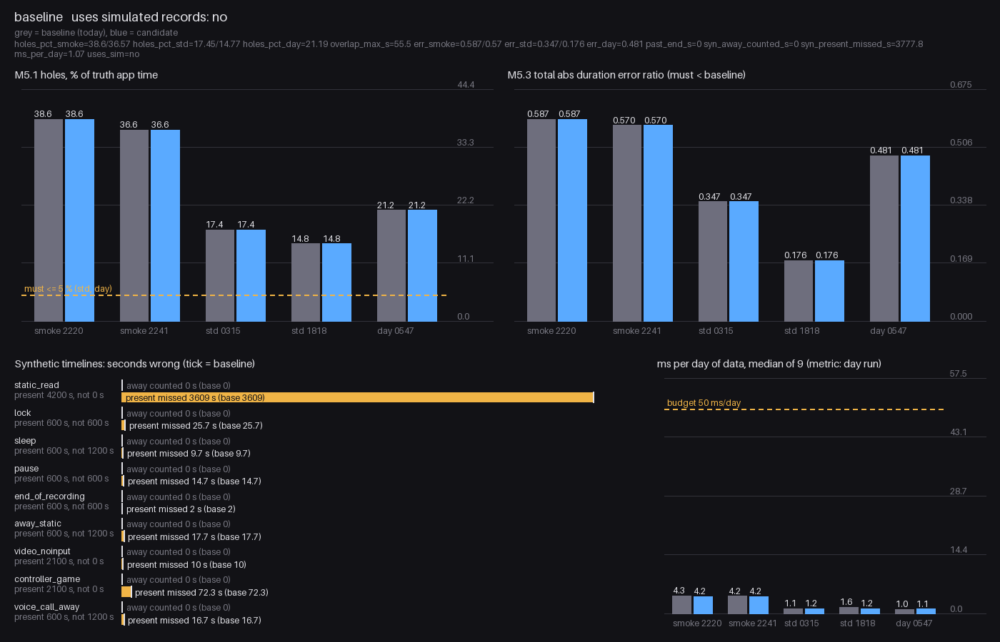
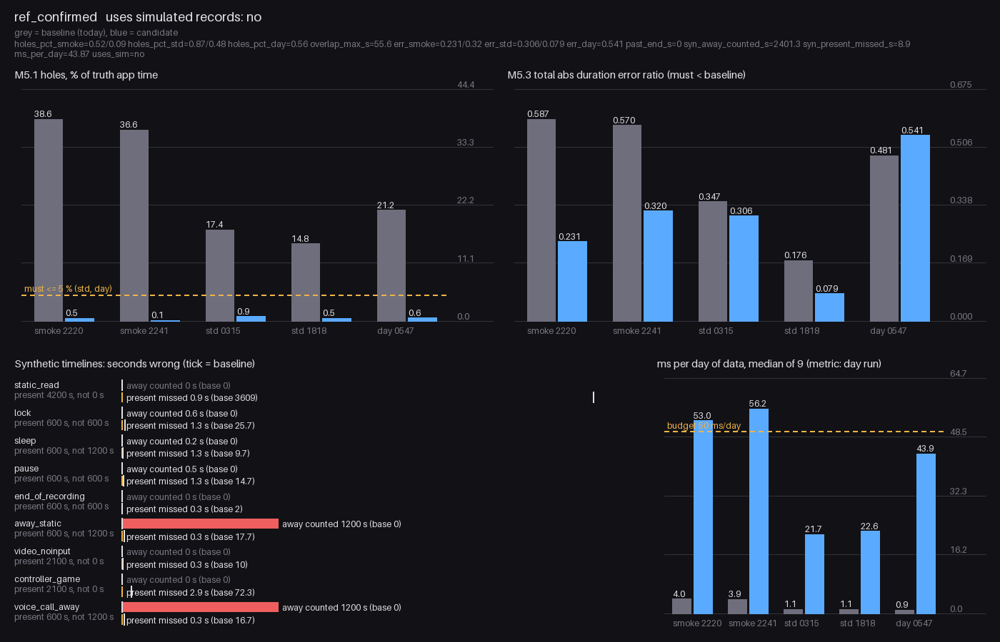
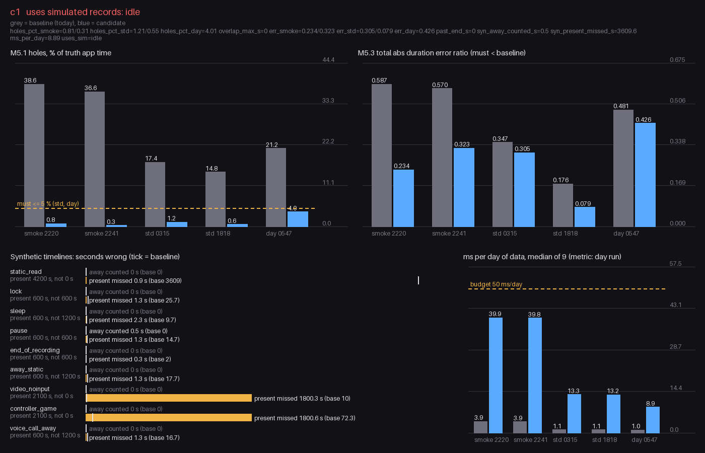
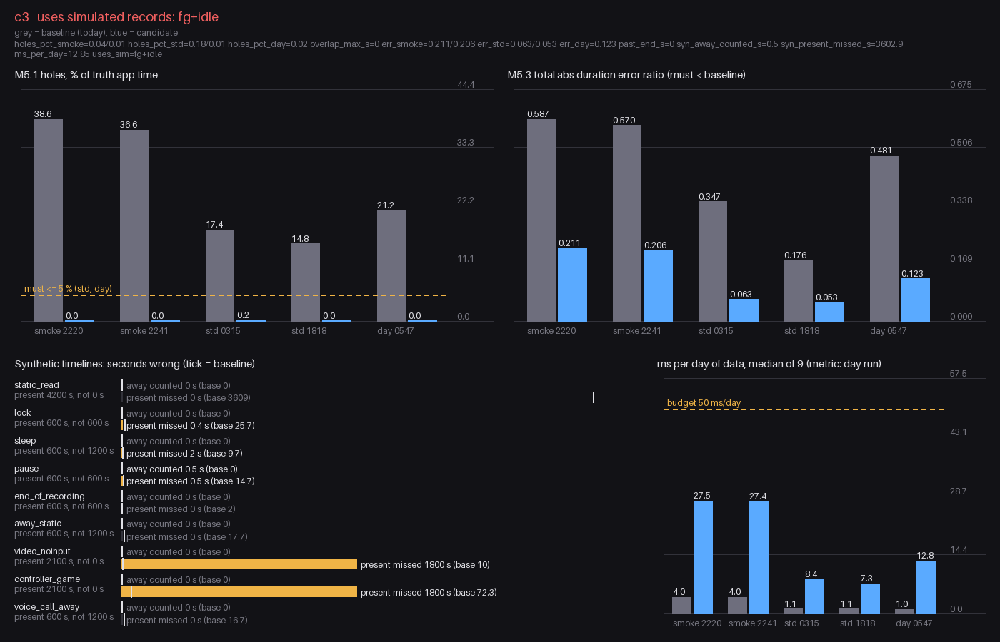
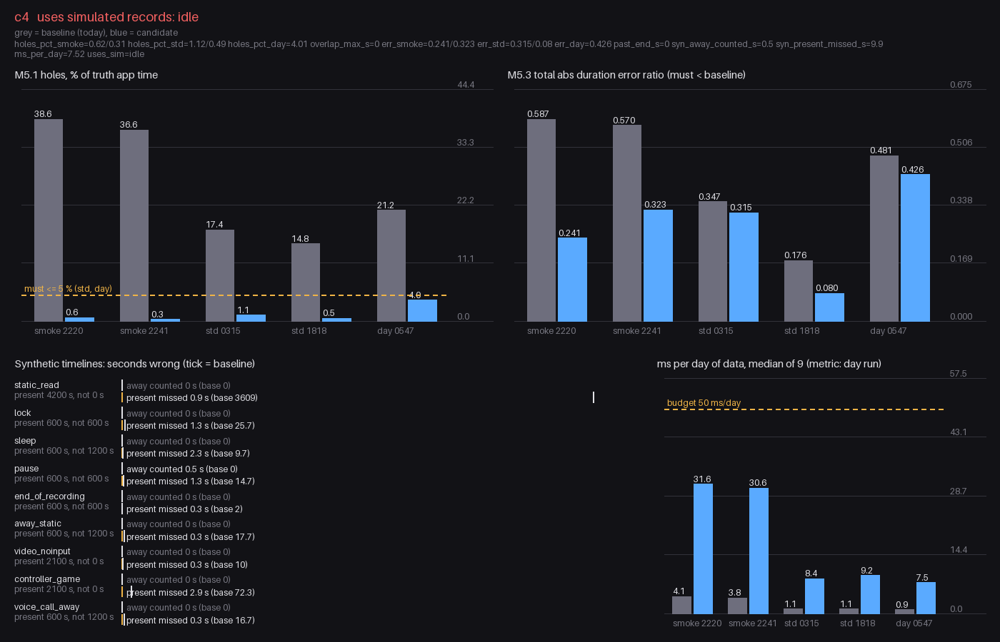

# App Time Between Frames
Date: 2026-11-19 · Context: Python 3.14, numpy, SQLCipher, Windows 11 26200, Ryzen 7 7800X3D; Akashic `pipeline/sessions.py` (`app_bands`), `storage/monitors.py`, `capture/gaps.py`; harness `eval/app-time-between-frames/` replaying the quality runs `eval/quality/results/` (smoke 2220/2241, standard 0315/1818, day 0547) · Goal: the timeline shows which app was in front for nearly all recorded time with no untyped holes; per-app durations match truth; no app time across lock, sleep, pause, stop or away-from-keyboard · Ruled out: game detection itself (#188), media sessions and episodes, the timeline UI, visible-but-not-focused time (TODO #149), retention, Ask quality · Constraints: no new dependency; schema may change (fresh app, no migration) · Fidelity: must keep M5.1 holes ≤ 5 % of truth app time on standard and day, M5.2 overlap ≤ today, no band inside a stored no-recording gap or past the end of recording, M5.3 duration error below today on every run; may end a band up to one check interval late (5 s / 15 s), approximate away where no input signal is stored, keep today's game-session handling · Budget: derivation ≤ 50 ms per day of data on one core; a capture addition ≤ 1 ms per tick and a few KB/h · Artifact: https://claude.ai/artifact/VmnFAvrpPTpcx7N1ShTkh4

## Answer
Best fit: **C4**, today's sessions held to the earliest of the next session start, the first later frame on the band's own monitor, the next stored gap, a game's end and the end of recording, and cut by an away span: every presence channel quiet for 180 s, back-dated to the latest activity. The channels are keyboard/mouse idle (a new back-dated idle record), the band's own process audible while its monitor still stores frames (picture changing, capped at 3 h), the user's own stored mic speech paired with the audible voice app, and an open game session [1]. On the five replayed runs it takes holes from 15-39 % of app time to 0.3-4.0 %, overlap from 55.5 s to 0, and the duration error below today on every run (day 0.426 against 0.481; 0.082 against 0.227 with clipped bands) [1]. On nine synthetic timelines it counts 0.5 s across away, lock, sleep, pause and stop and misses 9.9 s of present time, keeping a video watched without input and a voice call [1]. It costs 7.5 ms per day of data (30-40 ms with a dense idle record) and about 0.8 KB/h of away rows [1]. Prior art: back-dated away is ActivityWatch's and ManicTime's rule [2][3]; the presence channels resemble ManicTime's old sound/microphone settings [3]; no shipped tracker bounds the hold by later frames or pairs speech with the audible voice app.

## Candidates
| Candidate | Uses | Error | Cost vs budget | Status | Prior art |
| :- | :- | :- | :- | :- | :- |
| Today (reference) | M1 | `holes_pct_smoke=38.6/36.57 holes_pct_std=17.45/14.77 holes_pct_day=21.19 overlap_max_s=55.5 err_smoke=0.587/0.57 err_std=0.347/0.176 err_day=0.481 syn_away_counted_s=0 syn_present_missed_s=3777.8` | 1.07 ms/day | reference | — |
| Hold, fixed 60 s cap (reference) | M2 | `holes_pct_std=4.4/2.78 holes_pct_day=5.6 err_std=0.416/0.188 err_day=0.492 syn_away_counted_s=113.9 syn_present_missed_s=3548.6` | 16.5 ms/day | fails: day holes 5.6 % and M5.3 above today on std 0315 and the day run [1] | screenpipe 300 s rule [4] |
| Hold, monitor-confirmation bound (reference) | M3 | `holes_pct_std=0.87/0.48 holes_pct_day=0.56 overlap_max_s=55.6 err_std=0.306/0.079 err_day=0.541 syn_away_counted_s=2401.3 syn_present_missed_s=8.9` | 43.9 ms/day | fails: M5.3 above today on the day run, 2,401 s counted while away; one "shown" run per monitor for hours makes the bound useless [1][5] | none found |
| C1 Three-layer priority partition | M3, M16, M7, M12 | `holes_pct_smoke=0.81/0.31 holes_pct_std=1.21/0.55 holes_pct_day=4.01 overlap_max_s=0 err_smoke=0.234/0.323 err_std=0.305/0.079 err_day=0.426 past_end_s=0 syn_away_counted_s=0.5 syn_present_missed_s=3609.6 ms_per_day=8.89` | 8.9 ms/day / 50; ~0.8 KB/h | works; cuts a video or controller play without input as away (1,800 s each) [1] | ActivityWatch AFK back-dating [2] |
| C2 C1 + closing with a same-process audio veto | C1, M8, M17 | `not built: subsumed by C4` | ~18-28 ms/day est. | PARTIAL: music in a background tab of the focused browser vetoes away for up to 3 h (audio matched by image name) [5] | ActivityWatch audible tabs, ManicTime sound setting [2][3] |
| C3 Foreground switch rows as exact edges | M4, M6, M3, M16, M7 | `holes_pct_smoke=0.04/0.01 holes_pct_std=0.18/0.01 holes_pct_day=0.02 overlap_max_s=0 err_smoke=0.211/0.206 err_std=0.063/0.053 err_day=0.123 past_end_s=0 syn_away_counted_s=0.5 syn_present_missed_s=3602.9 ms_per_day=12.85` (upper bound: switch rows simulated from the truth source) | 10.9-12.9 ms/day / 50; ~2.4-3 KB/h of switch rows | works (upper bound); 10 % dropped rows keep holes ≤ 0.37 %; cuts video and controller play like C1 [1] | Android UsageStats event log (analogue) [6] |
| C4 Presence split by channel | C1, M7, M17, M8, M16, M10 (described) | `holes_pct_smoke=0.62/0.31 holes_pct_std=1.12/0.49 holes_pct_day=4.01 overlap_max_s=0 err_smoke=0.241/0.323 err_std=0.315/0.08 err_day=0.426 past_end_s=0 syn_away_counted_s=0.5 syn_present_missed_s=9.9 ms_per_day=7.52` | 7.5 ms/day (30-40 dense idle) / 50; ~0.8 KB/h | works (best fit) [1] | ManicTime presence settings [3] |
| C5 Display-request back-dating | M7, M9, M11 | `not built: refuted` | ~28 ms/day est. | fails: the aggregate ES_DISPLAY_REQUIRED bit stayed set in all 24 samples over 10 min on the target PC, including 268 s without input, so away never fires [5] | Timing 3 h rule, ManicTime 2025.2 [7][3] |
| C6 Per-app Otsu idle threshold | M7, C2 | `not built: refuted` | ~25 ms/day est. | fails: its gain is unmeasurable here, its 20 min clamp counts away time, and it is C2 with 300 s for the first 30 days [5] | per-user log-gap split (El Kholy et al. 2017) [8] |

## Method
C4 derives bands at query time from stored rows plus one new capture record.
1. Capture (new): on the existing 1 s gap tick, read `GetLastInputInfo` and `GetTickCount`; idle = max(0, signed int32(tick − dwTime)) (SendInput can put dwTime ahead); when idle reaches T = 180 s, store an away row back-dated to the last input, clipped to after the last stalled gap; close it at the next input. ~0.36 µs per tick, ≤ 20 rows/h × 40 B.
2. Band: each stored session [start, last frame] is held to the earliest of the next session start, the first later frame on its last frame's monitor (a focus move to an excluded, shell or null window stores a frame without a focused row), the next stored all/screen gap, its game session's end and the end of recording; stored gaps it spans are cut out (overlap 55.5 s → 0). Assumes a focus change always stores a frame outside game mode (0.3 s debounce).
3. Presence: away = every channel quiet for T, back-dated to the latest activity of any channel. K = keyboard/mouse (step 1). V = the band's own process in the sources of a stored system audio segment while its monitor stored a frame within 15 s; V alone holds presence at most 3 h past the last K or S activity. S = stored mic speech whose time matches the band's process audible within ±60 s (a voice app). G = an open game session of the band's process (today's handling). Assumes audio from the focused, changing app means it is being watched or heard.
4. Bands are cut by away spans; the cut time is typed away, not a hole.
5. The XInput pad channel (P) is described, not measured: probe empty slots off the capture tick (own thread every few seconds or on WM_DEVICECHANGE; an empty-slot probe costs milliseconds) and poll only connected slots per tick.

Cost: one session query with the last frame's monitor, gaps, game sessions, frames by time, and audio segments only where an idle stretch overlaps a band; bisect lookups, no per-band SQL. 7.5 ms per day on the replayed runs, 30.2-39.6 ms per day with a dense simulated idle record (28-103 stretches in 6.9 h).

Fails when: a video or playlist left playing after the user leaves counts up to 3 h (10,800 s in the extra scenario); a spoken podcast in the focused browser over a static screen counts about 15 s past the last input; music or a video without speech is invisible to V, because only speech segments are stored (the 1 s audible sampler keeps 5 min in memory); a SendInput jiggler keeps K active; a DualSense or Switch pad outside a detected game session is not seen.

Reproduce: `uv run python eval/app-time-between-frames/harness/run.py eval/app-time-between-frames/C4/c4.py`.

## Findings
### What Akashic stores today
- A session ends at its last stored frame and closes after 5 min without a frame [9]. Each monitor keeps one "shown" run for hours (6.87 h on the day run), so its last-checked time bounds nothing [5].
- Focus moving to an excluded, shell or null window stores a frame without a focused row, which starts no session; holding past it ran 912.6 s into other apps on the day run [5].
- The capture loop already polls GetForegroundWindow and GetLastInputInfo every 0.1 s and installs a foreground WinEvent hook it does not store [5][10].
### Trackers
- ActivityWatch polls input every 5 s, turns AFK after 180 s back-dated to the last input, and intersects window time with not-AFK, optionally unioned with audible browser tabs and always-active apps [2].
- ManicTime marks the last 10 min as away once 10 min pass without input; its 2025.2 beta replaced its sound/microphone presence settings with "stay active if an application is preventing sleep" [3]. Timing waits 3 h instead of 3 min when the frontmost app keeps the screen awake [7].
- WakaTime joins heartbeats within 15 min; no tracker found bounds a hold by later frames or ties foreground events to screenshot identity [11].
### Windows signals
- GetLastInputInfo is per session and its tick is not guaranteed to be incremental [12]; controllers through Steam Input or XInput may not move it [13].
- EVENT_SYSTEM_FOREGROUND is not sent on every switch (restore from minimized) [5].

## Mechanisms
- M1 Today's band rule: a session ends at its last stored frame · breaks on static screens [9]
- M2 Fixed-cap hold to the next session · breaks after a static stretch longer than the cap [4]
- M3 Monitor-confirmation hold · breaks because a monitor keeps one shown run for hours [5]
- M4 Foreground switch rows (hook or 0.1 s poll) · breaks when the hook misses a switch or a process is unreadable [5][10]
- M5 GetForegroundWindow poll · misses A-B-A inside a tick [10]
- M6 Sample-and-hold with exact starts and clipped end · breaks if a switch is dropped
- M7 Back-dated AFK threshold · breaks on controller input, jigglers, non-monotonic ticks [2][12]
- M8 Presence union veto · breaks when music plays after leaving [2][3]
- M9 Display-request threshold raising · breaks on stuck requests; the aggregate bit stays set on the target PC [5][7]
- M10 XInput packet-counter heartbeat · misses non-XInput pads; empty-slot probes cost milliseconds [13][5]
- M11 Session presence power events · coarse, not back-datable [14]
- M12 WTS lock/unlock rows · sharpens a band end by ≤ 1 s
- M13 Assignment-rule error: hold boundary rms 0.58 T, midpoint 0.29 T (derived)
- M14 Screenomics screenshot count [15]
- M15 HMM smoothing · not worth it where lock and gaps are exact
- M16 Stored no-recording gaps · end any hold [9]
- M17 Audible-process sampler (1 s, memory only) [10]

## Explored
- Hold with a fixed 60 s cap and the monitor-confirmation hold (earlier research): both fail the M5.3 must on some run; the confirmation hold counts 2,401 s while away [1].
- C2: its same-process audio veto is fooled by a background tab of the focused browser; C4's "picture changing" condition replaces it [5].
- C5: the aggregate display-request bit was always set on the target PC [5].
- C6: unmeasurable gain, counts away time, adds per-app history state [5].
- C3 alone (switch rows without the session-start fallback) fails the holes must with 10 % of rows dropped (9.72 %) [1].

## Caveats
- The replayed runs contain no idle, lock, sleep, away or long static screen; those cases are only in nine synthetic timelines built on the real migrations with a simplified capture model (fixed frame cadence, one shown run per monitor) [1].
- The real runs have no idle record: the harness treats them as always active, because the harness driver gives no input between focus steps; C1, C3 and C4 therefore score the same away handling on real runs.
- The scorer's truth is presence-blind and its M5.3 compares each truth run with the longest same-app band unclipped, so longer holds can raise M5.3; a clipped variant is reported beside it [1].
- C3's switch rows were simulated from the observer's foreground log, the same source as the scorer's truth: its real-run numbers are an upper bound [1].
- C4's V channel reads stored speech segments only; music and silent video are not seen. Its G channel counts an idle game until the stored session ends.
- T = 180 s and 300 s gave identical results: no scenario has a 3-5 min break.
- The M4 claim that out-of-context hook callbacks run on the installing thread rests on Akashic's own code comment (WEAK).

## Sources
[1] App-time replay harness and candidates — `eval/app-time-between-frames/` (harness/run.py, baseline, explored, C1, C3, C4) — tier 1 — target PC, 2026-11-19
[2] ActivityWatch aw-watcher-afk and canonical query — `_resources/references/aw-watcher-afk/aw_watcher_afk/afk.py:59-186`, `_resources/references/aw-webui/src/queries.ts:216-248` (https://github.com/ActivityWatch) — tier 1 — default branches, 2026-11-19
[3] ManicTime away time and release notes — https://blog.manictime.com/articles/may-2025/away-time/, https://www.manictime.com/releases/windows — tier 1 — 2025
[4] App usage time from sparse samples (screenpipe, arbtt, WakaTime) — `docs/research/app-usage-time-from-samples.md` — tier 1 — 2026-11-19
[5] Refuter analyses and spikes (hold overrun, monitor runs, foreground rate, SystemExecutionState) — `eval/app-time-between-frames/refuter/` — tier 1 — target PC, 2026-11-19
[6] Android UsageEvents.Event — https://developer.android.com/reference/android/app/usage/UsageEvents.Event — tier 1 — accessed 2026-11-19
[7] Timing FAQ — https://timingapp.com/help/faq — tier 1 — accessed 2026-11-19
[8] El Kholy et al., Identifying User Sessions in Interactions with Intelligent Digital Assistants, WWW'17 Companion — https://microsoft.com/en-us/research/wp-content/uploads/2017/04/WWW2017.pdf — tier 1 — 2017
[9] Akashic sessions and gaps — `src/akashic/pipeline/sessions.py:1-74`, `src/akashic/capture/gaps.py:32, 241-245`, `src/akashic/storage/monitors.py:89-97` — tier 1 — 2026-11-19
[10] Akashic hook, poll and audio sampler — `src/akashic/platform/win/events.py:1-278`, `src/akashic/capture/screen.py:83, 389-401`, `src/akashic/capture/audio.py:77-78, 258-389` — tier 1 — 2026-11-19
[11] WakaTime FAQ — https://wakatime.com/faq — tier 1 — accessed 2026-11-19
[12] GetLastInputInfo — https://learn.microsoft.com/en-us/windows/win32/api/winuser/nf-winuser-getlastinputinfo — tier 1 — 2025-07-01
[13] Getting started with XInput — https://learn.microsoft.com/en-us/windows/win32/xinput/getting-started-with-xinput — tier 1; Steam Input and GetLastInputInfo — https://steamcommunity.com/groups/SteamClientBeta/discussions/3/3887226156980206582 — tier 2
[14] Power setting GUIDs — https://learn.microsoft.com/en-us/windows/win32/power/power-setting-guids — tier 1
[15] Brinberg et al., Screenomics, Computers in Human Behavior 2020 — https://pmc.ncbi.nlm.nih.gov/articles/PMC7543997/ — tier 1 — 2020
