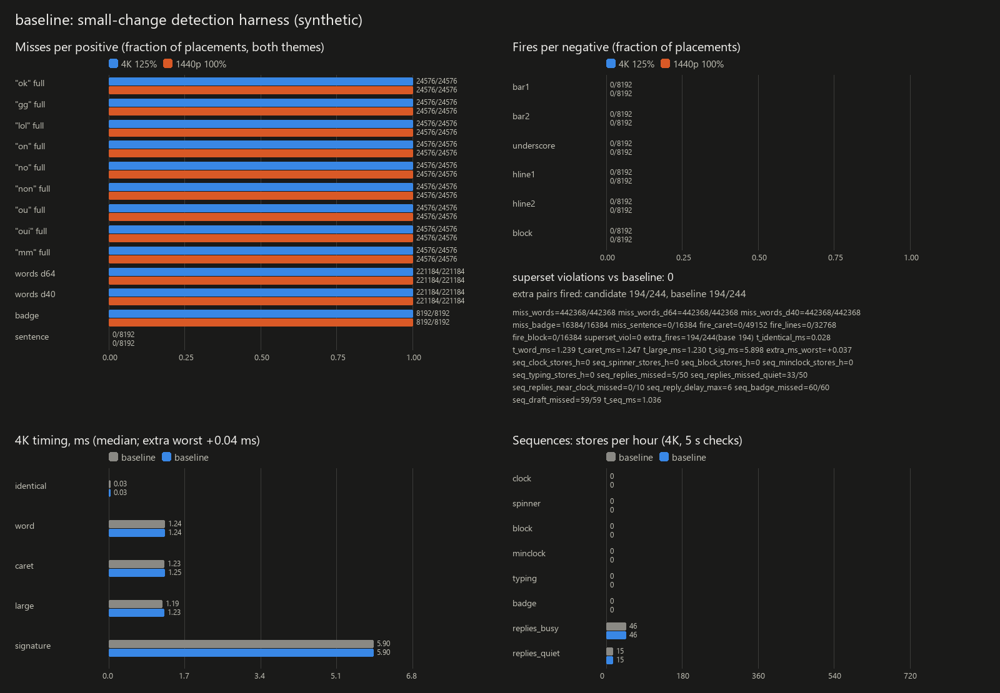
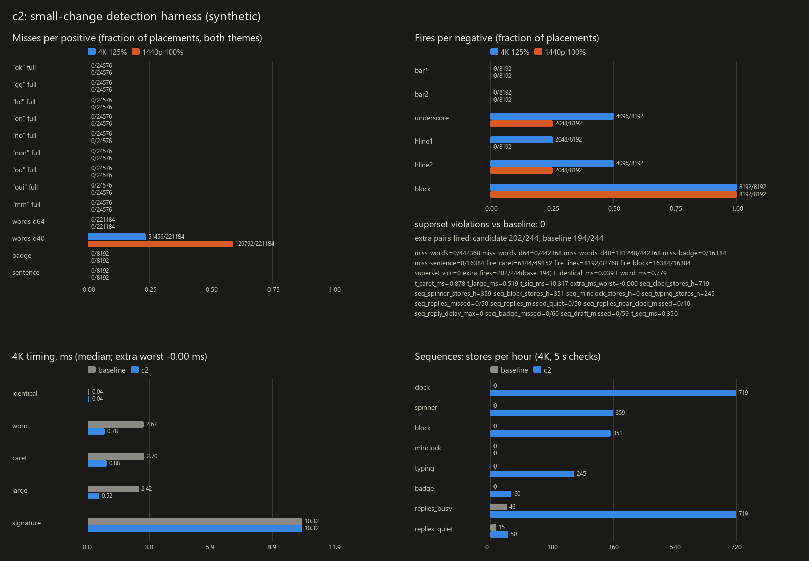
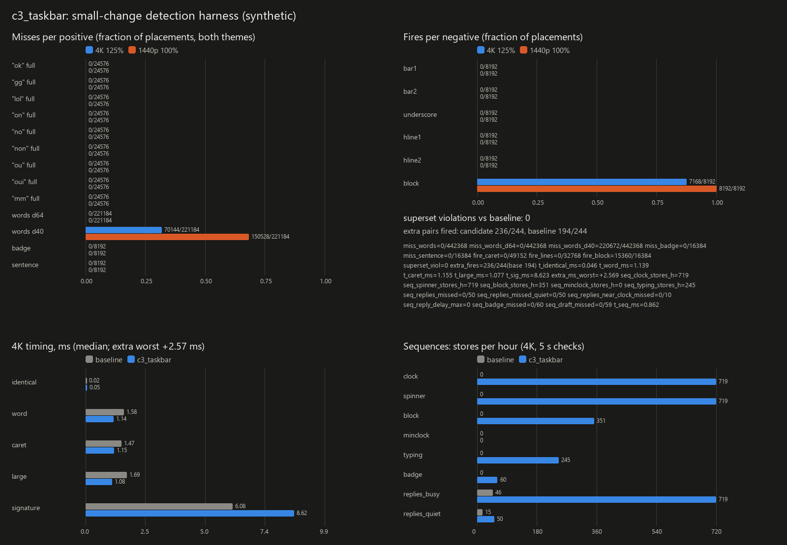
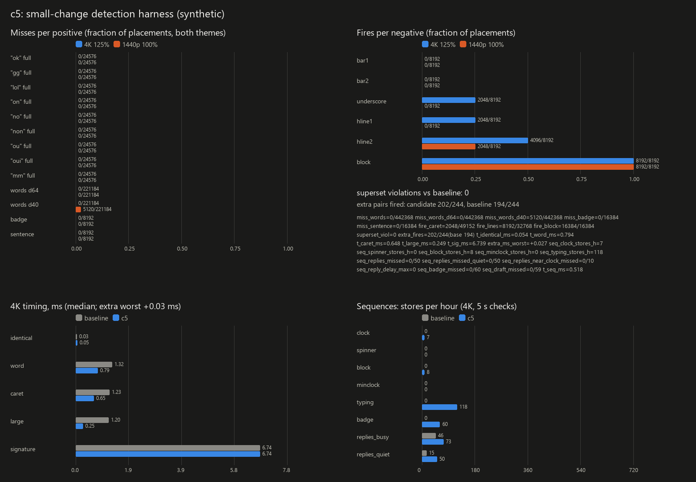
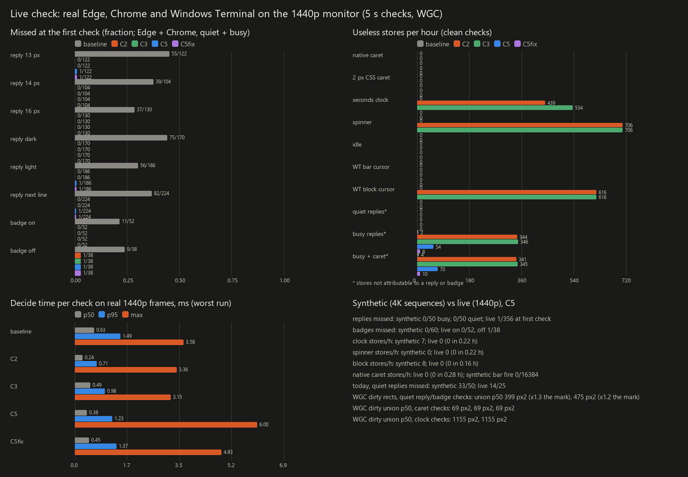

# Small Screen Change Detection
Date: 2026-11-19 · Revised: 2026-11-20 (live real-window check) · Context: Python 3.14, numpy 2.5.4, Pillow 13.0.0, Windows 11 26200, Ryzen 7 7800X3D; Akashic `capture/imaging.py` (`signature`, `differs`), per-window WGC composed per monitor (4K at 125 %, two 1440p at 100 %); harness `eval/small-screen-change-detection/` and `eval/quality/` · Goal: keep every meaningful small change (a one-word chat reply at 13-16 px, a 16 px badge, a short line of small text) on 4K and 1440p; store no more useless frames than today (caret blink, seconds clock, spinner); the OCR gate uses the same test · Ruled out: game-mode capture intervals, OCR accuracy, cursor capture, video and animation handling beyond today, retention or frame thinning, Windows builds without the APIs in use · Constraints: numpy and Pillow only, no GPU model per frame, production code unchanged during the audit · Fidelity: must catch a one-word reply and a badge in every sub-pixel placement at 1440p and 4K, both themes; must never fire on a 1-2 px caret blink; must keep harness M1.1 focused recall at or above today and M1.2 useless ratio at most today + 0.05; may count text-shaped timers as changes, miss fonts under 9 device px, keep today's game-mode behaviour · Budget: ≤ 3 ms extra CPU per 4K compare on one core, a few MB extra memory per window · Artifact: https://claude.ai/artifact/2CFUBV51hgt32UUJkikDvt

## Answer
Best fit: **C5**, today's test OR exact clusters of the few moved pixels (≥ 3 wide and ≥ 2 high), with a second reference (the previous check) that holds back regions changing at every check and caps exact A-B-A toggles. On 1,458,176 synthetic placement pairs it misses 0 one-word replies (full contrast and contrast 64), 0 badges and never fires on a 1-2 px bar caret; today misses every word and badge [1]. In one-hour 4K sequences it stores a seconds clock 7 times, a spinner 0, a blinking block caret 8 and the taskbar minute clock 0, and stores every reply and badge flap at once [1]. Its compare costs 0.65-0.79 ms against today's 1.23-1.32 ms (extra +0.03 ms worst), plus 2.6 MB per 4K monitor [1]. On the real desktop over 10 minutes it stored +5 frames on the primary and +9 on the right monitor beyond today, the fewest of the three built candidates; those extras are unlabelled [2]. On real Edge, Chrome and Windows Terminal windows captured through WGC on the 1440p monitor, C5 missed 1 of 356 one-word replies at the first check (today 131), stored every reply and badge by the second check, and stored a caret, seconds clock, spinner or terminal cursor 0 times per hour; while replies arrived alongside a running clock and spinner it added 54 useless stores per hour, which a one-line fix (stores through the dense gate also refresh the last-move map, C5fix) cuts to 8 with the same recall; its compare cost 0.35-0.38 ms at the median against today's 0.52-0.63 ms [9]. No prior art found; nearest are Stauffer-Grimson multi-modal background models [3] and x11vnc's tile heuristics [4].

## Candidates
| Candidate | Uses | Error | Cost vs budget | Status | Prior art |
| :- | :- | :- | :- | :- | :- |
| Today (reference) | M1 | `miss_words=442368/442368 miss_words_d64=442368/442368 miss_badge=16384/16384 fire_caret=0/49152 seq_replies_missed_quiet=33/50 seq_badge_missed=60/60` | compare 1.24 ms, signature 5.9 ms | reference | screenpipe-style global test [5] |
| C1 Gated sparse tile shape test | M1, M13, M3, M6, M14 | `not built: refuted` | ~1.0-1.4 ms est. / +3 ms | fails: misses x-height words ("rn", "re", "ça", "vu", "so", "un") in 2-8 of 16 placements at 13-14 px; lowering the width floor fires a 2 px underscore [6] | x11vnc tile heuristics [4] |
| C2 Gated exact sparse clusters | M1, M13, M6, M14 | `miss_words=0/442368 miss_words_d64=0/442368 miss_words_d40=181248/442368 miss_badge=0/16384 fire_caret=6144/49152 fire_lines=8192/32768 fire_block=16384/16384 superset_viol=0 extra_ms_worst=-0.000 seq_clock_stores_h=719 seq_spinner_stores_h=359 seq_block_stores_h=351 seq_minclock_stores_h=0 seq_typing_stores_h=245 seq_replies_missed=0/50 seq_badge_missed=0/60` | compare 0.78 ms vs today 2.67 ms in the same run / +3 ms; memory +0 | works on the musts; a spinner or block caret on screen stores at every check (359/h, 351/h); live desktop +8 primary, +19 right per 10 min [2] | Stauffer-Grimson connected components [3] |
| C3 Anisotropic 4x2 reduction + gated span | M14, M3, M13, M1, M6 | `miss_words=0/442368 miss_words_d64=0/442368 miss_words_d40=220672/442368 miss_badge=0/16384 fire_caret=0/49152 fire_lines=0/32768 fire_block=15360/16384 superset_viol=0 extra_ms_worst=+2.569 seq_clock_stores_h=719 seq_spinner_stores_h=719 seq_block_stores_h=351 seq_minclock_stores_h=0 seq_typing_stores_h=245 seq_replies_missed=0/50 seq_badge_missed=0/60` | +2.05 / +2.79 / +2.92 ms (min / median / max of 7) / +3 ms; +0.52 MB per 4K window | works on the musts with 0.1-0.2 ms of median margin; spinners and block carets store at every check; live desktop +9 primary, +34 right per 10 min [2] | RLSA (anisotropic smearing) [7] |
| C4 C1 + per-tile toggle set | C1, M7, M9 | `not built: refuted` | ~+0.03 ms est. | fails: a blinking cursor and a badge flap give the same per-tile hash sequence, so "store every badge flap" and "≤ 2 cursor frames" cannot both hold; inherits C1's misses [6] | RDP persistent bitmap cache [8] |
| C5 C2 + live/toggle split on the previous check | C2, M9, M8, M7 | `miss_words=0/442368 miss_words_d64=0/442368 miss_words_d40=5120/442368 miss_badge=0/16384 fire_caret=2048/49152 fire_lines=8192/32768 fire_block=16384/16384 superset_viol=0 extra_ms_worst=+0.027 seq_clock_stores_h=7 seq_spinner_stores_h=0 seq_block_stores_h=8 seq_minclock_stores_h=0 seq_typing_stores_h=118 seq_replies_missed=0/50 seq_replies_near_clock_missed=0/10 seq_badge_missed=0/60 seq_draft_missed=0/59` | +0.03 ms / +3 ms; 2.6 MB per 4K monitor | works (best fit); live desktop +5 primary, +9 right per 10 min [2] | Stauffer-Grimson multi-modal models [3] |
| C6 C1 + volatility cells | C1, M7 | `not built: refuted` | ~+0.8 ms est. | fails: inherits C1's misses; a 50 % blinker resets the run at every digest-equal check, so it is never suppressed [6] | Percy ignore regions (manual) [9] |

## Method
C5 decides per check, with `ref` = the last stored reduced gray frame and `prev` = the previous check's reduced gray frame (both already computed by `signature`).
1. Equal digests → no change (today).
2. Mask `m = (max(cur, ref) − min(cur, ref)) > 16` in uint8 (exact, no wrap). If `count(m) > 1e-4 · N` → store, as today (dense regime; every frame today stores is still stored: 0 superset violations in 244 extra pairs [1]).
3. Otherwise (sparse regime, at most 51 points at 4K and 23 at 1440p): take the moved points with a lower threshold (> 6, capped at 128 points) via `np.flatnonzero`, link points at Chebyshev distance ≤ 2, and take exact connected components. A cluster is shape-positive when it is ≥ 3 wide and ≥ 3 high, or ≥ 4 wide and ≥ 2 high, with ≥ 5 points. Assumes a bar caret ≤ 5 device px covers at most 2 reduced columns in every placement, and that x-height-only words are 2 reduced rows (both measured over all 16 sub-pixel residues).
4. Live rule: a point is live if a reduced pixel within 2 px moved at either of the previous 2 checks; a cluster stores only if its non-live points alone are shape-positive. Assumes meaningful text holds still for one check interval.
5. Toggle rule: an exact A-B-A at a cluster box (content among the 2 recorded there) is stored while that box has toggled fewer than 7 times in its episode (an episode ends after 12 checks without a toggle), then suppressed. The 7 comes from the harness's badge flaps, not a principle.
6. Taskbar band: clusters wholly inside the bottom 48 CSS px of a monitor keep today's behaviour, so the minute clock never stores. In production the band comes from the monitor work area.
7. A suppressed change stays in the stored-frame difference, so it is stored at the first check where it is neither live nor a toggle.
8. The OCR gate calls the same spatial test (steps 1-3), so a stored frame's text is re-read.

Cost: mask and count 0.43 ms against today's int16 path 1.40 ms; flatnonzero 0.026 ms; components and boxes ≤ 0.5 ms for 51 points; live and toggle rules ≤ 0.25 ms. Measured worst extra +0.03 ms, worst populated state −0.40 to −0.80 ms vs today [1]. Memory: previous gray 518 KB, recency map 2.07 MB (int32) at 4K; 230 KB and 0.92 MB at 1440p.

Fails when: a draft that never holds still for one interval is stored at most partially (9 of 70 complete in the extra stream; today stores none) → late or partial drafts. A 2 px underscore caret 9-11 px wide fires in 1/4 of 4K placements, and 2-row hover lines in 1/4-1/2 → one frame per blink or hover until the toggle budget runs out. A block caret stores up to 8 frames per blink episode. The > 6 threshold is more sensitive to faint tints, unmeasured on real screens. Taskbar badges stay missed, as today.

Reproduce: `uv run python eval/small-screen-change-detection/harness/run.py eval/small-screen-change-detection/C5/c5.py <out>` and `harness/live_replay.py --seconds 600 C5/c5.py`.

## Findings
### Live real windows (2026-11-20)
- Setup: synthetic chat page in real Edge and Chrome windows and a Windows Terminal window, right 1440p monitor at 100 %, WGC captures checked every 5 s, scored against the page's own event log; clean checks only [9].
- Missed at the first check: today 131/356 replies, 11/52 badges on, 9/38 off; C5 1/356, 0/52, 1/38; every candidate stores all of them by the second check [9].
- Useless stores per hour: native and 2 px CSS carets, seconds clock, spinner, terminal bar and block cursors 0 for today, C5 and C5fix; C2 and C3 439-706 for the clock, spinner and block cursor; busy phase (replies with clock and spinner running) today 2.5, C5 54, C5fix 8 [9].
- Compare cost on real frames: today median 0.52-0.63 ms, p95 1.09-1.49 ms; C5 0.35-0.38 ms, p95 0.80-1.23 ms; worst single call 6.0 ms on a loaded PC [9].
- Browsers stop presenting WGC frames while the display is off; Windows Terminal keeps presenting. Browser checks touching display-off spells were dropped [9].

### Screen recorders and remote desktop
- TigerVNC, FreeRDP shadow and WebRTC compare tiles exactly (memcmp, first-mismatch exit) with no thresholds or history; x11vnc samples one scanline in 32 per poll, ignores ≤ 4 changed tiles as cursor activity and has -fuzz/-grow/-gaps/-fs heuristics [4][10].
- None of Recall, Rewind, ManicTime, screenpipe, OpenRecall or Windrecorder documents blink or ticker suppression [5][11].
### Adjacent fields
- pixelmatch's `windowSize` returns the maximum diff count in any NxN window; its anti-aliasing test removes sub-pixel glyph shifts but not a caret [12].
- FFmpeg mpdecimate drops a frame unless an 8x8 block's SAD exceeds hi (768) or more than frac (0.33) of blocks exceed lo (320) [13].
- Stauffer-Grimson drop 1-2 pixel components as noise and keep several colour modes per pixel, naming monitor flicker as a bimodal case [3].
### Windows caret signals
- GetGUIThreadInfo reports only system carets (rcCaret in client coordinates; GUI_CARETBLINKING = currently visible); Chromium exposes a caret object only with accessibility on; Firefox only when accessibility is active; so no OS signal covers every app [14][15].

## Mechanisms
- M1 Global changed fraction: blake2b of the 1/4 gray frame; differs when > 1e-4 of reduced pixels moved > 16 · assumes a meaningful change is large · breaks when the change is one word [16]
- M2 Exact tile compare: memcmp per tile, bbox of changed tiles · assumes every pixel matters · breaks when a caret or clock must be ignored [10]
- M3 Per-tile span over offset grids: moved pixels span ≥ 3x3 in a 16x16 tile, four grids · assumes words ≥ 3x3 reduced px, carets ≤ 2 wide · breaks when words have no ascenders (2 rows) [6][17]
- M4 Densest-window count (pixelmatch windowSize) · assumes density separates meaning · breaks when caret and word counts overlap [12]
- M5 Block SAD hi/lo/frac (mpdecimate) · assumes magnitude marks meaning · breaks when a high-contrast caret matches a word [13]
- M6 Minimum-shape components · assumes noise is thin or tiny · breaks when the nuisance is wide [3]
- M7 Per-region state set for toggles · assumes blinks revisit exact states · breaks with drift, many-state clocks, genuine reverts [3]
- M8 Persistence before storing · assumes meaningful content lasts one check · breaks with fast toasts [14]
- M9 Two references (stored and previous check) · assumes a blink returns to an earlier state · costs one gray frame per monitor
- M10 Caret rectangle hint, veto only · assumes the app exposes its caret · breaks when it draws its own [14][15]
- M11 Gradient-density text cells · assumes text = dense horizontal gradients · breaks on smoothed small text [16]
- M12 Anti-aliasing pixel rejection · assumes sub-pixel re-rendering · breaks on a caret [12]
- M13 Sparse fast path over moved coordinates · assumes few moved pixels · falls back to the dense regime [1]
- M14 Reduction dilutes thin marks · the reduction factor and the delta threshold set the caret/word separation [17]

## Explored
- C1 Gated sparse tile shape test: x-height words missed in 2-8 of 16 placements; fixing it fires a 2 px underscore [6].
- C4 Per-tile toggle set: contradicts itself (cursor blink vs badge flap) [6].
- C6 Volatility cells: inherits C1's misses; a 50 % blinker is never suppressed [6].
- C2 and C3 work on the musts but store spinners and block carets at every check and add more real-desktop stores than C5 [1][2].
- OCR routing add-on (pass the stored frame's cluster boxes to the OCR gate and crop to their union with the text box, ~0.05 ms): complementary to every candidate, not measured.
- C5 with a width floor of 5 at 4K removes the underscore fires but misses x-height words in 64 of 27,648 quick-sweep pairs [1].
- WGC dirty regions (report the app's redraw, not the changed pixels) and a fixed pixel count (refuted earlier) [17].

## Caveats
- All placement numbers come from Pillow grayscale text in Segoe UI on a plain background: no ClearType fringes, no DirectWrite hinting, marks never over existing text [1].
- The real-desktop replay has no labels: its extra stores (+5/+9 for C5 per 10 min, at a 5 s interval on every monitor, where Akashic checks side monitors every 15 s) are an upper bound on added useless frames, from one 10-minute sample of the user's own use [2]. The quality harness's M1.1 and M1.2 have not been rerun with C5 (production code stays unchanged during the audit).
- The underscore caret fires are reported against the must as written ("1-2 px caret blink" = a bar caret); a 2 px underscore caret is counted as a failure condition, not a must.
- C3's timing margin (0.1-0.2 ms at the median) is load-sensitive.
- Mechanism claims: the earlier four-grid sweep and the researcher's sparse-path timings were WEAK (uncommitted or off-target) and were re-measured here; the Stauffer-Grimson text could not be extracted by the fact-checker but was read through pdftotext by the prior-art researcher [3].
- The live check used one synthetic page and one terminal at 1440p with 5 s checks on a single window; real apps, ClearType, 4K, 15 s side-monitor checks and full-monitor composition were not tested; clean hours are short (0/h means below about 4-6/h); the terminal run was captured with the display off; two terminal runs were invalid (a focus bug minimized the window) and replaced [9].
- The first live replay captured only the desktop wallpaper layer through WGC on `Progman`; the replay now grabs the desktop with GDI (Pillow ImageGrab).

## Sources
[1] Synthetic harness and candidates — `eval/small-screen-change-detection/harness/run.py`, `baseline/metrics.txt`, `C2/`, `C3/fix_taskbar/`, `C5/` — tier 1 — target PC, 2026-11-19
[2] Real-desktop replay, 10 min, 5 s checks, counts only — `eval/small-screen-change-detection/harness/live_replay.py`, `live_counts.json` — tier 1 — target PC, 2026-11-19
[3] Stauffer and Grimson, Adaptive background mixture models for real-time tracking, CVPR 1999 — https://www.cse.buffalo.edu/courses/cse725/peter/Stauffer_1999.pdf — tier 1 — 1999
[4] x11vnc man page (-fuzz, -grow, -gaps, -fs) and scan.c — https://www.mankier.com/1/x11vnc, https://raw.githubusercontent.com/LibVNC/x11vnc/master/src/scan.c — tier 1 — master, 2026-11-19
[5] Screen change detection for small text (screenpipe, OpenRecall, Windrecorder) — `docs/research/screen-change-detection-small-text.md` — tier 1 — 2026-11-19
[6] Refuter analyses and sweeps — `eval/small-screen-change-detection/refuter/` — tier 1 — 2026-11-19
[9] Live real-window check — `eval/small-screen-change-detection/live/` (`summary.md`, `results.json`, `analyze.py`, `run_live.py`, `c5_livefix.py`, `monitor_off.json`) — tier 1 — target PC, 2026-11-20
[7] Run Length Smoothing Algorithm (Wong, Casey, Wahl, IBM J. Res. Dev. 26(6), 1982), secondary description — https://crblpocr.blogspot.com/2007/06/run-length-smoothing-algorithm-rlsa.html — tier 3 — 2007
[8] MS-RDPBCGR Persistent Bitmap Caches — https://learn.microsoft.com/en-us/openspecs/windows_protocols/ms-rdpbcgr/2da3e165-d1ba-4b65-8909-7a0f7f858d69 — tier 1 — accessed 2026-11-19
[9] Percy regions — https://www.browserstack.com/docs/percy/set-regions/overview — tier 2 — accessed 2026-11-19
[10] TigerVNC ComparingUpdateTracker, FreeRDP shadow_capture, WebRTC differ_block — https://raw.githubusercontent.com/TigerVNC/tigervnc/master/common/rfb/ComparingUpdateTracker.cxx, https://raw.githubusercontent.com/FreeRDP/FreeRDP/master/server/shadow/shadow_capture.c, https://webrtc.googlesource.com/src/+/refs/heads/main/modules/desktop_capture/differ_block.cc — tier 1 — master/main, 2026-11-19
[11] Prior-art search (Recall, Rewind, ManicTime undocumented) — researcher return, 2026-11-19 — tier 2
[12] pixelmatch — https://github.com/mapbox/pixelmatch — tier 1 — main, 2026-11-19; Vysniauskas, Anti-aliased Pixel and Intensity Slope Detector, Elektronika ir Elektrotechnika 7(95), 2009
[13] FFmpeg vf_mpdecimate.c — https://raw.githubusercontent.com/FFmpeg/FFmpeg/master/libavfilter/vf_mpdecimate.c — tier 1 — master, 2026-11-19
[14] GUITHREADINFO, GetCaretBlinkTime — https://learn.microsoft.com/en-us/windows/win32/api/winuser/ns-winuser-guithreadinfo, https://learn.microsoft.com/en-us/windows/win32/api/winuser/nf-winuser-getcaretblinktime — tier 1 — 2024
[15] Chromium AXSystemCaretWin (M66); Mozilla bug 1504963 — https://chromium.googlesource.com/chromium/src.git/+/66.0.3359.53/ui/accessibility/platform/ax_system_caret_win.cc, https://bugzilla.mozilla.org/show_bug.cgi?id=1504963 — tier 1/2
[16] Akashic change test and text cells — `src/akashic/capture/imaging.py:26-62` — tier 1 — 2026-11-19
[17] Small-change spike — `eval/quality/spikes/change_detection_small.py`, `.json` — tier 1 — target PC, 2026-11-19
