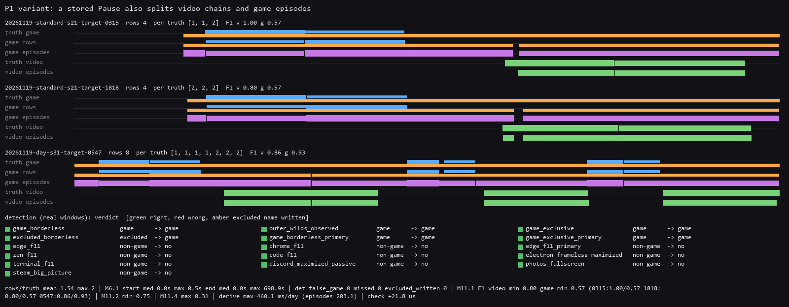
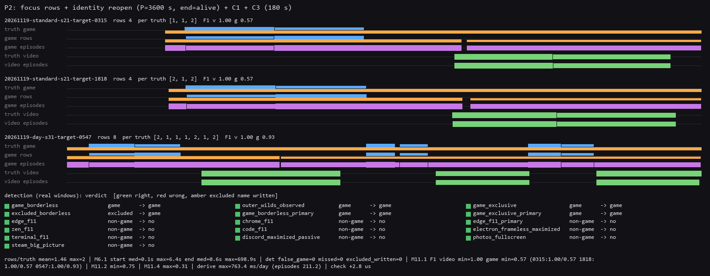
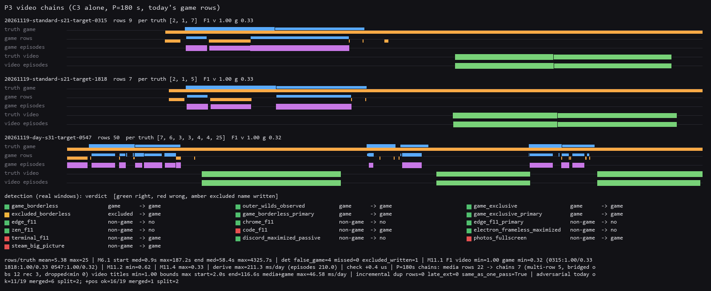
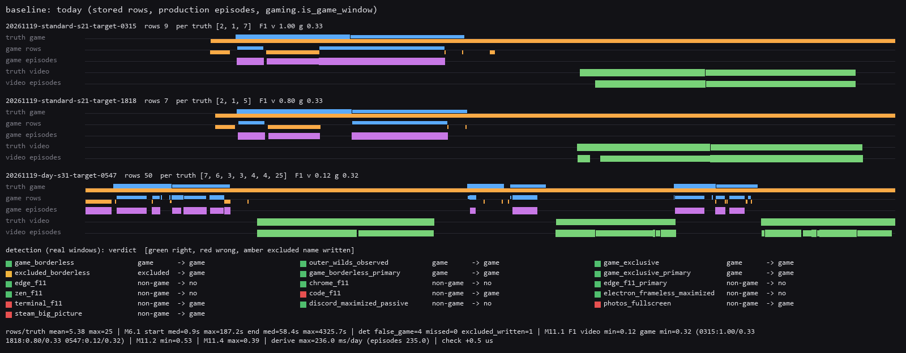

# Game Sessions And Episodes
Date: 2026-11-20 · Context: Python 3.14, ctypes Win32 (OpenProcess, WaitForSingleObject, GetProcessTimes, IsWindow), Windows 11 26200, Ryzen 7 7800X3D; Akashic `capture/gaming.py`, `capture/screen.py`, `storage/sessions.py`, `pipeline/episodes.py`; harness `eval/games-and-episodes/` (replays of the quality runs standard 0315 and 1818 and day 0547, 13 truth game sessions and 7 truth videos, plus a 16-case table of real fullscreen windows) · Goal: one stored game session per real play session; tell games from fullscreen non-games and keep excluded apps out (#188, #192); video and game episodes that match what happened (boundaries and titles) · Ruled out: game frame-rate guardrails (G3), game-mode capture cadence and OCR of game HUDs, conversation and work/browsing episodes, media session timing (#189, browser title holds), Ask quality · Constraints: Win32 through ctypes only; `GamesEnumeration` needs a restricted capability; protected processes refuse process handles · Fidelity: must keep at most 1.5 stored game rows per real game session on the standard and day runs, M6.1 game start and end error within 15 s, no excluded process in a game row or the log (#188), no game row for a fullscreen non-game of the harness (Steam Big Picture, F11 browser/terminal/editor, Photos, frameless Electron maximized), M11.1 F1 for video and game episodes at least 0.8, M11.2 title accuracy at least 0.8; may detect games from launchers not installed here by today's covering-window rule only, may place episode boundaries within 30 s · Budget: ≤ 1 ms extra per foreground check, no new polling thread above 1 Hz, registry and launcher reads cached and refreshed at most once a minute, episode derivation ≤ 100 ms per day of data on one core, no new dependency, schema may change (fresh app) · Artifact: https://claude.ai/artifact/E7WvkQKvavtwv6nNnMRtVv

## Answer
Best fit: **C1**, one game row per process instance, from process creation to process exit through a held `SYNCHRONIZE | PROCESS_QUERY_LIMITED_INFORMATION` handle, with time in front kept as a separate ledger, a provenance verdict that checks the exclusion first, and video episodes built from chains of media rows; a Pause splits game rows, game episodes and video chains (user answers 5-7) [1]. On truth clipped to the recorded span and split at stored Pauses, it meets every must: rows per real session mean 1.25 (max 2, only where a harness game restart overlaps the previous session by 0.2-0.5 s), M6.1 start and end error 0.0 s, 0 false games, 0 missed, 0 excluded names written, M11.1 F1 video 1.00 and game 1.00, M11.2 0.86 [1]. Cost: +21.8 µs per check at first sight of a process, then a cached verdict (1.0 µs) and a 1.0-1.2 µs wait on the handle, against 1 ms; derivation of the changed parts 71.1 ms per day of data against 100 ms; game-mode time unchanged (2.64 h, 6 s apart) [1][2]. Today's scorer reads rows 1.54 and M6.1 end 698.9 s for C1; both come from the scorer, not the rows: it does not clamp the truth end to capture stop (Outer Wilds exits about 700 s after recording stopped on both standard runs) and it counts every row that overlaps a truth session [1]. Prior art: Playnite's folder tracking and process monitor, Steam's lifetime play time, ActivityWatch's heartbeat merge [6][7]; no prior art found for a lifetime span with a separate in-front ledger. When the handle is refused (protected processes, anti-cheat), **C2** rebuilds the row from focus and process identity and ends it with an `IsWindow` liveness check: start error ≤ 6.4 s, end error ≤ 0.9 s, video F1 0.80 and titles 0.80 at the limit on the same clipped truth [1].

## Candidates
Report candidates follow the prototypes: C1 = P1 `pausesplit` (the merged parts provenance verdict, process-lifetime row and viewing chain, numbered C1, C2 and C3 in `candidates-merged.md`), C1a-C1d = the other P1 variants, C2 = P2 with `END=alive`, C2a = P2 with `END=front`, C3 = P3. "Clipped" = truth clipped to the recorded span and split at stored Pauses (pieces under 60 s video or 120 s game dropped), scored by `post.py`; "today's scorer" = the harness through `eval/quality/score.py`.

| Candidate | Uses | Error | Cost vs budget | Status | Prior art |
| :- | :- | :- | :- | :- | :- |
| Today (reference) | covering-window rule, focus rows | `rows/truth mean=5.38 max=25 · M6.1 start max=187.2s end med=58.4s max=4325.7s · false_game=4 missed=0 excluded_written=1 · F1 video min=0.12 game min=0.32 · M11.2 min=0.53` | check +0.5 µs; full derivation 236 ms/day | reference | — |
| C1 Lifetime rows, provenance verdict, viewing chains, Pause splits (P1 pausesplit) | G1, G2, G4, G6, G7, D2, D6, D7 | clipped: `rows/truth mean=1.25 max=2 M6.1 start max=0.0s end max=0.0s F1 video min=1.00 game min=1.00 M11.2 min=0.86`; `false_game=0 missed=0 excluded_written=0`; today's scorer: `rows/truth mean=1.54 max=2 end max=698.9s F1 video min=0.80 game min=0.57 M11.2 min=0.75`; `active err med=0.1s max=1.3s` | check +21.8 µs worst, ~2 µs steady / 1 ms; changed derivation 71.1 / 100 ms/day | works (best fit) | Playnite folder tracking + process monitor, Steam play time [6] |
| C1a P1 as first built: chains and game episodes bridge a Pause | as C1 | clipped: `F1 video min=0.80 game min=0.86 M11.2 min=0.70`; today's scorer: `F1 video 1.00 game 1.00 M11.2 0.84 rows 1.54 end max 698.9s` | +21.7 µs; 68.4 ms/day | fails: M11.2 0.70 on clipped truth; bridging a Pause contradicts answer 6 [1] | as C1 |
| C1b One game episode per row, chains bridge a Pause (rowep) | as C1 | clipped: `F1 video min=0.80 game min=1.00 M11.2 min=0.80`; today's scorer: `F1 video 1.00 game 0.57 M11.2 0.75` | +21.7 µs; 64.4 ms/day | works at the limit (video F1 0.80, titles 0.80) [1] | as C1 |
| C1c C1a with chain gap P = 600 s (p600) | as C1 | identical to C1a on every metric | +21.7 µs; 68.4 ms/day | fails: as C1a; P made no difference on these runs [1] | as C1 |
| C1d P1's own no-handle fallback: today's rule + reopen within 300 s | G3, D2, D6 | clipped: `rows/truth mean=1.50 max=5 M6.1 start max=4228.7s end max=4534.2s F1 game min=0.50 M11.2 min=0.50`; today's scorer: `rows 1.85 max 6` | +22.6 µs; 72.3 ms/day | fails: end error 4534 s, rows max 6 [1] | ActivityWatch pulsetime [7] |
| C2 Focus rows + identity reopen, liveness end (P2 alive, P = 3600 s) | G3, G4, G2, D2, D6 | clipped: `rows/truth mean=1.19 max=2 M6.1 start max=6.4s end max=0.9s F1 video min=0.80 game min=1.00 M11.2 min=0.80`; today's scorer: `rows/truth mean=1.46 max=2 start max=6.4s end med=0.6s max=698.9s F1 video min=1.00 game min=0.57 M11.2 min=0.75 false_game=0 missed=0 excluded_written=0` | +2.8 µs (IsWindow 0.3 µs once a second); changed derivation not measured separately | works at the limit; the measured fallback when the handle is refused [1] | ActivityWatch heartbeat merge [7] |
| C2a Focus rows + identity reopen, end at last front tick (P2 front) | G3, D2, D6 | today's scorer: `rows/truth mean=1.23 max=2 end med=213.9s max=21020.6s F1 game min=0.33 M11.2 min=0.62` | +2.8 µs | fails: rows end at the last in-front tick, so M6.1 end reaches 21020.6 s [1] | ActivityWatch heartbeat merge [7] |
| C3 Video viewing chains alone on today's game rows (P3) | G6, G5, G3 | `F1 video min=1.00 (all runs) · media rows 22 -> chains 7 · bounds max start=2.0s end=116.6s · incremental same_as_one_pass=True · adversarial ok=11/19, +pos ok=16/19`; game metrics as today | +0.4 µs; media+game derivation 46.6 / 100 ms/day | fails as a whole solution: game rows and detection stay at today's values; kept inside C1 [1] | ActivityWatch merge [7], Trakt/Simkl rewatch block [9] |

## Method
C1, per process instance; capture side on the existing foreground check, derivation side in episode building.

1. **Exclusion first.** An excluded exe never yields a name: its fullscreen window gets a content-free game row (no process, no title), game mode is kept, and nothing about it is logged (answer 7, #188). Cached verdicts are dropped when the exclusions change. Assumes the exclusion rules match by exe name, as today.
2. **Provenance verdict, once per (pid, creation time).** In order: the user's `games` / `not_games`; D3D exclusive fullscreen on a covering window is a game (DECISIONS #150); an exe under a launcher game folder (Steam `steamapps\common\<installdir>`, Epic, GOG) or in GameConfigStore is a game; an exe under a launcher root outside its game folders (`steamwebhelper.exe`, Big Picture) is not; on the borderless branch only, window class `Chrome_WidgetWin_*`, `CASCADIA_HOSTING_WINDOW_CLASS`, `WinUIDesktopWin32WindowClass`, `ApplicationFrameWindow`, `Windows.UI.Core.CoreWindow`, `ConsoleWindowClass`, or an image path under `%WINDIR%`, `SystemApps` or a `Microsoft.Windows*` package is not a game; otherwise today's covering rule. Launcher facts come from a background scan once a minute (7-12 ms) that swaps a frozenset. Assumes Store, Game Pass and Electron games are rare; the user's games list catches them (answer 8).
3. **Lifetime row.** On the first in-front sighting of a game instance, open `OpenProcess(SYNCHRONIZE | PROCESS_QUERY_LIMITED_INFORMATION)`. Start = process creation time (Outer Wilds showed its window 4.2 s after creation). Each check calls `WaitForSingleObject(h, 0)`; once signalled, end = `ExitTime` from `GetProcessTimes`. Focus loss never closes the row. A stored no-recording gap (Pause, stop, crash, lock, sleep) closes the row at the gap start; the row reopens at `max(creation, resume)` while the process lives (answers 5-6). Assumes an open handle keeps the pid from being reused (implied by the Windows docs, not stated).
4. **Front ledger.** Each row carries `active_ms` and `last_front_ms` from the foreground ticks. `gaming_now` reads `last_front_ms`, so game mode and GPU-job deferral follow time in front as today (2.64 h against 2.64 h, 6 s apart; active time error median 0.1 s, max 1.3 s).
5. **Name.** Steam appmanifest `name` → version `ProductName` only when `OriginalFilename` matches the running exe (a renamed `python.exe` reads "Python") → most frequent window title over the row.
6. **Refused handle** (`OpenProcess` error, `WAIT_FAILED`, failed `GetProcessTimes`): that instance follows C2 (focus stretches of one `(exe, creation time)` merged within 3600 s, end at the last 1 s `IsWindow` poll that saw the window alive).
7. **Game episodes:** one per row. App runs drop only the game's own process visits, not every app session overlapping a game row.
8. **Video chains:** media rows of the same `(app, title, artist)`, url compared only when both rows have one, chain across observed gaps ≤ P = 180 s with no other item of that app between. A stored Pause splits a chain; other stored recording gaps are bridged when the whole gap is ≤ 30 min and its uncovered part ≤ P. `MIN_PLAYED_MS` (60 s) applies to the chain's summed `played_ms`. A chain is emitted once `tail + P ≤ horizon`, so incremental runs equal one pass.

Row of instance i in recording stretch [r0, r1):
`row_i = [max(creation_i, r0), min(exit_i, r1)]`, `active_ms_i = Σ in-front check intervals`, opened only after one in-front game verdict.

Cost: first sight of a process = image path + class + launcher-facts lookup (20.8 µs) + decision (1.0 µs) = +21.8 µs per check against 1 ms; steady state = cached verdict (1.0 µs) + `WaitForSingleObject` (1.0-1.2 µs); `OpenProcess` + close 3.7 µs and `GetProcessTimes` 1.9 µs once per instance. No thread above 1 Hz: the launcher scan runs once a minute. Derivation of the changed parts, maxima over runs: media chains 63.9, games 2.5, app runs 6.7, total 71.1 ms per day of data against 100 (conversations unchanged at 127 ms/day). Schema: game rows gain pid, creation time, `active_ms` and `last_front_ms`.

Fails when: the handle is refused (protected processes return error 5; anti-cheat may strip rights) → C2 path, start error up to 6.4 s; a Chromium, Electron or UWP game outside launcher folders → missed until listed in the user's games; a non-game tool under `steamapps\common`, or an unlisted Qt/WPF app in F11 → false game; a game left minimised for hours → its row spans the lifetime and `active_ms` stays small, by design; the same video rewatched within P without url or position data → merged; a live stream that changes title → split.

Reproduce: `uv run python eval/games-and-episodes/P1-lifetime-provenance-chain/post.py eval/games-and-episodes/P1-lifetime-provenance-chain/pausesplit/candidate.py --figs` (needs the quality runs' stores in `eval/quality/local/runs/`, this PC only; working copy `_dev/invent/games-and-episodes/`, local, gitignored).

## Findings
### Why today fragments games
- Rows per truth session: 0315 [2, 1, 7], 1818 [2, 1, 5], day [7, 6, 3, 3, 4, 4, 25], the 25 being one Outer Wilds session [4].
- 57 splits: 38 from focus on a non-game for more than the 5 s `end_grace_s` (browser 10, Discord 9, Explorer 4, Steam client 3, Calculator 3, other), 9 from another game window taking the foreground, 10 from a minimised game in front. 29 of the next rows were flickers under 2 s (18 of the 25 Outer Wilds rows) [4].
- Away time between split rows: median 103 s, 44 of 57 ≤ 300 s, max 7475 s [4].
- A restart under the same exe (borderless to exclusive, 2 s apart) is not seen: 4 rows span two truth sessions (187 s start error) [4].
- Truth sessions are process lifetimes; Quality Game is in front 24-83 % of its span, Outer Wilds 7-9 %, so focus rows miss the end by up to 703 s and 3090-4326 s [4].
### Detection on real windows
- Today's rule on 16 real cases: 4 false games (`code.exe` F11, `windowsterminal.exe` F11, `photos.exe` fullscreen, Steam Big Picture `steamwebhelper.exe` class `SDL_app`), 1 excluded name written (`qualityvault.exe` borderless), 0 missed. Browsers in F11 are already deny-listed; maximised Electron windows keep `WS_CAPTION` [3].
- `SHQueryUserNotificationState` reads only the primary monitor (right-monitor cases read 5); the cursor is visible in every case; neither separates the cases [3][5].
- C1's verdict: 0 false, 0 missed, 0 excluded names on the same 16 cases [1].
- Probe costs (median of 15): foreground window 30 µs, QUNS 64-77 µs, cursor 4 µs, exe path 15-22 µs, launcher-facts lookup ~1 µs, Steam RunningAppID 11-14 µs, full launcher + GameConfigStore scan 7-12 ms [3].
### Process handles on the target PC
- `OpenProcess(SYNCHRONIZE | QUERY_LIMITED)` was granted for the harness game and Outer Wilds; open + close 3.7 µs, `WaitForSingleObject(h, 0)` 1.0-1.2 µs, `GetProcessTimes` 1.9 µs; exit seen within 6-22 ms of the process ending [2].
- `msmpeng.exe`, `lsass.exe` and `csrss.exe` refuse with error 5 [2].
- Outer Wilds has no version resource; its name came from the Steam appmanifest. The harness game's version info reads "Python" (a renamed interpreter) [2].
### Video episodes
- Today: 15 media-row splits (11 close/reopen within 10 s on the same title (#189), 3 Pause gaps, 1 other); 2 of 7 truth videos missed, split into 5 and 9 rows; titles are right everywhere, so M11.2 losses are unmatched episodes [4].
- Chains: 22 media rows → 7 chains, video F1 1.00 on all runs for P = 30, 180 and 600 s; incremental derivation equals one pass [1].
- Two early ends come from capture (private-window media rejection, picture-in-picture): 58.0 s and 116.6 s, beyond the 30 s boundary allowance; chains cannot repair a row that capture closed [1].
- Adversarial set (19 synthetic cases): 11 correct with today's columns, 16 with stored position columns; a rewatch inside one row and live-stream title changes stay wrong [1].
### Prior art
- Playnite tracks a game by install folder or process tree, polling `Process.HasExited` every 2 s; its play time is an active-poll sum that skips iterations longer than poll + 30 s [6].
- Steam and Playnite count process wall-clock time; reported inflation for minimised or idle games (forum only). No product found that keeps a lifetime span and an in-front ledger side by side [6].
- Game Bar's "Remember this is a game" flag has reported false positives (Edge, Chrome) and misses; Discord matches exe names against a server list plus a manual "Add it!" [5].
- ActivityWatch merges equal heartbeats within a pulsetime (5 s default) [7]. Jellyfin stops an idle session after 5 min without check-in [8]. Trakt and Simkl count ≥ 80 % as watched and block a re-scrobble within 1 h [9].

## Mechanisms
- G1 Process-lifetime session: hold a `SYNCHRONIZE | QUERY_LIMITED` handle, end at exit · assumes the handle is granted · breaks on launcher stubs, hours minimised, sleep [6][10]
- G2 Process-tree / directory monitor: tracked = exe under a launcher install folder · assumes games live in launcher folders · breaks for games outside them, re-parenting [6][12]
- G3 Heartbeat merge with pulsetime: equal key merges within P · assumes P separates sessions · breaks when P merges two sessions or a restart reuses the exe [7]
- G4 Focus-attributed active time over a lifetime span: span from G1, `active_ms` from foreground ticks · assumes one foreground at a time · two games' spans may overlap [6]
- G5 Progress-threshold completion (Jellyfin 5 %/90 %, Trakt 80 %) · needs playback position · breaks without position data [8][9]
- G6 Media-session stop hysteresis: the same item resuming within P extends the episode · breaks on rewatches and title changes
- G7 Name from launcher manifest, then version `ProductName`, then the title mode · breaks for renamed host binaries [5][12]
- D1 `SHQueryUserNotificationState` 2/3 · primary monitor only on this PC [3][11]
- D2 GameConfigStore `MatchedExeFullPath` (52 exes, none a non-game, misses Outer Wilds) [5]
- D3 Steam `RunningAppID` · not set during the Outer Wilds spike [2][5]
- D4 Hidden cursor, GPU 3D share · not verdicts alone [5]
- D5 `GamesEnumeration` · restricted capability [5]
- D6 UI-toolkit window-class deny (Chromium, Cascadia, WinUI, ApplicationFrame, CoreWindow, Console) on the borderless branch [3]
- D7 Package-path deny (`%WINDIR%`, `SystemApps`, `Microsoft.Windows*`) [3]

## Explored
- C1a (Pause bridged in chains and game episodes): M11.2 0.70 on clipped truth, and a Pause must split the row (answer 6).
- C1b (one game episode per row, chains bridge a Pause): passes at the limit (video F1 0.80, titles 0.80); C1 splits the chains too and reaches 1.00 / 0.86.
- C1c (P = 600 s): identical to C1a; the runs hold no gap between 180 and 600 s that changes a chain.
- C1d (today's focus rule + reopen within 300 s): end error 4534 s, rows max 6.
- C2a (P2, end at the last in-front tick): end error up to 21020.6 s.
- C2 pulsetime sweep P = 60, 300, 900, 3600 s: rows mean 2.85 / 1.85 / 1.54 / 1.46 with the liveness end, 2.62 / 1.62 / 1.31 / 1.23 with the front end; end error does not depend on P.
- C3 alone: fixes video only; game rows, detection and excluded names stay at today's values.
- Deny by a Chromium runtime file beside the exe: not built; the window-class deny already gives 0 false games on the table.
- Start at first in-front sighting instead of process creation: not built; creation time gives 0.0 s start error.
- QUNS, cursor and GPU share as verdicts: rejected by the real-window table and earlier research [3][5].

## Caveats
- Two scorings. Today's scorer does not clamp the truth end to capture stop and counts every overlapping row; the clipped scoring in `post.py` reads answer 6 as "truth splits at a stored Pause". C1 passes only on the clipped scoring; on today's scorer it shows rows 1.54, end 698.9 s, F1 video 0.80, game 0.57 and M11.2 0.75.
- The rows are replays: the harness simulates 100 ms foreground checks and takes process exits from the observer's ~1 s process record (`ctx.alive`), not from a held handle. The handle calls were measured on two processes only.
- Two games (the harness game and Outer Wilds), 13 truth game sessions and 7 truth videos. Real-window detection rests on 16 cases.
- C2's clipped figures come from a rescoring run while writing this report (`P2-focus-identity-reopen/clipped_alive.py`); its derivation cost was not split into changed parts (the harness's 763 ms/day includes building rows from simulated checks, which production does at capture time).
- `realwin.json` records `under_steam_root: false` for Outer Wilds while the handle spike reads `true`; the verdict is unchanged because the launcher-folder check comes first.
- Steam `RunningAppID` was not set while Outer Wilds ran in the spike, unlike the earlier research note.
- The rewatch guard needs position columns that are not stored today.
- Visible artefacts: every `side.png` draws Outer Wilds' truth to the right edge past capture stop; `fig-p2-rows.png` puts the "must ≤ 1.5" label on the 1818 lines; P3's `fig-0315-v1.png` (not embedded) draws the stored row ending about 1.6 min before the truth end, while `metrics.json` reports 58.0 s.
- WEAK: an open handle preventing pid reuse (implied, not stated); Playnite's "handle-held wait" (it polls `HasExited`); scrobbling thresholds for Plex and Trakt (Jellyfin and Simkl only verified).

## Sources
[1] Games-and-episodes harness and prototypes — `eval/games-and-episodes/` (harness, P1, P2, P3, `metrics.txt`, `metrics.json` with `clipped_split`, `sweep.json`, `metrics-alive-clipped.txt`) — tier 1 — target PC, 2026-11-20
[2] Process-handle spike — `eval/games-and-episodes/P1-lifetime-provenance-chain/spike_handles.json` — tier 1 — target PC, 2026-11-20
[3] Real-window detection table — `eval/games-and-episodes/harness/realwin.json` — tier 1 — target PC, 2026-11-20
[4] Diagnosis of today's rows and episodes — `eval/games-and-episodes/diagnosis.json` — tier 1 — 2026-11-20
[5] Windows game detection signals (research) — `docs/research/windows-game-detection-signals.md` — tier 1 — 2026-11-19
[6] Playnite game actions and FAQ; ProcessMonitor.cs, GenericGameController.cs — https://api.playnite.link/docs/manual/library/games/gameActions.html, https://api.playnite.link/docs/manual/library/games/faq.html — tier 1
[7] ActivityWatch aw-core `heartbeats.py` (heartbeat_merge, pulsetime) — https://github.com/ActivityWatch/aw-core — tier 1
[8] Jellyfin `UserDataManager.cs`, `ServerConfiguration.cs` — https://github.com/jellyfin/jellyfin — tier 1
[9] Simkl scrobble stop (watched threshold, 1 h re-scrobble block) — https://api.simkl.org/api-reference/simkl/scrobble-stop — tier 1
[10] Process Security and Access Rights; GetProcessTimes — https://learn.microsoft.com/en-us/windows/win32/procthread/process-security-and-access-rights, https://learn.microsoft.com/en-us/windows/win32/api/processthreadsapi/nf-processthreadsapi-getprocesstimes — tier 1
[11] SHQueryUserNotificationState — https://learn.microsoft.com/en-us/windows/win32/api/shellapi/nf-shellapi-shqueryusernotificationstate — tier 1
[12] GameFinder (Steam library layout, appmanifest) — https://github.com/erri120/GameFinder — tier 2
[13] Fact-check, prior-art and refuter notes — `_dev/invent/games-and-episodes/checks.md` (local) — tier 1 — 2026-11-20
[14] Akashic code — `src/akashic/capture/gaming.py:68` (`end_grace_s`), `src/akashic/pipeline/episodes.py:404-411` (app runs drop every visit overlapping a game row), `src/akashic/storage/sessions.py:134-141` (`gaming_now`), `docs/DECISIONS.md:21` (#150) — tier 1 — 2026-11-20
