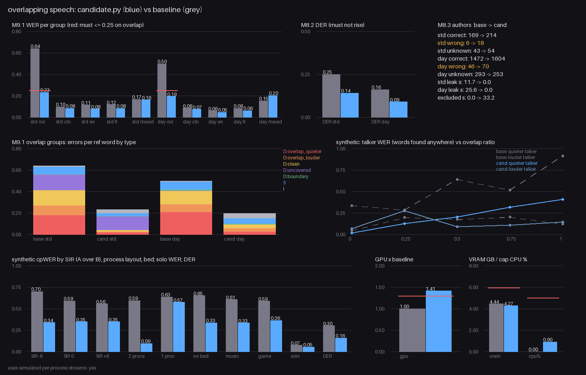
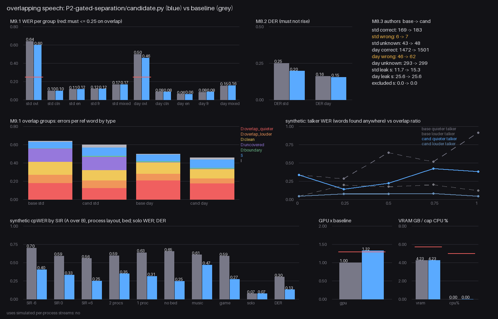
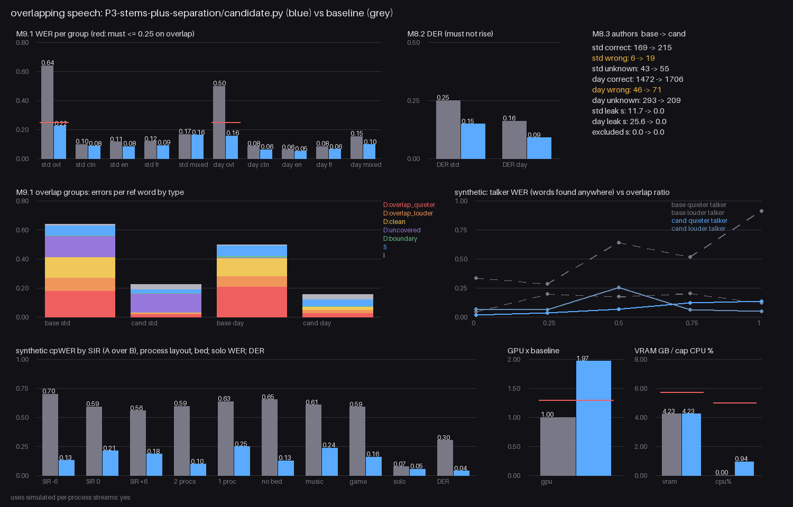
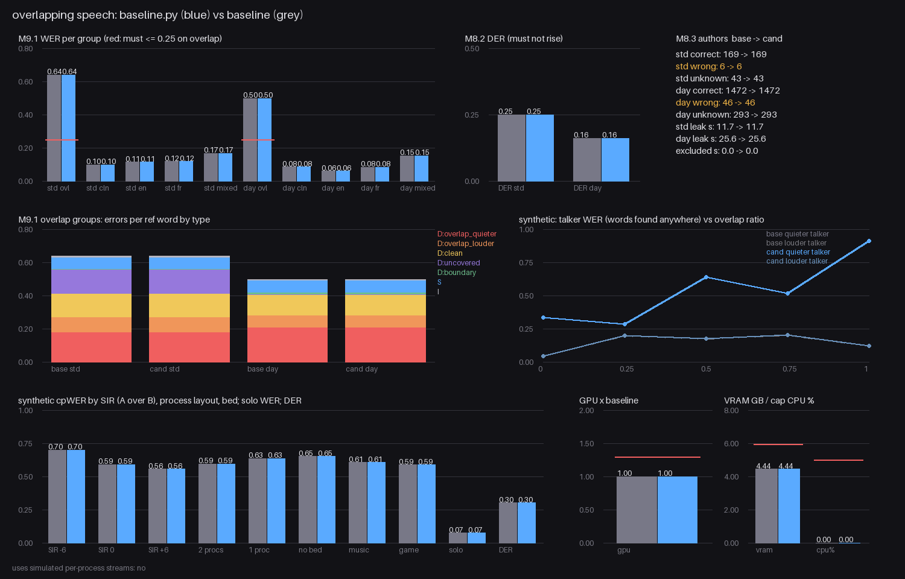
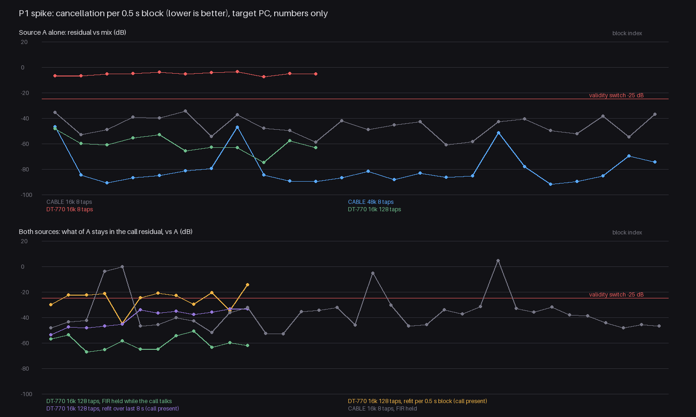
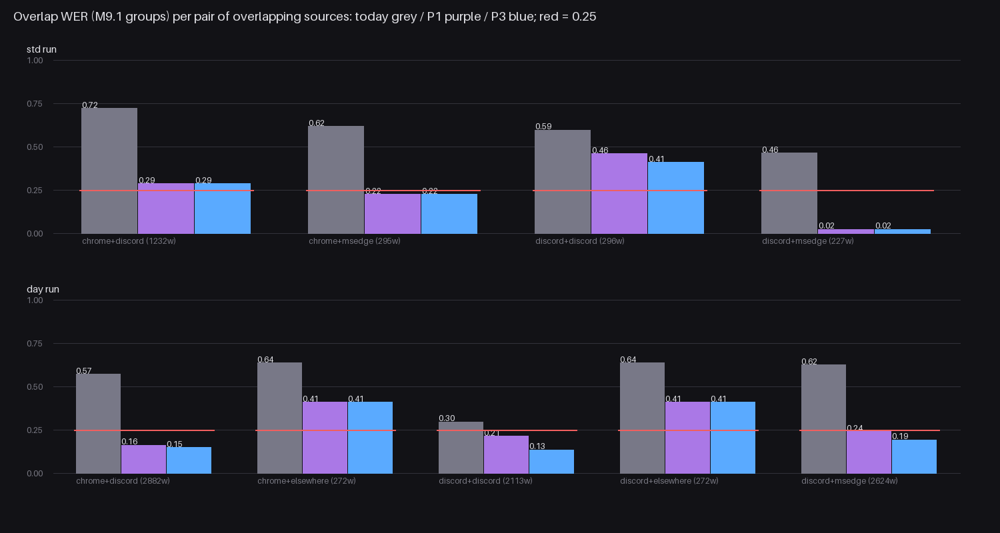
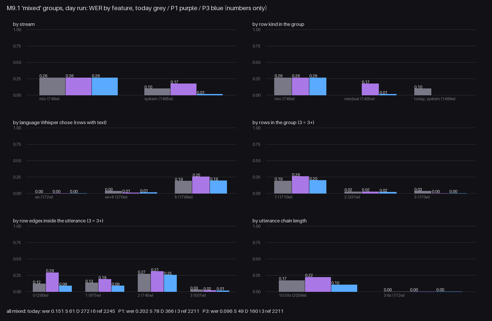
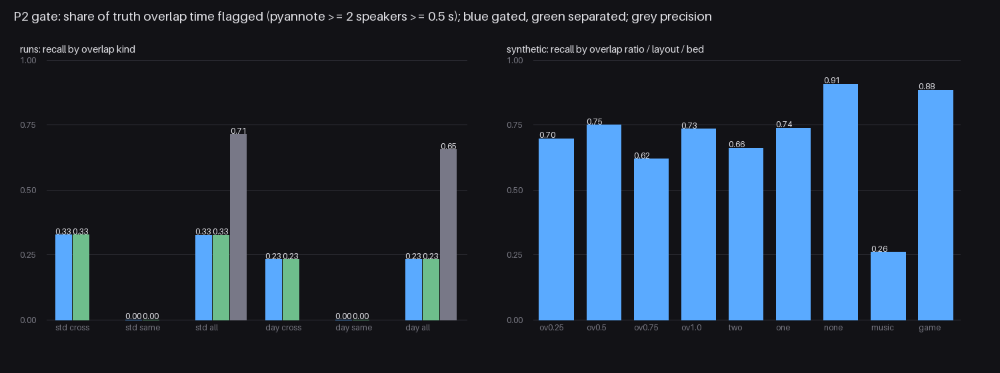

# Overlapping Speech
Date: 2026-11-20 · Context: Python 3.14, faster-whisper 1.2.1 large-v3 (float16, beam 5, FR/EN choice), pyannote segmentation 3.0 + WeSpeaker ResNet34, onnxruntime CPU, WASAPI process loopback via comtypes, Windows 11 26200, RTX 4080 Super; Akashic `capture/audio.py`, `platform/win/audio.py`, `pipeline/transcribe.py`, `pipeline/whisper.py`, `pipeline/speakers.py`; harness `eval/overlapping-speech/` (replays of the standard (1.08 h) and day (6.87 h) quality runs on simulated per-process streams, scored with `eval/quality/score.py`, plus a 72-mixture synthetic set with exact references) · Goal: transcribe each speaker correctly when two sources overlap; attribute overlapping speech to the right source and speaker; stop other apps' sound leaking into the wrong segment (#110) · Ruled out: speaker enrolment UI, transcript language detection (#139, already right), music recognition, Ask quality, real-time captions · Constraints: process loopback takes one process tree per client; Communications-category streams come back silent in process loopback on this PC (local control -96.7 dBFS); each WASAPI client resamples to 16 kHz on its own; faster-whisper decodes a window as one token sequence in one forced language · Fidelity: must keep harness M9.1 overlap WER at most 0.25 on the standard and day runs, clean-speech WER (EN, FR, mixed) no worse than today, M8.2 DER no worse than today, no audio of an excluded app stored; may drop speech of a third simultaneous source, may misplace word timing within 0.5 s, may treat music under speech as noise · Budget: GPU at most +30 % of today's transcription GPU time as a daily average (worst hour reported), VRAM at most +1.5 GB while transcribing, capture-side CPU at most +5 % of one core, fully local, no new dependency without approval (MossFormer2_SS_16K approved for measurement only) · Artifact: https://claude.ai/artifact/7MNf9bE4cRRZf4rTXyLJtF

## Answer
No candidate keeps every must within the limits. The closest is **C1**:
- **How it works:** up to three audible non-voice apps each get a process-loopback include stream. The call is the residual of the endpoint loopback after a 128-tap FIR subtracts those stems. Each stream is segmented, transcribed and attributed on its own, and any system row overlapping an excluded app's sound is dropped [1][2].
- **Musts kept:** overlap WER (0.231 standard, 0.193 day), EN and FR clean WER, DER (0.147 and 0.090) and the exclusion (0 s).
- **Cost:** GPU x1.15 as a daily average (two-parameter model), VRAM +0.04 GB, capture CPU about 2 % of a core.
- **Must failed:** mixed FR/EN clean WER on the day run rises from 0.151 to 0.202. A residual call row holding an English stretch then a French one is decoded in one language, and the other stretch is deleted [1].

The other two built candidates:
- **C6** (C1 plus overlap-gated MossFormer2 separation on every output stream) is identical to C1 on both runs, because its gate fired 0 times there. It is better only on synthetic same-app mixes (cpWER 0.247 against 0.575) [1].
- **C4** (gated separation on today's streams) fails overlap WER (0.597 and 0.458) [1].

Every figure comes from simulated per-process streams, and the harness call is category Other. So the silence of real Communications-category streams in process loopback is not exercised [1][5].

Prior art: OBS application audio capture and win-capture-audio for per-app streams [12][22]; WebRTC AEC3's delay estimation for the fitted subtraction [19]; PixIT for gated separation [14]. No prior art was found for the language split.

**RELAXES:** **C6 + language split** keeps every must on both scorings if the non-goal "transcript language detection (#139)" relaxes. The relaxation: a system row of 5 s or more with an unclear FR/EN choice is cut at an energy dip whose two sides get different languages, and each side is decoded with its own language.
- **Errors:** overlap WER 0.223 / 0.156, mixed clean 0.161 / 0.096, DER 0.148 / 0.089, excluded 0 s.
- **Cost:** GPU x1.23 (standard) and x1.13 (day) as a daily average by model, worst clock hour x1.26, densest 6-minute window x1.97 measured. VRAM +0, capture CPU about 2 % [1].
- **C1 + language split:** equals it on both runs, since the gate never fired there (inferred from the gate counts, not run separately).

## Candidates
Prototype map:
- C1 = P1 scored with the strict exclusion rule (`runs_strict_excl`).
- C1a = P1 as first built.
- C4 = P2.
- C6 = P3 with `P3_LANGSPLIT=0`.
- C6 + language split = P3.

"No-paused" = the same transcripts with truth utterances spoken while Akashic was paused removed. Clean limits are today's values: EN 0.113 / 0.059, FR 0.117 / 0.084, mixed 0.166 / 0.151, DER 0.249 / 0.161 (standard / day).

| Candidate | Uses | Error | Cost vs budget | Status | Prior art |
| :- | :- | :- | :- | :- | :- |
| Today (reference) | endpoint loopback + mic, one stream each | `ovl_std=0.639 ovl_day=0.497 en 0.113/0.059 fr 0.117/0.084 mixed 0.166/0.151 der 0.249/0.161 wrong 6/46 leak 11.7/25.6 s excl_s=0.0 syn_cpwer=0.615`; no-paused overlap 0.583 / 0.501 | 408 s GPU per recorded hour, VRAM 4.44 GB | reference | — |
| C1 Per-app stems + call residual, strict exclusion (P1) | A1, A3, X1, X2, S6 | `ovl_std=0.231 ovl_day=0.193 en 0.083/0.049 fr 0.091/0.060 mixed 0.161/0.202 der 0.147/0.090 wrong 18/70 excl_s=0.0 syn_cpwer=0.343`; no-paused overlap 0.116 / 0.193 | GPU x1.151 / x1.038 daily (model) vs x1.30, x1.76 densest 6-min window; VRAM +0.04 / 1.5 GB; capture CPU ≈ 2.0 / 5 % core | fails: mixed clean WER day 0.202 > 0.151 [1]; closest in-limit candidate | win-capture-audio / OBS application audio capture [12][22]; WebRTC AEC3 delay estimation [19] |
| C1a P1 as first built (residual dropped only while the excluded app is audible) | A1, A3, X1, X2 | `ovl_std=0.231 ovl_day=0.193 en 0.078/0.046 fr 0.082/0.060 mixed 0.161/0.202 der 0.141/0.089 excl_s=33.2` | as C1 | fails: 33.2 s of transcript over an excluded app's sound (15.3 s standard, 18.0 s day); mixed day 0.202 [1] | as C1 |
| C6 Stems, then gated separation on every stream (P3, split off) | A1, A3, X1, X2, S7, S1 | `ovl_std=0.231 ovl_day=0.193 fr_day=0.063 mixed_day=0.202 der 0.147/0.091 excl_s=0.0`; gate fired 0 times on both runs; synthetic cpWER 0.174 (one process 0.247 vs C1 0.575) | as C1 on the real runs + gate CPU 79.1 / 88.8 s per recorded hour; VRAM +0 | fails: mixed clean WER day 0.202 [1] | PixIT [14] |
| C6 + language split (P3) | A1, A3, X1, X2, S7, S1, L1 | `ovl_std=0.223 ovl_day=0.156 en 0.083/0.048 fr 0.091/0.062 mixed 0.161/0.096 der 0.148/0.089 wrong 19/71 excl_s=0.0`; no-paused overlap 0.107 / 0.156; synthetic (before the split) cpWER 0.174 | GPU x1.233 / x1.131 daily (model) vs x1.30, worst clock hour x1.259, x1.97 densest 6-min window; VRAM +0.0 / 1.5 GB; capture CPU ≈ 2.0 / 5 % core | works if the non-goal "transcript language detection (#139)" relaxes to a per-side FR/EN choice in long unclear system rows [1] | none found for the split; as C6 |
| C4 Overlap-gated separation on today's streams (P2) | S7, S1 | `ovl_std=0.597 ovl_day=0.458 en 0.116/0.061 fr 0.117/0.084 mixed 0.166/0.156 der 0.196/0.154 excl_s=0.0 syn_cpwer=0.329`; gate recall 0.33 / 0.23, same-app 0.00 | GPU x1.32 densest window, decode calls x1.086 / x1.031; VRAM +0 (CPU separation, RTF 1.70); CUDA variant +4.79 GB | fails: overlap WER 0.597 / 0.458 > 0.25; clean EN and mixed day also rise [1] | PixIT [14] |
| C2 Complementary include/exclude pair | A1, A2 | not built: refuted | two process-loopback clients (+0.78 % core measured for two) | fails: exclude mode reported silent for a Communications app too (#414), so exclude(X) drops the call from both streams [9][5][20] | win-capture-audio include + exclude [12] |
| C3 Wave Link mixer endpoints | A4 | not built: not applicable | ~1.5-2.9 % core (estimate) | fails: discord.exe, steam.exe and wallpaper64.exe render straight to the DT-770 endpoint; the Wave Link Voice Chat and System endpoints had no sessions [20] | Elgato Wave Link multitrack |
| C5 Packed Whisper window | S7 | not built: refuted | ~+9.5 % GPU at 20 % co-active (estimate) | fails: one token sequence and one forced language per window; separate passes already fit the daily budget [20][21] | none found |






C1.png shows P1 as first built (excluded 33.2 s). C6.png is P3, that is C6 with the language split. Each image puts the candidate in blue beside today in grey.

## Method
C1, the closest in-limit candidate. Capture runs in the capture process; transcription runs in the worker.

1. **Pick stems.** Per-session peak meters are polled once a second. Up to 3 audible apps that are not voice apps get a process-loopback include client, in this order: excluded apps first (they must be subtracted), then apps already stemmed, then the loudest non-music apps, then music. A pick stays for 30 s, and its first 100 ms stay in the residual. Assumes the call renders in the Communications category, so it cannot be captured per process and must be the residual [5].
2. **Residual.** The endpoint loopback minus each stem through a 128-tap FIR. The FIR is fitted jointly by least squares on 1 s where the meters show only stemmed apps, refitted every 60 s, held otherwise, and applied by FFT convolution. Assumes each client's own resampler acts as a fixed linear filter between refits; the spike measured -57 dB on the DT-770 endpoint over a short, quiet check [2].
3. **Validity switch.** On 0.5 s blocks where only stemmed apps sound, a residual less than 25 dB below the mix switches back to today's mix for at least 10 s, with the stems muted, so no speech is transcribed twice. Assumes endpoint APOs or a limiter (in the mix, not in the stems) show up as shallow blocks.
4. **Streams.** Every stem except music and excluded apps, plus the residual, runs Akashic's segmenter and Silero VAD. Each row is transcribed with today's decode and its own prompt context, attributed with today's speakers job, and stamped with its real start time. The mic stays as today.
5. **Strict exclusion.** An excluded app's stem is never kept. Any system row, stem or residual, is dropped while the meters show the excluded app audible within 1 s of it, as today's capture drops such segments whole.
6. **Relaxed step (C6 + language split only).** A system row of 5 s or more is checked when its chosen language holds less than 0.98 of the FR+EN probability. It is cut at the one of its 3 deepest 100 ms energy dips whose two sides (each ≥ 1.5 s) detect different languages, and each side is decoded with its own language. Assumes mixed FR/EN speech changes language at a pause. On the day run, 21 of the 62 rows holding a mixed utterance were split, and 0 of 80 single-language control rows.

The equations:
```
r[n] = y[n] − Σ_k (h_k ∗ x_k)[n]      y: endpoint loopback (16 kHz), x_k: stem k (process loopback include), h_k: 128 taps
h = argmin ‖y − Σ_k h_k ∗ x_k‖²       on 1 s with only stemmed apps audible, refit every 60 s, held otherwise
valid(block) ⇔ 10·log10(‖r‖² / ‖y‖²) ≤ −25 dB on stem-only 0.5 s blocks; else today's mix for ≥ 10 s, stems muted
```

**Cost:**
- **GPU:** daily average x1.151 (standard) and x1.038 (day), against x1.30. The model is 0.422 s per decode call + 0.0672 s per audio second, fitted on two same-session cost windows. The densest 6-minute window measured x1.76.
- **VRAM:** +0.04 GB against 1.5 GB.
- **Capture CPU:** 0.90 % of a core in the harness (meters, FIR, per-stream VAD) plus 1.09 % for three process-loopback clients in the spike, about 2.0 % against 5.
- **Speakers job CPU:** 453 s per recorded hour against 218 today.
- **With the language split:** x1.233 and x1.131 daily (0.479 s per call + 0.0577 s per audio second, plus 22.1 / 183.1 s of measured detection GPU per run), worst clock hour x1.259, densest window x1.97, VRAM +0.

**Fails when:**
- A residual row holds English then French → it is decoded in one language and the other is deleted (mixed day 0.202).
- Two talkers share one app → they stay mixed (Discord pairs 0.46 standard, 0.21 day).
- A real Discord call is in the Communications category → it cannot be a stem, and the method relies on it being the residual, which no real call has shown yet.
- A second voice app is active, or an APO or limiter sits on the endpoint → shallow residual, so today's mix for 10 s.

**Reproduce:**
- C1: `uv run python eval/overlapping-speech/P1-per-process-streams/p1_run.py eval/overlapping-speech/P1-per-process-streams/candidate.py eval/overlapping-speech/P1-per-process-streams`. The strict-exclusion scores are `detail.json` `runs_strict_excl`.
- C6 + language split: `uv run python eval/overlapping-speech/P3-stems-plus-separation/p3_run.py eval/overlapping-speech/P3-stems-plus-separation`.
- Both need the quality runs' stores in `eval/quality/local/runs/` (this PC only). Working copy: `_dev/invent/overlapping-speech/` (local, gitignored).

## Findings
### Where today's overlap errors come from
- All overlap error is on the system stream: 1226 errors over 1918 words on the standard run (1081 deletions), and 3579 over 7143 on the day run (3010 deletions) [3].
- By fix route, at word level:
  - per-process separation: 74.6 % (standard) and 89.2 % (day) of overlap errors;
  - speech separation: 5.1 % and 6.5 %;
  - never recorded by design: 20.3 % on the standard run (speech while Akashic was paused) and 4.2 % on the day run (voice on another endpoint) [3].
- The quieter talker, usually the video at about 0.4x the call level, loses 75 % (standard) and 80 % (day) of its words in overlapped moments [3].
- A call over a video reads 0.682 and 0.601; the same call with no bed and no overlap reads 0.025 and 0.057 [3].
- Fixing the per-process route alone projects to 0.237 (standard) and 0.116 (day); the paused-speech floor on the standard run is 0.130 [3].

### Can stems be subtracted from the endpoint mix on this PC?
- On VB-CABLE, an 8-tap fit leaves the residual -44.4 dB below the mix at 16 kHz and -85.0 dB at 48 kHz, with a stable lag and no drift [2].
- On the DT-770 at 16 kHz (the recorded default endpoint), 8 taps give only -5.4 dB, because each WASAPI client resamples on its own (lags 64-89 samples, drift -19.8 ppm). A 128-tap FIR gives -57.3 dB (worst block -48.0). Held while the call talks, -59.1 dB of the stem is left in the residual [2][21].
- The DT-770 check is short and quiet: 11 stem-only and 12 two-source blocks, with the mix at -60.9 dBFS [2].
- Capture CPU for 0, 1, 2 and 3 process-loopback clients: 0.31, 0.78, 1.09 and 1.41 % of a core (+1.09 % for three). The FIR at 16 kHz for three stems costs 0.47-0.59 % [2].



### How faithful the simulated per-process streams are
- Re-rendered sources explain 89 % (median) of the stored system band energy and 96 % of the mic [4].
- On single-source system segments, Whisper on the simulated stream and on the stored audio differ by 0.016-0.029 WER (standard) and 0.008-0.081 (day) per app [4].
- The streams are not sample-exact against the stored audio, so the residual is modelled from the spike's measured per-block depth and leak, not subtracted [1][4].

### What per-app streams change
- C1 cuts overlap WER from 0.639 to 0.231 (standard) and from 0.497 to 0.193 (day). With paused speech removed it reads 0.116 and 0.193 [1].
- Cross-app pairs drop to 0.02-0.29. Same-app Discord pairs stay at 0.46 (standard) and 0.21 (day) [1].
- Today, 253 of 254 standard-run system segments list Akashic's own loopback session as a source. The prototypes filter it by pid and list it on 0 segments [1][6].
- M7.1 leak drops to 0.0 s on both runs [1].
- Wrong authors rise from 6 to 18 (standard) and from 46 to 70 (day), while correct authors rise from 169 to 214 and from 1472 to 1604 [1].
- The mixed regression is on the residual call stream: its mixed-group WER goes from 0.095 (today's system rows) to 0.171, mostly deletions [1].
- On the 62 day-run rows holding a mixed utterance, the language split takes the row WER from 0.151 to 0.057. The 80 single-language control rows are unchanged (0.027 EN, 0.045 FR) [1][7].




### What gated separation adds
- On today's streams the gate flags 33 % (standard) and 23 % (day) of truth overlap time, and 0 % of same-app overlap. Precision is 0.71 and 0.65 [1].
- MossFormer2_SS_16K runs at RTF 1.65-1.76 on CPU (3-12 s windows), and at 0.041-0.051 on CUDA with +4.8 GB VRAM [1][17].
- After the stems, no real-run stream holds a two-talker overlap of 0.5 s or more (0.18 s and 0.35 s in total), so the gate fires 0 times [1].
- On the synthetic set the gate reaches recall 0.865 and precision 0.80, and same-process cpWER falls from 0.575 (C1) to 0.247 [1].
- Published results:
  - Whisper large-v3 after TF-CrossNet separation gets 5.0 % WER on Libri2Mix against 2.5 % clean [15].
  - PixIT lowers AMI-SDM cpWER with Whisper from 38.3 to 31.7, and leakage removal is essential (50.1 without) [14].
  - Separation models trained on English lose quality on other languages [16].



## Mechanisms
- A1 Process loopback include: `VAD\Process_Loopback`, include target process tree, one tree per client · assumes the app renders outside the Communications category · breaks for Communications streams (silent, local control -96.7 dBFS) and the capturer's own tree [5][8][9]
- A2 Process loopback exclude: whole mix minus one process tree · assumes exclude mode keeps Communications streams · reported silent for Teams in exclude mode too; single tree [9]
- A3 Per-session peak meter: `IAudioMeterInformation` per audio session, polled 20-1000 ms, as a per-app activity mask · assumes energy marks activity · energy is not speech; several sessions per app [10]
- A4 Per-app endpoint routing: an app routed to its own endpoint (undocumented AudioPolicyConfig, EarTrumpet) or a mixer channel · assumes the user's audio setup may change · undocumented, changed at 21H2 [13]
- A5 Ducking notifications: `IAudioVolumeDuckNotification` as a call-active signal · assumes ducking is enabled · default ducking lowers other streams during calls [11]
- X1 Fitted FIR stem subtraction: residual = mix − Σ FIR_k ∗ stem_k, least squares on stem-only time · assumes each client's resampler acts as a fixed linear filter between refits · breaks with endpoint APOs or limiters, packet gaps, drift between refits [2][19]
- X2 Validity switch: fall back to today's mix while the residual is not 25 dB below it · assumes stem-only blocks occur often enough to judge depth · breaks over long stretches where the call always talks
- S1 Separation before ASR: 2-speaker separation (MossFormer2 16 kHz, 55.7 M) then Whisper per output · assumes two talkers close to the training domain · breaks on 3+ talkers, language shift, artefacts, silent-output hallucination [15][16][17]
- S2 Target-speaker extraction (VoiceFilter, WeSep) · needs a clean target enrolment; one pass per speaker [18]
- S3 Diarization-conditioned Whisper (DiCoW, large-v3-turbo 0.9 B) · a second Whisper-class model, likely over +1.5 GB VRAM, English-trained [18]
- S4 Serialized-output Whisper (SA-DiCoW) · better on full overlap, worse on real meetings, leakage 11 % [18]
- S5 Speech enhancement (DeepFilterNet, RNNoise, Demucs) · removes non-speech only; may raise Whisper WER [18]
- S6 Per-stream segmenting: segment and decode each capture stream on its own, rows stamped with real start times · breaks with two talkers inside one stream
- S7 Overlap-gated processing: separation only where pyannote's powerset names two speakers ≥ 0.5 s · breaks under music beds and on overlaps under 0.5 s [1]
- L1 Language split at an energy dip: cut a long row with an unclear FR/EN choice where the two sides detect different languages · assumes the language changes at a pause · breaks on code-switching inside a phrase and on rows under 5 s [1][7]

## Explored
- **C1a (P1 as first built):** 33.2 s of transcript stored over an excluded app's sound (15.3 s standard, 18.0 s day). The strict rule (C1) brings it to 0, at +0.007 clean WER on the standard run.
- **C2 (complementary include/exclude pair):** refuted.
  - Issue #414 reports Teams silent in exclude mode as well as include mode, and the local control shows Communications streams silent in include mode. So exclude(X) would drop the call from both streams [9][5][20].
  - The harness call is a waveOut player in category Other, so the harness cannot show this failure.
- **C3 (Wave Link mixer endpoints):** not applicable. Discord renders to the DT-770 endpoint directly, and the Wave Link Voice Chat and System endpoints had no app sessions in the local probe [20].
- **C4 (overlap-gated separation on today's streams):** overlap WER 0.597 and 0.458. The gate misses most cross-app overlap (recall 0.33 and 0.23) and all same-app overlap; 13 of 19 standard overlap groups have a music bed [1].
- **C4 on the GPU:** RTF 0.049, but VRAM +4.79 GB against 1.5 GB, and GPU x1.42 on the densest window [1].
- **C5 (packed Whisper window):** refuted except for same-language pairs. Each window gets one token sequence and one forced language, and separate passes already fit the daily budget [20][21].
- **C6 without the language split:** identical to C1 on both runs (the gate fired 0 times), so it fails mixed day the same way; better only on synthetic same-app mixes.
- **S2-S5:** not prototyped. Each needs a target enrolment, a second Whisper-class model over the VRAM budget, or removes non-speech only [18].

## Caveats
- **Main caveat:** the harness call is a waveOut player in category Other, so the Communications-category silence of real Discord in process loopback (local control -96.7 dBFS) is not exercised. C1 and C6 rely on the call being the residual. The first thing a real call has to show is that the residual carries it and that no stem picks it up [5][20].
- **Simulated per-process streams:** re-rendered from player logs, not sample-exact (correlation 0.3-0.6 with the stored audio). The residual's leak is modelled from the spike's per-block depth on the DT-770 endpoint (-57 dB, 128-tap FIR, 23 blocks of a quiet check), not subtracted [1][2][4].
- **Small overlap margin on the standard run:** 0.231 (C1) and 0.223 (C6 + language split) against 0.25, a margin of 0.019-0.027.
- **Two scorings:** the harness M9.1 counts words spoken while Akashic was paused as errors (a floor of about 0.13 on the standard run). Every must is shown under both scorings.
- **Scorer change needed:** M9.1 joins references and transcripts in start order, and M8.3 picks the truth speaker across apps. Per-stream rows need a scorer that groups by (stream, source); the harness stamps each row with its real start time instead [1][21].
- **Wrong speaker authors rise:** standard 6 → 18 (C1) and 19 (C6 + language split), day 46 → 70 and 71. Correct authors rise more: 169 → 214-215 and 1472 → 1604-1706.
- **"Elsewhere" pairs:** these overlap pairs (WER 0.408 for C1 and C6 + language split) hold speech played on another endpoint, which Akashic never records by design.
- **Synthetic numbers of C6 + language split:** they come from a replay before the language split and were not rerun.
- **GPU daily figures are model estimates:** a two-parameter model (seconds per decode call + seconds per audio second) fitted on two same-session cost windows, not a measured day. The densest 6-minute window is measured. C4's daily figure is the decode-call ratio. The side.png GPU bars of C1 and C4 compare against a baseline from another session (x1.41, x1.32).
- **C1 + language split:** equals C6 + language split on the real runs by inference from the gate counts (0 gated spans), not a separate run.
- **Separation model:** MossFormer2_SS_16K (ClearerVoice-Studio, Apache-2.0, 55.7 M parameters, training data "open-sourced and private"), from Hugging Face at pinned commit 407cb030. The checkpoint sha256 (00a3a48b…) matches the LFS oid. It was exported to ONNX in a throwaway venv and is approved for measurement only [17].
- **C4's CPU separation is slow:** RTF 1.70; 114.9 s of audio separated took 207 s on the 1.08 h standard run. Separation would run on CPU only while no game is in front (user answer).
- **Limited evidence:** two runs, one synthetic set and one PC (DT-770 endpoint, headset). No real call was recorded for this study.
- **WEAK:** Communications silence as a general finding (one report, synthetic audio); the ducking attenuation figure is not on Microsoft's page [20].

## Sources
[1] Overlapping-speech harness and prototypes — `eval/overlapping-speech/` (baseline, P1, P2, P3: `metrics.txt`, `detail.json`, `cost-same-session.json`, `ls-census.json`) — tier 1 — target PC, 2026-11-20
[2] Subtraction spike on VB-CABLE and the DT-770 endpoint — `eval/overlapping-speech/P1-per-process-streams/spike.json` — tier 1 — target PC, 2026-11-20
[3] Diagnosis of today's overlap errors — `eval/overlapping-speech/diagnosis.json` — tier 1 — 2026-11-20
[4] Fidelity of the simulated per-process streams — `eval/overlapping-speech/fidelity.json` — tier 1 — 2026-11-20
[5] Can per-process loopback capture separate voice chat, game and browser audio on Windows 11? (research) — `docs/research/windows-process-loopback-capture.md` — tier 1 — 2026-11-19
[6] Does a WASAPI loopback capture show up as an audible session? (research) — `docs/research/wasapi-loopback-own-session.md` — tier 1 — 2026-11-19
[7] How should a local transcriber choose French or English per speech segment? (research) — `docs/research/whisper-language-choice-fr-en.md` — tier 1 — 2026-11-19
[8] PROCESS_LOOPBACK_MODE — https://learn.microsoft.com/en-us/windows/win32/api/audioclientactivationparams/ne-audioclientactivationparams-process_loopback_mode — tier 1
[9] Windows-classic-samples issue #414 — https://github.com/microsoft/Windows-classic-samples/issues/414 — tier 2 — comment of 2026-10-28
[10] IAudioMeterInformation — https://learn.microsoft.com/en-us/windows/win32/api/endpointvolume/nn-endpointvolume-iaudiometerinformation — tier 1
[11] Handling audio ducking events from communication devices — https://learn.microsoft.com/en-us/windows/win32/coreaudio/handling-audio-ducking-events-from-communication-devices — tier 1
[12] bozbez/win-capture-audio `audio-capture-helper.cpp` — https://github.com/bozbez/win-capture-audio — tier 1 — default branch, 2026-11-19
[13] EarTrumpet `AudioPolicyConfigFactoryImplFor21H2.cs` (per-app default endpoint) — cited by name in `_dev/invent/overlapping-speech/mechanisms-capture.md` (local) — tier 2
[14] PixIT: joint training of speaker diarization and speech separation — https://arxiv.org/abs/2403.02288 — tier 1
[15] Whisper large-v3 after TF-CrossNet separation on Libri2Mix — https://arxiv.org/abs/2503.17886 — tier 1
[16] Separation models across languages (EN-trained Conv-TasNet on Mandarin) — https://arxiv.org/abs/2204.11032 — tier 1
[17] MossFormer2_SS_16K model card and provenance — https://huggingface.co/alibabasglab/MossFormer2_SS_16K (commit 407cb030cd66340918ebb6c8cc63b18f8592cdbe), `eval/overlapping-speech/P2-gated-separation/model/provenance.json` — tier 1 — 2026-11-20
[18] Overlapped-speech ASR mechanism catalog (VoiceFilter, WeSep, DiCoW, SA-DiCoW, DeepFilterNet, RNNoise, Demucs) — `_dev/invent/overlapping-speech/mechanisms-capture.md` (local) — tier 2 — 2026-11-20
[19] WebRTC AEC3 delay estimator and clock-drift detector (prior art for the fitted subtraction) — named in `_dev/invent/overlapping-speech/brief.md` "Prior art" (local), not fetched — tier 2
[20] Fact-check, refuter and local probe notes — `_dev/invent/overlapping-speech/checks.md`, `brief.md` "Local facts" (local) — tier 1 — 2026-11-20
[21] Akashic code — `src/akashic/platform/win/audio.py:456-460` (each client converts to 16 kHz on its own), `src/akashic/pipeline/whisper.py:111-118` (one forced language per call), `eval/quality/score.py:743` (`m8_m9`, start-order join) — tier 1 — 2026-11-20
[22] OBS win-wasapi (application audio capture) — https://raw.githubusercontent.com/obsproject/obs-studio/master/plugins/win-wasapi/win-wasapi.cpp — tier 1 — master, 2026-11-19
