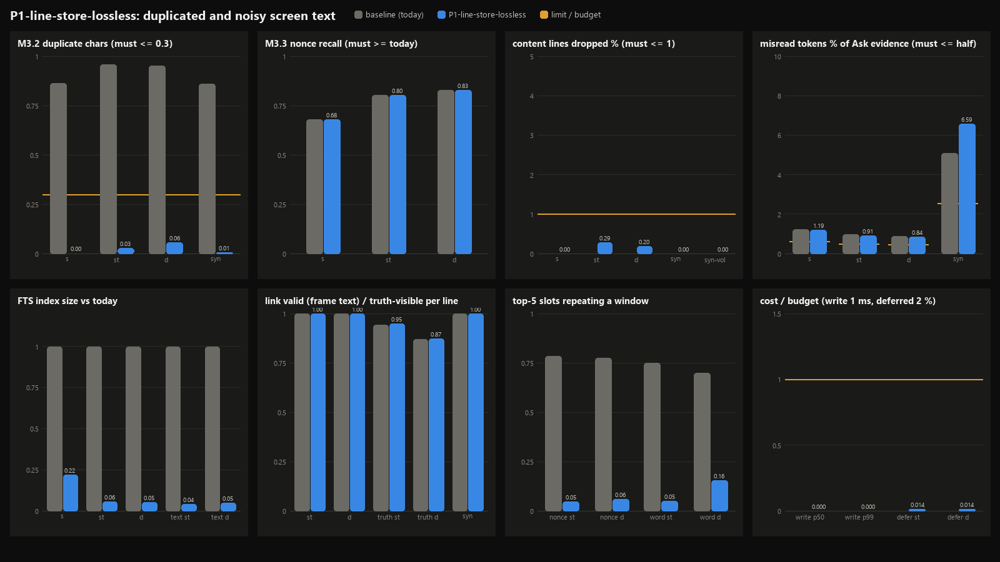
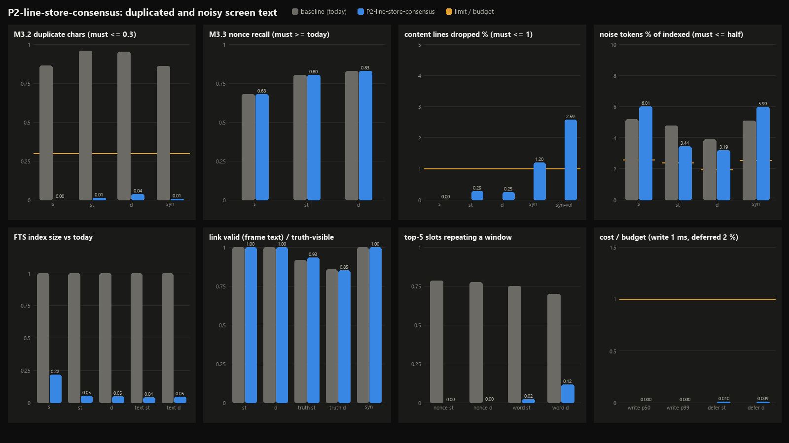
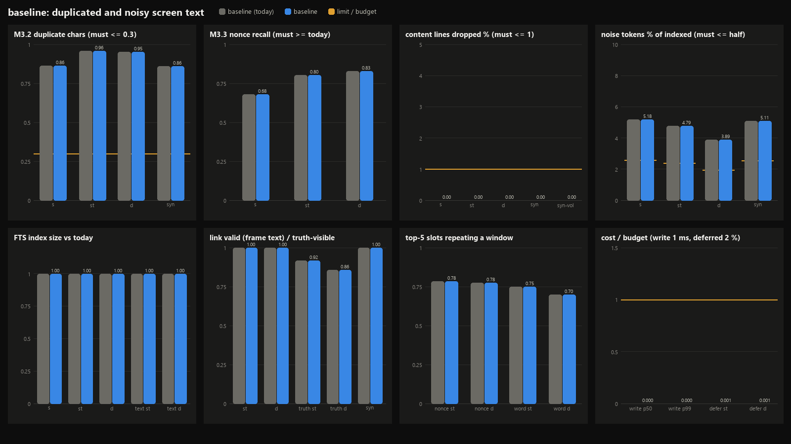
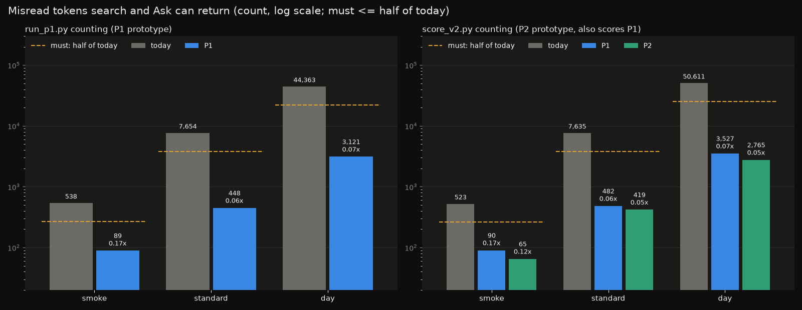

# Screen Text Duplication And Noise
Date: 2026-11-20 · Context: Python 3.14.10, SQLite FTS5 (in memory), Windows 11 26200, Ryzen 7 7800X3D; Akashic `capture/text.py`, `capture/ocr_gate.py`, `storage/frames.py`, `frame_windows_fts`, `pipeline/embed.py`; harness `eval/screen-text-duplication-noise/` (replays of the stored window texts of quality runs smoke 2241, standard 1818 and day 0547, scored against driver truth, plus a synthetic set with exact truth) · Goal: store and index each distinct piece of window text once per window run, near-duplicates included; separate content from UI chrome and drop or down-weight OCR garbage; keep every line the user saw findable at its moment · Ruled out: OCR accuracy itself (#190, French OCR pack F12), image change detection (#208), embedding reuse (#101), Ask and answer quality, a vision model, UIA read speed, cross-day dedupe of the same document · Constraints: Windows.Media.Ocr gives no confidence; the UIA read is a flat cache with no ancestry · Fidelity: must keep M3.3 no worse than today on the standard and day runs (through the new index), M3.1 CER no worse (on frames rebuilt from the line store), at most 1 % of content lines dropped or down-ranked as chrome or garbage, a kept line linked to a frame where it was visible (frame-text validity 1.00, per-line truth link no worse than today with the same weighting), M3.2 at most 0.3 (over what is physically stored), the count of provably misread tokens that search and Ask can return at least halved, every chrome visibility interval kept; may store UI chrome once per app per day, may choose which frame represents a repeated line · Budget: ≤ 1 ms extra per stored frame on the capture write path, deferred work ≤ 2 % of one core averaged over a day, FTS and Ask query cost no worse than today, no new dependency, no GPU model per frame, schema may change, text encrypted and any hash keyed (HMAC) as in #101 · Artifact: https://claude.ai/artifact/7PGhJezjoGUyc7cFD7xr7q

## Answer
Best fit: **C1** (prototype P1). A deferred worker turns each window's frame texts into a lossless line store, with one row per distinct line per (process, day) under an HMAC key [1]. Near-duplicates are stored as digit templates with exact slots or as exact edit residuals. Frame rows keep an ordered list of line ids, and sightings are on/off intervals per window run. There is one FTS document per window run. Chrome is stored once per app-day at a lower bm25 weight. Misread-shaped tokens go to a lowest-weight junk column that stays searchable. It keeps every must [1]:
- M3.3 equals today: 0.680 / 0.802 / 0.830.
- M3.1 on rebuilt frames equals today, with 0 rebuild mismatches on 10435 rows.
- Content lines down-ranked: 0 / 0.29 / 0.20 %.
- Frame-text link validity is 1.00. The per-line truth link is 0.985 / 0.948 / 0.875, against today's 0.984 / 0.942 / 0.870.
- M3.2 is 0.002 / 0.028 / 0.059 over FTS documents and 0 over physically stored rows.
- Misread tokens that search and Ask can return: 89 / 448 / 3121, against today's 538 / 7654 / 44363 (0.17x / 0.06x / 0.07x).

Cost: 0 µs on the write path against 1 ms. Deferred work takes 0.027-0.028 % of one core against 2 %. The FTS index is 0.22x / 0.056x / 0.052x of today [1].

Prior art: CLP for templates with exact variables [7] and template detection for chrome [10]. No line-level store with run intervals was found; screenpipe skips whole windows by SimHash [3][6].

Relaxed: if M3.1 may rise by 0.00004 CER on rebuilt frames, **C2** (P2, consensus readings) cuts misreads further. By `score_v2.py` it reaches 65 / 419 / 2765 against 523 / 7635 / 50611 (0.12x / 0.05x / 0.05x), with M3.2 0.002 / 0.011 / 0.037. It loses 0 / 0.29 / 0.25 % of content lines and drops 1.20 % of synthetic content lines [1].

## Candidates
Report candidates follow the prototypes: C1 = P1, which merges candidates C1, C2, C4 and C5 of `candidates-merged.md`. C2 = P2, which merges C1, the decompose variant of C3, C4 and C5. C1a-C1c are P1 sweep settings and C2a-C2c are P2 sweep configurations. C3 = merged C6.

Runs are listed smoke / standard / day. Two tools count misreads: `run_p1.py` ("p1") and `score_v2.py` ("v2").

| Candidate | Uses | Error | Cost vs budget | Status | Prior art |
| :- | :- | :- | :- | :- | :- |
| Today (reference) | one FTS row per stored frame window | `m32 0.863/0.958/0.952 · m33 0.680/0.802/0.830 · cer 0.2289/0.1837/0.2119 · link 1.00 · misread p1 538/7654/44363, v2 523/7635/50611 · tlinkL p1 0.984/0.942/0.870, v2 0.984/0.937/0.892 · crowd 0.733/0.784/0.777` | write 0 µs; FTS 127/1992/12012 KB | reference | — |
| C1 Lossless line store, digit template + residual, chrome by spread, junk column (P1) | D1, D11, D7, D6, D10, N4, N10, N6, N7 | `m32 0.002/0.028/0.059 (stored 0) · m33 0.680/0.802/0.830 · cerR 0.2289/0.1837/0.2119, rebuild_bad 0 · content down 0/0.29/0.20 % · syn_drop 0 · link 1.00 · tlinkL p1 0.985/0.948/0.875, v2 0.986/0.947/0.896 · misread p1 89/448/3121, v2 90/482/3527 · crowd 0/0.049/0.061` | write 0 / 1000 µs; deferred 0.027-0.028 / 2 % of a core; FTS 0.22/0.056/0.052x | works (best fit) | CLP [7], template detection [10] |
| C2 Line store with aligned-reading consensus (P2) | D1, D11, D7, D6, N4, N10, N6, N7, ROVER consensus | `m32 0.002/0.011/0.037 · m33 0.680/0.802/0.830 · M3.1 rebuilt 0.22886/0.18377/0.21191 (today 0.22886/0.18373/0.21189) · content down 0/0.29/0.25 % · syn_drop 1.20 % (volatile 2.59 %) · link 1.00 · tlinkL v2 0.986/0.944/0.896 · misread v2 65/419/2765 · crowd 0/0/0.002` | write 0 / 1000 µs; deferred 0.018-0.029 / 2 %; FTS 0.216/0.054/0.049x | works if M3.1 on rebuilt frames may rise by 0.00004 CER [1] | ROVER [9], CLP [7] |
| C1a C1, token stability guard off | as C1 | `drop 1.45 % standard, 0.65 % day · misread share per doc 0.84x/0.87x` | as C1 | fails: 1.45 % of standard content lines lost [1] | as C1 |
| C1b C1, minority readings down-ranked | as C1 | `drop 0.29/0.42 % · m33 day 0.826` | as C1 | fails: M3.3 day 0.826 against 0.830 [1] | as C1 |
| C1c C1, every guard off, LM at 5 % | as C1 | `drop 3.90/1.15 % · m33 day 0.826 · syn_drop 6.6 %` | as C1 | fails: 3.90 % lost [1] | as C1 |
| C2a C2, garbage split inside lines | as C2 | `misread v2 62/364/2631 · drop 0/1.59/1.10 % · m32 day 0.056` | as C2 | fails: 1.59 % / 1.10 % lost [1] | as C2 |
| C2b C2, UIA trigram LM on | as C2 | `misread v2 55/424/2884 · drop 0/0.29/0.23 % · m33 0.616/0.802/0.830` | as C2 | fails: smoke M3.3 0.616 against 0.680, harness lines no longer findable [1] | as C2 |
| C3 Source-split regimes, UIA landmark flag at capture | N8, N4 | `not built: no UIA ancestry in the cache request` | ~0.6 ms per frame on the write path (inventor estimate) | fails: the UIA read is a flat FindAllBuildCache, and UIA already drops buttons, menus and tabs [3][4] | none found |

C2c (C2 with LM and split) is listed in Explored: it loses 4.41 / 3.76 / 1.58 % of content lines.






## Method
C1. The capture write path is unchanged. Everything else runs in a deferred worker.

1. **Capture as today.** `frame_windows.text` is written per frame. Assumes the worker catches up between captures; the backlog stays findable through today's FTS.
2. **Lines and keys.** Each window text splits into lines. Each distinct line is keyed `HMAC(K_line, process | day | line)`. Assumes keys and text stay encrypted and keyed as in #101.
3. **Lossless near-duplicates.** A new line whose digit template (`\d+` → slot) matches a stored line stores only its digits. A new line within `ceil(0.1·len)` edits (len ≥ 8) of a stored line stores an exact edit residual. Other lines are stored whole. Frames rebuild byte for byte: 0 mismatches on 10435 rows. Assumes residuals stay small for clocks, counters and OCR flips.
4. **Frame rows and sightings.** A frame row keeps an ordered list of line ids instead of text. Sightings are on/off intervals per (line, window run). A run is consecutive frames of one hwnd with the same title and url and no gap over 300 s.
5. **One FTS document per window run** holds its content lines, and embeddings and Ask read the same document. Assumes the window run stays the search unit (RETRIEVAL.md: the window is the unit), so implicit AND still works across the lines of one run.
6. **Chrome by context spread.** A line key qualifies as chrome in either case:
   - it is seen in ≥ max(3, 0.5·N) (title, url) contexts of an app-day;
   - for a single-context app, it is seen in ≥ 0.8 of ≥ 3 runs.

   Lines over 200 characters are never chrome. Chrome goes to one app-day document at lower bm25 weight. It is kept in Ask evidence as one block, with every visibility interval. Assumes static content opened in many contexts is rare: 1 browser line on standard was taken as chrome.
7. **Junk column.** An OCR token is garbage-shaped when it misses the day's UIA lexicon and also does one of these:
   - fails FR-adapted rmgarbage;
   - is a 1-2 letter miss;
   - scores below the 2nd percentile of a char-trigram LM of the day's UIA tokens.

   Such a token goes to the junk column (lowest bm25 weight, still searchable) when its line was read once or the token sits only in a minority reading. A line whose garbage-shaped characters reach 34 % goes whole to the junk column. Assumes unstable OCR shows a second reading. 60-62 % of the remaining misreads are single stable readings and stay indexed.
8. **Link frame.** Each kept line links to the middle frame of its longest streak (allowed by the fidelity).

```
row(line) = T(template, slots)   if digit_template(line) matches a stored template
          = E(base_id, ops)      if a stored line is within ceil(0.1·len) edits (len ≥ 8)
          = T(line, ())          otherwise
frame_text(f) = join(row_text(id) for id in line_ids(f))
chrome(key) ⇔ contexts(key) ≥ max(3, 0.5·N_ctx)  or  runs(key) ≥ 0.8·N_runs with N_runs ≥ 3  (len ≤ 200)
```

Cost:
- Write path: 0 µs per frame (p50 and p99) against 1 ms.
- Deferred work, median of 9 repetitions in memory: 0.086 s over 0.087 h (smoke), 1.108 s over 1.12 h (standard), 6.919 s over 7.11 h (day). That is 0.027-0.028 % of one core against 2 %.
- FTS index: 28 / 111 / 619 KB against 127 / 1992 / 12012 KB.
- Stored text: 0.12x / 0.036x / 0.032x of today's characters.
- Top-5 slots repeating a window: 0.733 / 0.784 / 0.777 today, 0 / 0.049 / 0.061 with C1.

Fails when:
- A stable misreading (OCR gate reuse) stays indexed as content.
- Terminal rows scroll the same text, so chrome or pairing takes 1.06 % of day terminal lines (0.20 % of all lines).
- A window resize re-wraps lines into new keys (storage only).
- Content repeated across ≥ 3 contexts (a pinned document, a chat header) is down-weighted as chrome but stays findable.

Design obligations the harness does not model:
- NULLing `frame_windows.text` fires `frame_windows_passages_au` and `window_text_copies_au`.
- The embed worker, keyword run collapse, snippets and answer sources must read run documents.
- `delete_spent_frames`, delete-all, frame_text expiry and export must cover the line tables [3][4].

Reproduce: `uv run python eval/screen-text-duplication-noise/P1-line-store-lossless/run_p1.py eval/screen-text-duplication-noise/P1-line-store-lossless --reps 9`. It needs the quality runs' stores in `eval/quality/local/runs/` (this PC only). Working copy: `_dev/invent/ocr-text-duplication-noise/` (local, gitignored).

## Findings
### Where today's stored characters go
- Whole-text repeats of the window's previous text take 0.33 / 0.42 / 0.30 of stored characters [2].
- Exact repeated lines take 0.53 / 0.54 / 0.65, and near-duplicate lines (digits or ≤ 10 % edits) 0.013 / 0.006 / 0.012 [2].
- Chrome by context spread is 3.0 / 3.5 / 11.1 % of characters; garbage-shaped lines are 4.1 / 4.4 / 3.1 % [2].
- 0.73-0.78 of top-5 nonce-query slots repeat a window already shown [2].
### Where misreads come from
- Of the misread tokens C1 still indexes, 81-85 % come from live OCR, 13-17 % from deferred OCR and 1-3 % from UIA [1].
- 60.0 % (standard) and 61.7 % (day) sit in lines with no second reading of the same place. The OCR gate reuses stored text while the crop is unchanged, so a misreading is stable [1][4].
- The line store alone (no garbage rule, no consensus, no pairing) already cuts day misreads to 3866 of 50611 (0.08x) by `score_v2.py` [1].
- The garbage rules take that to 2996, and consensus to 2766 (−8 %) [1].
### Share against count
- Dedupe removes repeated correct text and leaves each misread once [1].
- So the misread share rises to 1.22 / 1.36 / 1.40x of today by occurrences and stays at 1.00 / 0.92 / 0.95x per document, while the count falls to 0.06-0.17x [1].
- Halving the share would need OCR correction, a non-goal [1].
- Under the round-1 unknown-token share, an oracle removing every garbled token reaches only 0.41x; the rest are real but unlisted words [1].
### Prior art
- screenpipe skips a whole window when its 64-bit SimHash is within 10 bits for under 60 s, and references whole frames by content hash. It has no line-level store [3][6].
- CLP splits log lines into a template and exact variables; Drain masks digits into templates [7][8].
- ROVER votes word-level readings across recognisers [9].
- Template detection finds blocks repeated across peer pages [10][14].
- Web boilerplate methods miss 5-20 % of content segments, so they can down-weight but never delete [12][13][3].

## Mechanisms
- N1 jusText block classes: link density, length and stopword density, neighbour relabel · assumes DOM links and stoplists · breaks on short content such as chat replies [12]
- N2 Boilerpipe shallow features in a decision tree · assumes web pages · P 0.818, R 0.796 on web [13]
- N3 Readability / Trafilatura container scoring · assumes a DOM · misses 5-20 % of segments, never a delete filter [13][3]
- N4 Repeated-block detection: count(line, app, day) / frames(app, day) ≥ θ · assumes chrome repeats across contexts · breaks on static content (pinned document, chat header, open code file) [14][10]
- N5 screenpipe SimHash skip: 64-bit over word 3-shingles per window · assumes small changes do not matter · skips small changes, no chrome split [6]
- N6 rmgarbage rules L, A, R, V, P · assumes vowels extended for French · breaks on URLs, paths, identifiers [11]
- N7 Lexicon hit ratio or char-trigram likelihood · assumes a FR/EN word list · breaks on names, games, code; systematic OCR errors pass [3]
- N8 UIA control/content views and landmark containers · assumes ancestry is read · Akashic reads a flat cache [18][4]
- N9 OCR geometry (word height, gaps) as a garbage hint · assumes word boxes · no confidence value; untested [20]
- N10 Store once and down-weight: keyed line once per app-day, never dropped · assumes rank changes are enough · content repeated across contexts is down-weighted
- D1 Exact content tag plus a reference frame · byte-identical only [6]
- D2 Window SimHash gate (Hamming ≤ 10 within 60 s) · skipped changes are lost; poor on short lines [6]
- D3 Manku pigeonhole probe for Hamming-k fingerprints · P/R ~0.75 at k = 3 on web pages [16]
- D4 Shingle MinHash / LSH · one OCR error removes w shingles [17]
- D5 Token-set Jaccard and containment, exact below 4 words · breaks on short lines [6]
- D6 Length-scaled edit merge: exact ≤ 2 chars, 1 edit ≤ 6, 2 edits above · false merges "File 1" / "File 2" [15]
- D7 Drain digit masking into a template · breaks on meaningful digits ("Level 2") [8]
- D8 Spell LCS template (τ 0.5) · merges short unrelated lines [3]
- D9 rsync/git rolling-hash delta · bytes only, no per-line key, not FTS-indexable
- D10 Incremental FTS5 of new line keys · external content needs exact values; contentless tables have no highlight or snippet [19]
- D11 Per-key sightings or run intervals per key · keys and indexes belong in the deferred worker [5]

## Explored
- C1a (stability guard off): 1.45 % of standard content lines lost.
- C1b (minority readings down-ranked): M3.3 day 0.826 against 0.830.
- C1c (every guard off, LM at 5 %): 3.90 % lost on standard, 6.6 % of synthetic content lines.
- C2 as best fit:
  - M3.1 on rebuilt frames is +0.000037 CER on standard and +0.000014 on day, because consensus replaces minority readings.
  - 4 false merges or real edits are voted away on day.
  - 1.20 % of synthetic content lines are dropped.
- C2a (split): 1.59 % / 1.10 % lost.
- C2b (UIA trigram LM): smoke M3.3 0.616 against 0.680.
- C2c (LM + split): 4.41 / 3.76 / 1.58 % lost.
- C3 (source-split regimes): no UIA ancestry in the cache request; not built.
- #101 link table alone: the whole-text key breaks on one changed character (21 % of vectors saved on mixed browsing).
- Window SimHash skip (screenpipe): lossy, skipped changes are not findable.
- Halving the misread share instead of the count: would need OCR correction (non-goal), since 60-62 % of misreads are single stable readings.

## Caveats
- **Two misread countings.**
  - `run_p1.py`: today 538 / 7654 / 44363, P1 89 / 448 / 3121.
  - `score_v2.py`: today 523 / 7635 / 50611, P1 90 / 482 / 3527, P2 65 / 419 / 2765.
  - Both put P1 and P2 under half of today on every run.
  - A rerun of `diag_mis.py` counted 3120 on day.
- **Two per-line truth links.**
  - `run_p1.py`: today 0.984 / 0.942 / 0.870, P1 0.985 / 0.948 / 0.875.
  - `score_v2.py`: today 0.984 / 0.937 / 0.892, P1 0.986 / 0.947 / 0.896, P2 0.986 / 0.944 / 0.896.
- **Not modelled in the harness:** frame_windows triggers, readers of `frame_windows.text`, delete, expiry and export paths, and the embed worker reading run documents (see Method).
- **Cost limits.** FTS query time was not measured; the index is 0.05-0.22x of today and top-5 repeats fall to 0-0.06. Deferred cost is in-memory Python on the target PC, without SQLite writes or encryption.
- **M3.1 on kept lines** (not rebuilt) is 0.2372 / 0.1798 / 0.1936 for P1. The brief binds M3.1 to rebuilt frames.
- **Terminal lines** lose 0.76 % (standard) and 1.06 % (day) under C1; the 1 % must covers all content lines.
- **Scope of the evidence.** Three replayed runs (0.09 h, 1.12 h, 7.11 h) and one synthetic set. P2's synthetic loss (chat 4, table 3, HUD 1 lines) shows only there.
- **Visible artefacts.**
  - C1.png: the noise panel shows the misread share (1.19 / 0.91 / 0.84 %), not the count, and its syn bar shows the harness unknown-token share.
  - C2.png and baseline.png: the noise panel shows the round-1 unknown-token share. The truth-link panel in C2.png is frame-weighted.
  - baseline.png draws today against itself.
  - fig-round2.png colours P1 violet, and its scatter labels overlap.
  - fig-content-down.png lists a "today" legend entry with no bars.
  - fig-drop-causes.png labels 3552 captured lines where details.json scores 3550.
- **WEAK:** the BnL French rmgarbage thresholds (21 / 4 / 6) are unverified. The 5-20 % boilerplate miss holds for jusText and trafilatura only [3].

## Sources
[1] Screen-text harness and prototypes — `eval/screen-text-duplication-noise/` (harness, baseline, P1, P2, `metrics.txt`, `details.json`, `v2_*.json`, `sweep2.json`, `m31_rebuilt.json`) — tier 1 — target PC, 2026-11-20
[2] Diagnosis of today's stores — `eval/screen-text-duplication-noise/diagnosis/summary.txt` — tier 1 — 2026-11-20
[3] Fact-check, prior-art and refuter notes — `_dev/invent/ocr-text-duplication-noise/checks.md` (local) — tier 1 — 2026-11-20
[4] Akashic code — `src/akashic/storage/migrations/0001_schema.sql:682,716` (triggers), `src/akashic/pipeline/embed.py:107-113`, `src/akashic/storage/retention.py:192`, `src/akashic/platform/win/uia.py:55,114`, `src/akashic/capture/ocr_gate.py:1-7`, `docs/RETRIEVAL.md:46` — tier 1 — 2026-11-20
[5] Identical Frame Text Reuse (#101) — `docs/solutions/2026-11-10 - Identical Frame Text Reuse/report.md` — tier 1 — 2026-11-10
[6] screenpipe tree cache, event-driven capture, text similarity — `_resources/references/screenpipe/crates/screenpipe-a11y/src/tree/cache.rs`, `crates/screenpipe-engine/src/event_driven_capture.rs:2620` — tier 1 — local copy
[7] CLP: Efficient and Scalable Search on Compressed Text Logs (OSDI 2021) — https://www.usenix.org/conference/osdi21/presentation/rodrigues — tier 1 — 2021
[8] Drain / Drain3 — https://github.com/logpai/Drain3 — tier 1 — current
[9] ROVER (Fiscus, ASRU 1997) — https://doi.org/10.1109/ASRU.1997.659110 — tier 1 — 1997
[10] Template detection via data mining (Bar-Yossef, Rajagopalan, WWW 2002) — https://doi.org/10.1145/511446.511522 — tier 1 — 2002
[11] rmgarbage and the BnL adaptation — https://jdmdh.episciences.org/10239/pdf — tier 2
[12] jusText algorithm — https://github.com/miso-belica/jusText/blob/main/doc/algorithm.rst — tier 1 — current
[13] Trafilatura evaluation — https://trafilatura.readthedocs.io/en/latest/evaluation.html — tier 2 — current
[14] Template detection across peer pages — https://arxiv.org/abs/1501.02031 — tier 2 — 2015
[15] Subtitle OCR merge of adjacent texts — https://arxiv.org/abs/2601.00299 — tier 2 — 2026
[16] Detecting near-duplicates for web crawling (Manku et al., WWW 2007) — https://doi.org/10.1145/1242572.1242592 — tier 1 — 2007
[17] On the resemblance and containment of documents (Broder 1997) — https://doi.org/10.1109/SEQUEN.1997.666900 — tier 1 — 1997
[18] UI Automation tree overview — https://learn.microsoft.com/en-us/windows/win32/winauto/uiauto-treeoverview — tier 1 — Win32
[19] SQLite FTS5 — https://www.sqlite.org/fts5.html — tier 1 — current
[20] Windows.Media.Ocr OcrWord — https://learn.microsoft.com/en-us/uwp/api/windows.media.ocr.ocrword — tier 1 — WinRT
