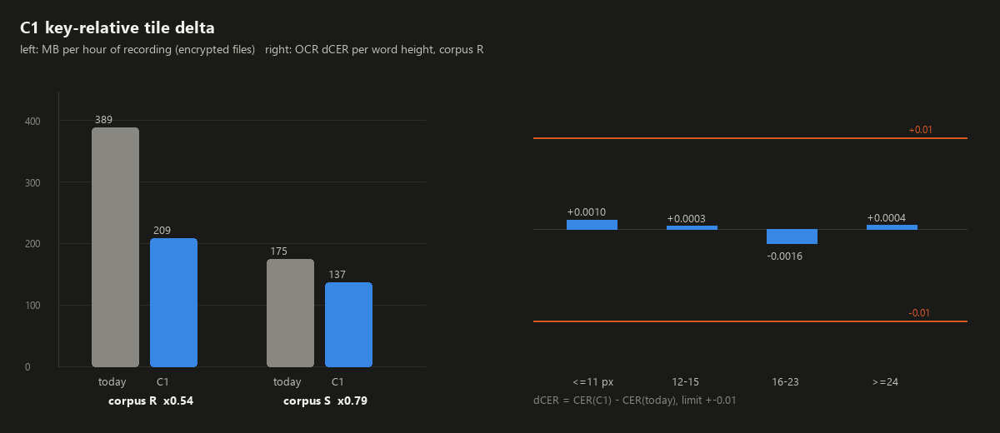
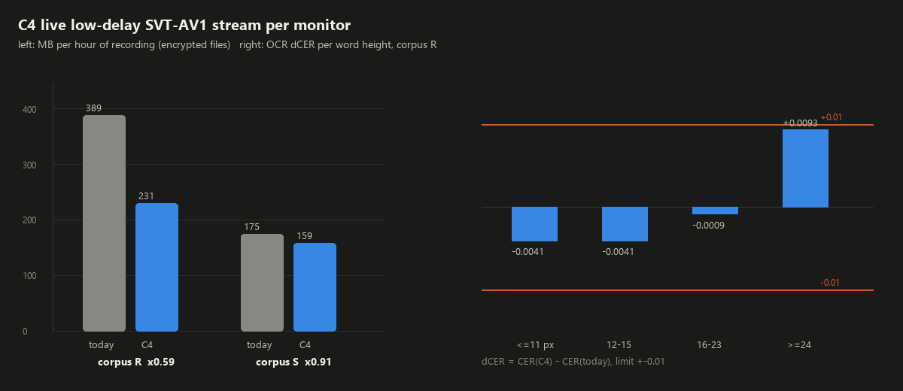
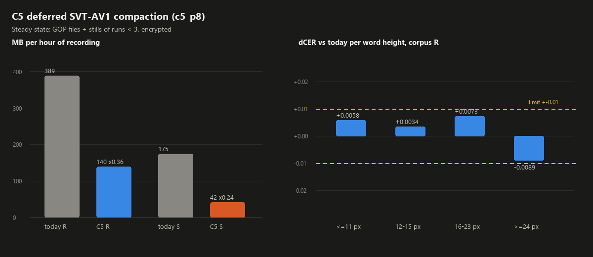

# Screenshot Store Growth

Date: 2026-11-20 · Context: Python 3.14, Pillow 13.0 (libwebp 1.6), numpy, PyAV 19.0.2 (FFmpeg avcodec 63, SVT-AV1 4.2.0, dav1d), Windows 11 26200, Ryzen 7 7800X3D, RTX 4080 Super; monitors 3840x2160 at 125 % (primary) and two 2560x1440; Akashic `capture/imaging.py` (`encode_webp`, WebP q70 method 2), `capture/screen_writer.py`, `capture/desk.py`, `storage/media.py`, `api/frames.py` · Goal: 1) cut store growth per day well below today's 4.2-4.9 GB; 2) keep every screenshot useful for the timeline, evidence images and deferred OCR; 3) keep capture CPU on the capture thread within budget · Ruled out: deleting or expiring history; changing which frames are stored (change rules belong to R7); audio and database size; the store's drive location (inter-frame video compaction is in scope) · Constraints: every stored part encrypted at rest (AES-GCM per file today); retention forever by default · Fidelity: must: OCR of stored frames within 0.01 CER of today at every font size, screen text on evidence images legible at 100 % zoom, every moment the change rules store today still decodes to its picture; may fake: pixels of regions unchanged since the last stored frame, colour detail of video and game content · Budget: ≤ 3 ms extra per 4K frame on the capture thread; no GPU model per frame; NVENC only without VRAM growth; a new dependency only on request; random access to any stored moment stays fast (decode cost per moment stated) · Artifact: https://claude.ai/artifact/1XYQdSskDsNYzUodn5AyrU

## Answer

Best fit: **C1, key-relative tile delta**. Each stored frame is either today's WebP q70 still (a key) or a delta file holding only the 64-px tiles that changed since the monitor's key, verified bit-exact at full resolution. On 60 minutes of the real desktop it stores **0.54x today's bytes** (208.7 against 389.0 MB per hour of recording), with OCR within +0.001 CER at every word height, every moment decoded, cold 4K decode p95 147 ms (today 122), +0.5 ms on key frames, less writer CPU than today on deltas, no background CPU, no GPU, no new dependency. On the synthetic quality runs it stores 0.79x: their source frames are already lossy WebP, so unchanged screen areas are never bit-identical there. Prior art: RDP's surface cache and RemoteFX tile difference [8, 9], used live, never at rest.

The largest measured saving within the budget is **C5, deferred SVT-AV1 compaction** (preset 8): 0.36x on the real hour (139.8 MB/h) and 0.24x on the synthetic runs, OCR within +0.007 on the real hour, capture unchanged, at 954 s of worker CPU per recorded hour (about a quarter of one core while recording) and with the synthetic corpus's text of 11 px or less at +0.021 CER. Prior art: screenpipe's snapshot compaction [4].

## Candidates

| Candidate | Uses | Error | Cost vs budget | Status | Prior art |
| :- | :- | :- | :- | :- | :- |
| C1 Key-relative tile delta | M7, M8, M9, M4 [1, 8, 9, 13] | R: 208.7 MB/h (x0.54), dCER ≤11 +0.0010, 12-15 +0.0003, 16-23 −0.0016, ≥24 +0.0004, 1821/1821 decoded, 0 of 1,663,933 reused tiles differ from raw; S: 137.1 MB/h (x0.79), dCER ≤ +0.003, 1997/1997 | capture 0 ms (signature already computed); writer +0.34/+0.51 ms p50/p95 on keys, −139 ms p50 on deltas / ≤ 3 ms; decode 4K p95 147 ms cold; RAM +47 MB; 0 VRAM | works (best fit) | RDPGFX surface cache, RemoteFX progressive tile difference [8, 9] |
| C2 Damage-rect manifest | M7, M9 | not built: same family as C1 with more reuse; refuter: the damage hint compose was assumed to hold is not there (window frame sequences live in `desk.py` and reset at every check) | est. writer ≤ +0.1 ms; decode ≤ 192 ms 4K | not built | RDPGFX cache-to-surface [8] |
| C3 Scroll and move reuse (on C1 or C2) | M10, M7 | not built: the gain depends on bit-exact shifted text, which fractional scaling (the 125 % primary) breaks | est. 0.5-2.5 ms on the capture path | not built | VNC CopyRect [10] |
| C4 Live low-delay SVT-AV1 per monitor | M1, M2, M6, M12 [1, 2, 3] | preset 11, crf 35: R 231.1 MB/h (x0.59), dCER ≤11 −0.0041, ≥24 +0.0093, 1821/1821 decoded; S x0.91, dCER ≤11 +0.028 | writer CPU 4K p50/p95 98/203 ms (today 225/303); decode 4K p95 139 ms; RAM ~0.3 GB per 4K encoder; 0 VRAM | fails: 0.59x against its 0.35x claim; SVT-AV1 4.2.0 turns screen-content tools off at preset ≥ 9, and preset 8 (x0.27) costs 4K CPU p95 1368 ms | none found at rest [11] |
| C5 Deferred SVT-AV1 compaction | M3, M2, M6, M12 [2, 3, 4] | preset 8, crf 35, WebP staging: R 139.8 MB/h (x0.36), dCER ≤11 +0.0058, 12-15 +0.0034, 16-23 +0.0073, ≥24 −0.0089, 1821/1821; S 42.1 MB/h (x0.24), dCER ≤11 +0.021, ≥24 +0.013 | capture 0 ms; worker 954 s per recorded hour on R (291 on S); decode 4K p95 152 ms; worker RAM +0.5-0.6 GB; 0 VRAM | works on the real corpus; the synthetic corpus's ≤ 11 px text exceeds the 0.01 limit | screenpipe snapshot compaction [4] |

## Method

C1, key-relative tile delta, per monitor.

1. Keep the monitor's current **key**: the last frame stored as a full WebP q70 method 2 still (today's encode, unchanged), plus its raw picture held in memory (25 MB at 4K, 11 MB per 1440p).
2. For the next frame the change rules store, take the per-tile change map from the 1/4-resolution gray signature the capture loop already computes (`screen.py:519`, `imaging.py:46-52`): a 64x64 tile is a candidate change if any of its signature cells differs. (Assumes a change the quarter-resolution map misses is caught by step 3.)
3. Confirm every tile the map calls unchanged against the held raw key at full resolution, bit-exact; any mismatch becomes changed. Reused pixels are then always the key's WebP reconstruction of identical raw pixels (the allowed fake), never a stale region.
4. Changed fraction f > 0.45, 64 deltas since the key, or a key older than 1 h → store a new key. Else pack the changed tiles in row runs of true neighbours, aligned to 16 px, into one atlas and encode it as WebP q70 method 2 (today's codec and setting on every new pixel); the delta file holds the 34x60 tile bitmask, the run layout and the atlas, encrypted as one file like today.
5. Decode a moment: key + its own delta file, a chain of 1. Paste the atlas tiles over the decoded key.

Measured on the real hour: key share 0.36 (primary), 0.12 and 0.24 (sides); mean changed fraction of deltas 0.20-0.25; key reasons: gray map over the limit 539, exact map over the limit 8, 64 deltas 4, first frame 3.

Cost arithmetic (4K, p50, measured): delta = gray map 0.45 + key array 9.6 (first delta after a key only) + frame array 9.4 + exact compare 3.0 + atlas pack 3.1 + atlas WebP 64 = 82 ms against 217 ms for a full encode; key = today's encode + 0.34 ms. Decode: key 90 ms, delta 112 ms p50 / 152 ms p95, flat with the position after the key (fig-c1-decode-position).

Fails when:
- full-screen video, a game, a window drag or a scroll changes most tiles → every frame is a key: no saving, no artefact;
- an atlas run end is crossed by the WebP loop filter → the run-end column reads 3.3 dB below today (−0.9 dB one pixel in, ≤ 0.7 dB further); no OCR effect measured (fig-c1-seam);
- the source is already lossy (synthetic corpus) → unchanged areas never match bit-exactly, f rises (0.79x).

Consumers that change: the full-size browser view serves today's stored WebP bytes as they are (`api/frames.py:167-168`); a delta has to be composed (4K 88/111 ms p50/p95) and re-encoded (JPEG q90 +12/16 ms, WebP q70 +220/290 ms), or composed in the browser from the key, atlas and run layout. Deleting a time range rewrites at most one key group per monitor (≤ 64 deltas re-encoded as keys from their composed decode; the old key file holds the deleted moment and cannot stay). A range export re-encodes as keys the in-range deltas whose key lies before the range. Age-based expiry, if ever enabled, deletes a key only after its last delta, at most 1 h later.

Reproduce: `.venv\Scripts\python.exe _dev\invent\screenshot-store-growth\locked_run.py _dev\invent\screenshot-store-growth\C1\cand.py --corpus all` after `harness.py today --corpus all`; `_dev/invent/screenshot-store-growth/` (local, gitignored; the real corpus was deleted after the study).

## Findings

### How memory and screen-recording tools store long screen histories
- screenpipe writes a JPEG per capture, then a worker compacts snapshots at least 10 min old into MP4 chunks of 25-100 frames (`-bf 0`, GOP 25), deleting the JPEGs only after the chunk is written and the database commits; GOP 25 is "6x cheaper" to extract one frame from for "~2.6 % larger files" [4].
- Windows Recall stores independent JPEG files [14]; Rewind's method is undocumented and its compression claims are marketing [15].
- Akashic's own baseline: as intra-only frames, AV1 NVENC is about WebP's size; the saving comes from inter-frame prediction (AV1 NVENC, key every 60: 3-7 MB/h per monitor against 22-64 for WebP) [1].

### Screen-content coding
- HEVC SCC reports large all-intra savings from intra block copy and palette on desktop content and about none on camera content [5] (unreachable for checking, see Caveats); AV1 has IntraBC and a 2-8 colour palette [6]; SVT-AV1 enables screen-content tools by default (`--scm 2`) [3], but version 4.2.0 forces the non-screen-content path at preset 9 and above (measured, C4).
- FFmpeg's libsvtav1 wrapper is asynchronous (`AV_CODEC_CAP_DELAY`) [7]; with `pred-struct=1`, `rtc=1` and no lookahead it gave exactly one packet per frame on 1824 encodes (measured, C4).

### Reusing unchanged screen regions
- RDP keeps a client bitmap cache (surface-to-cache, cache-to-surface) and a progressive codec that sends 64x64 tile differences against decoder state [8, 9]; VNC CopyRect moves rectangles inside the client framebuffer [10]. All rely on a live receiver; none is random-access at rest.

### The real desktop against the synthetic runs (today's encoder)
- One hour of the real desktop, as today's change rules store it: 1,821 frames (primary 1,301, sides 338 and 185), 389.0 MB/h, 9.34 GB per 24 h of activity, 214 KB per frame; input-triggered frames dominate (1,086). The synthetic quality runs: 174.6 MB/h, 272 KB per frame.
- Today's WebP q70 against the raw frames: CER 0.038 at 11 px or less; 4K decode p50/p95 85/122 ms.

## Mechanisms

- M1 Long-GOP inter-frame video per monitor: one packet per stored frame, key every K; a moment decodes from its key forward · assumes stored frames of one monitor are temporally coherent · breaks when keys cost more than a still (AV1 key 453 KB against 229 KB WebP at 4K, measured), and on constantly moving 4K content [1]
- M2 Software AV1 encoding (SVT-AV1 in PyAV) · assumes spare CPU · breaks under contention; screen-content tools off at preset ≥ 9 in 4.2.0 [1, 3]
- M3 Deferred compaction: write the still now, compact older stills into GOPs in the background, delete after commit · assumes idle CPU and a worker · breaks on long backlogs (gaming) [4]
- M4 Per-file stills: O(1) random access, damage limited to one file · size linear in frames [1, 14]
- M5 Still codecs on screen text (WebP lossy/lossless, AVIF) · single-sample measurements only · lossless explodes on photographic regions [1, 12]
- M6 Screen-content tools (intra block copy, palette) · assumes exact repeats and few colours · breaks on ClearType subpixel phases and video [3, 5, 6]
- M7 Tile references to earlier pixels (content-addressed or key-relative), chain bounded · breaks on scrolling and sub-tile changes [8]
- M8 Tile difference against a reference with a chain reset (RemoteFX progressive) [9]
- M9 Dirty-region maps from the capture path (Chrome Remote Desktop active map) · breaks when damage is over-reported [13]
- M10 Moved-rectangle reuse (VNC CopyRect) · needs bit-identical moved pixels [10]
- M11 Chroma and OCR: 4:4:4 costs +5-13 % (AVIF) to +11-21 % (HEVC NVENC) over 4:2:0; Windows OCR CER differs by ≤ 0.01 across WebP q50-q100, lossless and JPEG at ≥ 11 px [1, 16]
- M12 Encryption of shared files: per-packet AES-GCM with an index, or one whole file per group [1, 17]

## Explored

- C2 Damage-rect manifest: not built. Same mechanism family as C1 with more reuse and up to 16 files per moment; the refuter found its damage hint must be accumulated in `screen.py` until the next stored frame, because `desk.py` resets window frame sequences at every check.
- C3 Scroll and move reuse: not built. Its gain needs bit-exact shifted text; the primary runs at 125 %, where browsers re-rasterise scrolled text; the share of such frames was never measured.
- C4 Live low-delay SVT-AV1 per monitor: measured 0.59x at preset 11 (the slowest preset within today's writer CPU) against its own 0.35x claim. Inherent: SVT-AV1 4.2.0 forces the non-screen-content path at preset ≥ 9; preset 10 at crf 42 reaches 0.31x but fails OCR (16-23 px +0.028) and CPU p95; preset 8 at crf 38 reaches 0.27x within OCR at a 4K CPU p95 of 1,368 ms. Its CPU is below today's (mean 111 ms against 233 per 4K frame).
- C5 variants: preset 6 (x0.34) fails OCR at ≥ 24 px (+0.013); preset 10 (x0.53) loses the screen-content tools; JPEG q90 4:4:4 staging with preset 10 crf 40 (x0.40, worker 301 s per hour, capture −204 ms per 4K frame) passes OCR on the real hour but reads +0.026 at ≤ 11 px on the synthetic runs.
- NVENC-based streams (2026-11-15 baseline): need a CUDA context and 1.0-1.2 GB of VRAM for three sessions, against "no VRAM growth".

## Caveats

- The real corpus is one hour of one user's desktop at a busy time (1,821 frames, 2.3x the synthetic runs' frame rate); the saving on a quieter or more video-heavy day is unmeasured. The user's own exclusion additions were not applied while recording (only the built-in lists); nothing left the machine and the recording was deleted after the study.
- The synthetic corpus's sources are stored WebP: bit-exact reuse (C1) cannot match there and every candidate pays one more lossy generation; it is indicative only.
- OCR CER is Windows OCR (fr-FR) of each decoded frame against OCR of the raw frame, on a 150-frame sample per corpus; the ≥ 24 px bucket holds about 2.4-3.2 k characters.
- C1's key-frame CPU difference inside the harness was contaminated by C4's unlocked sweeps running at the same time; the key path was measured directly at +0.34/+0.51 ms.
- The C4 full-size browser view benchmark hung and was stopped; its view cost is taken from C1 and C5's measurements.
- C5's worker CPU and C4's encoder RAM were measured on this PC only; behaviour while a game runs was not measured.
- The MERL HEVC SCC paper [5] could not be read as text; its figures are unverified and no candidate depends on them. The SVT-AV1 docs do not say which presets enable IntraBC [3]; the 4.2.0 log line is the evidence.

## Sources

[1] Window composition baseline (encoders, NVENC, keyframes, decode) — `docs/baselines/2026-11-15-window-composition.md:186-257` — tier 1 — 2026-11-15
[2] PyAV 19.0.2 in the project venv (`av.codecs_available`: libsvtav1, libdav1d, av1_nvenc) — `.venv/Lib/site-packages/av` — tier 1 — 2026-11-20
[3] SVT-AV1 Parameters — https://gitlab.com/AOMediaCodec/SVT-AV1/-/raw/master/Docs/Parameters.md — tier 1 — master, 2026-11-20
[4] screenpipe snapshot compaction and encoder — `_resources/references/screenpipe/crates/screenpipe-engine/src/snapshot_compaction.rs:5-53`, `compaction_encoder.rs:5-195`, `video_utils.rs:115-181` — tier 1 — local clone, 2026-11-20
[5] Xu et al., Overview of the Emerging HEVC Screen Content Coding Extension (MERL TR2015-126) — https://shadow.merl.com/publications/docs/TR2015-126.pdf — tier 1 — 2016
[6] A Technical Overview of AV1 — https://arxiv.org/pdf/2008.06091 — tier 1 (preprint) — 2020
[7] FFmpeg libsvtav1.c — https://raw.githubusercontent.com/FFmpeg/FFmpeg/master/libavcodec/libsvtav1.c — tier 1 — master, 2026-11-20
[8] MS-RDPEGFX surface-to-cache and cache-to-surface PDUs — https://learn.microsoft.com/en-us/openspecs/windows_protocols/ms-rdpegfx/78c00bcd-f5cb-4c33-8d6c-f4cd50facfab — tier 1 — rev 18.1
[9] MS-RDPEGFX progressive codec — https://learn.microsoft.com/en-us/openspecs/windows_protocols/ms-rdpegfx/33fee2d9-e103-411c-9342-c51db32a9ace — tier 1 — rev 18.1
[10] RFC 6143, The Remote Framebuffer Protocol — https://www.rfc-editor.org/rfc/rfc6143.html — tier 1 — 2011
[11] Prior-art search for sealed per-frame AV1 streams in lifelogging or surveillance storage: none found — this study's researcher, 2026-11-20 — tier 3
[12] WebP near-lossless announcement — https://groups.google.com/a/webmproject.org/g/webp-discuss/c/0GmxDmlexek — tier 2 — 2015
[13] Chromium remoting VPX encoder (active map) — https://chromium.googlesource.com/chromium/src.git/+/main/remoting/codec/webrtc_video_encoder_vpx.cc — tier 1 — main
[14] Forensic artifacts in Windows 11 (Recall ImageStore) — https://securelist.com/forensic-artifacts-in-windows-11/117680/ — tier 3
[15] Rewind compression claims — https://9to5mac.com/2022/11/02/rewind-ai-records-everything-you-do-mac/ — tier 3 — 2022
[16] Small Text Windows OCR study — `docs/solutions/2026-11-20 - Small Text Windows OCR/report.md:46-52` — tier 1 — 2026-11-20
[17] Akashic MediaStore (one AES-GCM file per path, written once by temp + rename) — `src/akashic/storage/media.py:26-113` — tier 1 — 2026-11-20
