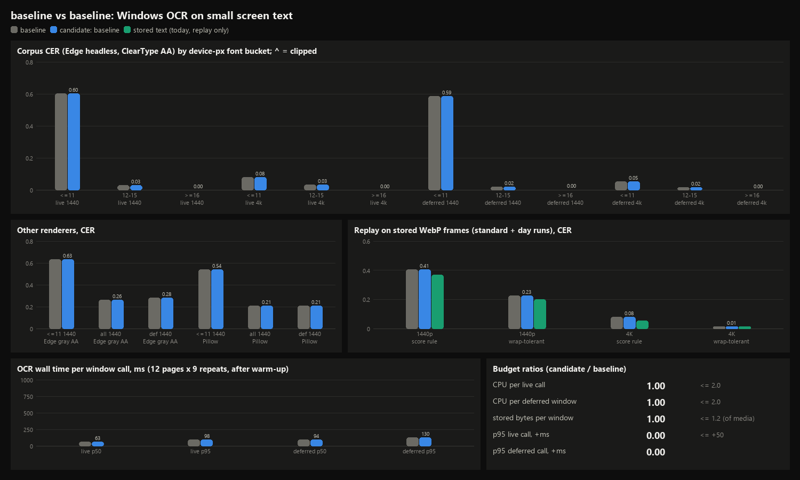
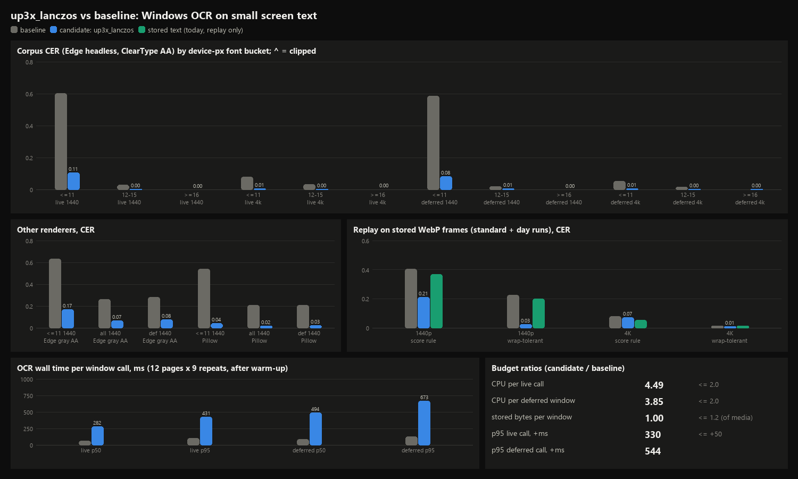
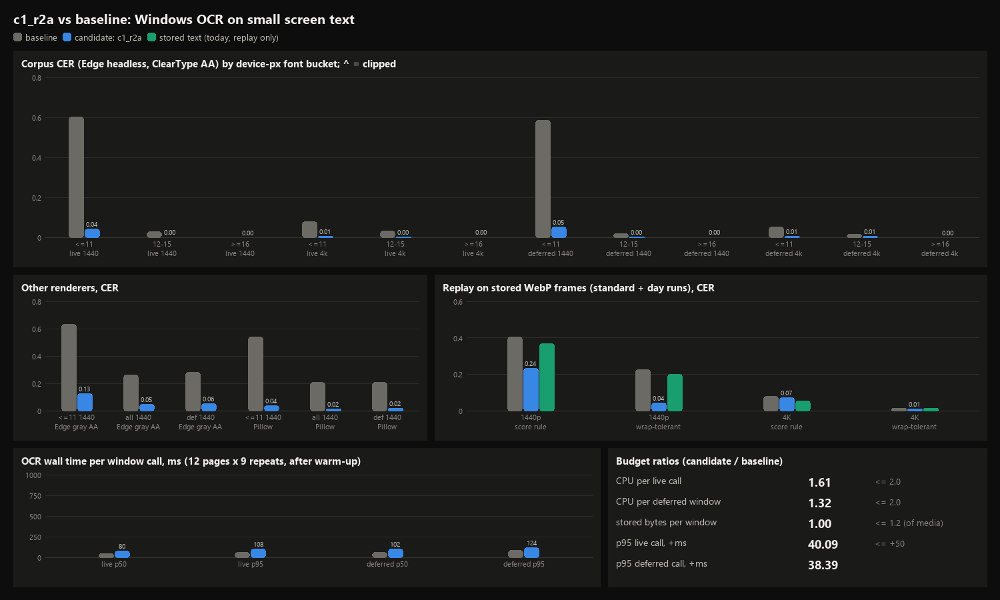
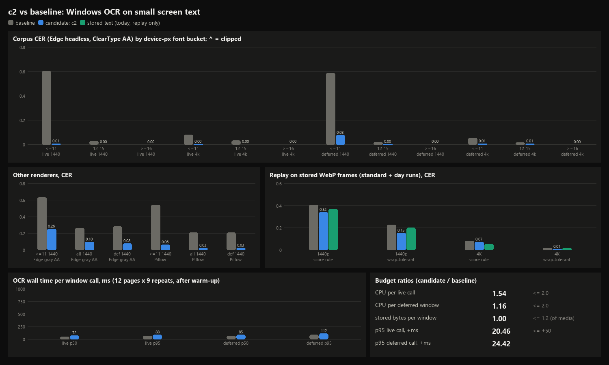
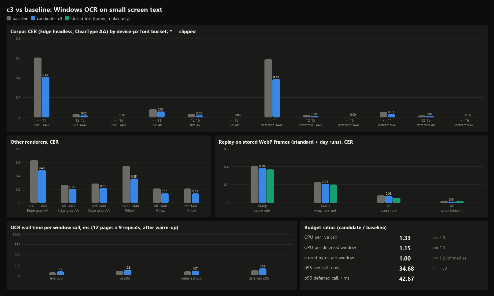
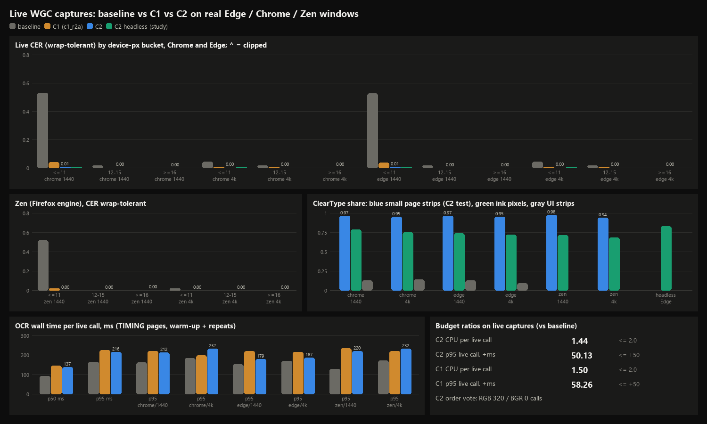

# Small Text Windows OCR
Date: 2026-11-20 · Revised: 2026-11-20 (live WGC captures) · Context: Python 3.14, Pillow 13, numpy, winrt Windows.Media.Ocr (en-US, fr-FR), Windows 11 26200, Ryzen 7 7800X3D; Akashic `platform/win/ocr.py`, `capture/ocr_gate.py`, `capture/imaging.py`; harness `eval/small-text-ocr/` (headless Edge corpus with ClearType, Edge grayscale and Pillow renders, plus a numbers-only replay of the quality runs' stored frames) · Goal: cut screen-text error for small fonts and on 1440p monitors; explain the residual 1440p error; keep OCR CPU and latency within budget · Ruled out: OCR language detection, UI Automation text, layout and reading order, search ranking, retention, change detection, game-HUD text · Constraints: Windows.Media.Ocr only, no new dependency, Pillow/numpy only · Fidelity: must keep M3.1 CER at ≤ 11 device px ≤ 0.05 and 1440p CER ≤ 0.10 on the standard and day runs (scored wrap-tolerant, see Caveats); 4K and UIA no worse; M3.3 no lower; may leave text under 8 px unreadable, keep layout as today, keep game-mode cadence · Budget: ≤ 2x today's OCR CPU per hour, ≤ +50 ms per OCR call at p95, lossless crop storage ≤ +20 % of media bytes · Artifact: https://claude.ai/artifact/MRnUmuowjtah1SgPAEdNrS

## Answer
Best fit on the path Akashic actually uses, live OCR of raw window pixels: **C2**, one OCR call on a mosaic of the window's line strips in which only strips under 16 device px are enlarged, and enlarged ClearType strips are rebuilt from their red, green and blue subpixels (three samples per pixel, read as 3x horizontal resolution) instead of being interpolated [1]. On raw ClearType Edge text it takes the ≤ 11 px error at 1440p from 0.602 to 0.006 (3x Lanczos: 0.072) and every other bucket to ≤ 0.004, at 1.55x CPU and +20 ms p95 per call [1]. Live WGC captures of real Edge, Chrome and Zen windows confirm it: ≤ 11 px at scale 1.0 0.53 → 0.005-0.007 (Zen 0.517 → 0.002), 12-15 px ≤ 0.002, RGB order voted on 320 of 320 calls; cost on real windows is 1.44x CPU and +50 ms p95 overall, at the per-call limit, with +17 to +91 ms by browser and monitor because browser toolbars add words to every call [9]. The quality runs' stored frames still cannot show it (4:2:0 WebP erases the subpixel phases; replays read ≤ 11 px at 0.40-0.49) [1]. The other 1440p cause the audit suspected is not the codec: OCR of the stored WebP matches the live text within 0.01, and the scorer's single-line matching misreads wrapped lines (1440p 0.371 → 0.201, ≥ 16 px 0.27 → 0.02 wrap-tolerant) [1][2]. No prior art found for the subpixel rebuild; strip packing resembles "example packing" for line recognisers [3].

If the per-call limit relaxed to about +250-700 ms on dense small-text windows, C1 at a forced 3x would meet the ≤ 11 px must on both replays (0.040 standard, 0.045 day) [1].

## Candidates
| Candidate | Uses | Error | Cost vs budget | Status | Prior art |
| :- | :- | :- | :- | :- | :- |
| Today (reference) | M12 | `cer_le11_1440=0.602 cer_le11_4k=0.080 cer_1440=0.237 cer_4k=0.023 replay_join_1440=0.225 replay_join_4k=0.013 replay_le11_join std/day=0.605/0.699` | p50 63 / p95 98 ms per call on sparse pages, 250-415 ms dense | reference | — |
| Uniform 3x Lanczos (reference) | M1 | `cer_le11_1440=0.106 cer_le11_4k=0.007 cer_1440=0.042 replay_join_1440=0.027 replay_le11_join std/day=0.039/0.058` | CPU 4.49x / 2x; p95 +330 ms / +50 | fails: 4.5x CPU and +330 ms p95 [1] | PowerToys 1.5x, Text-Grab 40 px rule [4] |
| C1 Single-call strip mosaic, budgeted scale | M7, M8, M1, M4, M12 | `cer_le11_1440=0.042 cer_le11_4k=0.007 cer_1440=0.017 cer_4k=0.004 dms_p95=40.090 cpu_ratio=1.612 replay_join_1440=0.043 replay_join_4k=0.010 replay_le11_join std/day=0.095/0.101` | CPU 1.61x / 2x; p95 +40 ms / +50 | fails: ≤ 11 px on the replays 0.095/0.101; the forced-3x variant passes (0.040/0.045) at +60 ms corpus p95 and +250-700 ms on dense real windows [1] | example packing (No Padding Please) [3] |
| C2 Strip mosaic + ClearType subpixel rebuild | C1, M5 (as a phase split) | `cer_le11_1440=0.006 cer_le11_4k=0.004 cer_1440=0.003 cer_4k=0.002 cer_def_le11_1440=0.076 dms_p95=20.460 cpu_ratio=1.545 replay_join_1440=0.153 replay_join_4k=0.008 replay_le11_join std/day=0.485/0.398` | CPU 1.55x / 2x; p95 +20 ms / +50 | works on raw live pixels (best fit); fails the replay musts because WebP frames fall back to luma [1] | none found (forward direction: Displaced Filtering [5]) |
| C3 Native pass + capped small-line refine | M9, M7, M8, M1, M4 | `cer_le11_1440=0.408 cer_le11_4k=0.056 cer_1440=0.160 dms_p95=34.7 cpu_ratio=1.333 replay_join_1440=0.207 replay_le11_join std/day=0.587/0.612` | CPU 1.33x / 2x; p95 +35 ms / +50 | fails: the cap leaves 68-73 % of small lines in real windows unrefined [1] | screenpipe OCR cache (per window) [6] |
| C4 Height-normalised strips, shrinking large text | M2, M8, M7, M1, M4 | `not built: same cost flaw as C1, saving overstated` | ~as C1 | PARTIAL [7] | none found |
| C5 Settled-frame worker refine | M8, M1, M4, M11, M7 | `not built` | ~+43-113 ms decode per settled state | PARTIAL: stored text has no line positions to merge into, and the WebP ceiling is 0.058 [7] | none found |
| C6 Worker band jobs with transient lossless crops | M7-M11, M5 | `not built` | live +≤ 26 ms est. | PARTIAL: the schema forbids text and a capture path on one row; needs new storage, retention and export handling [7] | none found |

## Method
C2, per window read on the live path (raw RGB crop from the existing gate):
1. Crop with `find_text_box` as today. Cut it into blocks with an XY-cut (column gutters first), after clearing columns inked in more than half the rows of tall blocks (window borders and separators had glued whole blocks into one strip). Strips = row runs of ink inside each block.
2. Small strips: run height ≤ 15 device px. Large strips stay at 1x.
3. Scale: the largest s ≤ 3 in 0.125 steps such that the predicted call time stays within today's predicted time + 40 ms, with a model fitted on 960 corpus calls: 44 ms per call + 57 ms/Mpix of dense text + 14 ms/Mpix of blank area, plus preprocessing 13.3 ms + 13.5 ms/Mpix of enlarged output.
4. For a small strip whose fringe energy (mean |a_R − a_B| in coverage units) is ≥ 0.05, rebuild it: per channel a_c = (v_c − bg_c)/(fg_c − bg_c), with bg the per-channel mode and fg the per-channel extreme, clipped to [0, 1]; interleave g[y, 3x + k] = a_k (RGB order, chosen per window by the lower total variation over the 4 largest strips), then Lanczos vertically, dark on light. ClearType strips measured 0.31-0.43 fringe energy and grayscale strips 0.001-0.004 on the corpus. Other strips, and every deferred or replayed WebP image, use plain luma Lanczos.
5. Pack the strips into one bitmap in XY-cut reading order with background gaps, and make one OCR call that replaces today's.

Assumptions it costs: Chromium and the OS render small text with RGB-stripe ClearType on these monitors (Chromium uses one global geometry from the ClearType settings and renders some layers in grayscale); the cost model's word-count dependence stays inside the +40 ms allowance on real dense windows (unmeasured: the replays read WebP and use small s).

Cost: corpus CPU 1.55x live and 1.16x deferred; p50/p95 72/88 ms against 63/98 ms today; storage unchanged.

Fails when: the subpixel order is wrong (BGR read as RGB scores 0.78); text is grayscale-AA (menus, side views, OLED, ClearType off) and falls back to luma (Edge grayscale ≤ 11 px 0.26); deferred game-mode windows read WebP (≤ 11 px 0.076); dense small-text windows may exceed +50 ms because OCR time grows with words recognised.

Reproduce: `uv run python eval/small-text-ocr/harness/run.py eval/small-text-ocr/C2/c2.py` (the corpus is rebuilt by `harness/corpus.py`, about 158 s).

## Findings
### What limits today's OCR
- Normal windows are OCR'd by the gate from raw pixels; only game-mode windows are OCR'd later from the stored WebP (q70, method 2, native size) [8].
- OCR of the stored WebP gives the same CER as the stored live text (1440p 0.452 vs 0.456, 0.41 vs 0.41; 4K 0.095 vs 0.097); a codec spike found ≤ 0.01 CER difference at ≥ 11 px across WebP q50-q100, lossless and JPEG [1][2].
- The scorer matches each truth line against single OCR lines; the harness pages wrap long sentences, so wrapped halves never match: 1440p 0.371 → 0.201 and ≥ 16 px 0.27 → 0.02 with a wrap-tolerant match [1].
- Real Edge text at 1440p reads at 0.82 (9 px), 0.80 (10 px), 0.19 (11 px), 0.07 (12 px) today; Pillow-drawn text is easier (11 px 0.047) [1].
### Live WGC captures (real browser windows)
- 144 corpus pages per browser in windowed Chrome and Edge on the left (scale 1.0) and primary (1.25) monitors, 16 per monitor in Zen; scored through the harness's live path [9].
- Wrap-tolerant CER ≤ 11 px, baseline / C1 / C2: Chrome 1.0 0.531 / 0.039 / 0.007; Edge 1.0 0.528 / 0.035 / 0.005; Chrome or Edge 1.25 0.044 / 0.007 / 0.003; Zen 1.0 0.517 / 0.018 / 0.002. 9-10 CSS px at scale 1.0: today 0.74-0.75, C2 0.005-0.009 [9].
- 95-98 % of small page strips carry ClearType fringes; browser chrome (tab titles, toolbar labels, Zen's sidebar) renders grayscale (0-9 % fringed), where C2 falls back to plain upscaling as designed [9].
- Cost (warm-up + 9 interleaved repeats): baseline p50/p95 92/166 ms, C1 144/224, C2 137/216; C2 1.44x CPU, +50 ms p95 overall, +17 to +91 ms per set; one call per page gives 1.42-1.78x and +45 to +98 ms. Wall times were noisy (another agent used the right monitor) [9].

### OCR cost
- On sparse pages OCR time follows pixels (blank ~14-20 ms/Mpix, text ~56-63 ms/Mpix); on real windows it follows words recognised (~0.29 ms per word, MAE 41 ms vs 64 ms for pixels), and correctly read small text roughly triples the word count [1].
### Prior art
- Windows-OCR apps apply at most scaling, padding and a background fill: PowerToys 1.5x HighQualityBicubic with a pixel-(0,0) fill and 64 px minimum; Text-Grab scales to a 40 px word height (project summary only); screenpipe does no preprocessing [4][6].
- No OCR tool or paper found inverts ClearType for recognition; Microsoft's displaced filtering describes the forward rendering [5].

## Mechanisms
- M1 Uniform Lanczos upscale · cost grows with the whole crop [4]
- M2 Adaptive scale to a target text height (Text-Grab) · needs a first pass; mixed sizes [4]
- M3 Per-line or per-block crops · 1 + N calls
- M4 Pad and edge-colour fill (PowerToys) [4]
- M5 Chroma removal / subpixel phase split · used here as a rebuild of ClearType coverage
- M6 Binarization · discards anti-aliasing information
- M7 Gradient-density text cells (`find_text_box`) [8]
- M8 Text-height estimation from ink-row profiles
- M9 Native word boxes from a first pass
- M10 Lossless crop storage · not needed for normal windows
- M11 OCR before encoding (live path already reads raw pixels) [8]
- M12 Thumbnail only above MaxImageDimension (10000) [8]

## Explored
- Uniform 3x Lanczos: 4.5x CPU and +330 ms p95 [1].
- C1 forced to 3x: meets the replay musts but +60 ms corpus p95 and +250-700 ms on dense real windows [1].
- C3: a +30 ms refine cap leaves most small lines unrefined; its pending queue never drains because unchanged monitors submit nothing to read [1][7].
- C4, C5, C6: not built; cost flaw, no stored line positions, schema conflict [7].
- Lossless storage for deferred OCR: the codec is not the cause, so the +20 % storage buys nothing measurable [2].
- Smoothing after the subpixel rebuild ([1,2,1] or a Lanczos round trip) does not help; normalised luma is slightly worse than plain luma [1].

## Caveats
- The run-level musts were scored on replays of stored WebP frames; C2's core cannot show there. Its ≤ 11 px and 1440p results come from headless Edge renders (ClearType confirmed on 81-85 % of ink pixels) with one page layout; real apps, icons and busy backgrounds are not covered.
- Live captures covered browsers on synthetic pages only; other apps, busy backgrounds and game-mode reads of stored WebP were not tested. C2's p95 sits at the +50 ms limit overall and goes over it on some browser and monitor sets (up to +91 ms), so dense real windows can break the per-call budget.
- M3.1 was scored wrap-tolerant because of a scorer artefact; `eval/quality/score.py` needs the same fix before the quality runs are rescored. M3.3 and UIA CER were not measured by this harness (UIA is untouched by construction).
- Cost models were fitted on the corpus; real dense windows cost more per pixel.
- The refuter could run no OCR experiments; its points rest on code and earlier measurements.
- WEAK sources: Text-Grab's 40 px rule (project summary), a Tesseract x-height figure and WebP 4:2:0 (not stated on the cited pages).

## Sources
[1] Small-text OCR harness and candidates — `eval/small-text-ocr/` (harness, baseline, explored, C1, C2, C3; `C2/step_a.txt`) — tier 1 — target PC, 2026-11-19/20
[2] Codec and size spikes (WebP, JPEG, lossless vs OCR) — researcher return, scripts in the session scratchpad — tier 1 — target PC, 2026-11-19
[3] Example packing, "No Padding Please" — https://arxiv.org/abs/1902.11208 — tier 1 (preprint) — 2019
[4] Windows OCR small text upscaling (research) — `docs/research/windows-ocr-small-text-upscaling.md`; PowerToys BitmapPreprocessor.cs — https://github.com/microsoft/PowerToys — tier 1 — 2026-11-19
[5] Displaced Filtering for Patterned Displays — https://www.microsoft.com/en-us/research/publication/displaced-filtering-for-patterned-displays/ — tier 1
[6] screenpipe Windows OCR adapter and OCR cache — https://github.com/screenpipe/screenpipe (crates/screenpipe-screen/src/microsoft.rs, ocr_cache.rs) — tier 1 — 2026-11-19
[9] Live WGC validation — `eval/small-text-ocr/live/` (capture.py, score.py, results.json, summary.md, side.png) — tier 1 — target PC, 2026-11-20
[7] Refuter analysis — `eval/small-text-ocr/candidates.md` (Refuter section) — tier 1 — 2026-11-20
[8] Akashic OCR path — `src/akashic/capture/screen_writer.py:310, 347-366`, `src/akashic/capture/ocr_gate.py:54-66`, `src/akashic/platform/win/ocr.py:48-62`, `src/akashic/capture/imaging.py:30-33, 77-105` — tier 1 — 2026-11-19
